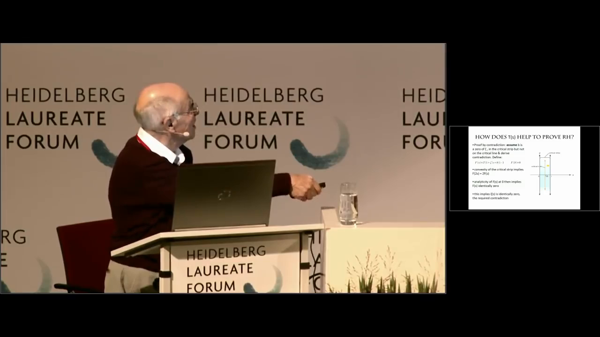
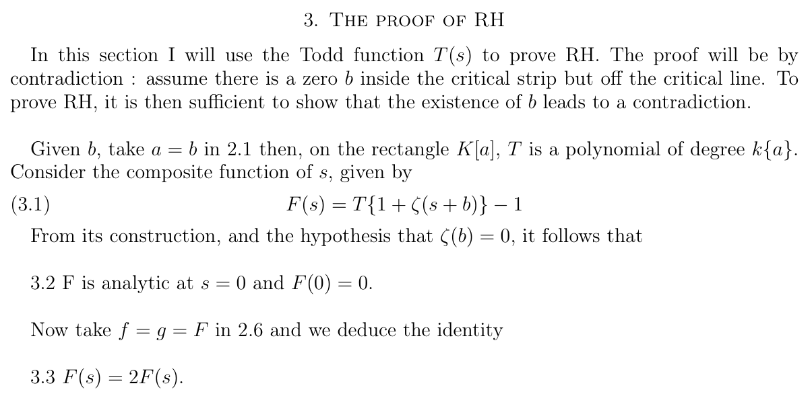

# 01 数学大师最后的光芒

2018年9月24日，八十九岁的迈克尔·阿蒂亚走上海德堡桂冠论坛的讲台，报告的题目，只有一个问题的名字：黎曼猜想。

一个困住数学家一百五十九年的问题，一位几乎拿遍数学界最高荣誉的老人，以及据说只有五页纸的证明。这样的组合，很难不让人产生一点不切实际的期待：万一呢？

宣布证明黎曼猜想的人，数学界从来不缺。期刊编辑的邮箱里，这类消息可能比会议通知还勤快。但这一次，站在台上的人叫阿蒂亚。大家总不能像处理陌生邮件那样，顺手把一位教科书里的大师拖进垃圾箱。

于是，目光都投向了海德堡。

*2018年9月24日，阿蒂亚在海德堡桂冠论坛介绍证明思路。截自会议录像36分20秒；[原始录像](https://av.tib.eu/media/40181)。画面中的论证是他当时提出的证明尝试。*

讲演却没有按围观者想象的方式展开。阿蒂亚谈欧拉，谈黎曼，谈拉马努金，还给年轻听众留下一个关于哈代和雨伞的小问题。人物、轶事、物理常数，轮番登场。气氛像一场大师带路的数学漫游，直到三十六分钟左右，那张承担全部期待的证明幻灯片，才终于出现在屏幕上。

核心思路讲得很快：先假定有一个零点不在临界线上，再借助一个叫Todd函数的新工具，推出矛盾。百余年的悬案，在这一页幻灯片上，似乎已经走到了结尾。

可听众还没有走到那里。

报告结束，掌声响起。主持人感谢了这场有趣的讲演，接着邀请提问，很快便点到了后排。随后，一位听众问出了一个朴素得不能再朴素的问题：这究竟意味着什么，黎曼假设已经解决了吗？他坦言，自己还没能消化刚才听到的内容。

这大概就是那场问答最微妙的地方。按理说，若真听见了黎曼猜想的最后一块拼图，大家该追问某个引理，或者开始盘算下学期的课程要不要重写。可现在，先要确认的，居然还是演讲的题目到底有没有兑现。

如果要给这份气氛找几个词，或许是：敬意中的尴尬，礼貌里的迟疑，以及没有急着说出口的怀疑。

阿蒂亚的回答依然自信。他认为，原本的黎曼猜想已经得到证明，还有许多更广泛的问题，留待后来者继续做。

台上已经抵达终点，台下仍在寻找路口。

## 那句刺耳的话

“not even wrong。”

连错都算不上。

这句话比“证明错了”还扎心。证明错了，至少说明大家走上了同一条路，能够指着某个地方说：这里桥断了。“连错都算不上”，则是说，关键的定义与推理还没有清楚到足以逐步核验的程度，读者甚至不知道该从哪一块桥板开始检查。

针对这份稿件使用这个短语的，是数学家Todd Trimble。2018年9月23日，也就是海德堡报告的前一天，他在MathOverflow的元讨论区谈到已经流出的文本，作出了这个严厉判断。

日期值得留意。这不是散场之后，全体听众齐声给出的判词。那条评论的另一半，还肯定了阿蒂亚过去半个多世纪的重大成就，并主张给这位老人应有的尊严。只截下最刺耳的三个词，传播效率当然更高，只是原来的一段话，也就剩下一半了。

*2018年流传的五页稿件《The Riemann Hypothesis》，第3页证明部分节选。[原稿](https://aperiodical.com/wp-content/uploads/2018/09/2018-The_Riemann_Hypothesis.pdf)。截图保留原有公式与文字；这是供讨论的证明尝试，并非已获承认的定理。*

真正使研究者停下来的，也不是“五页”太短。数学没有规定，困扰一百年的问题，必须至少用一百页纸解决。关键在于，这几页把最吃重的工作交给了Todd函数，而这个新工具的构造、性质与使用方式，并没有给读者一条可靠的核验道路。

一个工具既要像普通函数那样代入数值，又要像作用在整段函数上的算子那样工作，这两种身份，不能只靠同一个字母就自动打通。Lipton与Regan在随后发表的技术讨论里，认真尝试过这种区分，也指出它们仍不足以构成证明。其他讨论则追问，稿件要求的那些性质，究竟能不能同时成立。

如果一把钥匙被规定为能打开所有门，接下来最该检查的，大概就是钥匙本身。不能因为最后开门的动作只有两秒，就说造钥匙的工作已经完成了。

这场风波里，阿蒂亚其实早已给自己备好了一句自嘲。报告进行到九分钟左右，他说：

> “Solve the Riemann hypothesis and you become famous. If you are famous already, you become infamous.”

意思是：解决黎曼猜想，你会名扬天下；可如果你本来就已经名满天下，那就可能变得声名狼藉。

从famous到infamous，英文只多了两个字母，人生却可能拐一个很大的弯。八十九岁的老人站在台上，显然知道自己正在走向什么。他还是来了。

问题也就留给了我们：该怎样看待这最后一次冲锋？

## 一生都在架桥的人

先把镜头从那五页纸上移开一点。

阿蒂亚1929年出生于伦敦，父亲来自黎巴嫩，母亲来自苏格兰家庭。他在苏丹和埃及度过部分童年，后来到英国求学，在剑桥接受数学训练。一个人从小就往来于几种文化之间，长大以后，又把许多原本不怎么来往的数学领域拉到了一起。

少年时，他曾替比自己年长的同学解决功课上的难题，换取他们的保护。数学最早替他修好的，可能就是这座通向学校平安生活的小桥。后来桥越修越大，才修进了二十世纪数学的地图里。

*迈克尔·阿蒂亚，2007年。作者：Gert-Martin Greuel / MFO；[来源](https://commons.wikimedia.org/wiki/File:Michael_Francis_Atiyah.jpg)；[CC BY-SA 2.0 DE](https://creativecommons.org/licenses/by-sa/2.0/de/)。原图未修改。*

1966年的菲尔兹奖，2004年与辛格分享的阿贝尔奖，皇家学会会长，英国女王授予的爵士头衔。若把这些荣誉印在名片上，可能先得向印刷厂申请加长版。

但头衔还不是最有分量的部分。真正使人们不得不认真听他说话的，是那些已经站稳的数学。

其中最著名的，是阿蒂亚–辛格指标定理。

这个名字听起来像一件只有研究生才会领到的仪器，想法却可以说得很直观：有时，一类方程里两种解的数量之差，能够从它们所在空间的整体形状中算出来。你还没有挨家挨户地访问，城市的结构就先替你透露了一笔总账。

一边是分析：方程怎样解？另一边是拓扑：空间长什么样？指标定理告诉我们，在适当条件下，两边问的竟然是同一件事。

这座桥后来通向几何，也通向理论物理。与希策布鲁赫发展的拓扑K理论，与辛格合作的指标定理，以及同物理学家持续的交流，使阿蒂亚的名字，留在了许多学科的交界处。

*1977年，阿蒂亚（左）与希策布鲁赫。摄影：Konrad Jacobs / MFO；[来源](https://commons.wikimedia.org/wiki/File:Atiyah-Hirzebruch.jpeg)；[CC BY-SA 2.0 DE](https://creativecommons.org/licenses/by-sa/2.0/de/)。原图未修改，保留原水印。*

有些人擅长沿着一条大道把路修得更远，阿蒂亚常常提醒大家：旁边那座山，也许和这里本来就是连着的。

了解这一点，再看2018年那场报告，感受或许会有些不同。他又一次想把物理、几何和数论接起来。这个动作，对他而言并不陌生。陌生的是，这一次，桥面没有接上。

## 大师真的错了吗

如果问，那五页纸是否已经证明黎曼猜想，答案很清楚：没有。公开文本没有提供一份成立的证明。

可如果接着问，所以这位老人最后想寻找的方向，也就不值得再看了吗？事情就没那么简单了。

先看看，他究竟想把什么连到一起。

黎曼ζ函数，最初是一串看起来很朴素的加法：

$$
\zeta(s)=1+\frac{1}{2^s}+\frac{1}{3^s}+\cdots.
$$

当复数s的实部大于1时，这串无穷和收敛。欧拉发现，它还可以写成一个只由素数组成的无穷乘积。于是，整数世界的一本总账，居然能拆成素数世界的一张张分账。

黎曼再借助解析延拓，把这个函数带到原始级数之外。我们不必在这里带齐复分析的行李，只要记住：延拓后的函数会在一些位置取零，而最神秘的那些零点，全部住在实部0与1之间的一条竖带里。

黎曼猜想说，它们应该全都站到正中间：

$$
\Re s=\frac12.
$$

很像给一群已经排了很久队的人拍照，要求所有人都站在地上的同一条线上。麻烦在于，队伍有无穷长，不能拍完前面的人，就宣布后面也一定整齐。

为什么非得管他们站在哪里？因为这些零点的位置，会反映在素数计数的起伏里。零点越靠右，就可能带来尺度越大的偏差；全在正中间，素数分布的误差就受到很强的约束。

一条线，管着无穷多素数的脾气。这就是它让人放不下的原因。

### 从137开始，而不是从零点开始

阿蒂亚却想从另一个入口进去：物理学中的精细结构常数。它描述电磁相互作用的强度，没有单位，低能情形下，其倒数大约是137.036。

这个数为什么偏偏是这个数？圆周率π能够从圆的几何里算出来，137附近的这个数，会不会也藏在某种数学结构里，等人把它请出来？

所以，2018年那五页纸的背后，还有另一份十七页的稿件，题目叫《精细结构常数》。在阿蒂亚的设想里，前者只是后者的一项推论。观众以为他拿出五页纸，要从平地起一座摩天楼；他却认为地下早已修好了一座很大的地基。争论真正要检查的，恰恰是那座地基。

长稿想接起两套他很熟悉的数学。

一套来自希策布鲁赫的几何。几何学家会给空间配上一些“总账数字”，用来记录它的整体性质。两个空间做直积，某些总账数字也跟着相乘；而在指数函数那里，加法恰好会变成乘法。利用这样的规则，几何便能够和一套代数运算接上关系。传统的Todd类、Todd亏格，属于这片已经有严格理论的土地。

另一套来自冯·诺依曼的算子代数。我们熟悉的数，交换相乘顺序，结果不变；矩阵却往往不同，先旋转、再沿固定方向拉伸，与先拉伸、再旋转，最后的图形就可能不一样。这种“不肯交换顺序”的数学，在量子理论里十分自然。

算子代数还能把“维数”推广。普通向量空间的维数是一、二、三；在某些无穷维算子结构里，借助一种叫“迹”的总量计算，可以定义连续取值的归一化维数。一套看似只会数整数的账本，竟然能记下分数，乃至一整段实数。

阿蒂亚希望，通过不断迭代和取极限，把几何中的代数规则送进这样的算子世界，再比较其中两种描述，得到一张改变数值的映射。他把它称作Todd映射，记为T，并希望它把π送到一个新的数Ж：

$$
T(\pi)=\text{Ж},\qquad \text{Ж}\overset{\text{他的设想}}{=}\frac1\alpha.
$$

这个西里尔字母看起来像几根木柴搭在一起，承担的任务却很大：它要把数学里的圆，接到物理里的电磁相互作用上。

需要分清的是，这张新映射并不因为也叫Todd，就自动继承了传统Todd类的全部本领。一个名字可以纪念老师，不能替新对象办好出生证明。两套已有理论之间，究竟怎样搭桥，仍得逐步构造。

*阿蒂亚2018年尝试的结构示意。虚线表示他希望建立、却尚未证明成立的联系；137.036是低能精细结构常数倒数的近似值。此图为本项目原创，不是原论文截图。*

### 五页纸，怎样走到黎曼猜想

有了这台理想中的机器，阿蒂亚就想让它再干一件事：处理ζ函数的零点。

短稿给T列出了一张相当能干的履历：它在适当区域表现得像多项式，满足T(1)=1，把临界带送回临界带，把中央那条线送回中央。它还被要求满足一条特殊规则。若f、g是没有常数项的幂级数，那么

$$
T\bigl((1+f)(1+g)\bigr)=T(1+f+g).
$$

乘开左边，明明比右边多出一个fg。按这条规则，经过T以后，这块差别居然可以消失。

这正是他看中的本领：把乘法里多出来的复杂部分处理掉，再把复杂的零点问题压成一个矛盾。

具体地说，先假定临界带里有一个偏离中央的零点b，再用它构造辅助对象

$$
F(s)=T\{1+\zeta(s+b)\}-1.
$$

由于ζ(b)=0、T(1)=1，他希望得到F(0)=0，再调用T的特殊性质。原稿随后写出F(s)=2F(s)，由此断定F处处为零，再试图迫使ζ也处处为零。可ζ明明不是零函数，矛盾出现，于是那个偏离临界线的b就该被排除。

若这些步骤全部站得住，当然是漂亮的反证法。问题在于，T的那些性质怎样同时成立，特殊规则又怎样真正通向后面的等式？最困难的部分没有因为移到了另一个字母身上，就从数学里消失。

所谓五页纸很短，倒不如说，是最沉的一箱行李，被托运到了另一份稿件里。

### 一正一负，就能检查出什么

我们不妨亲手检查一下那台机器，不需要先学完算子代数。

仍把T当作通常意义上的复函数。上面的规则允许我们选f(s)=s、g(s)=−s。一正一负，右边正好抵消，左边却留下一个平方：

$$
T(1-s^2)=T(1)=1.
$$

当复数s在零附近变化时，1−s²就能扫过1附近的一小片区域。于是，那一片区域里的T值，全都被压成了1。

如果T又是通常的解析函数——按短稿“在每个紧凸区域上都是多项式”的要求，确实会有这种解析性——复分析的恒等定理就会接手：在连通区域里，一个解析函数只要在一小片开放区域恒为1，就只能一路恒为1。

机器省事到了极致：送进去什么，都回答1。

可恒等于1的函数，怎么把实部等于二分之一的临界线，仍送回那条线上？它把所有人都送去了实部1的地方，整条队伍集体坐错了车。

这就是一个具体的兼容性问题。保留这些性质、沿用普通复函数的解释，它们就会互相打架。这里并不是黎曼猜想把数学逼出了矛盾，而是我们给辅助工具许下的几项承诺，本身不能同时兑现。

也因此，把这件事笼统说成“推导出所有数字都等于零”，反倒遮住了真正值得理解的地方。检查一个证明，有时不用一路跟到最后；先看看它租来的那台机器，是否在开机之前就已经矛盾了。

### 后来者的第一种读法：它会不会根本不是普通函数

2018年9月26日，Richard Lipton与Kenneth Regan发表技术讨论。他们没有把这份稿件补成证明，而是认真追问：阿蒂亚想表达的，会不会是一种作用在函数上的运算？

普通函数，像一台输入一个数、输出一个数的机器。算子则可以把一整条曲线、一整个幂级数当作输入。输入对象变了，某些原本不可能的规则，确实就可能有另一种解释。

我们造一台最简单的“只看前两项”的机器，就能看见区别。

把1+2s+3s²送进去，只留下1+2s；把1+5s+7s²送进去，只留下1+5s。原来两式相乘，结果是

$$
1+7s+20s^2+29s^3+21s^4.
$$

机器看过以后，却只留下1+7s。若先把原来两式相加、再减去一个1，得到的式子也会留下同样的前两项。于是，“乘法与加法经过处理后给出相同结果”，在这种刻意丢掉高次项的规则下，完全可以成立。

这是一种很有用的简化，但它也有代价：信息丢了。送入s²，输出是零；送入零，输出也是零。看到输出为零，不能倒过来宣布原来的输入必定是零。

Lipton与Regan讨论的具体模型，是在某一点取函数值与导数，再把它们组合起来。我们的“只看前两项”，是帮助读者理解这类读法的小例子。它让我们看见，函数与算子的身份差别绝非咬文嚼字；换一种解释，能够使局部规则合理，却不会自动保住整条反证链。

几何中把高于某个维数的项消掉，也有严格的场景和规则。可是，几何账本中可以舍弃的项，搬到普通复数的等式里，为什么还能舍弃？若经过无穷极限，那些原来被忽略的部分会不会又积累回来？这些才是需要补齐的桥板。

“弱极限”也不能包办这一切。想象一列越来越密的正弦波，拿它做平均，正负振荡可能抵消为零；先把波形平方，再做平均，却仍会留下正的总量。先取极限、再做非线性运算，与先运算、再取极限，可能得到不同答案。两个步骤都很常见，交换它们却要另交一份证明。

这类讨论的收获很具体：它辨认出稿件可能想使用的机制，也指出这种机制会损失什么。它没有替黎曼猜想交卷，却让“没说清楚”变成了几个可以继续追问的问题。

### 物理学家还要追问：你算出的到底是哪一个常数

另一边，Sean Carroll从物理学出发，提出了不同的疑问。

低能情形下的α接近1/137，但在量子场论里，有效电磁耦合会随能量尺度变化。这个变化与其他粒子、量子修正，以及更高能量下的电弱理论有关。一个纯数学构造即使给出137.035999附近的数，也还要解释：为什么它对应的恰好是这里测得的低能数值？它与整套物理机制怎样相连？

好比有人算出一个数，和你家门牌号完全一样。固然巧，但要证明自己找到了你家，还得把街道和城市对上。

Carroll的疑问，并不是对任何未来理论下禁令。他在后续答复里也保留了这种可能：也许更深的规律会改变我们今天的理解。只是阿蒂亚当时的稿件，还没有提供这样的物理推导。

所以，数字的吻合、辅助工具的构造，以及黎曼猜想的证明，是三件需要分别交代的事。把它们放进同一份雄心里很动人，把三笔账真正算通，才是工作。

### 散场之后，还有人在接着算

后续也并非只剩几篇博客。

2019年，阿蒂亚与Joseph Kouneiher合著的《Todd函数作为弱解析函数》刊于《现代物理中的几何方法国际期刊》。可核对的摘要，将目标放在引入弱解析函数及其数学、物理用途上。这说明相关构想后来仍被整理为专门论文；但不能仅凭这个发表记录，就说2018年的黎曼证明已经得到确认。

另一条更能看清数学细节的后续，来自孔涅。

2019年1月底，阿蒂亚去世后不久，孔涅公开了一篇十四页的论文，题目很直白：《论阿蒂亚的一个想法》。他接手的是阿蒂亚2017年从上海返程时构想的一种迭代方法，原来的目标是为Feit–Thompson奇数阶定理寻找新路线。这是有限群论的问题，不是黎曼猜想，但同样带着阿蒂亚晚年的鲜明习惯：先找到一个运算，再不断重复它，期待复杂结构自己显露出来。

群可以粗略理解为一套能够合成、能够撤销的对称操作；它的阶，就是操作的总数。奇数阶定理说，这个总数若为奇数，群就一定“可解”。这里的可解不是说算出了某个未知数，而是说，它能按规定的层次拆成交换的部件。

阿蒂亚想用迭代找出某种较简单的表示信息。表示，就是让抽象的对称操作，变成向量空间里具体的矩阵动作。若能找到一个非平凡的一维表示，就像先从复杂的交响乐里，分离出一条有意义的单声部，给进一步拆解提供线索。

为什么反复运算可能有帮助？因为简单的一维表示，在那道特定运算下正好保持不变，成了“不动点”。希望是：从较复杂的输入出发，一步步迭代，最终落到这些简单对象上。

这像把一颗小球放进山谷，让它自己滚到谷底。真正的困难是：它会滚到你想找的谷底吗？还是另有一个看起来很安静、其实毫不相干的坑？

为了给运算腾出空间，孔涅先允许表示之间作形式上的减法，得到“虚表示”。这有点像从自然数扩展到整数：账本里可以出现负号，不等于眼前真的摆着一间负三维的房子。他证明，这道运算能够按相应规则延伸到虚表示，条件恰好就是群的阶为奇数。

随后，他在最小的奇数阶非交换群——21阶群——上检验迭代。选取适当的一类起点，确实能走向非平凡的一维特征标，也就是逐一记录各个对称操作在一维里怎样作用的那张数值表；但另一些方向上，又出现了吸引迭代、却不对应真正一维表示的不动点。自然选取的某些起点，还会迅速发散。

谷底找到了，山谷却不止一个。收敛到哪里，为什么收敛，停下来的究竟是不是我们想要的对象，都成了新的数学问题。

这就是一项有内容的跟踪研究：它给出严格结论，也明确暴露原设想的障碍。它没有重新证明奇数阶定理，更没有替Todd函数证明黎曼猜想；可它把一位老人留下的迭代草图，变成了一片能够继续计算、能够明确提问的土地。

### 再把目光移向那座山

现在再说“阿蒂亚的想法有没有价值”，我们手上总算多了几件具体东西：一份试图从算子结构解释物理常数的长稿，一条没有成立的黎曼反证链，几种试着读懂它的技术解释，以及在另一项晚年构想上取得了明确结果、也明确碰壁的后续研究。

它们的分量各不相同。不能拿其中一项的进展，替另一项的缺口销账；同样，也不必因为那五页纸没能走到终点，就认定这位数学家最后的所有念头都只配进废纸篓。

这也正好把我们带到后面的物理篇。零点和原子能级，会不会有相似的统计？能不能造一件“乐器”，让它自己奏出ζ函数的零点？混沌、分形、非交换几何，能不能提供经典估计之外的入口？单看问题，哪一个都不比阿蒂亚安分多少。

其中有些联系，已经长出了严格的数学；有些还只是模型、数值与设想。孔涅在2026年的综述里，仍在从几何、谱与正性结构理解零点。这条路早于2018年的报告，也不等于2019年那篇有限群论文，但它们都使我们看见一种活着的研究方式：试着让原本隔得很远的结构，彼此开口说话。

统计上的相似，怎样变成结构上的对应；有限范围的吻合，怎样走向覆盖无穷的论证。后面那些天马行空的故事，精彩之处也恰好在于，桥究竟是怎样一点点修出来的。

那五页纸能不能承担证明的重量，我们可以检查。那些没有走通的连接，未来是否还会以别的形式出现，却不必在今天就替历史写完最后一句话。

## 火光还在那里

2019年1月11日，阿蒂亚去世。从海德堡的那场报告算起，还不到四个月。

讲台撤下了，视频留了下来。后来的人点开它，依然能看见老人坐在那里，讲欧拉，讲黎曼，讲那个让全世界都不太放心的新想法。

报告末尾，一位女听众问他：别人是否相信，对您究竟有多重要？

他回答，数学和科学都包含创造与传播。想法若不传出去，就走不到别处；对他来说，重要的也不只是奖金，而是知道还有人在听。

八十九岁，名片早已写满，书架早已摆满，仍希望有人坐在对面，认真听自己讲一个新念头。

读到这里，再回头看那句famous与infamous的玩笑，便不太笑得出来了。盛名没有替他挡住质疑，他也没有把盛名收拾妥当，从此只出席颁奖礼和纪念活动。他又走上了一次讲台，把最后的想法，交到了别人手里。

笔者更愿意把“最后的光芒”理解为这个瞬间。一个人的成果可以收入全集，他对未知的好奇，却未必愿意跟着合订。

对于那份证明，今天的读者有今天应做的核验。对于这次尝试最终会在数学史里留下什么，时间还会继续添页。我们不急着替它颁一枚迟到的奖章，也不必只留下一句响亮的嘲讽。

毕竟，后来走上物理、混沌与几何小路的人，也需要一点这样的勇气：先相信两座山之间可能有桥，再老老实实地去量，那道山谷究竟有多宽。

数学的严谨，使我们知道桥有没有架成。数学家的浪漫，则使一代代人，仍愿意带着工具走到谷边。

火光还在那里。

下一位主人公走到灯下时，没有说自己已经征服整个古老猜想。他交出的是一个看上去颇不体面的数字：七千万。

目标明明是二。可偏偏就是这七千万，真正改变了数学。

[全书目录](../README.md) · [本篇目录](README.md) · [下一节](02_庾信平生最萧瑟.md)
