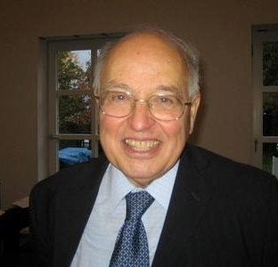
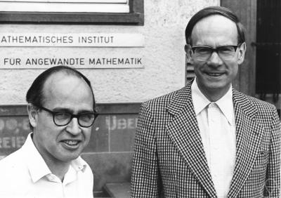
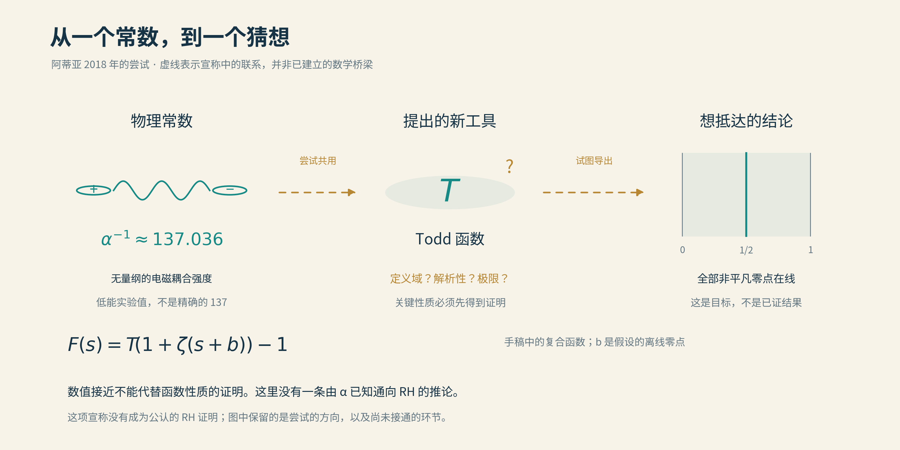

# 01 数学大师最后的光芒

2018年9月24日，八十九岁的迈克尔·阿蒂亚走上海德堡桂冠论坛的讲台，报告的题目只有一个问题的名字：黎曼猜想。

讲台上的人，早已拥有数学家所能期待的几乎一切荣誉。1966年的菲尔兹奖，2004年与伊萨多尔·辛格分享的阿贝尔奖，皇家学会会长的履历，英国女王授予的爵士头衔。更重要的是，即使把这些头衔悉数摘掉，二十世纪数学里也到处留着他的名字。许多年轻人来到这样的论坛，原本就是为了见一见教科书上的人。

而他这一次带来的，依然是一个新答案。

在公开的五页手稿中，阿蒂亚声称已经证明黎曼猜想。这个世界早就不缺宣称证明了黎曼猜想的人，期刊编辑的邮箱可以作证。稀罕的是，宣称者曾经确实打开过几道所有人都打不开的门。人们不得不认真听，也不得不追问：这一次，门真的开了吗？

*迈克尔·阿蒂亚，2007年。 作者：Gert-Martin Greuel / MFO；[来源](https://commons.wikimedia.org/wiki/File:Michael_Francis_Atiyah.jpg)；[CC BY-SA 2.0 DE](https://creativecommons.org/licenses/by-sa/2.0/de/)。本项目未修改原文件，保留原有标识。*

## 一生都在架桥的人

阿蒂亚1929年出生于伦敦，父亲来自黎巴嫩，母亲来自苏格兰家庭。他在苏丹和埃及度过部分童年，后来到英国求学，在剑桥接受数学训练。单看成长经历，他就很难被装进一个封闭的地理格子；他的数学后来也有相似的性格。

他在自传里记下过一个小小的生存办法：在学校比同班男孩小两岁，就替他们解决功课上的难题，换得年长同学的保护。少年阿蒂亚还认真喜欢过化学，实验的颜色很有吸引力；后来使他更愿意留下的，是数学可以从原则出发，走出很远。这样看，童年数学先帮他解决了身边的问题，成年数学才开始解决世界的问题。

有些数学家擅长在一座山上向深处开掘。阿蒂亚常常发现，两座看似隔得很远的山，地下原来连在一起。

拓扑学研究形状在连续变形中保留下来的性质。咖啡杯与甜甜圈的著名笑话，就来自这种不太尊重陶瓷工业的眼光：只要允许拉伸而不撕裂，一个把手与一个洞可能属于同一种结构。分析学则研究函数、极限和微分方程。一个问空间怎样连通，一个问方程有多少解，起初很像两个系的日常工作。

阿蒂亚与辛格的指标定理把它们接起来。在适当的紧致空间与椭圆微分算子条件下，考虑一个算子$`D`$及其伴随$`D^*`$，分析指标写成

$$
\mathrm{ind}(D)=\dim\ker D-\dim\ker D^*.
$$

右边数的是两种解空间维数之差。单独求解这些方程，可能十分困难；定理却告诉我们，这个差可以由空间与相关几何对象的拓扑资料计算。仿佛你还没有逐个访问居民，先看一眼城市的结构，便知道两类住户人数必定相差多少。

当然，真正的定理远比这个比喻精细。它的震撼在于，微分方程里的某个稳定数量，居然早已写在空间的整体形状中。此后，几何、拓扑、分析与理论物理沿着这座桥来往，桥面越来越宽。阿蒂亚与希策布鲁赫发展的拓扑K理论，以及他同物理学家之间的交流，也有这样的跨界气质。

*1977年，阿蒂亚（左）与希策布鲁赫。两人发展的拓扑K理论是其跨领域工作的代表之一。摄影：Konrad Jacobs / MFO；[来源](https://commons.wikimedia.org/wiki/File:Atiyah-Hirzebruch.jpeg)；[CC BY-SA 2.0 DE](https://creativecommons.org/licenses/by-sa/2.0/de/)。原图未修改，保留原水印。*

所以，当他晚年再次把两个遥远问题放在一起时，旁观者不能仅凭“听起来太远”便断定没有希望。他一生中最好的工作，恰恰使人学会了警惕这种断定。

但经历也不能替新论证担保。指标定理可以在下一篇论文中当作定理引用；指标定理的作者，却不能被当作下一篇论文的一条公理。数学在这里显得不近人情，正是这种不近人情，才使一个陌生人有机会与一位大师站到同一张纸前。

## 从一个加法，走到所有素数

阿蒂亚想打开的这道门，背后究竟是什么？

先写下一个看起来相当节俭的无穷和：

$$
\zeta(s)=1+\frac1{2^s}+\frac1{3^s}+\cdots
        =\sum_{n=1}^{\infty}\frac1{n^s}.
$$

这就是黎曼ζ函数最初的定义。取$`s=2`$，它是平方倒数和；允许$`s=\sigma+it`$为复数，故事才真正展开。实部$`\sigma`$控制各项变小的速度，虚部$`t`$使各项带上旋转的相位。这里必须把使用范围写在门口：上述级数在$`\sigma>1`$时绝对收敛。

在这个区域内，它又等于

$$
\zeta(s)=\prod_{p\text{ 为素数}}(1-p^{-s})^{-1}.
$$

把每个因子展开成$`1+p^{-s}+p^{-2s}+\cdots`$，再相乘，便会生出所有正整数的倒数幂。比如从素数2的那一栏挑出$`2^{-2s}`$，从3的那一栏挑出$`3^{-s}`$，就得到$`12^{-s}`$。唯一分解定理保证每个正整数恰好报到一次；绝对收敛保证这样重排无穷多项不会出事故。

加法的面孔朝向全体整数，乘法的面孔朝向素数。欧拉乘积就像一本双语词典，让分析问题与算术问题开始互译。它还说明$`\sigma>1`$没有零点，不过这需要乘积的收敛控制，不能只说每个因子非零。无穷多个非零数的乘积完全可能趋于零，有限乘法的常识到了无穷处，得重新办通行证。

黎曼关心的零点，却在这张原始通行证覆盖不到的地方。

复分析提供了一种扩展办法，叫解析延拓。ζ可以延拓到整个复平面，只在$`s=1`$留下一个单极点。延拓后的函数仍叫ζ，但原来的级数不会因为名字没换，就在所有地方突然收敛。地图上的公路可以用别的方法接着修，不能把尚未修好的路当成已经通车。

延拓后的ζ在负偶数$`-2,-4,-6,\ldots`$处为零，称为平凡零点。这个名字只表示它们容易由理论解释，并不意味着它们没用。其余零点全部位于

$$
0<\Re s<1,
$$

这条竖直的临界带里。黎曼猜想要求：每一个非平凡零点，都在正中的临界线$`\Re s=1/2`$上。

难处浓缩在“每一个”三个字里。

函数方程确实赋予零点关于临界线的对称性，但对称并不要求每个点都坐到镜子上。一个偏右的零点与一个偏左的零点，也能共同组成对称图案。正如对称的剧院并不会因此只出售中间一列的票。猜想要排除的是所有这样的离线可能。

## 零点的影子，投在素数身上

一个关于复数位置的问题，为什么能让人追逐一百多年？因为那些零点，会在素数的数量里留下影子。

记$`\pi(x)`$为不超过$`x`$的素数个数。素数定理给出$`\pi(x)\sim x/\log x`$，意思是两者之比趋于1。这是总的趋势；我们还想知道，真实计数在趋势线旁摆动得有多厉害。

为了把账算得整齐，数学家常用

$$
\psi(x)=\sum_{n\le x}\Lambda(n).
$$

冯·曼戈尔特函数$`\Lambda(n)`$在$`n=p^k`$为素数幂时等于$`\log p`$，其他时候等于零。账本里连素数幂也收进来了，看似多了麻烦，公式反而变得清楚。数学家有时候为了少做一点事，先给自己增加一点工作。

把跳跃点与求和方式处理妥当，显式公式的主体长这样：

$$
\psi(x)=x-\sum_\rho\frac{x^\rho}{\rho}
       +\text{来自常数、平凡零点等的修正项}.
$$

这里对非平凡零点的无穷和，需要按适当的截断、极限或平滑方式解释，不能当作随便排列的数值清单。不过，其中的机制已经看得见。若$`\rho=\beta+i\gamma`$，就有

$$
x^\rho=x^\beta e^{i\gamma\log x}.
$$

虚部$`\gamma`$决定振荡的节奏，实部$`\beta`$决定振幅随$`x`$增长的尺度。一个越靠右的零点，就可能投下越大的影子。RH要求所有这些实部都等于$`1/2`$；把无穷多项合在一起控制，还要付出对数因子，得到经典的误差界

$$
\psi(x)=x+O(\sqrt{x}\log^2x).
$$

符号$`O`$表示误差的绝对值不超过某个固定常数乘上后面的量。它没有承诺误差每次都取到这个大小。这里的平方根尺度，才是那条细细的竖线在素数世界里的分量。

计算机已经严格核验过极大有限范围内的零点。Platt与Trudgian的工作把验证推进到虚部高度$`3\times10^{12}`$；三万亿是高度，并非零点总数。严格计算需要控制舍入误差，也需要证明没有漏掉应有的零点，远比画一幅漂亮曲线费事。

然而，高度外面仍然是无穷。把记录再乘上一万，也没有消灭这个词。

证明临界线上有无穷多个零点，同样还没有检查完所有零点。偶数有无穷多个，奇数也没有因此失业。证明某个很高比例的零点在线，又是另一件事：即使例外所占比例趋于零，例外本身仍可能无穷多。比例、有限验证与全称结论各自承担不同的重量，不能把它们捆在一起，假装已经跨过最后一步。

因此，阿蒂亚带来的若是一份完整证明，它必须有能力把有限之外的每一个可能也管住。

## 137附近的另一团火

奇特的是，阿蒂亚的手稿并没有从零点统计直接起步。它先提到了物理学中的精细结构常数。

这个常数通常写作$`\alpha`$。在国际单位制下，它与电荷、真空介电常数、约化普朗克常数和光速的关系是

$$
\alpha=\frac{e^2}{4\pi\varepsilon_0\hbar c}.
$$

它是无量纲的。换一把尺子，米可以变成英尺，这个数却不会跟着单位制搬家。在通常所说的低能定义下，$`\alpha^{-1}`$约为137.036，所以“137”长期成为物理学中一个极有诱惑力的数字。它刻画电磁相互作用的强度；在量子场论里讨论有效耦合时，还必须说明所处的能量尺度。

为什么这个无量纲常数取这样的值？能否由更深的数学结构推出？这样的问题很容易把数学与物理引到同一张桌上。阿蒂亚长期往来于这两个世界，晚年仍试图用他称为Todd函数的对象处理这个问题。名称向曾在剑桥教过他的John Arthur Todd致意。

2018年的RH手稿把这项尝试与零点问题联系起来。他认为，同一种工具也许能解决两件事。于是先假定存在一个偏离临界线的零点$`b`$，再引入一个形如

$$
F(s)=T(1+\zeta(s+b))-1
$$

的复合函数，试图利用$`T`$被赋予的性质导出矛盾。

*阿蒂亚2018年尝试的结构示意。低能精细结构常数是实验确定的无量纲电磁耦合强度，倒数约137.036，并非精确的137。他希望将自己提出的Todd函数同时用于这一常数与RH问题。金色虚线表示宣称中的联系，关键函数性质与后续推理并未形成公认的RH证明；数字接近本身也不能代替证明。*

这里并没有一条“137等于某个数，所以黎曼猜想成立”的神奇算式。真正承担重量的是新函数的定义与性质。它在哪里定义？是否解析？不同极限怎样处理？后续使用的性质，能否同时成立？手稿把其中重要的依据指向另一份关于精细结构常数的稿件，核验者就必须沿着这条路继续往前追。

新对象当然可能成为钥匙，数学史上这样的故事数不胜数。但先给钥匙取个名字，并不会让它自动配上锁。若关键性质尚未建立，后面几行再优雅，也仍然悬在空中。

## 那句刺耳的话

“not even wrong”，常被译作“连错都算不上”。这句话听起来比“错了”还重，它背后的科学含义却有区别：有时一份论述尚未被组织成足够清楚、能够逐步判断真假的命题与推理，读者甚至无从指出普通意义上的第几步算错了。

针对阿蒂亚这份预印稿，Todd Trimble于2018年9月23日在MathOverflow的元讨论区使用了这个短语。日期值得记住：那是在海德堡报告的前一天，评论的对象是已经流出的文本。他在同一条评论里也明确肯定了阿蒂亚过去五十余年的重大数学成就。

于是，这句话既不能改写成“报告结束后数学界齐声宣布”，也不能戴到阿蒂亚整个人头上。它是一个具体评论者对一份具体论证可评估程度的严厉判断。把人压缩成晚年一次尝试，再把一次尝试压缩成一句讥讽，传播起来很省力，理解起来却几乎毫无所得。

论坛当天的公开评论仍强调，报告之后还须弄清定义和构造，继续讨论与评估。此后，这份宣称没有成为公认的黎曼猜想证明。问题留在纸面上：读者没有得到一条足以承担那个全称结论的、可以复核的道路。

这也说明，五页本身既算不了证据，也构不成罪名。数学史有短得惊人的证明，也有长得像一座城市的证明。短文可能抓住了结构，亦可能把全部困难塞进一个未经证明的引理。页数至多告诉编辑需要多少纸，不能告诉我们结论有多真。

## 火光还在那里

2019年1月11日，阿蒂亚去世。从那场海德堡报告算起，还不到四个月。

知道这个结尾，再回看2018年的录像，很难完全没有感情。一个已经不需要再向世界证明自己重要的人，仍站出来谈论那个最大的未竟问题。我们无法替他写下当时的内心独白，也无须猜测身体状况来解释数学。公开留下的行动已经足够：他还在提出构想，还在希望不同领域之间有另一座桥。

报告末尾的问答里，他还谈到创造与传播的关系：想法必须让别人听见，才可能走得更远。这些话不能补上一条引理，却保留了一个研究者仍愿意交流的姿态。最后一束光的含义，或许就在这里：一个人还在把自己的问题交给后来者，至于答案能走多远，交由他们继续检查。

这份希望可以动人，论证仍须受检验。悲壮与正确并无换算公式，荣誉也不能替某一行推理付账。但一次没有成立的宣称，同样不能倒过来烧掉已经建成的桥。后来的学生学习指标定理，所学的并不会因2018年的讲演而少一分可靠。

把本篇叫作“飞蛾扑火”，并不意味着追逐难题的人注定愚蠢。数学里有些火光，确实值得人走近。只是我们既要看见火，也要看清翅膀：问题的诱惑、生命的有限，以及一份证明所需的冷静。

下一位主人公走到灯下时，没有说自己已经征服整个古老猜想。他交出的是一个看上去颇不体面的数字：七千万。

目标明明是二。可偏偏就是这七千万，真正改变了数学。

[全书目录](../README.md) · [本篇目录](README.md) · [下一节](02_庾信平生最萧瑟.md)
