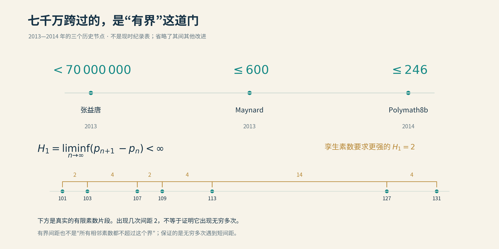
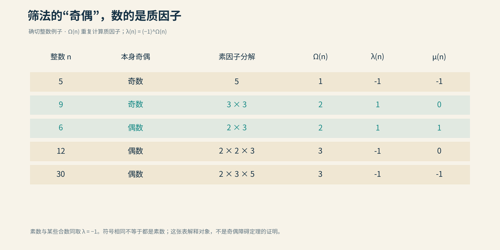

# 02 庾信平生最萧瑟

“庾信平生最萧瑟，暮年诗赋动江关。”

杜甫写下这两句时，咏叹的是前朝诗人庾信。千余年以后，有人请张益唐用诗形容自己，他选了这一联。2015年的专访里如此，2022年的答问中，仍是这两句。

隔着千年的纸墨，一个人认出了自己的身影。

平生，是漫长的寂静；暮年，才有动江关的回声。后来的人循着回声望去，容易只看见功成的那一刻。可诗里先写的，终究是那两个字：平生。

2013年4月17日，一篇题为《素数之间的有界间距》的论文投到了《数学年刊》。作者张益唐当时五十八岁，在新罕布什尔大学担任讲师。此前，他的名字远没有今天这样响亮；那份稿件却很快得到认真审读，并于5月获接受。

数学界收到的答案，是七千万。

*张益唐（VOA影像截图，Commons标注2014年）。 作者：VOA；[来源](https://commons.wikimedia.org/wiki/File:Yitang_Zhang.jpg)；[PD-US-government (VOA)](https://commons.wikimedia.org/wiki/Template:PD_VOA)。本项目未修改原文件，保留原有标识。*

## 呦呦鹿鸣

张益唐1991年在普渡大学获得博士学位，随后多年没有得到学术职位。后来人们熟悉的那段履历，便出现在这里：在赛百味做会计，前后约七年。

普渡的数学博士，去给三明治算账。若只看学历与岗位的对应关系，这大概算一道配错了的连线题。

不过，张益唐并不急着替自己判卷。工作让生活有了着落，数学也没有从脑子里搬走。附近大学的图书馆仍可以进去，纸笔也不挑办公地址。账本上的数字要算清，数轴上的数字，则可以慢慢想。赛百味卖的是快餐，这位会计做的学问，却一点也快不起来。

成名以后，这些往事被反复讲起，仿佛每一段窘迫，都早已伏好了通向荣誉的线索。可身在其中的人，未必看得见后来的篇章。生活须先安顿，生计须有着落；那些未能从容写在书桌前的年月，也不会因为一篇论文的到来，就重新归还。

1999年，经朋友和同道帮助，他进入新罕布什尔大学任教，此后多年担任讲师。在数论圈里，他还不大有名；在微积分课堂上，却早有自己的口碑。学校2013年的校刊记下了一个小场景：开学时，他先在黑板上写下姓名，解释中英文里姓与名的顺序，然后把名字擦掉，请大家叫他Tom。学生喜欢他的幽默、热情和讲解，也感激他对学生的关照。

对外，他暂时还不是让世界震动的张益唐；对学生，他已经是能让微积分少吓人一点的Tom老师。这两件事，原也不必等到同一天发生。

他在系里还有一项不大写进学术简历的本领：给饮水机换大水桶。成名以后，季理真采访他，提起系里秘书还惦记着这件事。他说，自己临行前刚换过，只要还在那里，就会继续换。

素数之间的距离有了新上界，办公室里的水，照旧不能断。数学界忽然多了一位名人，系里倒没有因此少一位肯搭手的同事。

数学之外，他读古典文学，也听音乐。采访中的张益唐，常常借前人的诗，说自己的事。那些句子在书中等了很久，到了他这里，又有了今人的温度。

当时，素数间距研究的气氛，却没有那么轻松。按张益唐后来向《晚点》回忆，2008年曾有一场围绕这个问题的研讨会，讨论的结果颇为悲观：已有的路线看似只差一点，大家却都没能走过去。张益唐没有参加，直到两年后才知道有这回事。

这场会，他连悲观也迟到了两年。

在另一场采访中，他说，等到弄清同行卡在哪里，反而觉得那可能是自己的长处。旁人眼中的路尽头，在他的纸上，还可以换一个方向试试。后来回望，缺席竟成了故事里的一处伏笔；身在当时，不过是一个没收到消息的人，继续做着自己的数学。

当然，会场里的悲观还不是一条“不可能定理”。大家受阻的是当时通向有界素数间距的路线，不能把它说成数学界已经证明一切传统方法都无能为力。张益唐后来真正交出的，也正是那第一步：先把距离压进一个固定范围。至于孪生素数要求的二，还在更远处。

2012年7月3日，科罗拉多。张益唐正在看望朋友，准备去听一场由朋友指挥的音乐会。按照他后来向普林斯顿高等研究院讲述的经历，这次休假，他没有带书，没有笔记，也没有电脑。等待出发时，他走到后院，想看看鹿。

鹿没有出现。一个盘桓已久的关键思路，却在等待中接上了。

“呦呦鹿鸣，食野之苹。”古人的诗里有鹿，有嘉宾，有鼓瑟吹笙。那一天，他赴一场音乐之约，没有等到鹿，倒等来了素数的消息。

消息还很轻，尚未成为那篇震动数学界的论文。从这个下午到次年春天，又过了八个多月。整理、简化、检查，灵光落回纸上，仍要经过漫长的伏案。后来我们记住了后院的片刻，那些没有轶事可讲的日子，则留在了证明的每一行里。

## 从无穷到7000万

把素数从小到大排开：2、3、5、7、11、13、17、19……越往后，总体越稀疏，却不时有两颗靠得很近。11与13，17与19，29与31，都是相差2的孪生素数。

孪生素数猜想说，这样的素数对有无穷多组。寥寥几笔，小学的黑板就能写下；一代代数学家，却迟迟没能替它落下最后一个句号。

张益唐带来的，是一个看起来很不体贴的答案：七千万。

人家问的是二，您给七千万？若是约人见面，说好相隔两步，您报出七千万步，对方恐怕已经不想出门。但数学家听到这个数字，却知道事情终于有了转机。

**他证明：无论把数轴看得多远，后面总还能找到一对素数，距离小于七千万。这样的近邻，有无穷多对。**

七千万的分量，恰恰在于它终于停了下来。素数可以大到写满整本书，仍会有这样的近邻；再大到写满一座图书馆，也不会是最后一对。数越来越大，那把量距离的尺子，却不必跟着加长。

用数学符号说，若 pₙ 是第 n 个素数，那么

$$
\liminf_{n\to\infty}(p_{n+1}-p_n)<7\times10^7.
$$

这里的“下极限”，看的是向无穷远走去时，间距还能反复回落到多低。读不惯这个符号也无妨，记住那把不再加长的尺子，就记住了定理的要害。

这当然不是说，每一对相邻素数都如此亲近。素数之间也有任意长的空白。张益唐保证的是，无论走多远，仍能一次次遇见近邻；荒原可以很长，相遇却不会从此绝迹。

在他之前，Goldston、Pintz和Yıldırım提出的GPY方法，已经取得重要进展：某些素数间距，相对于当地的平均间距，可以小得惊人。但“比平均值小得多”，和“永远小于某个固定数”，中间还隔着一道坎。

想象一条不断变宽的河。一处河面只有别处的十分之一宽，已经很可喜；可若整条河越来越宽，那十分之一，照样可能宽到望不见对岸。哪怕比例越来越小，也未必能用同一座桥跨过去：一百比一万小得多，一千比一百万的比例更小，可一千终究比一百大。

数学里，这里的平均尺度约为 log x，其中 x 表示素数所在的位置。GPY证明的是某些间距与这个尺度的比值可以趋近零；张益唐则第一次让一个固定常数，守住无穷多次相遇。**前者是相对地近，后者是近到同一把尺子始终够用。**

还能再多想一步。除了2，大素数都是奇数，两个大素数的差便是偶数。小于七千万的正偶数只有有限多个，而近邻有无穷多对。因此，至少有某一个偶数间距，会出现无穷多次。否则每一种间距都只出现有限次，加起来也不会变成无穷多。

我们知道，有一扇门会被无限次敲响。至于门牌是不是二，定理还没有告诉我们。

## 筛子的极限在哪里

七千万从哪里来？还得从一把古老的筛子说起。

把整数写成一张长表，保留2，划去其余2的倍数；保留3，划去其余3的倍数；再轮到5、7……这就是埃拉托色尼筛法。合数一批批退场，素数渐渐露面。

只筛一百以内的数，这件事可以在纸上做完。可孪生素数猜想问的是无穷多：我们不能拿一张无限长的纸，等到全部划完，再向编辑交稿。

于是，筛法的任务从“逐个找出来”，变成了“即使不逐个点名，也能证明至少有这么多”。像清点一座城的人口，未必认识每位居民，却要能把总数算住。

困难恰在这里。筛掉了2、3、5的倍数，留下来的未必就是素数：49和77也可以蒙混过关。继续筛，冒牌者会少一些，但条件互相交叠，账越来越难算。既要剔除合数，又要保证真正的素数没有被一并估计没了，是两回事。

有界间距的思路，先把目标放宽了一点。

孪生素数要求两个指定位置同时成功：一个是 n，另一个是 n + 2。我们暂且不指定这两位，先安排一整排候选位置，只求其中至少两位是素数。谁和谁成双，可以等到最后再看。

例如，把三个位置定为 n、n + 2、n + 6。当 n = 5，得到5、7、11，三个都是素数；当 n = 7，得到7、9、13，仍有两个。它们不必每次都成功，只要能证明在无穷多个地方至少成功两个，就能把距离限制在6以内。

这三个位置只是帮助理解的例子，我们并没有因此证明间距6的结论。张益唐原始证明安排的候选位置多得多，达到三百五十万个，再把这组位置放进长度小于七千万的范围里。网确实撒得很大，不过这一次，数学保证网里至少有两条鱼。

选位置也不能随意。譬如 n、n + 2、n + 4，总有一个数是3的倍数，不可能在远处三人一起成为素数。筛法通常要求候选组先避开这类先天的整除障碍，术语叫“可容许”。这只是给各个位置保留机会，还远不是发录取通知书。

下一步，是整个证明中最值得带走的一个想法：**用平均数，逼出一次成功。**

假设每移动一次这排位置，就数数其中有几个素数。零个记零分，一个记一分，两个记两分。如果能证明平均分大于1，那么至少有一次得了2分或更多。人人最多一分，怎么平均，也平均不出一点一分来。

直接平均往往不够好，因为大量明显没希望的位置会把分数拉低。数学家便给不同位置分配不同的“分量”：更值得考察的多算一点，没那么有希望的少算一点。这个分量叫权重，必须非负。

比如三组候选位置各得0、1、2分，普通平均恰好是1；若它们的权重分别为1、1、3，加权平均就是 (0 + 1 + 6) ÷ (1 + 1 + 3) = 1.4。权重改变了平均值，却没有凭空造出那次2分。

愿意再看一眼公式的读者，可以把每组素数的个数记作 S(n)，权重记作 wₙ。要证明的便是

$$
\frac{\sum_n w_nS(n)}{\sum_n w_n}>1.
$$

分母大于零，所有权重非负，便能推出至少有一组包含两个素数。如果在越来越远的适当区间，都能作出这样的保证，就有无穷多组成功。

真正的本领，是怎样选权重、怎样算平均。刚才的例子已经看到了0、1、2分；实际证明可不能先偷看答案，再给成功者加分。权重要从已经掌握的整除信息出发设计，而算平均时，又必须控制误差。只算出一个漂亮的主项，误差却可能把它全吃掉，仍然等于没有算出来。

GPY把这套办法推进到了门边。张益唐要做的，是让那扇门真正打开。

## 越过平方根的门槛

要算清刚才的平均数，为什么会碰上素数的分布？

先看我们熟悉的个位数。除了2和5，素数的末位只能是1、3、7、9。若把这些素数按末位分成四队，长远看，四队的人数大致相当。这就是一种“素数在等差数列中的分布”：末位是1的一队，每隔10个整数，就有一个候选位置。

十进制并没有特权。也可以按除以3的余数分队，按除以7的余数分队，或者按除以一个更大整数的余数分队。这个用来分队的数，数学家叫它“模数”，通常记作 q。

并非每队都有相同资格。比如按除以10的余数分队，余数0、2、4、5、6、8的队伍，很容易就被2或5拦住了。讨论均匀分布时，要先留下那些没有这种整除障碍的队伍。

筛法的加权计算，会把许多“能不能被这个数整除”的条件放在一起。一旦要求其中某个位置还是素数，问题就转成了：某些余数队伍里，究竟有多少素数？队伍划得越细，需要的分布信息也越细。此前埋下的账，到这里一起送到了桌上。

只说“长远看大致一样多”还不够。我们的候选位置在向无穷远移动，计算需要用到的模数也跟着变大。必须说明：能同时管到多大的模数？许多队伍的误差加在一起，会不会把那一点点优势淹没？

经典的Bombieri–Vinogradov定理提供了一个强有力的答案：在平均意义下，误差可以控制到大约 √x 这一尺度的模数，其中 x 是考察整数的大小，精确表述还要扣除一些对数因子。这里的平方根，说的是分队所用的模数能有多大，不是素数之间的距离。

为什么偏偏提这条线？因为在当时的GPY办法中，只靠这一级信息，还不足以把所需的加权平均推过1；若能把适用范围向平方根之外扩一点，局面就可能改变。

直觉上，人们会想：那就证明素数在所有更细的分队中，仍然足够均匀。这个目标当然很好，难也是真的难。

张益唐换了一个问法：**我手上的证明，真的需要所有这些分队吗？**

他重点处理一类特别的模数：它们由许多小素因子相乘而成，没有很大的素因子。这样的数，比较容易拆成合适大小的几块，便于把难处理的和式重新分组，再利用不同项之间的抵消，压住总误差。这里“容易”是相对的；落到论文里，仍是大量精细的分析。

另一边，他又调整筛法，让它主要调用这些自己能够处理的信息。**分布估计负责把这类特殊模数管得更远，筛法负责把所需条件收拢到它们身上。两边恰好接上，才有了突破。**

可以把它想成修桥。起初的设计，要求把整条河都治理好才肯开工；后来发现，只要选准桥址，处理好这一段水势，就足以把人送到对岸。缩小要求本身不算证明，关键是缩小以后，桥仍然能架起来。

张益唐越过平方根门槛的幅度并不大，却是一个不会随着 x 增大而消失的指数上的改进。正是这一点余地，使筛法能保证：在一组足够多、位置固定的候选者里，至少两位会无穷多次同时成为素数。

七千万，便是他当时选取候选位置和各项参数后，给出的一个足够用的界。它不是什么藏在宇宙深处的神秘常数，也不是一颗颗检查到七千万就得到了答案。它量的是这排候选位置的宽度；证明管的，却是它们一路走向无穷远。

消息传开以后，许多人加入改进，Polymath公开协作把各处估计一再磨细，数字迅速下降。2013年，James Maynard又带来新的筛法，陶哲轩也独立发展了相近思想。

如果说张益唐增强了筛法能取得的分布信息，Maynard和陶哲轩则重新安排了权重使用信息的方式：让每个候选位置有更多单独调节的余地，不必都挤在原先同一种安排里。结果，只用经典的分布估计，也能越过“平均数大于1”的门槛。

这正是数学有趣的地方。好不容易找到更强的工具，后来者又发现，把手里的旧工具换一种组合，也能打开门。

Maynard把界推进到600，方法还可以保证：给定任意有限个数的素数，总有某个固定长度的区间，能在无穷多个地方把这么多素数装进去。2014年，Polymath8b进一步把两素数间距的无条件界推进到246。

张益唐先使人看见，有界间距的彼岸可以抵达；后来者沿着新的渡口，又把两岸拉近了一些。

## 到2的距离有多远

*2013—2014年的三个历史节点：张益唐证明相邻素数间距的下极限小于七千万，Maynard把历史界推进到600，Polymath8b再到246。这里保证无穷多次出现短间距，并不保证每对相邻素数都短，也没有证明孪生素数无穷多。下方真实素数片段只解释“间距”的含义。*

七千万，600，246。数字一路缩短，仿佛二已经隐约在望。可数轴上的两百多步，有时比此前的七千万步还难走。

前面的办法，一直保留着一项自由：一大排候选位置里，谁成为素数都行，凑够两个便算成功。孪生素数却把位置指定死了，必须是 n 和 n + 2。从“这许多人中，总有两位能成双”，变成“就要这两位”，要求骤然苛刻了起来。

背后还有一道著名的“奇偶障碍”。名字听着像小学问题，困住的却是一代代筛法高手。

这里的奇偶，不是说一个整数是奇数还是偶数，而是数它由几个素因子相乘而成，重复的也算。例如，13只有一个；15是 3 × 5，有两个；12是 2 × 2 × 3，有三个。

素数只有一个素因子，当然属于“奇数个”的一边。但三个、五个素因子组成的合数，也混在这一边。连奇偶都看不清，就更谈不上从中认出只有一个的素数。

问题不在于我们不会分解12或15，而在于：**当对象是一整片不断扩大的数列，只掌握通常那些“有多少数能被某些小数整除”的统计，往往不足以分清这两类。** 某些数列在这些检查里看起来极为相似，实际含有多少素数，却可以很不一样。

这就像一份调查只记录身高、鞋码和年龄。数据再精确，也不能靠反复加减，算出每个人喜欢哪首诗。信息里没有充分记录的区别，不会因为计算更辛苦，就自己长出来。

喜欢符号的读者，可以用 Ω(n) 记下素因子的总个数，再用刘维尔函数给奇偶两边各挂一块牌子：

$$
\lambda(n)=(-1)^{\Omega(n)}.
$$

奇数个挂 −1，偶数个挂 +1。这不是素数识别器，只是把筛法难以看清的一种区别，单独标了出来。

*看图中的素因子个数与 λ 一列，就能看清这里的“奇偶”。μ 是另一种常用算术函数，本节不需要使用。图为本项目原创；[图源、数学依据与简化说明](img/README.md)。*

因此，给孪生素数对估一个上限，和保证一个非零的下限，难度很不一样。说“最多这么多”，多放进几个合数，顶多估得宽些；说“至少这么多”，就得保证拿出来的真是素数对。只要下限还允许零，账本再漂亮，也没有证明一定有人到场。

这并不意味着筛法永远没有机会。新的分布信息、新的相关关系，或者别的数学工具，都可能改变它的能力。只是沿着现有的纯筛法框架继续拧紧参数，不能想当然地把246拧成二。

二很近。通向它的路，还没有那么近。

## 数学如诗

再读那两句诗，“动江关”便有了今人的回声。一份此前并不显赫的署名，一篇寄往《数学年刊》的稿件，从寂静中传出，继而引来许多人的应和。七千万之后，纸上的数字一再改写，那第一道缺口，却有了再也抹不去的名字。

荣誉来得很快，走到荣誉之前的路，却很长。那些年月，没有因为镁光灯亮起就变得轻省。只是从此以后，再有人读到“暮年诗赋”，会想起一个曾在大学讲师的职位上，长久研究素数的人。

上一章的阿蒂亚，已在声望的高处，仍向最远的火光伸手；这一章的张益唐，则从漫长的无闻中，走到了众人的目光里。来路不同，走到纸前，仍须一行行写下自己的证明。纸很薄，能够承住的，又何止几页人生。

七千万没有许诺自己就是二，却把一段有界的距离，写进了无穷远。后院没有等来的鹿，留在了那个夏天；从纸上走出的素数，却已越过许多重江关。

2025年6月，七十岁的张益唐回国，全职加入中山大学香港高等研究院。后来记者谈起“落叶归根”，他却不大愿意接受这个比喻：研究还要继续，自己还不甘心就此成为一片落叶。

*2025年，张益唐与吴小莉在中山大学校园。图片来自凤凰卫视《问答神州》[专访原页](https://ishare.ifeng.com/c/s/v002kWodNLmF4bXuiXHiH6rkaKcQatPhYlxtCz3J7CuArOk__)；保留原图，未裁剪。[图源说明](img/README.md)。*

校园里的照片，浅色衬衫，双手背在身后，步子从容。世人替他写了许多传奇，他自己还要去办公室，把没写完的论文继续写下去。

《晚点》的采访里还有个小插曲。记者问，写得累了烦了，会做什么？他去散步。再问，是独自走，还是和太太一起？他说还是习惯一个人，因为太太走得比他快。

原来，有些独行，未必关乎天才的孤独，也可能只是两个人的步速。素数间的距离已经缩短，散步时的这一点距离，倒不急着解决。

不过，张益唐心中还有另一个长期问题。早在素数间距成名之前，他就在追逐某种可能贴近1的零点。这个零点甚至未必存在，却让几代数论学家为它保留了一把椅子。

接下来，我们要去看那把椅子，以及它终于被撤走的时刻。

[全书目录](../README.md) · [本篇目录](README.md) · [上一节](01_数学大师最后的光芒.md) · [下一节](03_西格尔零点不存在了.md)
