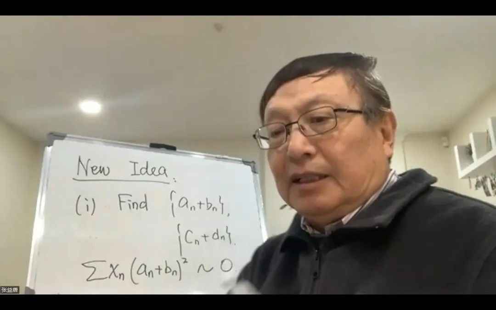

# 03 西格尔零点不存在了

如果你找到一颗西格尔零点，恭喜你：黎曼设想的一道防线，被你攻破了。

至于那一百万美元，先别急着订机票。千禧年大奖悬赏的是黎曼假设；这颗零点推翻的，却是它的推广——广义黎曼假设。数学家的两个字，有时比银行的附加条款还值钱。

奖金另说，数学史上的位置，大概是有了。

可惜，这颗零点有一个小小的缺点：谁也没有见过。

一代代数学家为它修筑理论、绕行远路，有人甚至花去半生，试图证明这位贵客根本不会来。张益唐，就是其中之一。

## 黎曼假设的反例？

先把时间拨回十九世纪。

黎曼把素数的秘密，藏进了ζ函数的零点里。他的猜想说，那些非平凡零点，无论走到多远，都应该站在实部等于1/2的临界线上。

这是一句关于“所有”的话。要证明它，得管住无穷多个零点；要推翻它，找到一个不守规矩的就够了。

广义黎曼假设把这项要求，推广到一批与ζ函数有亲缘关系的L函数。西格尔零点，正是其中一个格外可疑的候选反例：它若存在，就会落在实轴上，紧贴着1，与中央的1/2相去甚远。

**所以，找到一颗西格尔零点，就足以否定广义黎曼假设。反过来，排除了这种零点，也只是排除了一类反例，还没有证明整个猜想。**

这些L函数，又为什么值得关心？

我们已经知道素数有无穷多个。可若把奇素数按除以4的余数排成两队：5、13、17……站在余1的一边，3、7、11……站在余3的一边，两边会一直势均力敌吗？

1837年，狄里克雷证明，两队都不会断粮，都有无穷多个素数。后来人们还知道，数得足够远，两队所占的比例都会趋近一半。不过，“迟早差不多”是句很宽厚的话，宽厚到没有告诉你要等多久。

L函数就是研究这种差异的工具。比如给余1的整数记正号，余3的记负号，偶数不计，便得到一份带正负号的账。正负抵消得如何，记录着两队之间的偏差；换一种分组，就换一份账。

ζ函数看素数的全局，这些L函数则让我们看清不同队伍的情形。

到了十九世纪末、二十世纪初，数学家已经能在靠近1的区域里排除大量零点，却始终留下一个口子：某些L函数，那里或许还有一个实零点。

它一旦太靠近1，就意味着某些素数队伍之间，会出现异常顽固的偏差。“最终会均匀”的承诺依然有效，只是这个“最终”，可能远得让估计失去用处。

数学家给这位迟迟不肯露面的嫌疑人留了一个名字：朗道–西格尔零点，简称西格尔零点。

研究者大多相信，它根本不存在。但在数学里，没人来敲门，与证明门外没人，是两回事。

## 大师西格尔

西格尔这个名字与黎曼如影相随。

1932年，他从黎曼的遗稿中整理出重要的计算方法，使黎曼–西格尔公式进入现代数论。后来的人们得以更高效地计算临界线上的ζ函数，也才看清，1859年那篇短文背后，竟藏着如此深的伏笔。

黎曼留下几页纸，后人读了几十年。所谓大师的留白，有时确实有些费人。

西格尔本人也很有大师的脾气。他原想研究天文学，后来被弗罗贝尼乌斯引向数论，1920年在兰道指导下取得博士学位。星空没有留住他，整数倒留住了。

在法兰克福任教时，他有一门高等课程，总共只有两名学生。有一天，两人都因校内事务迟到了。赶到教室，才发现教授已经独自开讲，黑板也写满了一大块。

出勤率是零，教学进度丝毫不受影响。

这位连空教室也能认真讲下去的人，在1935年交出了一项影响深远的成果。它原本研究一种叫“类数”的数量：大致说，是衡量整数世界扩大以后，分解规则离我们熟悉的模样有多远。可这条路走着走着，又与L函数相逢。

西格尔证明，相关L函数在1处的值，不能小得太离谱。借着它，数学家也能限制零点向1靠近的程度。

然而，这个强大的定理里，藏着一个令人哭笑不得的遗憾。

它保证某个关键的正常数存在，却没有给出计算这个常数的有效办法。好比有人证明，你寻觅的东西一定在某个半径以内；问半径多大，答曰：存在。

不是没有地图，是地图上的比例尺还空着。

这便是著名的“无效常数”。名字颇不客气，定理本身却极有价值。许多后来成果借它跨过了河，到了需要明确数字的地方，又不得不停下来。

西格尔没有发现一颗零点。他留下的，是一道强有力的限制，以及限制之外，那个仍未排除的“也许”。

## 半生逐影

时间走到2007年，张益唐公布了一份有关朗道–西格尔零点的预印本。

那时，七千万还没有到来，世界尚未认识这位新罕布什尔大学的讲师。后来我们习惯把他的故事讲成“多年沉寂，一朝证明素数间距”，容易忘记，沉寂之中，他已经在另一座山上走了很久。

2007年的稿件没有成为公认的完整证明。2013年张益唐成名后，人们重新翻出这篇旧作，陶哲轩也在公开讨论中指出，其中关键引理的论证还需要展开核验。

七千万替他打开了世界的门，没有替他打开这道门。

2022年11月，他又拿出一百余页的新稿。11月8日，北京大学组织线上报告，并向公众直播。屏幕里没有复杂的舞台布置，一块白板，一支笔，张益唐开始讲他的研究。

*2022年11月8日学术报告截图。来源：[北京大学数学科学学院／北京国际数学研究中心](https://math.pku.edu.cn/xyxw/145226.htm)。白板上的“New Idea”，意为“新想法”。*

画面里的两个英文词，倒像替这位数学家写了一行小传：New Idea。

人们记得他熬过了多少年，数学却还要问，他想到了什么。

他的思路，可以从反证法说起。

假设那个令人头疼的L值小到了某种程度。张益唐尝试由此推出：一大批相关L函数的零点，会被迫在某个区域里排得异常整齐，连相邻间距都受到很强的约束。

接下来，换一种方式给这些零点“算总账”：把许多函数放在一起，估计某些量的平均大小。这用到了他熟悉的大筛法一类工具。倘若前面的整齐排列，会让同一笔账算出彼此冲突的结果，那么最初那个假设就不能成立。

一个零点躲着不出来，便去查它必须留下的痕迹。这是反证法的锋利之处：不必抓到它，只要证明它无处容身。

难处也正在这里。直觉里的“太整齐”，必须变成可计算的不等式；上下两笔账之间，还得容得下全部误差。张益唐那一百余页的努力，就在这些细处。

## 离一，还有多远

这份稿件希望推进到哪里？

把1想成一道墙。过去的理论说，零点不能无限任性地贴上去；张益唐试图给出一道能明确计算的隔离带。

如果把不同L函数各自的尺度记为q，他在2022年稿件中提出的零点距离下界，大致是：

$$
\text{零点到1的距离}\ \geq\ \frac{c}{(\log q)^{2024}}.
$$

这里c是一个统一的、可有效计算的正常数。q可以粗略理解为前面分组规则的基本周期，log就是自然对数。

两千多次方，看起来很不客气。但大数世界里，不能只凭指数的长相判断强弱。q不断增大时，它的任何固定正幂，最终都会跑赢log q的2024次幂。取倒数之后，次序便反了过来。因此，这样一条有效的对数幂界，若能成立，会超出经典西格尔定理所直接提供的相应距离保证。

不过，它还没有走到终点。通常所说的排除西格尔零点，需要一道更宽的、统一的隔离带：

$$
\text{零点到1的距离}\ \geq\ \frac{c}{\log q}.
$$

两式中的常数不必相同。只看分母，差距就清楚了：假如log q等于10，前者要除以10的2024次方，后者只除以10。

一道缝，与一条走廊，相差的可不只是排版。

张益唐的尝试，是先把最贴近墙的那道缝清出来。对整座山而言，这一步依然艰难；对终点而言，路却还长。

而这一步本身，也还在接受检验。张益唐在2024年的采访中坦言，初稿有问题，一些地方没有写清，仍在修改。截至本章核对时，arXiv上所列仍是2022年的第一版。因而，这里讲的是他的研究方案与证明主张，还不能写成已经确立的定理。

七千万是一项完成的突破，西格尔零点是另一场漫长的跋涉。一个人的成就，无须替他的每一次尝试作保；一次尚未完成的尝试，也无权抹去他的成就。

我们当然盼望这个故事仍按熟悉的方式收尾：多年孤独，终于迎来自己的答案。

历史却在这里，换了一位来客。

## 不速之客

很不幸，靠找到一颗西格尔零点去领千禧年大奖，这个念头可以彻底打消了。

2026年10月，OpenAI向数学大陆发起了一场饱和核弹攻击。

一轮轰鸣之后，西格尔零点不存在了。

“怅望千秋一洒泪，萧条异代不同时。”

[全书目录](../README.md) · [本篇目录](README.md) · [上一节](02_庾信平生最萧瑟.md) · [下一节](../02_第二篇_经典方法的新长征/04_零点密度新估计.md)
