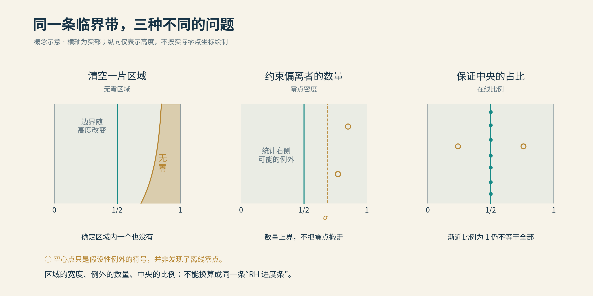
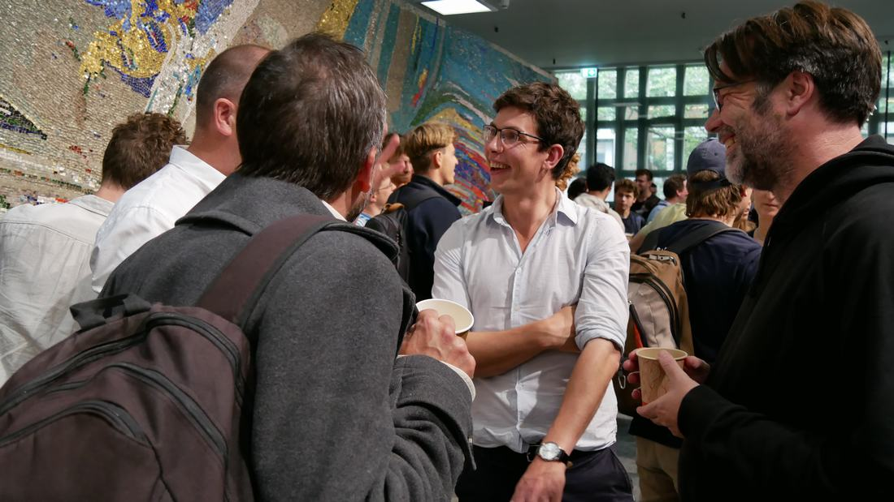
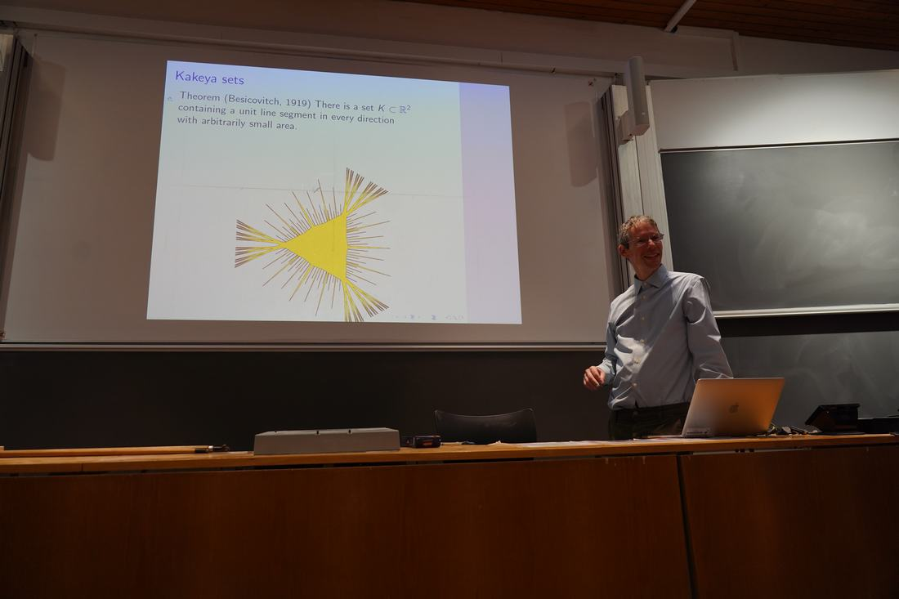
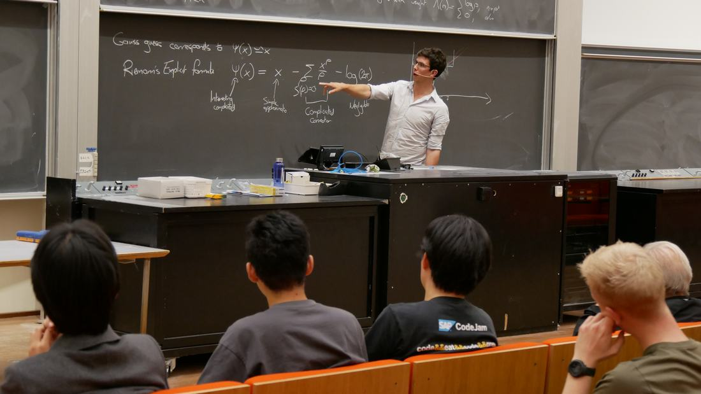

# 04 零点密度新估计

假如黎曼假设是错的，数学家还能做些什么？

一个很务实的回答是：请它错得少一点。

这当然不是和零点商量。数学家想知道的是：即使临界线之外藏着反例，它们最多能有多少？如果那些潜在的捣乱者足够稀少，我们仍然可以绕过尚未解决的黎曼假设，证明许多关于素数的事情。

登顶的路还没找到，山脚下的日子也得继续过。

2024年，拉里·古思（Larry Guth）与詹姆斯·梅纳德（James Maynard）就在这条绕山的小路上，打开了一道久攻不下的关口。他们改进了零点密度估计，论文后来发表于2026年的《数学年刊》。

成果的名字不太像新闻，背后的故事倒很值得一听。

## 八十四年的山口

先把地图摊开。

ζ函数的非平凡零点，都住在实部0与1之间的临界带里。横着看，是零点离中央有多远；竖着看，则是我们把目光投向多高的地方。黎曼假设要求，它们全都站在中央那条1/2线上。

零点密度研究暂且退一步：在中央右侧另画一道竖线，比如实部3/4，再数它右边直到某个高度为止，最多可能藏着多少零点。这里包括画出的边界，数的是可能数量的上限，并不是已经找到了离线零点。

为什么先看右边？因为零点具有关于中央的对称性，右边管住了，左边也就有了着落。

这和给学生点名有点像。黎曼假设要求一个也不许缺席；密度估计暂时做不到，只能先报告：即使有人没来，缺席人数也不会超过这个数。

名单上写着“至多十人”，不等于真的有十个人逃课。也可能全员到齐。

*无零区域问“哪里没有”，密度估计问“至多多少”，在线比例问“至少多少在线”。空心点为示意，不是已发现的反例。本项目原创；[数学依据与作图说明](img/README.md)。*

1940年，英国数学家英厄姆（Albert Ingham）给出一项重要估计。后来，蒙哥马利、哈拉斯、赫胥黎等人陆续推进，换工具，也换着角度逼近。

难题却在3/4附近留下了一道山口。

一边的办法在这里渐渐吃力，另一边的办法走到这里，也恰好用尽气力。两条路都到了，桥却没有接上。后来几十年的许多改进，改变了其他地段的风景，这个关键瓶颈仍横在那里。

所谓“八十四年的突破”，说的是2024年终于越过了这处承自1940年的经典门槛。其间数学家没有放八十四年长假，山口也没有因为大家足够勤奋，就自行让路。

梅纳德盯着它，已有大约十年。

## 少年游

前面写到七千万时，梅纳德已经登过场。那位把素数间距上界推到六百的年轻人，后来又在大间距、缺少某个数字的素数等问题上接连开路。

不过，他自己讲起成长经历，倒没有那么多命中注定。

申请大学时，他把数论填进了最感兴趣的数学方向。学校并没教过多少，他靠自己读书摸索，回忆时还庆幸：面试官没有追问太多，否则那点不太成体系的自学知识，未必经得住盘问。

少年先把志愿填上了，学问留给往后慢慢补。

读博士时，他做出的第一个研究结果，还让他踏实了不少：总算有了成果，可以在其他问题上大胆一点。后来才发现，这个结果早已有人证明过。好在等他知道，注意力已经转到下一项研究，并没有太过介怀。

数学家的第一次发现，有时是发现自己并非第一个。

到了2022年，他获得菲尔兹奖。国际数学联盟主席告知消息，并请他确认是否接受时，他竟忽然担心，自己一激动会说错话，把接受说成拒绝，于是刻意答得格外缓慢。

素数间距可以压缩，领奖的那句话，最好不要。

*梅纳德在2024年哥本哈根大学哈拉尔德·玻尔讲座活动中。纸杯、背包、三三两两的交谈，也是数学生活的一部分。来源：[哥本哈根大学数学系现场相册](https://www.math.ku.dk/english/calendar/events/hbl-maynard/photos-from-the-james-maynard-lecture/)，原图未修改。*

奖章并不替人解题。那个零点密度问题，他仍然时常拿出来想，又一次次卡在同一个地方。

有些难题的厉害，在于它看上去总像只差一点。它不把门关死，留一线光，让人再耗上几年。

## 一顿午餐的伏笔

2020年初，梅纳德乘飞机去科罗拉多参加会议，途中想到，也许可以借一借调和分析的工具。

巧的是，同去开会的古思，也在思考相近的方向。午餐时，梅纳德向他解释了数论这边的问题，又给了他一个可供试探的例子。

餐桌上谈的是试探，答案还在几年之后。一顿饭之后，多了一个可以一起想的问题。

古思来自另一片数学天地。他擅长几何与调和分析，关心不同方向的细管怎样相遇，波动怎样叠加，复杂图形里藏着什么约束。这些问题乍看离素数很远，却都要处理一件事：许多简单东西聚在一起，什么时候会变得异常拥挤，什么时候又会彼此抵消。

*古思在2025年11月21日王虹获奥斯特洛夫斯基奖的活动中介绍其研究，投影上是挂谷集合。这里可以看见他熟悉的几何世界；照片不是2024年合作现场。来源：[哥本哈根大学活动原页](https://www.math.ku.dk/english/calendar/events/ostrowski/)，原图未修改。*

古思断断续续想了几年，最初看中的调和分析办法，却没有奏效。直到2024年2月，他带着新的尝试再次联系梅纳德，两人才开始密切合作。几个月后，结果出来了。

2020年的午餐，2024年的论文。

数学会议的餐费，偶尔要过几年，才看得出报销得值不值。

## 众声喧哗

两人究竟在解决什么？先看一支不同寻常的乐队。

有许多根小箭头，长度不超过1，各自以不同的速度转动。把它们首尾相接，得到一根合成箭头。方向散乱时，它们彼此抵消，合成箭头往往不长；偶尔赶上许多箭头朝着相近方向，合成箭头就突然长起来。

把合成长度随时间画成曲线，便会看到起伏，以及偶尔冒出的高峰。

研究中常用的一种和式叫狄利克雷多项式，可以写成：

$$
D(t)=\sum_{N<n\le 2N}b_n e^{it\log n},\qquad |b_n|\le1.
$$

暂时不必被名字吓住。这里大约有N根箭头，bₙ决定各自的长度和起始方向，log n决定转速，t推动时间向前。整行公式，就是把这些转动的小箭头加起来。

一万根箭头，若完全同向，合起来可以长达一万；若方向如随机撒开一般，典型的合成长度只在一百左右。这只是帮助理解抵消的随机模型，真正的箭头按确定的规则运动，证明必须管住最不走运的情形。

偏偏最难处理的，常常是中间那档：不是普通起伏，也没有高到万箭齐指，像一万根箭头合出了约一千的长度。一般地，这对应N的3/4次方附近，恰是新方法要攻克的高度。

可ζ函数的零点明明意味着“等于零”，怎么又扯到“特别大”了？

因为被检测的函数，与用来检测它的函数，不是同一个。

数学家设计辅助和式，把零点留下的信息整理成这样的结构：开头有一个1，后面跟着若干部分。假如那里真是零点，后面就必须合力抵消那个1，总账才能归零。如果后面的每一部分都太小，就根本凑不够。

经过适当处理，这会迫使至少一段有限和达到足够大的数值。零点本身安静无声，检测它的另一根曲线，却会在附近留下高峰。

**因此，只要证明高峰不能太多，就能反过来限制零点的数量。**

这条桥需要处理近似误差，也要避免同一片零点或同一座峰反复登记；实际计数会把检测时刻适当隔开。我们在这里抓住的是思路：看不到目标，就去数它必须留下的痕迹。

## 此时无声胜有声

限制高峰，最顺手的办法是看平均值。

举个简单的例子：某一组采样值的平方加起来，不超过一万；那么，其中绝对值达到一百的，最多只能有一个。因为光这一个，平方以后就已经花完了全部预算。

高峰越高，越经不起多来几座。

经典均值估计就是这类办法的精密版本。遗憾在于，算出来的预算还不够紧，容得下的高峰，比我们希望的多。把平方换成更高次方，固然能更敏锐地盯住尖峰，随之而来的交叉项，却也会挤满纸面。

古思与梅纳德把问题重新组织成一张矩阵：每一行记录一个时刻，每一列记录一根箭头。我们要问，这张表能不能让同一组箭头，在许多不同时刻，都合出很大的总和？

线性代数把这件事翻译成矩阵的“最大放大能力”，专业名称是最大奇异值。若高峰时刻太多，放大能力就必须很强；能给放大能力设下更紧的上限，就能给高峰数量设限。

但真正巧妙的地方，是他们没有急着把账算得整整齐齐。

一个最简单的提醒是：100与−99相加，只剩1；倘若为了省事，先各取绝对值再加，就只看见199。这个上界当然没错，却宽得几乎没用了。

复杂的振荡和也是如此。每一块单独估计得很漂亮，不代表把这些估计拼起来，仍然保留了整体的精细信息。有些抵消，藏在不同部分之间；分开处理时，顺手就丢掉了。

两人的一个关键选择，是暂缓惯常的简化，保留振荡积分之间的联系，再同时利用几处抵消。纸面一时更乱，最后的总账却更省。

此外，他们还观察高峰出现的时刻，彼此有没有特殊的排列规律。例如1、4、7、10这几个时刻，便有1＋10＝4＋7这样的配对；类似关系很多的集合，与关系稀少的集合，需要不同的办法对待。

数学上把这种配对的丰富程度称为“加法能量”。旧工具对结构很强的一类已经颇有办法，新论证补上另一类的控制，再处理两者交接的地方，才真正收紧了上限。

这里的突破，不是第一次发现正负会相消，而是找到了原先算账方式没有充分利用的抵消。

一条老路走不通，有时并非少了一把更大的锤子。也可能，是某个太熟练的动作，需要晚做一步。

## 柳暗花明

2024年5月，新稿公开。那道关于3/4的老关口，终于松动。

把高度T以内、实部不小于3/4的非平凡零点数记作N(3/4,T)，只取上半平面并按重数计。比较经典基准与新结果，核心变化可以浓缩成两行：

$$
\begin{aligned}
\text{经典基准：}\quad &N(3/4,T)\le T^{3/5+o(1)},\\
\text{新的估计：}\quad &N(3/4,T)\le T^{5/9+o(1)}.
\end{aligned}
$$

3/5是0.6，5/9约为0.556。后面的o(1)，表示随着T不断增大而趋于零的指数余量。这是大尺度的增长保证，不能拿任意一个小T直接算作精确人数。

乍一看，两位顶尖数学家折腾多年，只把0.6变成了0.556，颇有些费力。

但这个小数，站在指数的位置上。

只比较两种主幂，前者与后者之比是T的2/45次方，会随着T增大而不断扩大。就像利率只差一点，放到足够长的年月里，账本最后会长成完全不同的模样。

而且，这不是只在一条线上修补一个数字。把新估计与已有结果配合，还能改善一整段区域的数量控制。那些依赖这处瓶颈的素数问题，也就跟着有了新的余地。

当然，0.556仍然大于零。T的这个正数次方还会不断长大，容得下无穷多个潜在例外。我们得到的是更紧的上限，离“一颗也没有”，仍隔着一层根本不同的要求。

黎曼假设要的是全员归队。人数再少，点名时也不能说“差不多齐了”。

## 一寸山河

零点的数量少一些，素数那边能得到什么？

不妨把整数排成一条无限长的街道，把素数所在的位置点上灯。越往远处，灯总体越稀疏，但时而密集，时而又隔着一段黑暗。

素数定理告诉我们，整条街走到很远的地方，大约能见到多少盏灯。更细的问题是：只截取远处的一小段，灯还会按预期的密度出现吗？

在x附近，平均每隔约log x就有一个素数。因此，长度为y的一段区间里，我们希望看到大约y/log x个素数。这里的“短”，是相对于起点x而言；在无穷面前，一段长得足够绕地球许多圈的路，也可能只是小巷。

难处在于，大范围的平均，不能自动照顾到每一条小巷。全国年平均降水正常，你家楼下也照样可能一个月不下雨。

这时，零点密度估计就派上用场了。

连接零点与素数的显式公式，可以理解成“平均数加上许多修正”。越靠右的零点，可能带来越大的修正；密度估计则约束，这些影响较大的家伙不能太多。把它们按位置分层计算，就能更好地控制短区间里的总误差。

古思与梅纳德的工作，把一项经典短区间素数计数结果的长度指数，从7/12，约0.5833，降低到了17/30，约0.5667。

意思是，在足够大的x附近，只要区间长度比x的17/30次方多出一点固定的指数余量，就能在论文规定的范围内，保证素数个数越来越接近预期。这一点余量仍须保留；论文给出的具体范围是从x的17/30＋ε次方到x的0.99次方，ε为固定的适当小正数。

公式里只少了一点，允许观察的街区却可以短很多。

这里得到的也不仅是“有一盏灯”，而是“这一段大约有多少盏灯”。它与前面固定间距内反复出现素数对的问题，问法不同，却都在让那条看似任性的长街，显出更细的秩序。

*2024年哈拉尔德·玻尔讲座“素数与零点密度”。梅纳德指向黑板上的黎曼显式公式：从素数到零点，再从零点回到素数。来源：[哥本哈根大学数学系现场相册](https://www.math.ku.dk/english/calendar/events/hbl-maynard/photos-from-the-james-maynard-lecture/)，原图未修改。*

## 山高水长

梅纳德在一次公开报道中，把黎曼假设比作一座巨山：眼下还缺少攀登它的工具，只好先寻找绕山的路。

这句话倒很适合替本章收尾。

古思与梅纳德没有让哪颗零点搬家，也没有发现一颗反例。他们改进的是我们能够给出的保证：如果偏离中央的零点存在，它们不能多到原先估计容许的程度。

数学的山河有时就是这样。远看，峰顶依旧，似乎一切未动；走近才发现，一道困住几代人的山口，已经可以通行。

山那边的风，先吹了过来。

下一章，我们顺着临界带的右边继续走。这一次，要求再严一点：能不能清出一片地方，让零点一个也进不来？

[全书目录](../README.md) · [本篇目录](README.md) · [上一节](../01_第一篇_飞蛾扑火/03_西格尔零点不存在了.md) · [下一节](05_无零点区域的拓展.md)
