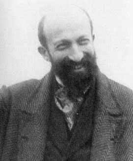
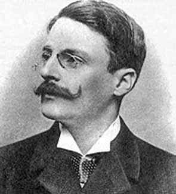
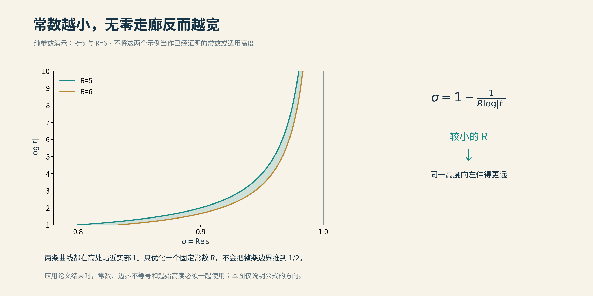
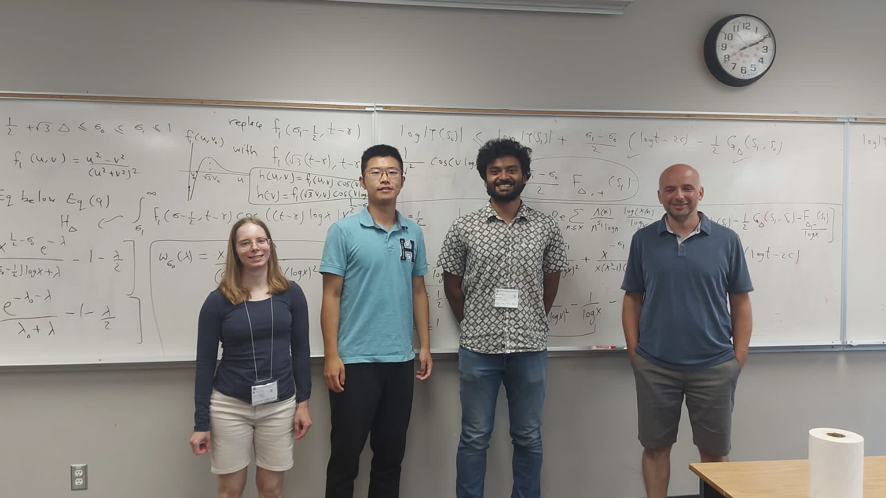
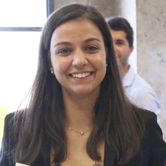
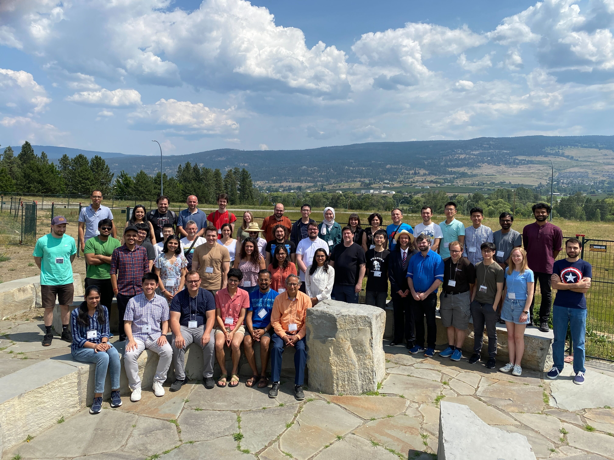

# 05 无零点区域的拓展

从5.69693到4.896，数学家走了二十一年。

若只看这两个数字，实在不像什么壮举。计算器随手一减，连1都不到。可在这不到1的距离里，藏着几代人的办法、几十页的不等式，以及许多个不肯下班的小数点。

他们究竟在做什么？

上一章，我们请那些可能偏离临界线的零点少来一点。这一章，要求更坚决：**有些地方，一个也不许来。**

这片被证明没有零点的地方，就叫无零区域。边界每向左移动一点，零点可能藏身的天地便少一点，素数世界也就多一分可以把握的秩序。

故事得从十九世纪讲起。那时没有电脑，小数点还没有这么长，人的胡子倒是留得很有耐心。

## 双峰并峙

1896年，法国的雅克·阿达马（Jacques Hadamard）与比利时的德拉瓦莱·普桑（Charles de la Vallée Poussin），各自证明了素数定理。

它回答的是一个朴素的问题：数到一个很大的数，途中大约会遇见多少个素数？此前，人们已经猜出了答案的模样；这一年，猜测终于有了证明。

两个人当时都只有三十岁上下。我们在旧照片里见到的庄严面孔，很容易让人忘记：历史上的大师，也曾是刚刚走到舞台中央的年轻人。

*阿达马。来源：[圣安德鲁斯大学MacTutor历史图片档案](https://mathshistory.st-andrews.ac.uk/Biographies/Hadamard/pictdisplay/)。原页未注明这张照片的拍摄年份。*

阿达马小时候，先显露出来的倒是希腊文与拉丁文的天分。算术一度不太出色，后来遇到好老师，才渐渐转了方向。长大后回忆往事，他把自己说得几乎是班里的算术差生；传记作者又替他查了查，发现他的记忆颇有些谦虚过头。

连大师的童年，也不能只听大师自己讲。

普桑的来路同样并非笔直。他先学工程，拿到文凭后仍放不下数学，转身又走了一条路。父亲是鲁汶大学的地质学教授；父亲研究脚下的土地，儿子后来研究素数的疆域。

*德拉瓦莱·普桑。来源：[圣安德鲁斯大学MacTutor历史图片档案](https://mathshistory.st-andrews.ac.uk/Biographies/Vallee_Poussin/pictdisplay/)。照片不是1896年发表证明时的现场记录，拍摄年份未详。*

两份证明在同一年抵达。据普桑文集的历史介绍，阿达马校阅自己论文的清样时，收到了普桑论文的第一部分。

没有即时通信，也没有预印本服务器。两条独立走来的路，在寄到的纸页上相遇了。

他们跨过的关键关口，是证明ζ函数在实部等于1的直线上没有零点。黎曼假设要求零点全部站到1/2线上；证明素数定理，却还用不着走那么远。

先守住右边这一道门，素数的总体秩序就能成立。

这是数学里颇值得宽慰的一件事：最难的问题还没有解决，许多重要的事情，已经可以开始。

## 寸土之间

把临界带想成一幅向上无限延伸的长卷。左边标着0，右边标着1，中央画着1/2。

我们知道，非平凡零点都在这条带里。黎曼假设说，它们其实全在中央；无零区域的研究，则从右边那块已经有把握的地方出发，试着向左再清出一条走廊。

1899年，普桑进一步给出了经典形状的无零区域。它不是一条宽度固定的直道：向上走得越高，能够保证安全的宽度越窄。

常见的写法是：从规定的高度开始，

$$
\sigma>1-\frac{1}{R\log|t|}
$$

这一侧没有ζ零点。

暂且不用被符号拦住。σ是横着的位置，|t|是离实轴的高度；log是自然对数。**这句话只说了一件事：在每个高度，我们能从右边往左清出多宽的一条带。**

宽度就是1除以“R乘以高度的对数”。所以R越小，清出的地方越宽。这里的纪录像百米赛跑，数字往下走，成绩才往上走。

*同一高度上，R=5比R=6清出的区域更宽。图中的5与6只是演示参数；纵轴采用高度的对数。本项目原创；[作图说明](img/README.md)。*

这条走廊很长，长到没有尽头；宽度却越来越吝啬。

正因为如此，“所有足够高的地方都成立”是一项分量很重的承诺。电脑检查到再高的地方，头顶也还有无穷多的天空。证明必须把那些尚未算到、也永远算不完的地方，一并照顾到。

后来人们又提出更具体的要求：别只说存在一个常数，请告诉我它到底是多少，从多高开始有效。

从“前面有路”，到交出可以照着走的地图，这便是“显式”二字的意思。

## 三、四、一

怎样证明一片地方没有零点？

总不能让电脑在地图上挨个敲门。点有无穷多个，敲门的人先退休了，第一条街还没查完。

古典证明的办法，是给零点设一道逻辑上的关卡：假定它在那里，便会使一个本来不可能小于零的量，偏偏变成负数。

入口出奇简单，只用到高中学过的余弦：

$$
3+4\cos\theta+\cos2\theta
=2(1+\cos\theta)^2\ge0.
$$

右边是一个平方乘以2，怎么也不会是负数。左边于是有了一个很牢靠的保证：无论角度怎样变化，三部分按3、4、1搭配，总和都不会跌破零。

这与素数有什么关系？

ζ函数有一种经过变换的表达，可以从两面来看。一面写的是素数及其幂的加权总和；另一面写的是零点、极点和一些可以估计的项。它像一本双语账簿，同一件事，在两页上用不同的语言记账。

把刚才的余弦组合放进素数这一页，每一项都乘上非负的权重，于是整本账的总数必定不小于零。

再翻到零点那一页。

零点越靠近我们选取的观察位置，就会带来一个越强的负贡献。实轴上1处的极点则提供一个正贡献。古典办法的妙处，是把它们安排进同一个组合：如果有零点恰好站在实部1的线上，逐渐靠近观察时，它带来的负项至少有“4份”，极点提供的正项却只有“3份”。其余部分救不了场，总数便要跌成负数。

一页说不能为负，另一页说必须为负。

账对不上，假设的零点就不能在那里。

再把其余各项估计得细一些，还能证明：零点不但不能站在那条线上，也不能挤得太近。右侧的无零走廊，就这样一点点被清了出来。

这也解释了为什么数学家会对一串余弦系数如此上心。3、4、1是最容易说明白的一组，却未必最省力。换上更多项，调整各自的分量，有时就能让目标零点更突出，让其他项少占一点预算。

有点像录音：主角已经开口，周围却坐着一屋子爱插话的人。麦克风的方向稍微调一调，便可能多听清半句话。

计算机可以帮忙寻找更合适的组合，但最后仍要证明它处处非负。只在屏幕上看见曲线没有跌下去，还不够。采样点之间，也属于数学家的责任范围。

## 另有青山

到了1958年，维诺格拉多夫与科罗博夫走出了另一条重要路线。

他们改进了对振荡和的控制。许多项各自并不小，加起来却可能互相抵消；若能把这种抵消估计得更准，就能更好地约束ζ函数在右边界附近的增长，再借复分析把这种约束变成新的无零区域。

上一章那些转着方向、彼此抵消的箭头，在这里又有了用武之地。

变化发生在边界的形状上。经典公式的宽度，分母里有一个“高度的对数”；新办法把它的主要幂次从1降到2/3，同时添上一个增长更慢的修正因子。具体式子可以先不记，记住结果就够了：**走得足够高时，新走廊收窄得更慢，留下的安全地带也更宽。**

一个改的是尺上的刻度，一个改的是边界弯曲的方式。

不过，无穷远处占优，并不保证从家门口开始就占优。新公式还带着自己的常数，在某些高度，旧办法反而更好用。实际计算时，数学家会把不同方法接在一起，哪一段更有力，就让哪一段上场。

这条路线后来称为维诺格拉多夫—科罗博夫型无零区域。它与经典路线并行生长，各有自己的山口，也各有后来者。

历史没有把旧路封起来。许多需要明确数值的应用，仍要从那里经过。

## 小数点里的春秋

2005年，哈比巴·卡迪里（Habiba Kadiri）发表了一篇论文，把经典型常数推进到5.69693。

她把此前两种加权思路结合起来：一种调节较小整数的贡献，另一种让较大整数的贡献平缓地收尾。两者照顾的是不同地段，放在一起，便能少浪费一些估计的余地。

所谓改进常数，往往就是这样。纸面上只换了几个数字，背后的工具却重新装配过了。

卡迪里在法国求学，2002年取得博士学位，后来到蒙特利尔做博士后，2007年加入加拿大莱斯布里奇大学。她研究零点，也参与建立数论研究群体，指导学生，把更多年轻人带到这些问题面前。

2023年，她面向公众作了一场题为“数学中的韧性”的讲座。话题包括数学焦虑，以及怎样面对那些久攻不下的问题。

这倒比一张满是奖项的履历更亲切。小学生会被一道题困住，数学家也会；只是数学家的那道题，有时已经困住了好几代人。

*卡迪里2023年1月26日公开讲座“Resilience in Mathematics”的官方视频封面，含户外人物照。来源：[莱斯布里奇大学活动页](https://www.ulethbridge.ca/public-professor/public-professor-series-dr-habiba-kadiri)及其链接的讲座视频；不是讲座现场截图。*

接力很快继续。迈克尔·莫辛霍夫（Michael Mossinghoff）与蒂姆·特鲁吉安（Tim Trudgian）搜索更合适的非负三角多项式，也重新处理误差项，在2014年公布、2015年发表的工作中，把常数推进到5.573412。

后来安德鲁·杨（Andrew Yang）加入合作。三人2022年公布、2024年发表的论文，又得到5.558691，并改进了另一种形状的无零区域。

到这里，读者大概已经开始替他们着急：忙了这么久，小数点前面怎么还是5？

特鲁吉安显然很懂这种心情。2023年，在加拿大举行的显式数论暑期学校上，他给自己的报告起了个题目：

**“Not Another Improvement in Some Random Constant...”**

不妨译得随意一点：“可别又是改进某个莫名其妙的常数……”

研究者先替听众把槽吐了，接下来才好解释，那个常数为什么并不莫名其妙。

*2023年7月，加拿大不列颠哥伦比亚大学奥肯那根校区，“Inclusive Paths in Explicit Number Theory”暑期学校的研究小组合影。来源：[BIRS官方相册](https://www.birs.ca/files/workshops/UBCO/2023/23ss001/index.html)。相册未逐一标注姓名，这里保留场景，不猜认人物。*

这些照片里没有奖台，白板上倒是一点也不冷清。

一条定理写进书里，常常只有一个年份、几个姓氏。真正发生过的数学，要拥挤得多：有人讲课，有人提问，有人把一个式子擦掉，换一种写法再算。

小数点向前走的时候，身后是许多人。

## 后浪入海

新一代的名字，也渐渐出现在论文首页。

基娅拉·贝洛蒂（Chiara Bellotti）2019年在比萨大学完成本科，2022年取得硕士学位，随后赴新南威尔士大学堪培拉校区攻读博士。2023年，她已经发表预印本，改进ζ函数的显式增长估计，并由此扩展维诺格拉多夫—科罗博夫型无零区域。

从学生证到定理，并没有一道必须等到毕业才能跨过的门槛。

她把有关常数从55.241推进到预印本中的54.004；后续正式结果及进一步改进另有更新。这里的五十多，与前面经典公式里的五点多，装在不同形状的公式里，不能拿来直接比大小。

数学里的数字也认上下文。脱离公式比纪录，就像拿摄氏度去参加百米赛跑。

*贝洛蒂。来源：[新南威尔士大学博士研究生资料页](https://www.unsw.edu.au/hdr/chiara-bellotti)。这是她求学阶段的校方资料照，不代表其2026年仍处于同一学籍状态。*

2026年3月，贝洛蒂、特鲁吉安与杨合作公布《受希思—布朗工作启发的无零区域》。经典型公式里的常数，这次到了4.896，结论适用于高度至少为3的范围。

那篇论文开头，还给希思—布朗写了几行押韵的献词。正文是不等式，抬头却有一点诗意。新办法借用了前辈的思想，论文也没有忘记向来路致意。

这一次的重要改进，是更有效地组合加权方法。原先分开估计的对称零点，可以配成一对来处理，少丢掉一些有利的信息；经过适当平滑，观察位置也能移进已经证明安全的区域，靠近下一段尚待排除的地方。

它的直觉像修路：先在已铺好的地面站稳，再向前铺一截；新铺的一截，又成为下一步的立足处。每次推进都有前一步的证明托底，并不是先把想要的结论当作已经成立。

这样的推进也会渐渐放缓，最后停在方法所能到达的地方。不会因为多运行几遍，就一路走到临界线。

从2005年的5.69693到2026年的4.896，在同一高度比较，经典公式保证的宽度增加了约16%。这是走廊宽了16%，并不是黎曼假设完成了16%。至于更强输入能带来的4.8594，论文也有讨论；这里记下的是它着重展示的4.896这一步。

我们的目光往往被终点吸引。可若把每一步都省略，只留下最后的赢家，历史便成了一张领奖名单。

*2023年“显式数论中的包容之路”暑期学校合影。卡迪里参与组织，特鲁吉安等人授课；活动安排从课程学习走向合作研究。照片记录的是这场暑期学校，不是2026年论文的合作现场。来源：[BIRS活动页](https://www.birs.ca/events/2023/summer-schools/23ss001)与官方相册。*

## 纸上有山河

绕了这么远，最后还是要回到素数。

为什么一条细窄的无零走廊，值得这么多人费心？因为零点的位置，关系着素数计数的误差。

可以把素数定理看成一份总量预报：范围扩大时，素数大致按什么规律出现。零点则带来起伏，使实际数量偏离那条平滑的预报曲线。

一个零点的横坐标越靠近1，它可能造成的起伏就越难压下去。

在一种常用的加权计数里，素数及其幂按规定的分量入账，预报的主项是x。只看零点贡献中的幂次，横坐标0.9对应的影响含有x的0.9次方，横坐标0.99对应的则含有x的0.99次方。相对于主项，后者缩小得更慢。完整估计还要计入高度、分母和许多零点的共同作用，但这个比较已经说明：越靠右的零点，越让误差估计头疼。

无零区域就是提前划掉一批最难对付的可能性。它告诉我们，某些过于靠右的零点根本不会出现，于是能够把素数预报的误差压得更紧。再把数值写明确，就可以算出从哪个范围开始，预报有多可靠。

这一点改进，有时还能传到别的问题里：一个区间多长才能保证有素数，一份估计从多大开始才真正管用。复平面上挪动的一条细线，最后会落到整数世界的具体问题上。

原来，小数点也有它的山河。

当然，经典边界还有一个始终不肯让步的地方：无论把固定的R磨得多小，向无穷高处走去，它终究还是越来越贴近实部1。要抵达中央的1/2线，需要进一步改变方法，而不只是接着往小数点后添数字。

到2026年秋天，关于固定无零半平面的新材料，又把故事带向了另一处转折。那一页留给后面的AI篇。本章先记住此前的长路，记住那些把“存在”写成数字，又把数字一点点改好的人。

无穷太远，人的一生太短。

有人在边界上留下自己的名字，有人留下一个后来被改进的小数。新的论文会把旧的纪录向后推，却仍要在参考文献里，回头认一认来时的路。

下一章，我们把目光从边缘移到中央。那里还有另一群人，正设法证明：已经站在临界线上的零点，比我们原先知道的更多。

[全书目录](../README.md) · [本篇目录](README.md) · [上一节](04_零点密度新估计.md) · [下一节](06_临界线上的零点比例.md)
