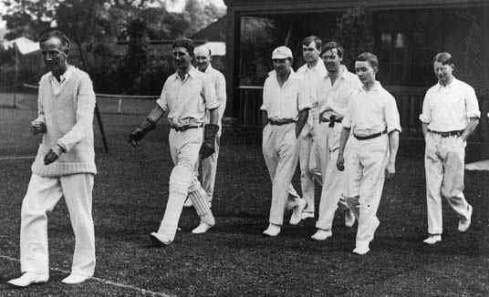
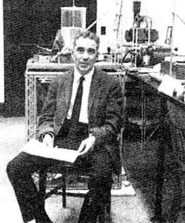
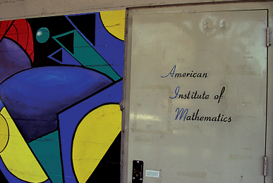
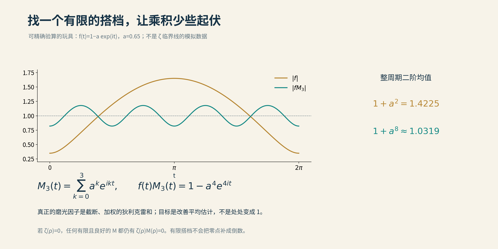

# 06 临界线上的零点比例

四十一分。

若写在大学试卷上，大约要准备补考；若写在黎曼假设的研究史上，却足以让一篇论文留下姓名。

2010年，三位数学家宣布：他们能保证，至少41.05%的非平凡零点落在临界线上。

距离康瑞把比例推过四成，已经二十一年。

这里的百分数，需要稍稍换一种读法。计算机在严格验证过的巨大有限范围内，看到的零点全部在线；数学家追问的，却是把搜索范围一直推向无穷以后，究竟还能保证多少。

一张没有尽头的名单，无法等点完名再交卷。他们得从函数的整体结构里，提前读出一个比例。

这一章，就从那些缓慢移动的小数说起。

## 无穷也嫌少

1914年，哈代证明：临界线上有无穷多个零点。

听上去，已经很接近胜利了。可无穷这个词，向来不肯替人把话说满。

平方数1、4、9、16……也有无穷多个；但前一百万个正整数里，只有一千个平方数。范围越大，它们所占的比例越小，最终趋向于零。临界线上即使站着无穷多个零点，也可能只是整支队伍里越来越稀疏的一列。

*哈代带领“The Mathematicals”出场，对手名叫“The Rest of the World”——“世界上的其他人”。队名已经很有气势；数学里的“其余所有”，却没有那么容易拿下。照片出自[圣安德鲁斯大学MacTutor档案](https://mathshistory.st-andrews.ac.uk/Biographies/Hardy/pictdisplay/)，拍摄年份未标。*

1942年，塞尔伯格又向前一步：在线零点至少占某个固定的正比例。队伍再长，这一份也不会被冲淡到零。

1974年，莱文森把保证推进到超过三分之一。

莱文森原本学的是电气工程。学生时代，他替维纳检查书稿，发现证明里有一处缺口，便补上一个引理。按他后来的回忆，维纳随即坐到打字机前，把引理打出来，署上这位学生的名字，寄给了期刊。

老师亲自打字，学生从此改行。若说人生也有函数方程，这一页，大约就是两边开始相等的地方。

*手持文稿的莱文森，身后仍是工作的日常。照片出自[MacTutor档案](https://mathshistory.st-andrews.ac.uk/Biographies/Levinson/pictdisplay/)，未标年份与具体场合。*

他在微分方程等领域耕耘多年，晚年重新走回数论。三分之一的成果发表后，1975年，他因脑瘤去世。人停在六十三岁，方法却继续向前。

1989年，康瑞把比例推过五分之二；更具体地说，达到至少40.88%。此后的许多年，后人都在这套方法里添砖、换梁，寻找还能打开的窗。

要懂这门手艺，可以先记住一个很朴素的事实：一条连续曲线从零的上方走到下方，中途总得穿过零。

临界线上的ζ函数经过适当调整，可以变成这样一条实值曲线，而且不改变零点的位置。由“变号”寻找零点，是一个自然的入口。困难在于：我们不能只看画出来的那一小段，还要对无限远处作出保证。

## 二十一年，一小步

2010年的新论文，署名是Hung Bui、Brian Conrey和Matthew P. Young。2011年，它正式发表。

康瑞仍在队伍里。1989年留下的那道刻痕，二十一年后，他又和年轻的合作者一起往前挪了挪。

Bui于2008年在布里斯托大学取得博士学位，随后到牛津做博士后。新论文公布时，离他毕业不过两年。研究履历才翻开几页，面对的却是一份跨越百年的旧账。

*Hung Bui。照片及履历来自[曼彻斯特大学](https://research.manchester.ac.uk/en/persons/hung.bui/)；此图不作为2010年合作现场。*

这一次，40.88%变成了41.05%，相差0.17个百分点。

小数点不动声色，纸上的工作却不少。作者在导论里坦言，这类问题有一种特别磨人的地方：一个新想法究竟能不能带来进步，往往要先做完一大批计算才知道。

灵感来了，还不能庆祝。得先算算，它是不是白来一趟。

康瑞对合作并不陌生。他自1997年起主持的美国数学研究所AIM，早年的地址颇有些大隐隐于市的意思：它设在硅谷一家Fry’s电子卖场建筑的仓储空间里。2005年的《美国数学会通讯》特写，留下了那扇低调的门。

*AIM早期入口。图取自Allyn Jackson的[2005年实地报道](https://aimath.org/news/fea-aim.pdf)，第1331页；原刊内嵌图片提取，保留完整画面。*

卖场里出售计算机，旁边的人研究计算机算不完的问题。门不大，胃口不小。

研究所支持者约翰·弗莱曾打过橄榄球，相信团队协作；这种做法起初也遭遇过数学家们的怀疑。几位高手围着同一道难题，未必立刻灵光乍现，却可能让一个人的盲点，恰好落进另一个人的视野。

临界线上的零点，当然不会因为人多就自动归队。三位作者真正带来的，是一个由两部分组成的新工具。

它有个不大威风的名字：磨光因子。

## 磨光的手艺

“磨光”听起来像木工活。它要对付的，确实也是起伏。

ζ函数在临界线附近忽高忽低。如果直接估计它的平均大小，少数特别高的尖峰会占掉很多分量；把这些估计再换算成零点数时，能够得到的保证便不够好。

这里有一座看不见的桥。莱文森型方法把ζ及其导数组合成一个辅助函数，再借助函数方程和复分析中的计数工具，把“能保证多少零点在线”转化为某些积分的估计。可以把它理解为：先估计有多少零点尚不能用这套方法确认在线，再从总数里扣除这份损耗。损耗的上界越小，留给在线零点的保证就越多。

所以，数学家想找一个搭档，乘上去以后，让需要估计的函数不再那么大起大落。这个搭档就是磨光因子。

先不管ζ，做一道中学代数题：

$$
(1-u)(1+u+u^2)=1-u^3.
$$

让u取0.1，左边第一个因子离1还差0.1；配上后面的有限和，乘积离1就只差0.001。原先的缺口，被推到了更小的三次方里。

添上更多合适的项，还能把误差往后推。这里“合适”两个字很要紧：随手添几项，未必是修整，也可能是在添乱。

*同一种有限抵消的思路，也可以用来压低周期波动。图中的金色曲线起伏较大，青色曲线更接近1。此为本项目原创玩具模型，并非ζ函数的真实数据；[计算细节](../资料/06_临界线上的零点比例/03_数学解释与科普参考.md)。*

真实的磨光因子，比这个小例子精细得多。它模仿倒数，却只取有限项，并给各项安排权重，争取在整体平均上抵消一部分波动。它不能在零点处真的变成倒数，更不会把原来的零点擦掉。

所谓磨光，磨的是估计里的毛刺。

至于为什么不把和式写得越长越好，也有个可想象的原因。把一堆振荡相乘、再取平均，不但要算每一项自己，还要算它们两两相遇的影响。节奏相差大的，常常容易抵消；节奏十分接近的，却可能纠缠很久。

像两只走时略有偏差的钟。短时间内，看上去还很齐整；要等它们明显错开，得有耐心。

和式越长，这样的近邻就越多。于是，能写出一个漂亮的搭档，与能证明它确实帮了忙，中间还隔着一大片算不干净的误差。

## 两种声部

Bui、康瑞和Young没有只在旧和式的末尾接长一截。他们把两种不同结构的磨光因子放到一起，让它们共同工作。

这也不等于两份功劳直接相加。两种工具之间还会彼此影响；只有把这种交叉影响算清，才能知道它们是在合奏，还是互相拆台。

他们证明相应的平均估计，并调整权重，最终越过了41%这道门槛。

这项工作还给出另一份成绩：至少40.58%的非平凡零点，既在线上，又是单零点。所谓单零点，是函数在那个位置只消失一阶；把零点想成曲线过零时最普通的一次穿行，可以帮助理解，但严格定义还要看导数。

两个成绩不能混用。在线，不自动等于单；黎曼假设本身，也没有包办“所有零点都是单零点”这另一件事。

而这些百分数，都按高度趋于无穷的意义理解，分母按重数统计全部非平凡零点。它们不会保证，你随手截取一小段，就恰好看见这个比例。

从此，再读“四成”二字，就知道里面并非只有四成的故事。

## 从交易室到黑板前

到了下一轮推进，作者名单又长了一些：Kyle Pratt、Nicolas Robles、Alexandru Zaharescu和Dirk Zeindler。

罗夫莱斯的履历，颇不像一条直线。他学过数学和物理，也曾在伦敦、苏黎世的投资银行工作；后来回到研究生院，转入解析数论。伊利诺伊大学2015年的系刊介绍，还认真列出了他工作过的银行。

从金融市场走到临界线，百分数倒是一直跟着他。只是后者涨起来，实在有些慢。

*Nicolas Robles。照片来自[个人网站](https://www.nicolasrobles.com/)，求学和银行经历可见伊利诺伊大学[2015年系刊](https://math.illinois.edu/system/files/inline-files/mathtimes-fall15-web.pdf)第7页。*

2015年取得博士学位后，他在伊利诺伊大学做研究，也为Wolfram从事程序开发。黑板与代码，并不是这项研究到最后才临时找来的邻居。

这条路上，还有一段值得停下来看的插曲。冯绍继此前提出过新的磨光构造，但它允许取多长、相应误差能否压住，经历了后续检查与修补。Pratt和Robles在2018年发表的工作中，改进了这一步的分析，使原先通向超过41.28%的那组参数得到支持。

好点子需要人提出，也需要有人把承重的部分一寸寸验过。数学论文的页脚下面，偶尔藏着几年工期。

四人合作的下一项工作于2018年公布，2020年正式发表。论文标题选了一个很整齐的分数：超过十二分之五。

换成百分数，是41.666……%。而文中具体参数其实走得更远：在线比例下界超过41.7293%。标题用了一个好记的路标，计算还往前走了一小段。

## 量体裁衣

这一回，改进不只在于工具更长，还在于先问了一遍：究竟要给谁配搭档？

前面说过，计数时用到的辅助函数，往往已经把ζ和它的导数组合在一起。导数记录函数怎样变化。既然被估计的对象已经换了，磨光因子若仍只照着ζ本身来设计，就未必最合身。

四位作者研究更灵活的构造，把这些变化信息也编进搭档之中，并证明相应的平均公式。

可以把它想成裁衣：量的不仅是身高，还要看肩背、袖口与人的动作。布料多一些有帮助，剪裁对不对也同样要紧。这里的裁剪当然是比喻；真正落在纸上的是系数、导数，以及它们之间可以严格控制的抵消。

方法里也有猜想的影子。一些来自“比值猜想”的计算规则，能够提示复杂平均可能长成什么样，帮助研究者挑选方向。但这篇论文给出的比例改进是无条件结果：启发可以先借，证明仍要补齐。

猜想负责指路，不能替桥梁签验收单。

*2018年，伊利诺伊州厄巴纳。Kevin Ford与他的博士生Kyle Pratt、Xianchang Meng、George Shakan合影。照片来自[Ford本人的相册](https://ford126.web.illinois.edu/Gallery_of_Mathematicians/index.html)。论文之外，也有这样坐在一起的时刻。*

四人论文首次公布时，Pratt还在读博士；他到2019年才毕业。旧问题没有等人资历齐全，再准许他们走近。

到了实际计算，研究者还要在许多可调参数中寻找有效组合。论文致谢里因此出现了一个不在首页作者名单上的名字：伊利诺伊几何实验室的Matthew Faust。他帮助编写了产生这些结果的代码。

一篇研究无限的论文，最后也要有人把程序写对。

这正是现代数学工作里不那么上镜的一面：推导打开可选择的空间，计算寻找较好的位置，严格估计再确认脚下确实站得住。灵感、手算和代码各有一份工作，没有哪一份可以只凭热闹交差。

小数点后面的几位数，由此有了人的温度。

## 几乎，也是距离

读到这里，大概会生出一个期待：再往前推进，等哪一天做到100%，黎曼假设就该结束了吧？

偏偏，比例意义上的100%，仍可能留下例外。

再看正整数。非平方数所占的比例趋于100%，却没有因此消灭1、4、9、16……这些平方数。它们依旧无穷无尽，只是越来越稀。

*四幅点阵展示1—64中的不同选择；标注的比例指范围趋于无穷后的极限。非平方数占比趋于1，仍遗漏无穷多个平方数。图为整数类比，不代表ζ零点分布。*

所以，这条路线可以取得越来越强的总体保证，却不能仅凭一个趋于100%的比例，排除所有离线零点。黎曼假设要的是每一个都在；“几乎”二字再轻，夹在中间，也有分量。

但这并不抹去那些小数的意义。它们让我们看见：不用逐一找到无限多个对象，也能依靠结构、平均与抵消，说出整个群体的一些事情。

1914年的无穷多，1942年的正比例，1974年的三分之一，1989年的四成，再到新世纪的小数点。数字排得下一行，人的一生却放不进去。

2026年8月，Alpöge与Furman的公开预印本又写下一个新数：至少67.25%的非平凡零点，既是单零点，又在临界线上。那项工作，以及它所带来的研究方式的变化，留到第四篇再说。

此刻，先把这一页翻过。

小数之外，临界线还在那里。

*本章[论文、人物故事与视频素材底稿](../资料/06_临界线上的零点比例/README.md)，集中保存出处、版本和未收入正文的材料。*

[全书目录](../README.md) · [本篇目录](README.md) · [上一节](05_无零点区域的拓展.md) · [下一节](07_德布鲁因–纽曼常数.md)
