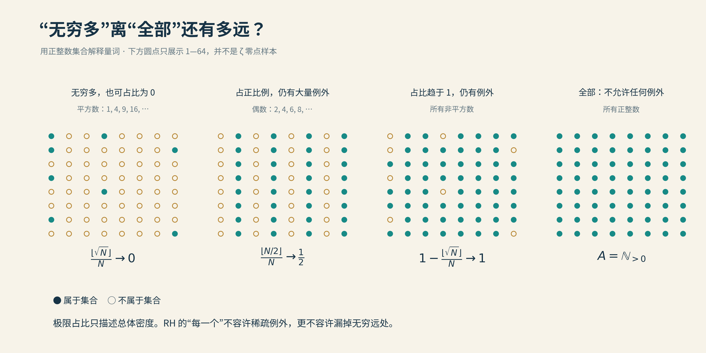

# 06 临界线上的零点比例

“超过四成的零点已经在临界线上了。”

这句话很容易让人误会，仿佛有一张名单，数学家逐一核对，给其中四成盖了章，剩下的还在排队。实际情况几乎相反：在严格验证过的巨大有限范围内，零点全部在线；而“四成”说的是把高度不断推向无穷之后，理论上能够保证的总体比例。

名单没有列完，比例却能估计。这正是分析方法擅长的事情：它不一定告诉我们每一位乘客坐在哪里，却能由车厢的结构推断，某一区域至少坐了多少人。

这一节讲的是从二十世纪积累而来的比例方法，以及2010年至2020年前后的几次改进。2026年的新突破留到第四篇。先知道旧工具究竟在计算什么，才看得清后来跨过的门槛。

## 分母究竟是什么

记$`N(T)`$为所有满足$`0<\mathrm{Im}\rho\le T`$的非平凡零点数，按重数计算。黎曼–冯·曼戈尔特公式给出

$$
N(T)=\frac{T}{2\pi}\log\frac{T}{2\pi}
-\frac{T}{2\pi}+O(\log T).
$$

这里的$`O(\log T)`$表示误差的绝对值不超过某个常数乘以$`\log T`$，对足够大的$`T`$成立。主项比误差大得多，因此虽然我们未逐个找到高度$`T`$以内的零点，仍能相当准确地知道它们有多少。

再记$`N_0(T)`$为其中落在$`\mathrm{Re}s=1/2`$上的零点数，同样按重数计算；记$`N_0^*(T)`$为其中既在临界线上、又是单零点的个数。单零点表示函数在那里只消失一阶，即$`\zeta(\rho)=0`$而$`\zeta'(\rho)\ne0`$。

相应的两个下极限是

$$
\kappa=\liminf_{T\to\infty}\frac{N_0(T)}{N(T)},
\qquad
\kappa^*=\liminf_{T\to\infty}\frac{N_0^*(T)}{N(T)}.
$$

它们满足$`0\le\kappa^*\le\kappa\le1`$。若证明$`\kappa\ge c`$，意思是对于任意小的$`\varepsilon>0`$，从某个高度起，在线比例总不少于$`c-\varepsilon`$。这不是承诺每个有限高度都达到$`c`$，也不必先证明比例本身有极限。

重数不能省略。假如某个在线零点是二重的，它给$`N`$和$`N_0`$都贡献2，却不给$`N_0^*`$贡献任何东西。证明在线，与证明既单又在线，难度和命题内容都不同。黎曼猜想本身也不要求零点全为单零点；人们广泛相信的单性，是额外的一项性质。

还有一个容易被忽略的逻辑细节：即使某天证明$`\kappa=1`$，单凭这个比例等式仍不能推出黎曼猜想。离线零点可以有有限多个，也可以有无穷多个但只占零密度。十亿张白纸里夹一张黑纸，黑纸的占比很小；把总张数送到无穷，也不会使那张纸在逻辑上消失。

*正整数中的平方数无穷多，却占比趋于0；偶数占一半；非平方数占比趋于1，却仍遗漏无穷多个平方数。RH要求“全部”，比任何允许例外的渐近比例都严格。图中圆点展示正整数1—64，而不是ζ零点。*

## 从变号到计数

在临界线上，ζ一般是复数。不过乘上一个适当的相位，可以得到实值的Hardy函数

$$
Z(t)=e^{i\vartheta(t)}\zeta(1/2+it),
$$

其中$`\vartheta(t)`$来自函数方程中的伽马因子。对实$`t`$，$`Z(t)`$取实值，而且乘上的相位不为零，因此它的实零点恰好对应临界线上的ζ零点。

这让问题看起来熟悉许多。一条连续实曲线若从正变负，中间必定经过零。Hardy在1914年证明临界线上有无穷多零点，后来Selberg证明其中有一个正比例。Levinson在1974年把可证明比例推进到超过三分之一，Conrey在1989年推进到超过五分之二。

现代比例方法并不只是把实曲线画得更长，再统计变号。变号会漏掉偶数重的零点；而只靠肉眼或有限采样，也不能给出无穷高度的比例保证。研究者需要利用函数方程、辐角变化、辅助函数与积分估计，在整体上控制零点数。

辐角原理提供一种桥梁：沿闭合曲线走一圈，记录一个亚纯函数的复数值绕原点转了多少圈，可以知道曲线内部的零点数减去极点数。Levinson型方法选择由ζ及其导数组成的辅助函数，把“有多少零点能在线上得到保证”与“辅助函数在邻近区域内有多少零点”联系起来。后一个问题再通过对数积分与均值估计来控制。

这条链条并不短。它解释了一个初看反常的安排：为了证明ζ在某条线上经常为零，数学家却花很大力气估计某个函数平均有多大。

## 给波动找一个搭档

ζ在临界线附近的波动很不均匀。有时很小，有时异常大。如果直接估计平均值，那些大峰会增加成本，使我们从整体信息中提取零点数量时损失太多。磨光因子，英文叫mollifier，是为改善这个局面而设计的搭档。

在$`\mathrm{Re}s>1`$时，有

$$
\frac1{\zeta(s)}=\sum_{n\ge1}\frac{\mu(n)}{n^s},
$$

其中$`\mu(n)`$为莫比乌斯函数：若$`n`$含有某个素数的平方因子，取0；若$`n`$由$`k`$个不同素数相乘而成，取$`(-1)^k`$；$`\mu(1)=1`$。这个公式来自欧拉乘积逐项展开。

若真能在需要的区域里毫无代价地乘上$`1/\zeta(s)`$，乘积便恒为1，波动当然消失了。可在零点附近，倒数本身有极点；而这正是我们正在研究的位置。不能先使用一个处处良好的倒数，再把“处处良好”作为结论领回来。

实际的做法是截断并加权。例如，一个最基本的模型是

$$
M(s)=\sum_{n\le y}\frac{\mu(n)}{n^s}
P\left(\frac{\log(y/n)}{\log y}\right),
\qquad y=T^\theta,
$$

其中$`P`$是适当的多项式，通常设置$`P(0)=0`$、$`P(1)=1`$等边界条件。它是有限和，没有倒数在零点处的极点。我们希望$`\zeta(s)M(s)`$在平均意义下比较接近1，至少比ζ单独出现时更好控制。

这里的“磨光”不意味着对每一个点都作同样程度的修整。$`M`$也不可能在ζ零点处神奇地补出一个有限的逆。它通过系数之间的算术抵消改善整体积分，目的是让均值估计更有效。

看一个简单的平均模型就能理解它想节省什么。若$`f(t)=1+e(t)`$，且$`e`$的平均约为零，那么

$$
\frac1T\int_T^{2T}|f(t)|^2 dt
\approx1+\frac1T\int_T^{2T}|e(t)|^2 dt.
$$

误差的平方平均越小，二阶矩便越接近1。Levinson型方法真正使用的函数与归一化更复杂，但让一个合适乘积的二阶矩降下来，确实能够改善最终的比例下界。

## 为什么不能把和式写得无限长

既然$`M`$在模仿倒数，多保留一些项似乎总会更好。问题是：我们不仅要写得出来，还要能证明相应的积分估计。

把$`|\zeta M|^2`$展开，会出现许多数项之间的交叉项。先看更简单的狄利克雷多项式

$$
A(t)=\sum_{n\le y}a_n n^{-it}.
$$

它的平方均值包含

$$
\int_T^{2T}|A(t)|^2 dt
=\sum_{m,n\le y}a_m\overline{a_n}
\int_T^{2T}e^{it\log(n/m)} dt.
$$

当$`m=n`$，指数恒为1，积分等于$`T`$，这叫对角项。当$`m\ne n`$，相位旋转带来抵消，但若$`m`$与$`n`$很接近，$`\log(n/m)`$很小，旋转会很慢。和式越长，接近的组合越多，非对角项就越难处理。

加入ζ、导数和更复杂的磨光系数之后，非对角结构进一步涉及算术相关、指数和与特殊和式估计。把$`y=T^\theta`$中的$`\theta`$往上加，可能增强磨光能力，也可能让证明所需的误差控制失效。这不是计算机内存不够，而是理论能否辨认足够细的抵消。

此外，最合适的搭档未必只模仿$`1/\zeta`$。辅助函数含有导数时，磨光系数也可以相应调整。不同片段分别处理不同结构，多片磨光因子之间还会产生交叉项。方法的进展既来自能处理更长的和，也来自知道该把什么放进和里。

## 从四成到十二分之五

Bui、Conrey与Young在2010年公布、2011年发表的工作，利用扩展的磨光结构，证明

$$
\kappa\ge0.4105,\qquad
\kappa^*\ge0.4058.
$$

因此，“超过41%的零点在线”是准确的简述；若说到41.05%这个更精确的数，应写“至少41.05%”。而“既单又在线”的下界是40.58%，不能把两个数互换。论文标题只能容纳一句话，数学结论通常比标题稍有耐心。

随后，Pratt、Robles、Zaharescu与Zeindler在2018年公布、2020年正式发表的工作，把在线比例下界提高到略大于

$$
\frac5{12}=0.41666\ldots.
$$

它研究更复杂的磨光系数和扭曲二阶矩，包括如何有效地处理ζ及多个导数的线性组合。某些组织计算的思想受到比值猜想研究的启发，但这里作为应用给出的比例改进是无条件结果。猜想可以提示该寻找什么公式；把误差证明到所需范围，则是另一份不能省去的工作。

从41.05%到超过41.66%，数字看起来只移动了一小段。若只看小数，会错过里面那些改变积分计算方式、延长可处理范围的步骤。研究者面对的是一个优化问题，但可供优化的空间本身也在变化。

同时，不应给方法瓶颈安上一堵未经证明的永久围墙。某类磨光因子、某种均值输入能够达到什么上限，是有具体条件的技术问题；它不能直接推出一切未来方法都不得超过某个比例。2026年的公开工作正提醒我们，历史纪录与理论禁令应当分别存放。

## 平均怎样回答一个精确问题

把这条路线再串起来看：先用函数方程和辅助函数建立零点计数关系，再把某些计数成本转为对数积分，继而用均值不等式控制积分，最后通过磨光因子降低均值。每一步都损失一些信息，也都有可能在未来找到更好的安排。

例如，对数是凹函数，在合适的正值积分中有

$$
\frac1T\int_T^{2T}\log|f(t)| dt
\le\frac12\log\left(
\frac1T\int_T^{2T}|f(t)|^2 dt\right),
$$

零点处可用标准的可积性或极限处理。这解释了二阶矩为何会进入对数计数论证，也显示均值越小，得到的控制越好。但从右边一个数到最终$`\kappa`$下界，还要经过具体辅助函数、位移参数和边界项，不能把这个不等式单独冒充整个比例证明。

平均方法的力量在于，它可以跨越无限范围，而不必先知道每个零点的位置。它的限制也在于，平均往往容许少量例外。我们从“四成”学到的，不只是一个百分数，还包括怎样以有限的分析信息，对无限多个零点作出保证。

到了2026年，Alpöge与Furman的公开预印本把“既单又在线”的比例推进到至少67.25%，其发现与核验过程又引出新的研究分工。这里先把它作为通往第四篇的路标，不把2020年的十二分之五留在“最新纪录”的位置上，也不把新结果压缩成一句机器替我们拧大了同一个旋钮。要解释它改变了什么，仍须回到具体论证。

比例、边界、重数，这几样东西至此已经分开。下一节将暂时不再数有多少零点在线，而是让整个函数随一个参数变形：如果把零点当作会运动的对象，它们保持在一条实线上究竟有多稳定？

[全书目录](../README.md) · [本篇目录](README.md) · [上一节](05_无零点区域的拓展.md) · [下一节](07_德布鲁因–纽曼常数.md)
