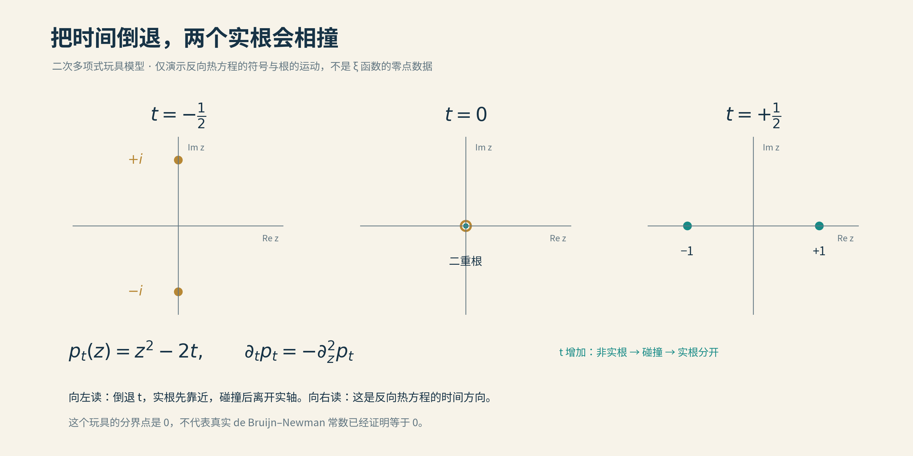
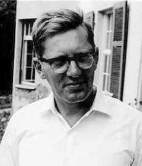
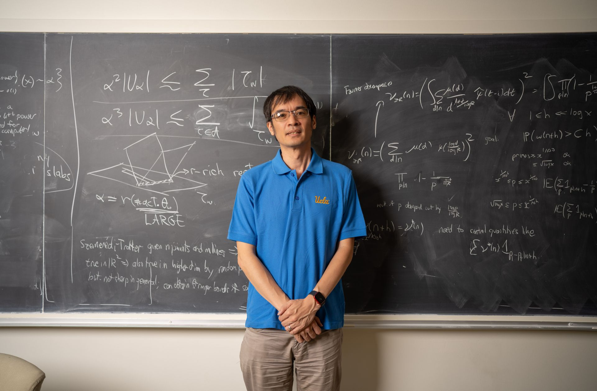
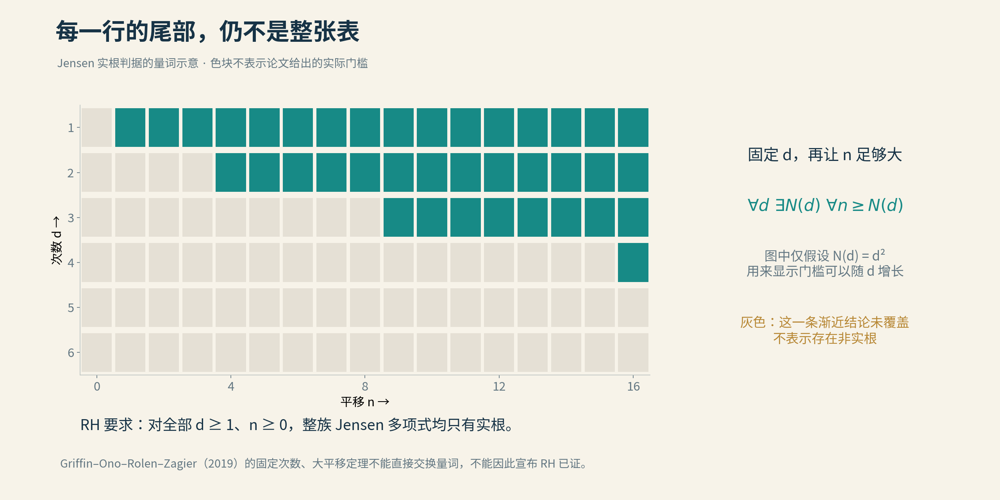

# 07 德布鲁因–纽曼常数

如果黎曼猜想是真的，它也只能勉强为真。

这句话听起来，像一位数学家熬过通宵之后，对上帝颇有微词。

然而，“勉强”两个字，后来竟成了定理。

2018年，布拉德·罗杰斯与陶哲轩证明：如果所有非平凡零点当真都站在临界线上，那么在一种特定的变形下，它们没有丝毫向后退让的余地。哪怕只把参数往回拨一点，也会有零点离开队伍。

我们追寻了一百多年的秩序，倘若存在，竟恰好站在失序的边缘。

要理解这件事，先得给静止的零点，借一点时间。

## 把时间借来

黎曼留下的是一个函数。后来的数学家却想：能不能把它放进一部电影里，看它的零点如何聚散？

这条路，波利亚在20世纪20年代便已探过。1950年，荷兰数学家尼古拉斯·德布鲁因进一步研究了这类变形。做法可以先用一句话说明：把原来的函数整理一下，再装上一个可以连续转动的旋钮。

整理后的函数叫ξ函数，它保留了我们关心的全部非平凡零点；再换个坐标，原来竖直的临界线就成了横着的实轴。于是，“零点全在临界线上”，变成“零点全是实数”。问题原封不动，只是换了个便于开工的姿势。

旋钮上的刻度记作t。t等于零，播放黎曼原来的那一帧；转到别的刻度，函数改变，零点也随之移动。

这种变化服从一个与热传导有关的方程，因此人们称它为“热流”。不过，按这里的记号，t增加对应的是**反向热方程**。它是一种数学时间，不能照着烧水、晾茶的经验去猜方向。

先看一部只有两个角色的小电影。零点由下面这个方程给出：

$$
z^2=2t.
$$

t等于二分之一，两个根是−1和1，都在实轴上。把时间往回拨，它们越走越近；到零时，在原点相逢。再往回，右边成了负数，实数的平方不够用了，两根便离开实轴，成为一对虚数。

*一部只有两个零点的“电影”：从左到右，t依次为−1/2、0、1/2。正文倒着播放，演示实根如何相遇后离开实轴。这是教学模型，并非黎曼零点的实测运动。*

**全都在线，不等于还能往后退。**

小电影只演这一件事。真正的ξ函数有无穷多个零点，演员多了，剧情也就难以收拾。

## 一线之隔

德布鲁因证明，只要把旋钮转到二分之一或更大的位置，所有零点就都在实轴上。而且，一旦某个时刻已经全是实根，继续向前，这种性质便能保持。

1976年，查尔斯·纽曼补上另一侧：不能无限向后退，总有一个有限的分界时刻。

两人的名字，于是被一枚希腊字母连了起来：Λ，德布鲁因–纽曼常数。它标记着“全部零点都是实数”的起点。到达它，或者越过它，全都在线；尚未到达它，就会有零点在外面。

黎曼猜想问的，恰好是零时刻。

如果分界点在零的左边，或者正好等于零，黎曼猜想就成立。若分界点还在零的右边，那我们来早了：原函数里已经存在离线的零点。

纽曼却提出一个颇有锋芒的猜想：分界点不可能在零的左边。

别人替黎曼猜想寻找余地，他偏要证明它没有余地。两者若都正确，分界点便只能恰好落在零上。

*德布鲁因，MacTutor档案照片，拍摄年月未标。除了零点，他还关心数学证明如何交给机器检查。*

这位荷兰数学家的兴趣，远不止一个常数。1968年，他已经在开发Automath，让证明写成计算机能够核查的形式。那时，计算机连办公室都还没有普及，数学家已经替它安排起了审稿的差事。[原始报告与亲历回忆](../资料/07_德布鲁因–纽曼常数/02_人物与故事.md)

半个多世纪后，机器又走回了这条路。此刻先记住这个伏笔。

## 相逢太近，退路太短

如何知道那条分界线在哪里？

最早的一条线索，藏在挨得特别近的零点之间。

在刚才的小电影里，两根越靠近，倒退到碰撞所需的时间就越短。真正的零点群也有相似的性情：某些异常亲近的零点对，能限制它们在过去保持实根的时间。这类近邻中，著名的便有“莱默对”。

当然，两颗零点并非独处。周围无穷多个邻居都在影响它们，必须把这些作用估计清楚，小间距才能兑换成严格的下界。

从20世纪末到新世纪，计算不断找到这样的线索。2011年，Saouter、Gourdon与Demichel把下界推到约负的一千亿分之一。上方则有Ki、Kim与Lee在2009年的结果，把早年的二分之一上界严格向下推进了一步。

零越来越近。

但负数后面添再多位小数，也不会自己变成零。到2018年，数学家终于换了一种问法：既然一对零点难以说尽，能否让整群零点一起作证？

## 秩序的破绽

布拉德·罗杰斯研究的一个重要主题，正是确定规则里出现的随机性。2013年，他从UCLA取得博士学位，随后辗转苏黎世、密歇根。2018年，他与陶哲轩合作，把纽曼等了四十多年的不等式证了出来：Λ不小于零。

*陶哲轩与黑板。摄影：David Esquivel／UCLA。这是校方发布的资料照，并非2018年合作证明的现场。*

思路里最漂亮的地方，是利用“太整齐”来制造矛盾。

假设纽曼猜错了，分界时刻比零更早。那么，零点到达今天这张照片之前，已经在实轴上共同生活了一段时间。

这段时间不会白过。零点之间有一种排斥作用：靠得越近，影响越强。一个点左右两边若都挤着邻居，它的运动就受到两侧牵制。长久演化下去，局部的疏密会被这种相互作用约束。

可以想象一排能够互相推挤的小珠子。紧挨着的那几颗受到更强的作用，过分拥挤的地方难以一直维持。论文真正要证明的，正是这种图景在无穷零点群里究竟能严格成立到什么程度。

还有一处精巧的尺度变化：越往高处，零点的平均间距越小。同样一段时间，相对于那些越来越细密的间隔，就显得越来越长。罗杰斯与陶哲轩通过困难的局部能量估计，把这一点变成结论：如果零时刻之前真有那段全为实根的历史，高处零点就会被迫排列得过于均匀。

可它们偏偏没有那么整齐。

已有的严格研究保证，有足够多的相邻零点，间距显著小于当地的平均值。它们不是一列刻度间隔近乎固定的尺子。用平均间距统一尺度后，这种已经证明的参差，恰好与上述规则性冲突。

于是，假定的那段负时间，不能存在。

**微小的参差，证明了秩序没有余裕。**

这里用的是已证明的零点统计结果，并不需要把完整的随机矩阵猜想先当作定理。[论文与作者解说](../资料/07_德布鲁因–纽曼常数/01_论文与进展.md)

2018年公布、2020年发表的这项成果，证明了纽曼猜想。黎曼猜想则从“Λ不大于零”，被压缩成一句更锋利的话：

$$
\text{黎曼猜想成立}\quad\Longleftrightarrow\quad\Lambda=0.
$$

一个多余的负号被排除了，另一个方向的困难，还留在原地。

*2018年3月8日，纽曼参加宁波诺丁汉大学首届数学日活动。校方所列报告主题正是黎曼猜想。那年1月，以他命名的猜想刚刚获证。*

更动人的是，罗杰斯与陶哲轩的论文致谢中，就有纽曼的名字。提出问题的人，仍在给解答问题的人提供意见。

四十余年之后，一个猜想成了定理；名字背后的人，还在讲台上。

## 评论区里的长征

下界到了零，上界怎么办？

2018年，另一种工作方式接过了这一问。陶哲轩主持的Polymath15项目，把讨论搬到了网上：公开问题、估计、程序和计算结果，让许多人沿着同一条路线推进。

日后论文的署名是D. H. J. Polymath。初看像一位名字颇长的教授，实际是一群人的共同笔名。

博客里留着这段过程的痕迹：有人提出估计，有人带来算出的数值，还有人指出哪一步需要修改。一条留言若足够有用，就能进入下一轮计算。论文发表时很整齐，生长时却枝枝蔓蔓。[项目讨论记录](https://terrytao.wordpress.com/2018/02/24/polymath15-fourth-thread-closing-in-on-the-test-problem/)

2019年的合作论文得到上界0.22。随后，Platt与Trudgian把黎曼猜想的严格验证推进到三万亿的高度，再接上热流方法的判据，得到0.2；这项工作在2020年公布，2021年发表。

三万亿听着很大，离无穷却仍然很远。计算为什么还能给出约束全部零点的结论？

因为这是一场分工。某些有限范围，可以由程序逐一核验；更远处，则由分析估计接管。像检查一座向远方延伸的桥，近处逐段验收，远处必须有统一的结构保证。只把车开得足够远，不能证明前方永远没有断桥。

这些计算还得带着误差界工作。近似小数告诉我们“看起来在哪里”，严格计算要交代“必定在哪里、有没有漏掉”。证明里的机器，同样要把账算清楚。

另一边，Alexander Dobner在2020年提出新证明，2021年正式发表。他不再依赖原证明所用的黎曼零点间距统计，而借助狄利克雷级数的近似，证明只要退到负时间，变形后的函数就会出现离线零点；方法还推广到更广的一类函数。这里离线的是**变形后的函数**，不是宣布原来的黎曼猜想出现了反例。[论文与版本](https://arxiv.org/abs/2005.05142)

同一扇门，终于可以从另一条走廊抵达。

至于上界，0.2也不是故事的终点。2026年的公开记录中，又出现了更小数值的计算证书与报告；它们的核验状态各有说明，不能混作同一层次的定论。人与机器的后续故事，留到后面的AI篇章。[记录及状态说明](https://teorth.github.io/optimizationproblems/constants/21a.html)

## 一份生日礼物

就在热流路线向前推进时，另一条老路也重新热闹起来。

起因是一份生日礼物。

为了庆祝唐·扎吉尔的65岁生日，小野健送给他一道关于整数分拆与多项式的问题。小野自己没能解决，也没指望朋友一定解得出来。扎吉尔却觉得很有趣，很快给出了答案。

数学家的礼尚往来，有时就是把自己的难题包装一下，送到别人家里。

*左为小野健，右为扎吉尔。身后的白板上，就是那道生日题。照片由Emory University提供，随2019年报道发表；报道未明确照片拍摄日期。*

这份礼物随后长出了新的枝条。小野与他的两位昔日学生Michael Griffin、Larry Rolen，以及扎吉尔合作，把问题背后的规律发展成更一般的方法。2019年，他们将它用在了黎曼猜想的一条古老等价道路上：Jensen多项式。[Emory原始采访报道](https://phys.org/news/2019-05-mathematicians-revive-abandoned-approach-riemann.html)

到了2025年底，小野又暂别弗吉尼亚大学的讲台，赴硅谷加入昔日研究学生洪乐潼（Carina Hong）创办的Axiom Math，担任创始数学家。当年带学生做数学的人，如今与学生一起，教机器做数学。[这段后来的故事](../资料/07_德布鲁因–纽曼常数/02_人物与故事.md)

先回到那份生日礼物。热流让零点运动，这条路则把无穷的函数，拆成许多有限的多项式。

可以先把ξ函数在中心展开后得到的系数，想成一串写不完的数字。按规定连续取几项，配上固定的组合系数，就能做成一个多项式。取三项，可以做二次的；取四项，可以做三次的。起点可以挪，长度也可以换。

于是有了两个旋钮：**从哪里开始取，取出多高的次数。**

Jensen与波利亚留下的判据说，这一整族多项式若全都只有实根，就等价于黎曼猜想。

无限被拆小了，却没有变少。

## 每一行的远方

四位作者的突破，是证明：**无论先选定哪个次数，只要起点移得足够远，做出的多项式就一定全是实根。** 他们还证明，次数不超过八时，所有起点都可以。

背后出现了一位老朋友：埃尔米特多项式。学过概率、分析或量子力学的读者，或许曾在别处遇见它。

作者发现，固定次数以后，把那些Jensen多项式适当平移、缩放，随着起点向后移动，它们会越来越接近对应的埃尔米特多项式。后者的根有一个特别好用的性质：全是实数，而且互不重合。

为什么“接近”竟能保证“全是实根”？

想象一条曲线，穿过横轴几次，每个交点都隔着一段距离。在每个交点左右各钉一根小桩，一根在横轴上方，一根在下方。曲线只要改变得足够小，两根桩之间就仍然一上一下，连接它们的曲线便不得不穿过横轴。

每个原来的交点旁，都留住一个新的实根。次数有多少，找到的根便有多少，名额已经占满，没有根能另外跑到复平面去。

这就是简单实根的稳定性：用一个熟悉的极限形状，约束无穷多个新的多项式。[原论文定理及数学底稿](../资料/07_德布鲁因–纽曼常数/03_数学解释与科普参考.md)

那么，黎曼猜想是不是只剩最后一点收尾？

把次数排成一行行，把取系数的起点排成一列列，就能看清留下的缺口。定理照亮了每一行的远方，但“足够远”的门槛，可以随着次数升高而后退。

*教学示意：每行代表一个次数，每列代表一个起点。图中假设门槛为次数的平方，只为解释逻辑，不是论文给出的真实门槛；灰格表示尚未由这条规则覆盖，并不表示反例。原论文另已覆盖次数不超过八的全部起点，这幅通用量词图未将该额外结果画入。*

每一行只剩有限的空白，可这样的行有无穷多。

“每一行终会看见黎明”，与“整张地图已经天亮”，中间仍隔着一片辽阔的夜色。

## 恰好在此

一条路把零点放进时间，寻找它们全部归位的那一刻；另一条路把函数拆成多项式，试着逐一照亮所有角落。

我们已经知道：如果黎曼猜想为真，那么在这条热流里，它站得极准。没有半步可以后退，也不容一颗零点失约。

数学的“勉强”，有时竟是最苛刻的恰好。

下一章，暂别复平面。回到整数里，一枚小小的正负号，正准备走出另一种风景。

---

本章的[论文、人物史料与视频素材底稿](../资料/07_德布鲁因–纽曼常数/README.md)已单独整理；图片来源见[图片说明](img/README.md)。

[全书目录](../README.md) · [本篇目录](README.md) · [上一节](06_临界线上的零点比例.md) · [下一节](08_莫比乌斯随机游走.md)
