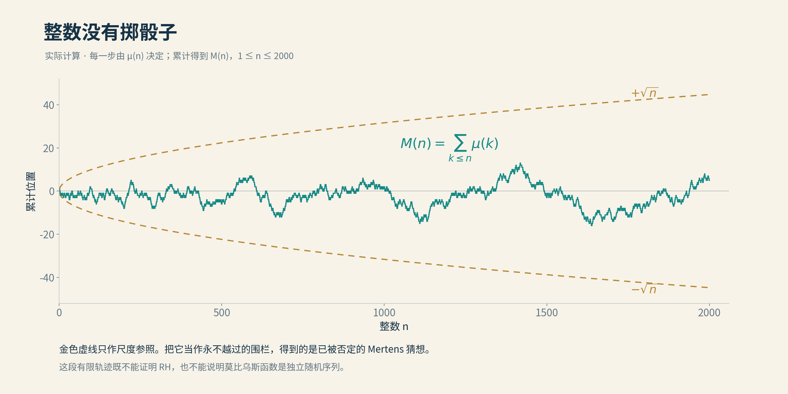

# 08 莫比乌斯随机游走

把正整数依次摆开。每遇到一个数，就按它的素因子决定向上走一步、向下走一步，或者留在原地。没有骰子，也没有随机数发生器；下一步早已由那个整数决定。

走出来的折线却很不安分。它有时连续下降，有时突然回头，很难从眼前几步猜到远处。这样的图像容易让人说“随机”。但在数学里，像随机只是问题的开始：究竟哪一种统计像？在哪一种尺度上像？我们能否把这种感觉变成足以控制ζ零点的定理？

## 整数怎样决定一步

这条路使用莫比乌斯函数$`\mu(n)`$。如果$`n`$含有任何素数的平方因子，便取0；否则，若它由奇数个不同素数相乘而成，取−1；由偶数个不同素数相乘而成，取+1。另约定$`\mu(1)=1`$。

例如，2、3、5都是−1，6=2×3是+1，30=2×3×5又是−1；4和12都含有平方因子4，因此是0。走路时遇到它们，就原地等一拍。前十步是+1、−1、−1、0、−1、+1、−1、0、0、+1，累计位置最后停在−1。

把累计位置记作Mertens函数：

$$
M(x)=\sum_{n\le x}\mu(n).
$$

这个和不告诉我们下一步去哪，却记录走了这么久到底偏出去多少。如果正负号长期偏爱某一边，位置就可能和步数一样大；如果它们充分抵消，累计偏差会小得多。

莫比乌斯函数并非为了模仿硬币而发明。它首先是一件处理整除关系的工具：对大于1的整数，把所有正因子的莫比乌斯值相加，结果恰好为零。若这个整数有几个不同素因子，展开“每个素因子取或不取”的组合，正负贡献就像展开若干个(1−1)相乘，全部抵消。这个朴素恒等式，是莫比乌斯反演的核心，也解释了前面零点检测时，一长段系数为什么会消失。

## 平方根从哪里来

假如真的抛一串相互独立、正反面等可能的硬币，把两面记成±1，每一步的平均贡献为零。平方累计位移时，单步的平方贡献相加，不同步之间的交叉项在平均意义下消失，于是平方位移的平均约为步数。典型位移便在步数的平方根尺度附近。

这是平方根抵消的直觉来源，但它说的是一种概率模型里的典型大小，不是一道任何时候都不能跨过的围栏。随机路径也会偶尔走远。更不能因为一张莫比乌斯折线看着相似，就宣布交叉项已经像独立硬币那样全部消失。

算术关系一直在场。当两个整数互素时，莫比乌斯函数满足乘法关系；它还在所有带平方因子的整数上取零。4、8、12的停步不是三次偶然掷出的结果。一个模型若把这些联系抹掉，可能猜中某个数量级，也可能在另一个问题上立即出错。

因此，题目中的“随机游走”是一扇观察窗口。真正要证明的，始终是确定序列的抵消估计。

*按整数素因子算出的莫比乌斯累计和，n从1到2000。青线是真实计算的阶梯曲线，金色虚线是正负平方根尺度。有限图像不能证明RH；将虚线当作永不越过的硬界，得到的是已被否定的Mertens猜想。 本项目原创；[图源、数学依据与简化说明](img/README.md)。*

## 一条折线怎样接到黎曼猜想

联系来自已经见过的倒数公式：在实部大于1时，$`1/\zeta(s)`$等于以$`\mu(n)`$为系数的狄利克雷级数。莫比乌斯不是ζ函数的旁观者，它把素因子逐个拆开的符号，恰好组织成了ζ的倒数。

将级数作分部求和，可以把它写成累计函数的积分：

$$
\frac1{\zeta(s)}=s\int_1^\infty M(x)x^{-s-1} dx,
\qquad \mathrm{Re}s>1.
$$

如果$`M(x)`$长得慢，积分就可能在更靠左的地方继续收敛。直觉是：累计的正负抵消越强，原本绝对值很大的无穷和，就越能在更宽的范围里保持可控。这里要控制整个累计过程，不能只知道某几个点恰好回到了原处。

严格的经典等价命题是：RH成立，当且仅当对每一个$`\varepsilon>0`$，都有

$$
M(x)=O_\varepsilon\left(x^{1/2+\varepsilon}\right).
$$

这句话允许常数和起始位置依赖$`\varepsilon`$。例如给定0.01，要有一套从某处起管住$`x^{0.51}`$尺度的界；改给0.001，则可能需要另一套常数和更远的起点。不能只挑一个方便的正数便宣布条件满足，也不能把所有余量一起删掉，换成$`|M(x)|\le\sqrt{x}`$。

从抵消界到RH的方向，可以由上面的积分看到骨架：任取实部大于二分之一的位置，选一个更小的正余量，积分便在那里定义全纯函数。它与ζ倒数在原来的共同区域一致，延拓后就不能容许ζ在这里有零点；再用函数方程的对称性处理左侧。反方向需要在RH下控制ζ倒数并作更精细的分析，不是把同一句话倒着读一遍。

于是，临界线上的位置问题，被换成实数轴上一条折线的增长问题。表达变得直观，困难并没有被换掉。

## 一道过分整齐的围栏

十九世纪末的Mertens猜想提出一个更整齐的界：对$`x>1`$，累计偏差的绝对值始终小于$`\sqrt{x}`$。如果这是真的，它当然足以给出上述RH所需的估计。许多数值计算也曾与它相容。

1985年，Odlyzko与te Riele证明这个猜想不成立。他们不是把整数一直枚举到终于碰到一个反例，而是结合高精度零点信息、分析论证与格基约化方法，证明越界必然发生。证明有人逃出了围栏，不一定要先在路上抓到他，并抄下门牌号码。

这件事没有推翻RH。平方根乘上常数1的硬界，比对每个正余量都成立的增长估计强得多。否定一个足以推出RH的更强命题，不能反过来否定RH。它推翻的是一道过分整齐的围栏，也提醒我们：有限图像带来的安全感，未必能覆盖无穷远处。

后来在RH假设下，研究者继续细化Mertens和的上界，包括Soundararajan的工作。这类条件结果可以帮助辨认RH究竟容许多大的波动，却仍应把假设写在门口。用RH推导出来的界，不能再拿回来充当RH的独立证明。

## 缩短镜头以后

累计函数从1走到x。还有一种不同的看法：把镜头放在一个很大的整数附近，只看一小段，问这段中的正负是否仍能平均抵消。

全程偏差不大，不保证每一小段都平衡。一条远足路线最后回到营地，中间仍可能连续爬升很久。反过来，许多短段各自有不错的平均表现，也不能自动拼成我们需要的全局平方根界：段与段之间如何累积，仍是一笔账。

Matomäki与Radziwiłł在2015年公布、2016年发表的工作，为短区间里的乘法函数建立了强有力的平均工具。应用到莫比乌斯和Liouville函数时，能够说明：当区间长度趋向无穷，即使它相对起点非常短，几乎所有这样的区间仍表现出平均抵消。

“几乎所有”在这里不能删去。它容许少量起点成为例外，并且是随着尺度增长的渐近结论；并非随便拿一个长度为十的窗口，正负就必须均匀。它也没有给出每个起点上都成立的平方根误差。

证明要利用乘法函数的结构，将短区间的信息与较长范围的均值联系起来，并在不同素因子尺度之间分解问题。真正的进展，是用算术依赖取得控制，而不是先假定这些依赖不存在。独立硬币模型给出了一个想去的方向，定理则必须自己修路。

*陶哲轩在2006年马德里国际数学家大会。 作者：Gert-Martin Greuel / MFO；[来源](https://commons.wikimedia.org/wiki/File:Terence_Tao.jpg)；[CC BY-SA 2.0 DE](https://creativecommons.org/licenses/by-sa/2.0/de/)。本项目未修改原文件，保留原有标识。*

## 陶哲轩证明了哪一种随机性

另一类问题研究相关性。两个相隔固定距离的位置，符号是否倾向于一致？再增加几个位置，又会怎样？这些问题与累计抵消相邻，却不是同一个命题。

这里常用Liouville函数$`\lambda(n)`$：它数素因子的总个数，重复因子也计算，按奇偶性取±1，因此不会取零。比如4有两个素因子2，所以Liouville值为+1；莫比乌斯值则为0。两位演员很像，但不能替对方签名。

2015年，陶哲轩证明了Chowla与Elliott猜想的两点相关、对数平均版本。对数平均给第n项约$`1/n`$的权重；这与把所有项等权相加不同。结果说明在这种平均方式和适当的不同线性形式条件下，两点相关趋于消失。证明结合短区间乘法函数研究、傅里叶分析与熵递减等工具，把不同尺度间的联系变成可用的信息。

这不是完整Chowla猜想的证明，更不是“所有微观位置已经像独立硬币”。两点、对数权重与渐近范围，都是定理的内容。

同年，他又解决Erdős偏差问题：任意一串±1，在某些齐次等差数列$`d,2d,3d,\ldots`$上取部分和，其绝对值不可能被一个固定常数永远压住。这里寻找的是无界偏差，序列也不必是莫比乌斯或Liouville。证明与对数平均Elliott结果相连，但结论既不是RH，也没有给出RH需要的Mertens平方根尺度控制。

两项成果的重要性，无需靠一个更大的猜想来替它们担保。它们让人看见：乘法结构、短区间和相关性之间，原来可以搭起新的桥。

## 随机的面孔，确定的骨架

到这里，“像随机”已经分成几个不同问题：累计偏差能长多快，短区间平均能小到什么程度，若干位置之间有多少相关。它们各有自己的量词、权重和例外范围。只用一个“随机”把这些问题装进同一只袋子，提起来轻便，打开时却容易拿错。

第二篇也可以在这里合上地图。零点密度限制偏离中央的数量，无零区域清出确定的空间，在线比例给出总体保证；热流与实根判据改变观察函数的方式，莫比乌斯则把问题带回整数的正负抵消。它们不是一条进度条上的五个百分数，而是围绕同一对象取得的不同信息。

下一篇先从Connes写给黎曼的一封信走进谱与物理的全景，再回到素数为什么显得随机、混沌究竟是什么意思。那里的随机模型、确定性混沌与这里的算术抵消会互相照亮，但不会因为折线都很曲折，就成为同一个定理。

整数没有掷骰子。它们只是把下一步的理由，藏得比我们目前能看见的更深。

[全书目录](../README.md) · [本篇目录](README.md) · [上一节](07_德布鲁因–纽曼常数.md) · [下一节](../03_第三篇_物理篇之混沌大陆/09_给黎曼的一封信.md)
