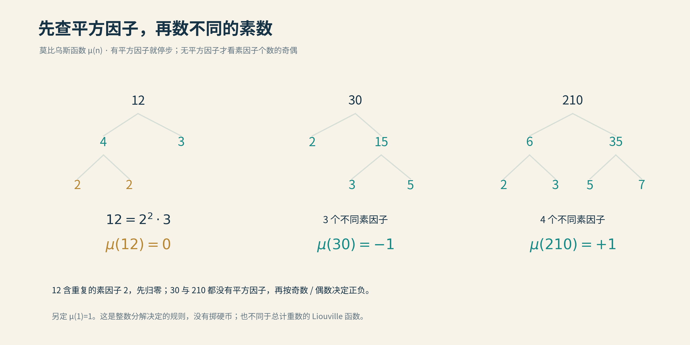
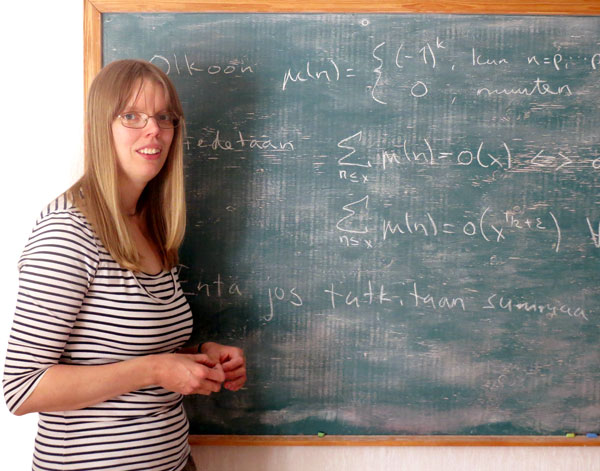
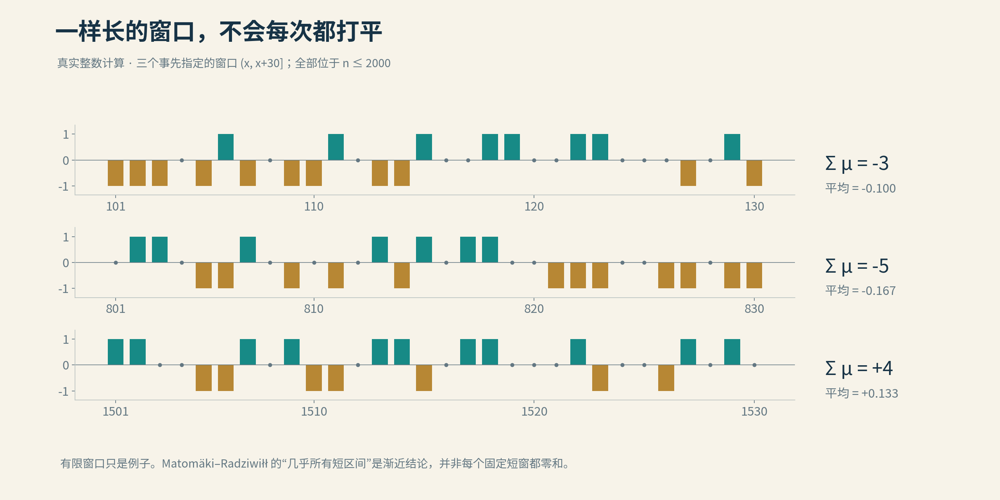

# 08 莫比乌斯随机游走

假如把黎曼猜想改成一个走路游戏，规则简单得几乎不配有一百万美元的奖金。

给每个正整数发一张纸条，上面只写三种指令：向上一步，向下一步，原地不动。按顺序照着走，不许作弊，也不用掷骰子。

难处只有一个：走到无穷远之前，你得证明自己不会偏得太远。

数学家已经走了一百多年。路上的每一步都算得明白，整条路的去向，却仍然云深不知处。

## 进退之间

发纸条的人，是莫比乌斯函数，记作μ。它的规矩看素因子。

一个数的分解里，只要有素数重复出现，就原地不动。例如12=2×2×3，两个2重了，μ(12)=0。

没有重复，再数素因子：奇数个，向下一步；偶数个，向上一步。于是2、3、5都向下，6=2×3向上，30=2×3×5又向下。数字1单独约定为向上。

先查重，再数数。一个整数的出身，决定了它的步伐。

*12含平方因子，μ值为0；30有三个不同素因子，取−1；210有四个，取+1。本项目原创教学图。*

前十张纸条，依次是：

+1，−1，−1，0，−1，+1，−1，0，0，+1。

走完，停在−1。二、三、五这些素数颇为齐心，一起往下；六和十赶来，替它们往回拉了两步。

把走到第x步时的累计位置记作M(x)，这就是梅滕斯函数：

$$
M(x)=\sum_{n\le x}\mu(n).
$$

看起来像游戏，骨子里却是整除关系。以6为例，它的正因子是1、2、3、6，对应的符号恰好是+1、−1、−1、+1，加起来为零。这个现象对所有大于1的整数都成立：把它全部正因子的μ值相加，正负必定抵消。

这正是莫比乌斯反演背后的机关。前面章节里用来抵消系数的工具，如今脱下工作服，自己走上了舞台。

## 平方根的远方

如果真的靠抛硬币决定上下，走一百万步，会离出发点多远？

典型的距离大约是一千步，而非一百万步。独立、公平的硬币没有偏爱的方向，正负抵消后，位移的均方根等于步数的平方根。一百万开平方，便是一千。

这里说的是典型尺度。谁也没有给硬币颁发一张“永远不许越界”的通行证。

莫比乌斯的脚步也让人想起这种起伏。然而，它没有硬币。遇到4的倍数就停步，是素因子规定的；互素整数之间还有乘法关系，不能各走各的。所谓“随机游走”，是借一扇窗观察它，而非给它签发随机性的身份证。

*青线按定义精确计算，走到2000时M(2000)=5。金色虚线只是平方根尺度，不是已经证明的边界。有限画面里的安静，管不到无穷远。*

为什么偏偏要关心平方根？

因为这条折线，通向ζ函数的倒数。在最初绝对收敛的区域里，1/ζ(s)可以写成一串以μ(n)为系数的无穷和。正负号抵消得越好，这个和就越有希望越过原来的边界，继续向临界线靠近。

而ζ若等于零，它的倒数就会出现奇点。因此，只要能把倒数在临界线右侧稳稳地控制住，就能排除那里的零点；再借函数方程的对称性，左侧也便无处藏身。

这座桥的严格结论，是黎曼猜想等价于下面的保证：无论给定多小的正数ε，走得足够远以后，总能找到一个固定常数Cε，使

$$
|M(x)|\le C_\varepsilon x^{1/2+\varepsilon}.
$$

不用怕这个ε。它表示平方根之外的一点余量：可以是0.01，也可以是0.001，还可以更小。每次选好余量，允许重新选择常数和起点，但从那以后，要一直管住。

所以，黎曼猜想要求的是一种极强的长期抵消。

指数里的二分之一，把复平面的零点，与整数队伍里的正负号，悄悄接在了一起。

## 围栏之外

十九世纪末，梅滕斯提出了一个更漂亮的猜想：走过第一步之后，累计位置的绝对值始终小于步数的平方根。

不添余量，不乘额外常数。围栏修得十分齐整。

这也并非凭空许愿。1897年，梅滕斯发表了五十页数表，把μ值和累计和一路列到一万。纸上这些脚步，都走得规规矩矩。

数据没有说谎。只是无穷远，比五十页纸还长。

它若正确，黎曼猜想也就随之成立。可有些数学命题，恰恰是因为太漂亮，让人舍不得怀疑。

1983年，荷兰CWI的通讯里已经出现了推翻这个猜想的公告；1985年，安德鲁·奥德里兹科与赫尔曼·特里勒正式发表证明。

最有意思的是：他们并没有沿着整数一个个走下去，直到亲眼看见越界。

那时，奥德里兹科在美国贝尔实验室，特里勒在阿姆斯特丹的CWI。两人的工具里，既有ζ零点的高精度计算，也有一件新近问世的利器：Lenstra、Lenstra与Lovász提出的格基约化算法，通常简称LLL。

思路可以听成一段合奏：通过显式公式与适当平滑，累计和的起伏能够联系到许多由ζ零点决定的振荡。平时这些振荡互相抵消；若能让足够多的重要振荡同时朝着一个方向，合起来的波峰便可能越过围栏。

LLL帮助他们寻找这种“赶在一起”的机会。最后，分析估计与计算共同保证：越界一定发生。

他们证明了有人翻墙，却没有交出那个人的门牌号。[原论文与作者回顾](../资料/08_莫比乌斯随机游走/01_论文与进展.md)

这件事推翻了梅滕斯猜想，却没有推翻黎曼猜想。前者要求一条不许越过的平方根硬线；后者允许前面那一点任意小的幂次余量。墙倒了，山还在。

进入新世纪，桑达拉拉詹等人又在假定RH成立的前提下，研究这条折线究竟还能怎样起伏。他在2007年公布、2009年发表的工作，便将累计和的上界与异常拥挤的零点区间联系起来。

正负号走出来的路，兜兜转转，还是要向零点问路。

## 相逢在蒙特利尔

后来，一些数学家不再只盯着从1走到x的总路程。他们把镜头拉近：随便截下一小段，这里的上下步伐，会不会也大致平衡？

全程没有偏得太远，不代表每一段都平坦。山路可以起起落落，最后仍回到山脚。

2013年，一次会议报告结束后，芬兰数学家凯莎·马托迈基与马克西姆·拉齐维乌聊起了如何改进她的结果。讨论没有停在会场，两人继续通信。2014年，他们同在蒙特利尔的数学研究中心工作，把原先的问题推向更广的乘法函数。

后来马托迈基在母校采访中回忆，做出来的推广，比他们起初预想的还要好。[图尔库大学原始采访](https://www.utu.fi/fi/ajankohtaista/uutinen/akatemiatutkija-kaisa-matomaki-palkittiin-kansainvalisesti-tyostaan)

*马托迈基与黑板。照片刊于芬兰数学教育刊物Dimensio的人物采访；黑板上恰好就是本章的莫比乌斯函数与短区间。拍摄日期未标。*

数学合作有时像一封越写越长的信。起初只是商量一处小改动，写到后来，旧地图已装不下新的路。

2015年1月，两人公布论文；2016年，成果发表于《数学年刊》。论文扉页上写着：献给安德鲁·格兰维尔。这位数论学家，也是他们在蒙特利尔合作时的重要支持者。

同一年，两人共同获得SASTRA拉马努金奖；后来又共享2019年数学新视野奖。他们研究的是“小区间”，引起的回响却一点也不小。

*拉齐维乌，2017年奥伯沃尔法赫。摄影：Petra Lein，Archives of the Mathematisches Forschungsinstitut Oberwolfach。数学也有走出黑板的时候。*

## 方寸之间

这项成果最惊人的地方，是窗口可以短得出乎意料。

设想在极远处挑一个起点，只看后面一小段整数。窗口长度只要随着总尺度慢慢增长，哪怕增长得很慢，对几乎所有起点而言，莫比乌斯函数在窗口里的平均值仍会趋近零。

也就是说，上下两种步伐的差，和窗口长度相比，终将变得很小。

“几乎所有”容许例外；“慢慢增长”也不等于永远固定看十个数。定理保证大多数窗口的平均表现，并没有保证每段路都风平浪静。

*实际计算的三个窗口，分别从100、800、1500之后开始，长度均为30。它们没有恰好零和，也不是短区间定理的证明，只帮助读者看清“局部平均”在看什么。*

他们怎么把这么短的片段控制住？

第一步，是顺着素因子拆开问题。大多数整数，都能在适当选择的素数范围里找到因子。把一个整数写成“素数×剩余部分”，乘法函数的值也能相应拆开。先筛出这些便于处理的大多数，再把少量例外单独估计。

第二步，是把短区间里的起伏，换到振荡的世界里研究。一批狄利克雷多项式记录着不同素因子尺度的信息；均值估计与大值估计，要证明它们不容易在太多地方同时出现异常。

最后，再把这些控制翻译回原来的整数窗口，得到几乎所有短段都接近长范围的平均表现。对μ而言，长平均趋于零，于是短平均也跟着归零。[论文与机制底稿](../资料/08_莫比乌斯随机游走/03_数学解释与科普参考.md)

他们没有把算术的纠缠剪断，冒充独立的硬币；他们抓住的，恰恰是那些纠缠本身。

## 邻居知道多少

一串符号平均为零，就够随机了吗？

看这一列：+1，−1，+1，−1，+1，−1……

正负人数完全相等，下一项却毫无悬念。只要知道这一项，隔壁那位就被猜了个透。

所以，除了“总共偏出去多少”，还要问：相邻位置之间，究竟有没有暗中串通？

这里常换一位演员出场：刘维尔函数λ。它也按素因子个数的奇偶给出±1，但重复的因子照样计数，从不取零。4=2×2，它算两次，给+1；莫比乌斯遇见重复因子，却直接给0。

要检测两个邻居是否串通，可以把它们的符号相乘：同号得+1，异号得−1。若长期相乘后平均接近零，便意味着同号和异号之间没有持续的整体偏好。刚才那列机械交替的符号，两两相乘永远是−1，当场露馅。

Chowla猜想想控制的，正是这类相关性，而且不止两个位置。

2015年，马托迈基、拉齐维乌与陶哲轩先取得了对位移取平均的成果。到了同年9月，陶哲轩又证明了固定两点相关的**对数平均版本**，并处理了更一般的Elliott框架。

这里的对数平均，是给第n项约1/n的权重。这样一来，100到1000、1000到10000这样的十倍区间，虽然项数差很多，总权重却大致相同。每一层数量级，都能分到相近的话语权。

这很有用，却仍不同于把所有项一票一票地等权相加。两个位置、对数权重，这些字不能省；省掉了，定理就会被误写成另一个尚未由它证明的命题。

## 信息不能透支

陶哲轩的证明里，有一个来自信息论的转折：熵递减。

不妨随机挑一个很大的起点，读出后面一段λ的正负号。这是一份信息。再记录起点与若干素数的整除、余数关系，那是另一份信息。

麻烦在于，这两份信息未必独立。知道整数的算术出身，可能就猜得到它的某些符号，不能直接把两者分开平均。

陶哲轩的办法，是不断调整观察的尺度。粗略地说，如果两份信息在每一层都泄露太多彼此的秘密，那么记录更长的符号串时，就能一次次省下本应需要的信息量。

可这笔账不能一直往负数记。

严格的熵不等式保证：在合适的某个尺度上，两者共享的信息必须足够少。于是，一些原先纠缠的平均可以被解开，再接上短区间估计与分析工具，逼出所需的抵消。[作者解说](https://terrytao.wordpress.com/2015/09/18/the-logarithmically-averaged-chowla-and-elliott-conjectures-for-two-point-correlations-the-erdos-discrepancy-problem/)

这一步并没有宣布整列λ变成了独立硬币。它只找到一处足够好用的尺度，让证明能从那里穿过去。

山没有移开，但终于有了一道窄门。

## 三十年后的答卷

同一个2015年，还有一桩旧事等来了结局。

埃尔德什曾问：能否设计一列±1，让它无论怎样按固定间隔抽取，累计偏差都永远关在同一座小围栏里？

按固定间隔，是取第d、2d、3d……项，d可以是任意正整数。你既要管住原队伍，也要管住每隔两项、三项、四项抽出来的队伍。

交替排成+1、−1，看起来最稳妥。但只挑偶数位置，便全是−1，一路向下。你在原队伍里补好的平衡，换一种点名方式，就散了。

埃尔德什猜，没有任何排法能够永远过关。围栏只要高度固定，总有某种抽法和某一段长度，会让累计偏差越过去。

*1985年，埃尔德什与十岁的陶哲轩一起做数学。照片由陶家提供，刊于《普林斯顿校友周刊》。这张照片并不表明他们当时讨论的就是偏差问题。*

照片里，老人和孩子并肩而坐，同样托着下巴，看着纸上的问题。

三十年后，孩子交来了一份答案。

答案背后，也有一段留在网上的插曲。2015年9月9日，Uwe Stroinski在陶哲轩博客下留言，问近期的短区间成果能否帮助解决埃尔德什偏差问题。陶起初解释了两类问题之间的障碍，随后又在讨论中指出，与Elliott猜想似乎存在可用的联系。

9月17日，两篇相关预印本上传。一篇推进对数平均相关性，另一篇解决埃尔德什偏差问题。先前Polymath5合作留下的归约与论证，也被接进了最终证明。[原始讨论与论文](../资料/08_莫比乌斯随机游走/02_人物与故事.md)

一条留言当然不是全部证明。但有时，长久备好的工具，只差有人在门口问一句：能不能用在这里？

定理告诉我们：**无论怎样安排正负号，总有一种点名方式，会让偏差越过任意事先划定的界限。**

这并不与黎曼猜想冲突。固定高度的围栏，与随步数增长的平方根尺度，原本就不是同一回事。

## 余音未尽

此后的研究，也没有停在那扇窄门前。

2017年，陶哲轩与约尼·特拉韦宁把对数平均的Chowla结论推进到所有奇数阶相关。三项、五项、七项一起相乘，可以讨论；这并不等于所有偶数阶也自动过关。

2021年，Harald Helfgott与拉齐维乌又换了一种语言：把整数当作点，按照素数整除关系连线，研究这张图怎样混合不同位置的信息。图上的扩张性质，使他们能对相关性趋于零的速度给出更强的定量控制。

到了2023年，Cédric Pilatte进一步改进这条路线，把相邻两项的对数加权相关界，从依赖双重对数的节省，推进到固定的对数幂次节省。通俗地说，早先不只证明“偏好终会消失”，后来还在不断改进“究竟消失得多快”。[后续论文与版本](../资料/08_莫比乌斯随机游走/01_论文与进展.md)

从短区间，到信息论，再到图的谱与矩阵，研究整数的工具，早已走出了整数本身。

然而，这些成果各自控制的，是窗口、权重、相关性或例外范围。要回到莫比乌斯累计和，证明RH要求的那一种全局抵消，仍须跨过它们尚未跨过的距离。

第二篇便在这里暂且收笔。我们追过零点，也清过区域；修过界限，也换过坐标。最后绕回整数，面前竟只剩一串简单的正负号。

下一篇，一封写给黎曼的信，将把我们引向谱与物理。那些从零点里传来的起伏，会不会原本就是某种振动的回声？

正负号还在往前走。

远处，另一片海面亮了起来。

---

本章[论文、人物故事与视频素材底稿](../资料/08_莫比乌斯随机游走/README.md)已另存；图源见[图片说明](img/README.md)。

[全书目录](../README.md) · [本篇目录](README.md) · [上一节](07_德布鲁因–纽曼常数.md) · [下一节](../03_第三篇_物理篇之混沌大陆/09_给黎曼的一封信.md)
