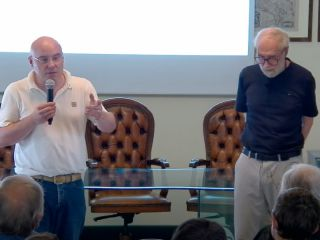
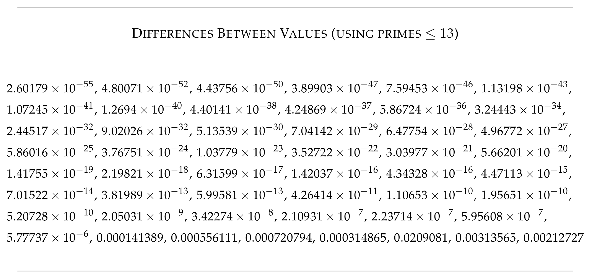
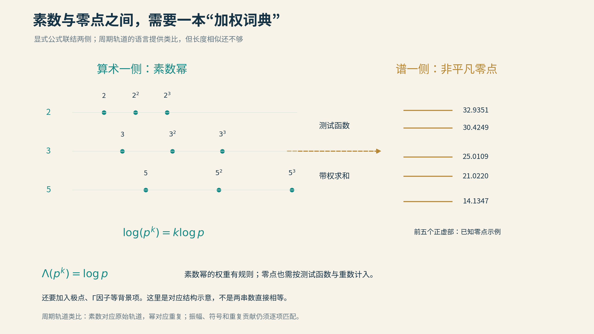
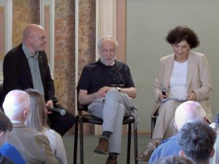

# 09 给黎曼的一封信

有些信，寄出时就知道，不会有回音。

2025年6月2日，阿兰·孔涅去了意大利的塞拉斯卡。1866年7月20日，黎曼在这里走完了三十九岁的人生。两天以后，孔涅要在瓦雷泽的黎曼国际数学学校作报告。学校设在托普利茨别墅，名字里已经坐着一位不便亲自出席的听众。

于是，他给自己出了一道题：如果能向黎曼汇报今天的进展，讲什么，才能让他惊讶，又让他更相信自己的猜想？

还有一条规矩：尽量只用黎曼熟悉的数学。

这可比给同行作报告更难。新名词可以挡住听众一阵子，挡不住收信人。何况，收信人是黎曼。

*2025年6月4日，托普利茨别墅。孔涅在右侧。图为主办方RISM发布的报告视频配图，原图为320×240像素；画面虽小，时间与地点却恰好落在这封信的来处。*

孔涅最终把这道题写成一封信，收入《黎曼假设：过去、现在与一封穿越时间的信》。预印本于2026年2月公开，随后发表于《开放数学问题杂志》。这一年，恰逢黎曼诞辰二百周年。

一个研究非交换几何、拿过菲尔兹奖的人，提笔时给对方的称呼，仍是“大师”。

## 尺素寄来

下面完整翻译预印本第23—25页，包括信前说明与页内脚注。译文用引文样式与本文叙述区分；原有公式保留，50项误差以原始清单呈现。原文几处写“低于13”，但明确列入13，译文据实际构造统一为“不超过13”。

这三页写的是一条研究路线，信末的未知与信中的惊喜，同样值得读。

[三页信件原件](../资料/09_给黎曼的一封信/原始文献/Connes_2026_Letter_to_Riemann_pp23-25.pdf) · [已下载的42页论文](../资料/09_给黎曼的一封信/原始文献/Connes_2026_Letter_Through_Time_2602.04022v1.pdf) · [英文与翻译校记](../资料/09_给黎曼的一封信/README.md)

---

> **给伯恩哈德·黎曼教授的一封信**
>
> 我应邀于2025年6月4日在瓦雷泽的托普利茨别墅作报告，黎曼国际数学学校就设在那里。为了准备这场报告，两天前，我到塞拉斯卡作了一次朝圣之行。黎曼于1866年7月20日在那里去世。
>
> 考虑到这场报告的地点，我给自己提出了下面这个挑战：
>
> **我能告诉黎曼什么，既让他感到惊讶，又让他更有信心相信自己的假设是真的？**
>
> 因此，接下来我要写的是一封给他的信。我会称他为“大师”。当然，有一条必须遵守的要求：不得使用他不知道、或者不容易理解的数学概念。事实上，我会把自己限制在他曾经使用过的概念之内。在一段开场说明之后，真正的新内容将出现在信的第二部分。
>
> **致伯恩哈德·黎曼教授**
>
> 您在论文中证明的那个美丽公式，也就是利用ζ函数的零点计算小于x的素数个数的公式，不幸在教科书中被写得很不妥当，暴露出人们对公式中间那一项的深刻误解。您用π′(x)表示严格小于x的素数个数，并在x本身是素数时加上二分之一。对于计数函数
>
> $$
> f(x):=\sum_{n\ge1}\frac{1}{n}\pi^{\prime}\!\left(x^{1/n}\right),
> $$
>
> 您得到了下面这个含有对数积分函数的公式，其中
>
> $$
> \operatorname{Li}(x)=\int_0^x\frac{dt}{\log t},
> $$
>
> 而
>
> $$
> \begin{aligned}
> f(x)={}&\operatorname{Li}(x)\\
> &-\sum_{\alpha}\!\left[\operatorname{Li}\!\left(x^{1/2+\alpha i}\right)
> +\operatorname{Li}\!\left(x^{1/2-\alpha i}\right)\right]\\
> &+\int_x^{\infty}\frac{1}{t^2-1}\frac{dt}{t\log t}-\log 2.
> \end{aligned}
> $$
>
> 您在论文结尾处理多值函数时十分谨慎。但数学语言已经发生变化：如今，人们使用的函数通常都要有确定的单值含义，多值函数的使用已不再普遍受到认可。
>
> 在标准教科书中，例如爱德华兹的那本经典著作〔原尾注7〕，中间这一项被写成对Li(x^ρ)求和，ρ遍历ζ的非平凡零点。
>
> 然而，这样的求和显然没有意义，因为把ρ换成ρ＋2πin/log x，其中n是任意整数，x^ρ并不会改变。因此，Li(x^ρ)在这条等差序列上保持不变，使这个无穷和无法获得合理的含义：它包含了本质上相同的项的无穷次重复，因为这些复数x^ρ至少会在半径为x的平方根的圆周上无穷地聚集。事实上，在您的论文发表多年以后，冯·曼戈尔特给出了您这一定理的详细证明。他在写公式时，在某种程度上更加谨慎……他没有直接处理Li，而是使用一个定义明确的单值函数Ei(z)=Li(exp(z))，以正确的变量z，而非exp(z)，作为自变量。于是，他把ΣLi(x^ρ)换成ΣEi(ρ log x)，证明了您的公式。
>
> 话虽如此，从您的公式显然可以看出，您已经掌握了今天所谓的吉南—韦伊显式公式。后来加入的新做法，是把您使用的函数1/log u换成任意的试验函数φ(u)，将它作用在素数幂上，再写出一个等式；等式涉及今天所谓φ(u)的梅林变换〔原注9〕在ζ非平凡零点处的取值。这不会令您惊讶。
>
> 这样得到的等式，其实不能完全算作对您公式的推广。因为您的试验函数1/log u在u=1处有奇点，所以您的公式比这些经典的吉南—韦伊显式公式还要精细一层。这些显式公式有一个引人注目的特点：如果试验函数φ(u)在某个有限区间[1,x]之外为零，那么计算只涉及有限多个素数，也就是截至x的那些素数。当然，您的公式本来就是这样：它使用的函数在[1,x]内等于1/log u，在区间外等于零。所以，这也不会令您惊讶。
>
> 不过，大师，请让我告诉您一件我认为很能支持您假设的事实。
>
> 我要设计一个过程，仅用几个素数，就以惊人的精度接近您ζ函数最前面的非平凡零点。所谓只用几个素数，究竟是什么意思？让我们考虑一个具体情形：假设我不知道13以后的素数有哪些。我只知道2、3、5、7、11和13。
>
> 乍看起来，想要把握ζ的零点，似乎必须用到所有素数，因为定义这个函数的欧拉乘积包含了全部素数。因此，只截取欧拉乘积的一部分，只考虑其中涉及不超过13的素数的因子，居然就能获得ζ零点的线索，这似乎很难相信。
>
> 让我只用您熟悉的概念来描述这个过程。从2、3等等，一直到13这些素数出发，我们构造一个二次型。它类似于您应用狄利克雷原理证明共形映射定理时所使用的二次型。
>
> 这个二次型定义在一个无限维函数空间上：函数φ(u)的自变量是正实数，而它在[1,13]以外为零。把显式公式应用于下面这个函数，就得到二次型的值Q(φ)：
>
> $$
> \psi(v)=\int_0^{\infty}\varphi(u)\varphi(uv)\,\frac{du}{u}.
> $$
>
> 因为φ在[1,13]之外为零，ψ便在[1/13,13]之外为零。因此，计算Q(φ)时，所需的素数幂只有2、3、4、5、7、8、9、11、13，不必用到其他素数幂。
>
> 接下来，我能够证明：在满足
>
> $$
> \int_0^{\infty}\varphi(u)^2\,\frac{du}{u}=1
> $$
>
> 这一条件的函数中，存在一个函数η(u)，使二次型Q(φ)取得最小值。这个存在性证明，与希尔伯特在1900年的《论狄利克雷原理》中给出的证明完全类似。
>
> 然后，我取η(u)的梅林变换。我也能够证明〔原注10〕，这个梅林变换的零点位于临界线上〔原注11〕。这个证明需要一个关于极小值唯一性的条件〔原注12〕。
>
> 我想向您报告的惊人事实是：借助远远超出您那个时代能力的现代计算机器，计算η(u)梅林变换的零点，例如最前面的50个零点，会发现它们与ζ的非平凡零点吻合得令人难以置信。以第一个零点为例，小数点后有54位相同；接下来也如此。吻合的小数位数逐渐减少，到第50个零点时，就只有少数几位相同了。
>
> 我计算了仅用不超过13的素数所得数值与ζ零点真实数值之间差异的上界，列在这里：
>
> **数值之间的差异（使用不超过13的素数）**
>
> 
>
> 这说明，我们已经能够切实把握您的零点，而整个过程中没有在任何一步用到全体素数的无穷集合。而且，我们预先就知道，η(u)的梅林变换的所有零点都在临界线上。
>
> 我们还不知道的是：当我们提高上限——这里原先取的是x=13——相应的零点集合是否会收敛到ζ的零点。这件事目前尚未得到证明。
>
> 另一方面，您的猜想之所以成立的抽象原因，似乎已经近在咫尺：我们知道，极小本征向量ηₓ的梅林变换，其零点都是纯虚数；我们期望ηₓ收敛到某个函数，而那个函数的梅林变换就是您的Ξ(it)。这样，结论就能由胡尔维茨定理推出。该定理意味着：如果一列全纯函数收敛〔原注13〕，并且它们的零点都在某条固定直线上，那么极限函数的零点也仍然位于那条直线上。
>
> 怀着敬意与钦佩，
>
> 阿兰·孔涅
>
> **原文页内脚注**
>
> 9．φ(u)的梅林变换定义为：
>
> $$
> \mathcal M(\varphi)(s)=\int_0^{\infty}u^{s-1}\varphi(u)\,du.
> $$
>
> 10．见第6.1节。
>
> 11．这里经过归一化，临界线对应于虚轴。
>
> 12．证明使用了卡拉泰奥多里—费耶尔于1911年得到的关于托普利茨矩阵的一个定理的推广；需要假设二次型的最低本征值是单重的，且对应本征函数为偶函数。
>
> 13．在紧子集上一致收敛。

---

*译文据 Alain Connes，arXiv:2602.04022v1，§5，第23—25页，按[CC BY 4.0](https://creativecommons.org/licenses/by/4.0/)翻译与排版，非作者审定译本。原文另页尾注7的完整译文、记号说明及数值转录见[翻译校记](../资料/09_给黎曼的一封信/01_信件中译与校记.md)。Li的实积分须按主值理解；译文保留原式，以便读者对照。*

## 六个素数的远行

读到这里，先把大半符号放下。信中真正的新办法，可以分成三步。

第一步，给波形打分。

取一段只在有限范围里出现的波形，用素数和显式公式规定评分办法。改变波形，分数也跟着变。这个评分规则，就是信里的“二次型”。熟悉的a²＋b²已经是一种二次型；这里把两个数换成了一整段函数，规则也复杂得多。

第二步，找最低分。

如果允许把波形越缩越小，零函数大概会成为最不费力的参赛者。于是先把总体大小固定，再比较形状，寻找真正使分数最低的那个。信中的积分等于1，做的就是这件事。

第三步，换一种方式读它。

梅林变换擅长研究缩放。把横坐标改成“对数刻度”，它便与傅里叶分析接上了关系：原来读的是波形，现在读的是频率。孔涅考察这个变换在哪里等于零，发现它们与熟悉的ζ零点靠得极近。

只用2、3、5、7、11、13，便听见了14.1347……附近的消息。第一个近似值的误差上界约为2.6×10⁻⁵⁵。

六个小小的素数，像带着一份远方的口信。

但这个过程还有普遍的分析项与精细的极值计算，并非把六个数往计算器里一按。尤其不能直接去求“六项欧拉乘积的零点”：那样的有限乘积，本来就没有我们要找的这些零点。真正的机关藏在它们参与构造的评分规则里。

信中的50项误差也值得看一眼。第一项极小，最后一项约为0.0021，中间还有一项约为0.0209；精度总体变差，却并不逐项单调。孔涅带给黎曼的是一份出色而参差的成绩单。

## 山在一线之外

这封信最动人的一句，也许恰恰是：这件事目前尚未得到证明。

已经造出的近似函数，在所需条件下，零点只能待在指定直线上。可这些函数不断变化以后，是否真的会走到黎曼的Ξ函数面前？

“都站在一条线上”与“站着的正是我们要找的那些零点”，是两件事。

孔涅与沃尔特·范·瑟伊勒科姆的论文，给出了控制一类变换零点位置的一般定理。孔涅、孔萨尼与莫斯科维奇的《Zeta Spectral Triples》，则进一步把构造写成自伴算子和谱，并展示数值逼近。两篇论文都已与这封信一起下载，关键定理与未完成步骤分别记在底稿里。

综述第6.6节把待办事项写得很清楚：需要验证相关最低本征值的单重性和本征函数的偶性，还需要控制候选近似与真正极小函数之间的差距。某个容易处理的候选函数已经会趋向目标，并不等于真正参加定理的那个函数也会。

这里的“只差收敛”，与登山时的“只差最后一段”，都不能按字数估计距离。

一旦建立了恰当的函数收敛，胡尔维茨定理才会接棒。可以这样理解：一列全纯函数在一片区域里足够稳定地逼近一个非零的极限函数，极限若在直线外突然冒出一个零点，附近的逼近函数也得留下零点的踪迹。若它们在那里从来无零，这种突然冒出来的情况便不可能发生。

这就是他希望借来的力量：让近似函数的几何纪律，一直传到极限。

## 尚未造出的琴

这也解释了，为什么从这一篇开始，研究黎曼猜想的人会谈起乐器、原子与振动。

前一篇，我们不断追问零点在哪里，能不能把它们逼得更近。现在，有人换了一个问题：能不能找到一种结构，使这些零点根本没有离开临界线的自由？

一根固定两端的弦，只允许某些振动频率。一个量子系统，也有自己的能级。这样的数值清单，叫作“谱”。若能找到一个独立构造的自伴算子，把它的谱与全部非平凡零点准确对应，自伴性保证谱为实数，便可能替我们守住那条临界线。

关键是“全部”，也是“独立构造”。先把已知零点刻成琴键，再说琴弹得准，终究只是手艺好。

所谓希尔伯特—波利亚设想，寻找的正是一件尚未造出的琴。孔涅的方案，是这条长路上的一种走法。

零点的高度约从14.1347、21.0220、25.0109开始。谱已经印在那里，琴身却仍未现形。

## 茶凉之前

这条路曾在一场下午茶里，忽然露出另一端。

1972年4月初，休·蒙哥马利来到普林斯顿高等研究院，与塞尔伯格讨论ζ零点的间隔。茶叙时，他把自己的发现告诉了弗里曼·戴森。戴森认出了其中的形式：在他熟悉的随机矩阵理论里，特征值之间也有这样的关系。

一个从素数走来，一个从物理走来，竟在同一张公式旁碰了头。

这并非事后杜撰的神来之笔。高等研究院保存着戴森1972年4月7日写给塞尔伯格的信，补上了蒙哥马利所需的物理文献。那封信有地址，有日期，也有真正能收到信的人。

后来的计算不断加强这个联系。零点并不像把沙子随手撒在桌面上：经过适当缩放，它们彼此靠近与避让的统计，表现出随机矩阵谱的特征。

当然，统计相像还不能替两套对象办同一张身份证。同一种谱统计可以出现在不同系统里；蒙哥马利最初证明的范围，也小于完整的对相关猜想。它带来的首先是方向：我们要找的那件东西，也许与某种量子系统有相通的结构。

数学家于是发现，研究素数，偶尔也要跨过走廊，找物理学家喝杯茶。

## 回声有路

还有一条线索，比“听起来像”更具体。

在某些几何或动力系统中，一条轨道绕行以后回到起点，并恢复原来的运动状态，就形成一条周期轨道。走一圈是它，重复两圈、三圈，仍由同一条原始路线生长出来。

素数幂也有这种层次：2、4、8、16，是同一个素数的反复出现；3、9、27，则来自另一位。取对数以后，log(pⁿ)=n log p，乘方恰好变成了路程的整数倍。

数论的显式公式把素数幂与零点联系起来；谱理论的迹公式，把闭合路线与振动频率联系起来。两边各有权重、背景项和精细的适用条件，却显露出一种令人难忘的共同语法。

*素数像原始路线，素数幂像重复绕行。这是寻找结构的线索；两列不能去掉权重后直接画上等号。本项目原创教学图。*

塞尔伯格已经在双曲曲面的世界里，建立过严格的谱与闭合测地线之间的联系。有限域上的曲线，也曾让韦伊从几何中找到零点位置的理由。后人期待的，正是普通整数世界里的一次相似相逢。

但整数的舞台还要自己搭。素数不能因为长得像一条路，就自动变成一条路；量子混沌也不能因为名字足够迷人，就自动负责证明。

接下来的几章，我们会走进这些具体构造：简单规则怎样长出难以预报的行为，分形弦怎样把几何唱成声音，电话工程师研究过的波形怎样来到孔涅的工作台，实验室又能怎样让零点留下可测的痕迹。

先辨认风景，再问路通向哪里。

## 信未写完

回头再看开头那一天，孔涅上午在托普利茨别墅报告，下午又到瓦雷泽的埃斯滕塞大厅，与市民谈数学。

*同一天的另一场谈话。孔涅坐在中间，前景是现场观众。来源：RISM活动录像配图。*

一位前人收不到信，一群今人仍愿意来听。

一百多年过去，黎曼当年的几页纸，已经长成一片需要许多学科共同测绘的大陆。孔涅寄出的不是捷报；他把地图、计算，还有没有走通的路，一起装进了信封。

落款之后，路还在延伸。

---

本章[信件原文、翻译校记、论文与视频素材](../资料/09_给黎曼的一封信/README.md)已保存；完整出处见[本篇参考文献](参考文献.md)。

[全书目录](../README.md) · [本篇目录](README.md) · [上一节](../02_第二篇_经典方法的新长征/08_莫比乌斯随机游走.md) · [下一节](10_素数分布是混沌的吗.md)
