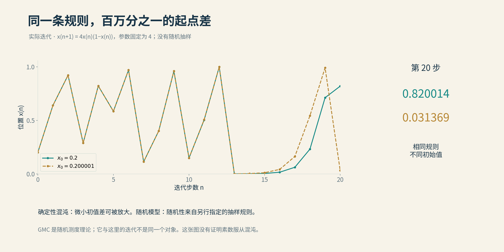
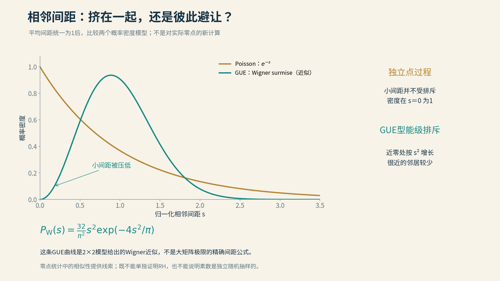
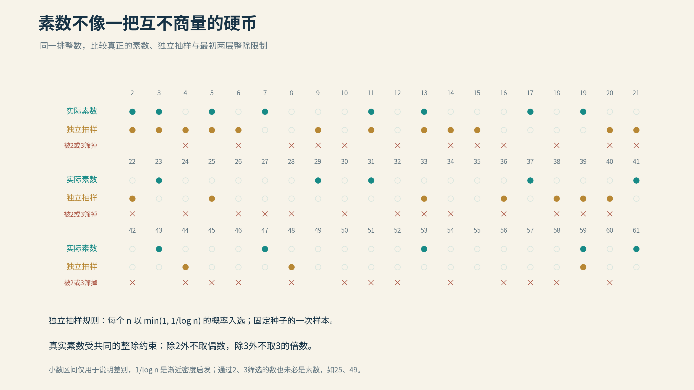

# 10 素数分布是混沌的吗

2025年12月，《科学美国人》把“素数模式”列入当年的十大数学突破。那条新闻指向10月的一篇报道：素数显露出意想不到的分形混沌模式。

把“素数”“分形”“混沌”放进同一个标题，很难不让人停下来。

素数一直给人两种矛盾的印象。它们好像有纪律：除了2以外全是奇数，越往后总体越稀疏，数量有清楚的平均规律。它们又好像没有纪律：下一颗隔多远出现，附近会不会挤出一群，为什么有些区间忽然特别安静，都很难从前几颗的队形直接看出来。

“混沌”似乎能把这种印象一把抓住。可是，如果明天再检查一遍，101仍然是素数，102仍然是合数。整数没有偷偷重掷骰子。

那么，这条新闻究竟发现了什么？先别急着回答。我们要先看看，真正的混沌怎样从一条再简单不过的规则里长出来。

## 一条种群规则，也能让预报失灵

1976年，生态学家罗伯特·梅在《自然》发表了一篇后来影响深远的论文。他研究的模型，简单到可以用一只普通计算器来玩。

把一个种群的数量换算成0与1之间的比例。下一年的比例，等于今年的比例，乘上尚未占用的空间比例，再乘一个繁殖参数。数量少时有增长空间，挤得太满时，竞争又会压住增长。

这不是对某种真实动物的完整描绘，而是一条极简的反馈规则。它却有丰富得出人意料的行为：参数较小时，数量可以安定下来；改变参数，可能开始一年多、一年少地轮换，再变成更长的周期；在某些参数范围里，又出现持续而不重复的复杂波动。

把繁殖参数取成4，从0.2开始，头几步是0.64、0.9216、0.2890左右。一条规则反复按下去，就足以把数字推来推去。

更有意思的是，另开一台计算器，从0.200001开始。初始值只相差百万分之一，二十次以后，两边却分别来到约0.82和0.03。两台机器都没有掷骰子，也没有改变规则，小小的差别已经被放大成完全不同的位置。

*固定同一个确定性规则x(n+1)=4x(n)(1−x(n))，从0.2与0.200001分别开始。20次迭代后约为0.820014与0.031369。两条轨迹由高精度计算得到，展示初值敏感，不是素数混沌的证明。*

这便是初值敏感的一种清楚展示。若最初测量只有有限精度，长时间以后就难以继续作精确预报。知道方程，并不意味着我们能把未来算得任意远。

然而，混沌也没有取消所有预测。对于适当的系统和典型轨道，长期访问不同区域的比例仍能呈现稳定规律。我们可能说不准某次迭代准确落在哪里，却能描述它通常在哪些地方停留得多、哪些地方停留得少。

这给数论研究带来一种重要启发：确定性与统计规律可以共存。但要把启发变成素数的定理，还必须找到具体的联系。整数的排列本身，并没有因为这只计算器表现复杂，就自动变成一种已知混沌轨道。

## 一座不会变化的城市，也有统计规律

想象一座所有建筑、门牌和街道都已固定的城市。今天拍照，明天拍照，同一地点的东西不会自己换位置。但如果闭上眼睛，在地图上随机挑一个街区，再拍下一张照片，不同照片之间就会出现统计规律。

随机的是我们站在哪里，城市本身没有变。

对素数和ζ函数，也可以这样提问。我们不必假装它们由随机规则生成，仍可以随机选取一个足够高的位置，考察附近的样子。那些窗口中，哪些现象常见，哪些罕见，怎样比较不同高度，都是严格的数学问题。

这是“确定的对象具有随机统计”最朴素的含义。天气、气体和金融市场中的概率，可能牵涉真实环境的复杂变化；数论中有时只是把固定的一幅长卷展开，在不同地方取景。

但在发现精细统计之前，数学家还做过一个更大胆的尝试：先画一座假的城市，看看它像不像真的。

*图：平均间距归一化以后，Poisson模型允许很多很近的邻居，GUE的Wigner近似呈现二次能级排斥。曲线比较的是理论模型，不是素数间距数据，也不是黎曼猜想的证明。*

## 给每个整数一枚硬币

素数定理告诉我们，在一个很大的整数附近，素数所占的比例大约是这个整数的自然对数的倒数。

克拉梅尔模型把这条平均规律变成一场游戏：从大于2的整数n开始，用概率大约为1/log n的硬币决定是否把它涂红。红色的数字便是模型里的“素数”。不同数字各掷各的，彼此独立。

这座玩具城市十分便宜，却能提出许多有用的猜测，比如素数间距在多大尺度上可能出现异常。它最重要的作用，不是替我们查出下一颗素数，而是提供一个可比较的基准：真实素数比独立随机模型更整齐，还是更容易聚集？

模型的毛病也一眼可见。它会把不少偶数涂红，而真正的素数早就把这些位置排除了。类似的限制还有能否被3、5、7整除，它们会在不同间隔之间留下联系。

比如，两个相邻整数不能同时是大于2的素数；两个相差2的数有没有机会同时为素数，又受其他素数的整除条件影响。若把这些结构全忘掉，只保留平均密度，预测便有可能在关键处失准。

因此，数论中的概率模型并不是越随意越好。真正的手艺，是决定哪些规律必须留下，哪些细节可以暂时交给随机性。

*图：真实素数、独立抽样和最初的整除筛选，排在同一张整数表上。抽样可能挑中合数；真实素数则共同服从模2、模3等限制。通过前两道筛也不能保证为素数，例如25和49。*

## 给素数照一束假想的光

还有一种观察办法，很有物理味道。把一段大整数区间中的素数想成一排散射点，再问：照射它们以后，不同方向会出现什么强弱的信号？

2018年，托夸托、张与德库尔西－爱尔兰研究了这种散射视角。原先肉眼看上去不规则的一排点，在特定大尺度极限的散射图景里，显露出尖峰与多尺度秩序。相关极限结论以哈代－李特尔伍德素数对猜想为条件。

这并没有把素数变成一块已经制作出的晶体，也没有证明它们服从某个混沌演化方程。它提供的是一副新眼镜：数论中的相关信息，可以换成物理学熟悉的集体散射来观察。看似杂乱的排列，原来可能同时保存着很细的秩序。

## 随机的零件，确定的装配法

另一种模型保留了整数最深的骨架：素因数分解。

给每个素数各自独立地分配一根方向均匀随机的单位小箭头。2有自己的箭头，3也有自己的箭头。到了6，就不用再抽签，而是按照乘法规则把2和3的箭头组合起来。到了12，便把2的箭头用两次，再用一次3的箭头。

小箭头的乘法可以理解为转角相加。它们本身是复数，但读者只需记住：合数使用的是已经分配好的零件。

这样构成的“随机乘法函数”，在素数处随机，在合数处遵守装配规则。4的箭头完全由2的箭头决定，6又由2与3共同决定，所以所有整数上的函数值不可能彼此独立。

这就比独立硬币多了一层算术味道。它不是随机决定哪些整数是素数，而是用素数作基本零件，制造一类保留乘法关系的随机对象。

为什么值得这么做？许多数论问题要研究大量正负贡献或旋转箭头的相加。它们可能大幅抵消，也可能偶尔朝同一个方向积累。独立随机游走给出的第一直觉，是一百步走下来大约偏离十步，走一万步大约偏离一百步，也就是平方根的尺度。

但共享素因数的箭头没有那么独立。它们在不同尺度上形成联系，最后的抵消程度，可能比第一眼的平方根估计更微妙。亚当·哈珀的一系列工作，正把这种细微差别变成可以证明的结果。

## 山峰下面，还有一层山峰

要理解“乘法混沌”，先想一张地形图。

远远看，地图上有宽阔的山脉与盆地。放大以后，大山上还有山脊与山谷。继续放大，又有更细的起伏。两个距离很近的地点，共享同一条大山脉，却未必落在同一道小山脊上；距离远了，共享的层次便逐渐减少。

这种“相近位置共享许多尺度，较远位置只共享少数尺度”的相关方式，是问题的重要部分。它与每个像素各自抽签的白噪声很不一样。

现在再做一步：根据高度给地图涂亮度。高一点的地方，不只稍微亮一点，而是被成倍放大；低一点的地方，则迅速变暗。把越来越细的起伏加进去后，亮度会变得高度不均匀，一小簇亮峰可能承载大量权重。

数学家要研究的，不只是亮点在哪里，还包括每个区域分到了多少“亮度总量”。在概率论里，这种给不同区域分配权重的对象叫作随机测度。

高斯乘法混沌，简称GMC，是处理这类多尺度随机权重的一套理论。它由近似高斯的相关起伏出发，通过指数化把相加的起伏变成相乘的权重，再配合恰当的尺度调整，寻找稳定的极限。

“混沌”在这里是一个专门名称。它关注的是多尺度随机结构，不要求我们先找到一只扇翅膀的蝴蝶。地图也不必像康托尔集那样，放大后每一块都严格复制整体；相似可以体现在统计规律中。

## 为什么平均值会被少数亮峰带走

设想十个人一起吃饭，其中九个人收入普通，第十个人极其富有。算出的平均收入，可能高得让九个人都感到陌生。

数学中的平均值也会遇到这种情形。许多窗口表现平常，极少数窗口出现很高的峰，便足以显著抬高平均。于是，“一般情况下有多大”与“把所有情况平均后有多大”，未必由同一个直观尺度描述。

对于乘法混沌，这种差别尤其重要。当放大高峰的力度达到一个临界值，通常使用的调整方式会失效。要看见一个非平凡的极限，必须更仔细地校准尺度。

这个临界点不是数学家为了增加术语而设置的关卡。它意味着，少数极端事件和大量普通事件之间的力量关系发生了变化。若只盯着平均值，最重要的结构反而可能被遮住。

素数为什么会与这样的地图发生联系？欧拉乘积把ζ函数与所有素数连接起来。取适当的对数以后，不同素数带来的振荡可以相加；把素数按大小分层，便能够看到不同尺度的贡献。相近位置的振荡并不完全独立，多尺度的相关地形由此进入视野。

这是从乘法的算术世界走向乘法混沌的一座桥。真正的证明比图景复杂得多，但连接并非只靠名字中的那个“乘法”。

## 2025年的新消息，镜头对准了哪里

现在可以回到新闻。

2025年，哈珀报告了他与埃罗·萨克斯曼、克里斯蒂安·韦布合作的一项结果。研究的对象，是临界线上ζ函数的大小。

我们可以把函数的模平方想成一条曲线上各处的亮度。先在很高的位置附近随机放一个长度固定的小窗口，再把窗口里的亮度加起来。随着观察位置越来越高，按正确尺度调整这份总量，它的分布会走向与临界高斯乘法混沌有关的极限。

这是一件相当奇妙的事。原始函数完全确定，移动取景窗之后，它的起伏却显露出一种精细的随机结构。此前萨克斯曼与韦布已经建立了ζ函数与乘法混沌之间的重要联系；新的报告进一步把镜头对准模平方形成的临界随机权重。

这里被测量的是ζ函数在一个窗口里的“亮度总量”。我们没有随机改造素数，也没有在给零点间距另取一个名字。随机矩阵提供零点排列统计的模型，乘法混沌则帮助描述函数值在不同尺度上怎样聚集。两种视角面对同一座算术大山，却照亮了不同的坡面。

2025年的公开讲稿仍将这项合作列为准备中的工作。

## 从模型走回真正的算术

概率模型的雄心当然不止于画出一幅漂亮地图。人们希望，它提供的规律能够帮助解决真正的算术问题。

Victor Y. Wang与Max Wenqiang Xu在2025年发表的工作，就是这类尝试的一例。它研究一类带有算术权重的和怎样抵消，其中的刘维尔函数会按一个整数所含素因子的个数决定正负，重复的素因子也要计算。

例如，4含有两个素因子2，得到正号；8含有三个，得到负号。把这样的符号在许多数上加起来，看似简单，却会触及深刻的乘法关系。随机乘法模型能提示，我们应该期待怎样的抵消。

这项结果在相应的广义黎曼猜想和L函数比值猜想的假设下，把概率模型中的一个预言转化为特定算术情形下的结论。它显示桥梁正在延伸，也清楚标出了桥下仍由哪些猜想支撑。

另一边，模型本身也在继续向前。哈珀、桑达拉拉詹与徐于2026年公布的预印本，研究这类随机单位箭头构成的乘法函数在短区间里的和。区间长度趋于无穷、同时相对所在位置仍足够短时，经过适当调整，分布可以趋向高斯；区间很接近整体尺度时，调整所用的尺子还得改变。

这告诉我们，同一个模型也不能只用一把尺子量到底。短窗口、大窗口以及几乎覆盖整个范围的观察，可能看见不同的统计面貌。

## 标题留下的问号

所以，素数分布是混沌的吗？

如果这句话只是问素数是不是毫无规律，答案显然是否定的。如果它问素数是否已被证明由某个具有蝴蝶效应的动力系统生成，本章讨论的结果也没有作出这样的结论。

真正有意思的答案更具体：与素数紧密相连的算术对象，确实能够呈现精细的随机规律；其中一些多尺度起伏，已经与乘法混沌建立了严格联系。确定的规则没有消失，它们长出了我们过去不易看清的统计结构。

新闻标题打开了一扇门。走进去以后，看到的比“素数很乱”丰富得多：随机位置与固定对象，独立零件与共享因子，普通窗口与罕见高峰，原来可以在同一个问题里彼此牵动。

下一节，我们换一种更容易动手想象的分形。只需一根弦、一把剪刀，再把同一件事反复做下去。令人意外的是，那些剪下来的小段，最终也会把我们带回黎曼。

[全书目录](../README.md) · [本篇目录](README.md) · [上一节](09_给黎曼的一封信.md) · [下一节](11_素数与分形.md)
