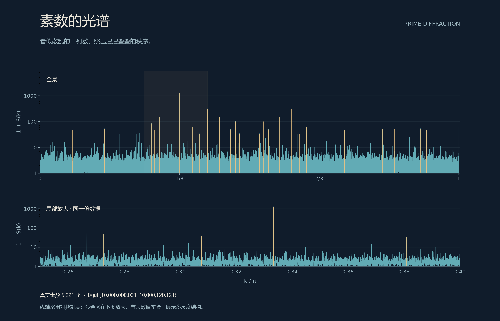
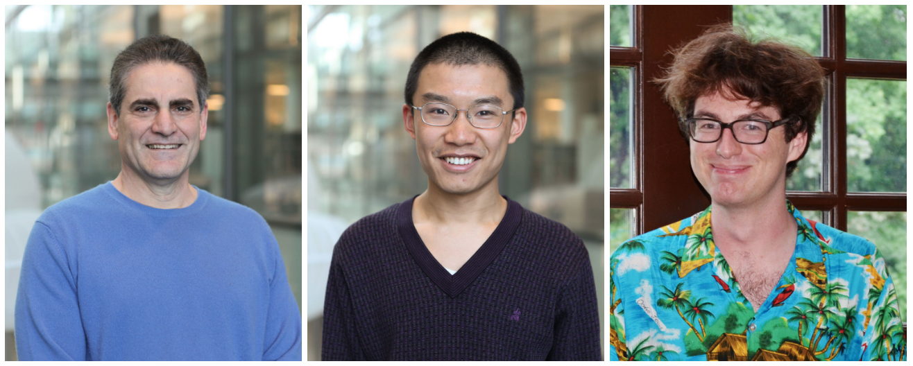
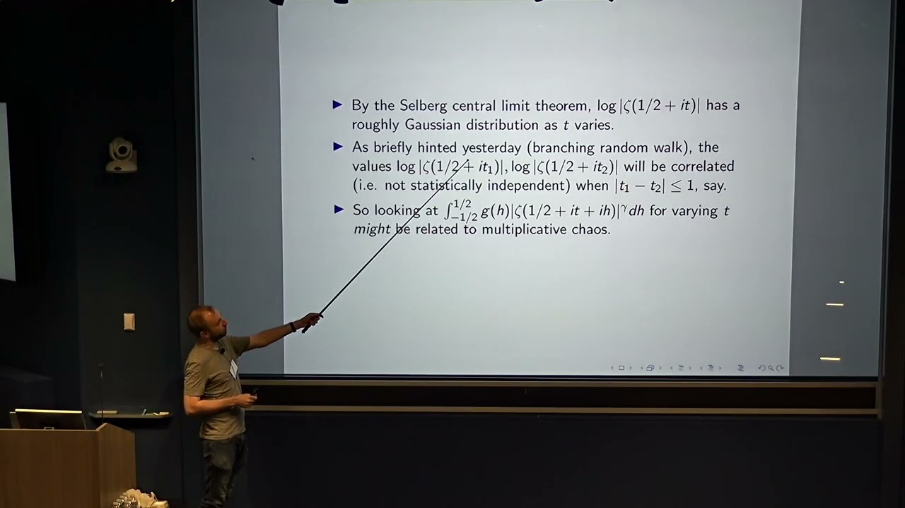

# 10 素数分布是混沌的吗

说了这么久的零点，我们该回头看看素数了。

毕竟，黎曼当年写下那篇薄薄的论文，题目问的就是：**不超过一个给定数的素数，究竟有多少个？** 零点在复平面上排列，牵动的却是整数世界里的疏密与起伏。

不妨翻一页最朴素的账本。一百万以内，共有78498个素数。用那条平滑的对数积分曲线估算，得到约78628个，多了约130个。账目已经相当漂亮，可数学家偏偏要追问：这一百多从哪里来？把一百万换成一万亿，甚至一路换到无穷，误差又能长到多大？

素数定理描出大势，黎曼假设进一步约束偏差。把它翻译成素数计数的语言，就是：当范围越来越大，真实数量与平滑估计之间的误差，始终受到一道“平方根乘上对数”尺度的界限约束。精确说法中的固定常数与量词，留在底稿；这里先记住，**临界线上的那个二分之一，对应着素数分布里平方根级别的精细控制。**[〔1〕](参考文献.md#第10节确定性混沌随机模型与乘法混沌)

所以，研究素数的波动，并没有离开黎曼假设。我们只是从山的另一面，望向同一道山脊。

2025年10月，《科学美国人》报道了一项新进展：与素数相关的结构，显露出“分形混沌”的面貌。年底，它又进入该刊的年度十大数学突破。

素数，分形，混沌。三个词放在一起，很像一封来自数学深处的邀请函。

*素数的“光谱”：按托夸托等人的[原论文方法](https://arxiv.org/abs/1804.06279v2)，对一百亿附近的5221颗真实素数独立计算。横轴表示空间频率，纵轴以对数刻度显示1＋散射强度；下图放大上图的浅金区域。它呈现素数排列的多尺度结构，并非已经证明素数具有蝴蝶效应。[数据与复现](../资料/10_素数分布是混沌的吗/04_图片与视频素材.md)*

这片峰峦，确实是从素数里长出来的。看似零落的位置，换一种照法，竟能显出这样分明的山势。

不过，要读懂它，我们得先辨认“混沌”这个名字下的几种风景。

## 蝴蝶从方程里飞来

1963年，气象学家爱德华·洛伦兹研究了一个由三个方程组成的简化对流模型。规则已经写定，轨迹却在两翼之间盘旋、往返，长久的演化对最初那一点细微差别极为敏感。

把系统每一时刻的状态依次连起来，便能看见那对著名的“蝴蝶”羽翼。这是方程留下的笔迹，也是混沌理论最广为人知的形象。

十多年后，罗伯特·梅又把类似的惊奇，带进了生态学。

梅的来路颇有意思。他起初学化工，据他后来回忆，有一次为了等同学考完试一起去聚会，临时参加了自己原本没有修读的荣誉物理课程考试，结果拿了第一。随后转向理论物理，再后来，又把目光投向了生物种群。[〔2〕](../资料/10_素数分布是混沌的吗/02_人物与故事.md)

有的人等朋友，刷一会儿手机；有的人等朋友，顺手换了一条学术道路。

1976年，梅在《自然》介绍的一类模型，简单得几乎不像会惹出什么麻烦：把今年的种群数量换算成0到1之间的比例，乘上剩余的生存空间，再乘一个繁殖参数，便得到明年的比例。

取参数为4，规则就是：下一次的数＝4×这一次的数×（1−这一次的数）。

从0.2开始，也从0.200001开始，让两组数字各走二十步。起点只差百万分之一，终点却分别到了约0.82和0.03。规则一字未改，最初那点差别，已经走得天各一方。

*初值0.2与0.200001，20次迭代后分别约为0.820014与0.031369。有限步计算展示初值敏感；它是教学模型，并非真实种群预测。*

这就是混沌最迷人的反差之一：**每一步都有章可循，远方却未必能够准确预知。** 测量多保留几位小数，可以延长预报的期限，却不能让有限精度无限支撑下去。

但素数还有自己的问题。明天重算一遍，101仍然是素数，102仍然是合数。它们没有天气，也不需要繁殖。

蝴蝶怎样飞进整数世界，还得另找一条路。

## 素数不掷骰子

数学家很早就学会了一种办法：先造一副骰子，看看它能猜中多少。

20世纪30年代，瑞典数学家克拉梅尔提出一种随机模型。到了一个很大的整数n附近，素数出现的平均密度大约是1/log n；于是，给每个位置各掷一次特殊的硬币，按这个概率决定要不要把它涂红。

红色的位置，就是一份临时编排的“素数名单”。越往后，红点越稀疏；有时挤在一起，有时隔出长长的一段空白。真实素数的几分神态，它居然都有。

这种模型能帮助人们猜测：大间隙该有多大，罕见的聚集又该有多罕见。像一张粗略的航海图，虽不能照着它停靠码头，却能指一指方向。

可它也有个不太体面的毛病：偶数也可能中签。

真正的素数早就讲好了规矩，除了2，偶数一律不来。模3、模5、模7，还各有自己的禁行区域。比如三个相邻的奇数，总有一个能被3整除；过了3、5、7，就不能再凑出这样三颗连续排列的素数。

*平均密度相近，不代表内部关系相同。独立抽样可能选中合数；通过最初几道整除筛选也还不够，25和49便能混过只检查2、3的关卡。*

素数的自由，带着许多祖传的规矩。好的随机模型，必须知道哪些可以交给运气，哪些一条也不能省。[〔3〕](../资料/10_素数分布是混沌的吗/01_论文与进展.md)

## 化学家的那束光

2017年前后，普林斯顿的一位化学家，带着素数去找了一位数论博士生。

化学家叫萨尔瓦托雷·托夸托。他平日研究粒子的排列：晶体怎样有序，材料怎样无序，连巧克力豆怎样堆得更紧，都曾进入他的研究。现在，他与学生Ge Zhang做了一件跨界的事：把素数摆成一排假想的散射粒子，在计算机里照上一束光。

观察晶体时，散射出去的波会相互叠加。有些方向彼此加强，留下亮斑；有些方向互相抵消，归于暗处。肉眼不容易察觉的排列关系，可以借这一明一暗显形。

那一排不大整齐的素数，竟也照出了有层次的尖峰。开篇的配图，就是循着这条思路，用真实素数重新算出的光谱。

经亨利·科恩介绍，托夸托找到了当时仍在读博的马修·德库尔西－爱尔兰。两人在普林斯顿高等研究院多次讨论；年轻的数论学家认出了图景背后的老朋友——哈代与李特尔伍德关于素数成对出现的猜想。

化学家带来的是光，数论学家认出的是谱。[〔4〕](https://www.quantamagazine.org/a-chemist-shines-light-on-a-surprising-prime-number-pattern-20180514/)

*从左至右：Salvatore Torquato、Ge Zhang、Matthew de Courcy-Ireland。此为三张照片的并列展示，并非现场合影。图片由Quanta刊出；前两张摄影为C. Todd Reichart，第三张由德库尔西－爱尔兰提供。*

2018年的论文，把这种联系写成了具体数学：在规定的大区间极限下，假设哈代－李特尔伍德的素数对猜想成立，素数的散射结构便会显露出层层嵌套的秩序。

为什么会有秩序？单看“除2外都在奇数位置”这一条，就已经存在两格一重复的底纹；再把其他整除限制叠上去，更多尺度便加入其中。它们并不排成普通晶体那样整齐的队伍，却也远非一把随手扬出的沙子。

这项工作的价值，是把已有的算术关系放进另一种可见的图景。它并未证明所依赖的素数猜想，但提供了一个很好的提醒：**看起来杂乱，有时只是光还没有照对方向。**

## 一座城，万种风景

到了2025年，另一束光照向了ζ函数。

9月11日，纽约西蒙斯基金会的一场会议上，亚当·哈珀报告了他与埃罗·萨克斯曼、克里斯蒂安·韦布合作的进展。报告题目很直白：《黎曼ζ函数的平方产生临界乘法混沌》。

*2025年9月11日，哈珀在西蒙斯基金会报告。画面来自主办方发布的讲座视频封面，保留了讲者、指示杆和投影内容。[会议及录像](https://www.simonsfoundation.org/events/mps-conference-on-universal-statistics-in-number-theory/)*

要读懂这个题目，可以先想象一座已经建好的城市。

街道、房屋、门牌，都固定不动。我们闭上眼睛在地图上选一个位置，拍下一小片街区；换个位置，再拍一张。照片之间可以有稳定的统计规律，城市却从未重新施工。

**随机的是取景的位置。**

数学家研究ζ函数，也能这样取景：沿临界线往很高处走，在一大段范围里随机选个位置，截取附近长度为1的小窗口。接着，把函数在窗口里的模平方——可以暂时想成各处的“亮度”——加起来。

这张照片有多亮？亮度集中在哪些地方？把观察的位置推得越来越高，经过适当缩放，会不会出现一种稳定的统计面貌？

这才是那条“素数与混沌”新闻所指向的具体问题。研究者先抓住了ζ函数这扇窗，窗后才是素数。

而这项工作，也并非突然在2025年从天而降。萨克斯曼与韦布2016年公布、2020年发表的论文，已经在广义函数的意义下，将临界线上随机平移的ζ函数与一种复高斯乘法混沌联系起来。2025年的报告继续向前，处理的是模平方所形成的临界随机权重。

从一幅能描述振荡的图景，走到能够称量“亮度”的对象，中间还有一道难关。

## 素数各执一弦

为什么ζ函数里，会长出这么一幅地形？

欧拉乘积给出了入口：每个素数贡献一个因子，所有因子相乘，便与ζ函数相连。取对数以后，乘法变成加法；素数们的贡献，便可以一项一项听见。

在适当截断的近似中，一个素数像一根小弦：随着观察位置变化，它的贡献上下振荡。素数越大，相关振荡变化得越快。把素数按大小分层，就像把低音、中音、高音分别请入乐队。

附近两个位置，听到的低音十分相似；到了更细、更快的声部，才渐渐分开。两个位置越近，共享的声部就越多。这种跨越许多尺度的联系，叫作“对数相关”。名字可以先放下，记住那句话就好：**近处的人，共享更多层风景。**

这里需要一道技术上的桥。欧拉乘积最初在实部大于1的区域收敛，不能直接搬到临界线上无限相乘。真正的研究，要截断、近似，并证明被省去的部分不会破坏所考察的结论。数学家的工作，往往就藏在“可以想成”与“确实如此”之间。

为了先听清这支乐队，概率论还提供了一种排练办法：给每个素数一根随机方向的单位箭头。

2和3各抽一次签。到了6，不再另抽，直接把2和3对应的转角相加；到了12，就用两次2的转角，再加一次3的转角。合数按素因数分解装配，不能自由发挥。

例如，某一次抽签若给2分配30度，给3分配80度，那么6对应110度，12对应140度。随机发生在零件上，装配仍遵守整数的老规矩。

这便是随机乘法函数的一种基本模型。它保留了素因数分解，也保留了由共享素因子带来的牵连，比给所有整数各掷一枚互不相干的硬币，更接近算术的脾气。

## 山外青山

现在，把音乐换成地形。

先画一条缓缓起伏的山脉，再在山脉上叠加更小的山丘，然后继续叠加更细的皱褶。近邻共享大山的起伏，却可能分别落在小山脊的两侧；距离越远，共享的层次越少。

这与前面那支素数乐队，是同一种多尺度直觉。

再做一步：把高度变成亮度。山头高一截，亮度就乘上一倍，而非只增加一个固定数量。如此一来，不同层的高度原本相加，对应的亮度却在相乘。

举个小例子。假如每层的高度增加1，就让亮度乘2，那么连续三层都高出1的地方，亮度就成为原来的8倍；一层高、一层低，则可能相互抵消。经过许多层筛选，有些地方格外耀眼，大片地方却很暗。

这种不均匀还会随着尺度继续生长：一座高山之上，另有高山。

由高斯型的相关起伏出发，经过这样的指数放大，再作必要的归一化，数学家可以构造一种给各个区域分配随机权重的对象。这便是**高斯乘法混沌**，简称GMC。它的理论根基，来自让－皮埃尔·卡哈纳在20世纪80年代的工作，后来逐渐进入统计物理与数论。[〔5〕](../资料/10_素数分布是混沌的吗/01_论文与进展.md)

此处的“混沌”是这套概率理论的专门名称。洛伦兹的蝴蝶讲的是确定性动力系统的初值敏感；开篇的素数光谱展示位置之间的散射关联；这里的乘法混沌，则讲随机权重如何在不同尺度上聚集。它们可以互相启发，却不能只凭同名，就认作同一种现象。

所谓“分形”，在这里也不要求每座山都像复印件那样重复。相似可以发生在统计规律里：换一个尺度，熟悉的疏密与起伏又出现了。

## 平均数的秘密

如果把高峰再放大一些，会发生什么？

先请十个人坐进一间屋子。九个人收入平常，最后进来一位巨富。屋里的人数只多了一个，平均财富却可以高得让前九位怀疑，自己是不是走错了门。

ζ函数的“亮度账本”，也有这种脾气。多数窗口相对平常，少数窗口异常明亮；它们足以把平均值推到一个大多数窗口并不经常达到的高度。

因此，要问“通常看见什么”，光看平均数并不够。

在乘法混沌里，放大山峰的力度还有一道临界门槛。低于门槛时，常规的缩放办法能留下非平凡的随机图景；到了门槛，照旧缩放，典型样本却会越来越暗。平均亮度仍可能被极罕见的峰托住，眼前的普通风景则几乎消失。

哈珀团队研究的模平方，恰好落在这个临界位置。

他们2025年的讲稿报告：对于长度为1的随机高处窗口，累计的模平方需要按“log T除以√log log T”的尺度调整，才会趋向由临界乘法混沌给出的非平凡分布。T表示观察的高度尺度。这里比单看整体平均所想到的log T，又多了一层缓慢的修正。

别急着记住这把复杂的尺子。它表达的意思很朴素：**少数高峰改变了平均，多数窗口需要另一把尺子。**

## 越过那道门槛

真正困难的，是如何证明这两幅图景能够接上。

一个常用办法，是比较各种平均：平均值、平方的平均、立方的平均……如果条件合适，这一串信息可以确定一个分布。

偏偏这里的极限分布有很重的尾巴。按照哈珀的讲稿，它连一阶及更高整数阶矩都不有限；另一边，ζ函数的任意高阶矩也远没有被算清。通常那座桥，走到这里，两头都不大好落脚。

他们于是换了一条路。

先用一段有限的算术和，替代难以直接处理的ζ函数。再按素因子的大小拆分这段和：只由小素数拼出的部分保留下来，含大素数的另一部分，则设法证明它在窗口积分中的影响，通常可以归入一个可计算的尺度因子。

为什么有希望？大素数对应的相位转得快，在窗口里反复转动，许多细节便有机会平均掉。真正需要保留的，反而是小素数织出的那层共同背景。

但“有机会”还不够。罕见的大峰会把直接的误差估计冲垮。因此，他们又加入一道随尺度设置的“护栏”，控制部分和在各层上的增长，使比较不被极端贡献吞没。带着这道护栏，真实算术对象的统计量，才能与随机乘法模型对照；还要证明这种限制对目标分布的影响能得到控制。

**先把无穷变成有限，再把大小素因子分开，最后管住少数失控的高峰。** 这几步之后，概率模型才有机会接住真实的ζ函数。

这是讲稿给出的证明路线，完整的细节当然远比这几句话艰难。2025年的报告将合作成果标为“准备中”；截至本章核对时，本文依据的是公开讲稿与会议记录，未把它写成一篇已经找到正式发表版本的论文。[〔6〕](../资料/10_素数分布是混沌的吗/01_论文与进展.md)

那份讲稿里，还有一句颇有数学家的幽默：困难在于临界混沌很难处理；好处则是，指数恰好等于2，平方至少还能展开算一算。

山势如此险峻，登山者的安慰竟然是：幸好还会平方。

## 风景之外，还有用处

这套理论的收获，已经不止一幅好看的山水。

把随机乘法函数给出的箭头首尾相接，人们想知道，走到最后还会离原点多远。若每一步完全独立，平方根是熟悉的尺度：走一万步，典型的偏离大约是一百步的量级。

可是，算术里的箭头共享素因子，彼此之间有亲缘。哈珀2017年公布、2020年发表的工作证明，在这类随机乘法模型中，箭头总和的平均长度，比平方根尺度还要小一个缓慢增长的因子。这解决了赫尔森的一个猜想。

奇妙之处在于，**平均长度变小了，长度平方的平均仍保留原来的量级。** 少数特别长的合成箭头，把平方平均托在高处。刚才那位走进屋子的巨富，在算术里又出现了。

2025年，Ofir Gorodetsky与Mo Dick Wong发表了一份更短的证明，借助萨克斯曼与韦布关于随机ζ模型的结果，把这座桥走得更简洁。它仍沿着哈珀开出的方向，并以损失部分精细估计为代价。数学的进步，有时是越过一座山，有时是让后来的人少绕几道弯。

桥的另一端，也有人把随机模型带回确定的算术。Victor Y. Wang与Max Wenqiang Xu在2025年的工作中，在相关广义黎曼假设及L函数比值猜想的条件下，推进了一类带乘法字符权重的刘维尔函数和的抵消估计。这里的条件不能省略：它说明不同理论怎样接上，并不反过来证明支撑它的猜想。

到2026年6月，哈珀、桑达拉拉詹与徐又公布了短区间研究：对同一种随机乘法函数，区间长度趋于无穷、同时相对于所在位置趋于零时，选对归一化，和的分布会趋向复高斯；当区间接近整体尺度，尺子也需要改变。

同一片山水，远望与近看，果然各有章法。[〔7〕](../资料/10_素数分布是混沌的吗/01_论文与进展.md)

## 回到黎曼的账本

现在再问，素数分布是混沌的吗？

我们已经可以给出比“很乱”更具体的回答：素数所连接的ζ函数，具有丰富的多尺度起伏；一些严格的极限结果，以及新的合作报告，正在把这种起伏与乘法混沌联系起来。确定的算术对象，可以拥有深刻的随机统计规律。

它与黎曼假设的联系，也可以落到实处。

欧拉乘积把素数接到ζ函数，显式公式再把ζ的零点接回素数计数。黎曼假设关心所有非平凡零点的位置，由此约束计数误差；乘法混沌研究随机窗口中的函数值怎样起伏、尖峰怎样聚集，为理解同一个函数提供了更细的工具。

两者在这里相遇，但“多数窗口是什么样”与“所有零点在哪里”，中间仍有距离。一个分布极限定理允许概率越来越小的异常情形存在，黎曼假设却不能漏掉任何一颗越界的零点。

这也正是这些研究的意味：我们逐渐知道，浪头如何聚集，潮汐怎样起落；要断定整片海洋的边界，还得继续向远处走。

开篇那页账本，依旧翻在桌上。一百万以内，是78498颗素数。

数字没有改变。我们看它的眼睛，却多了一双。

下一节，收起那束光，拿来一根弦。把它不断剪开，听听那些越来越短的片段，还能留下怎样的回声。

[研究底稿与原始文献](../资料/10_素数分布是混沌的吗/README.md) · [本篇参考文献](参考文献.md)

[全书目录](../README.md) · [本篇目录](README.md) · [上一节](09_给黎曼的一封信.md) · [下一节](11_素数与分形.md)
