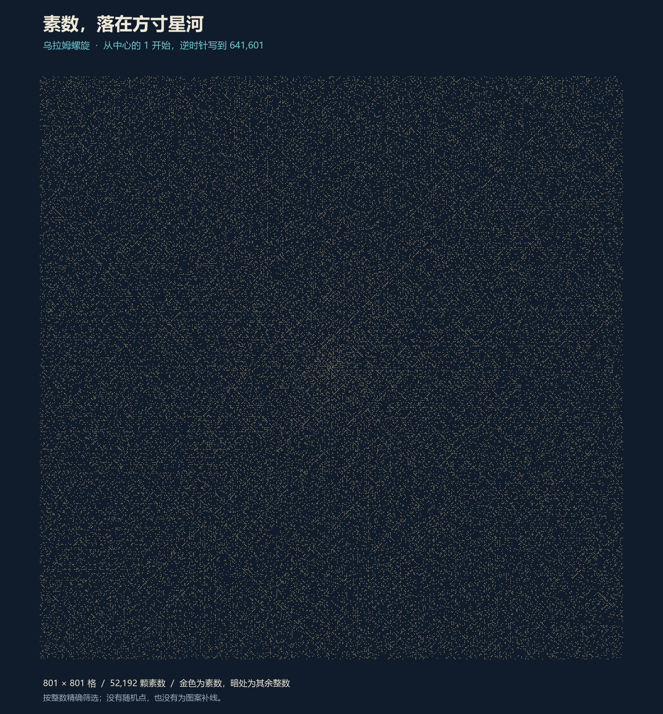
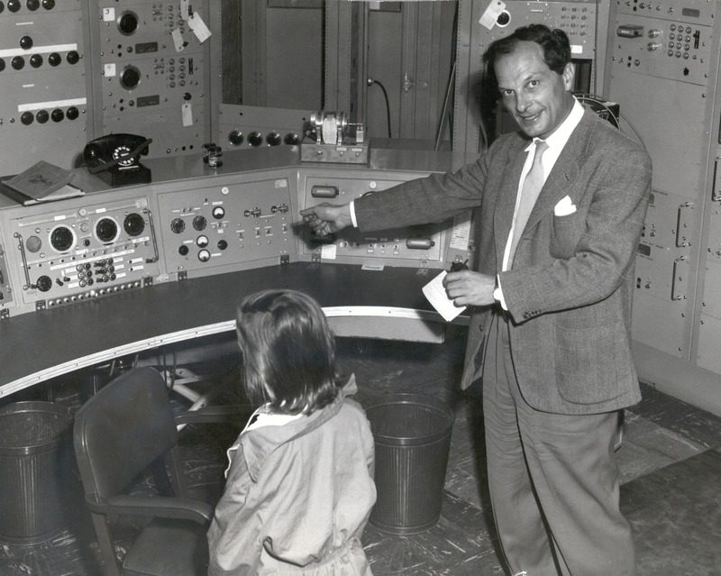
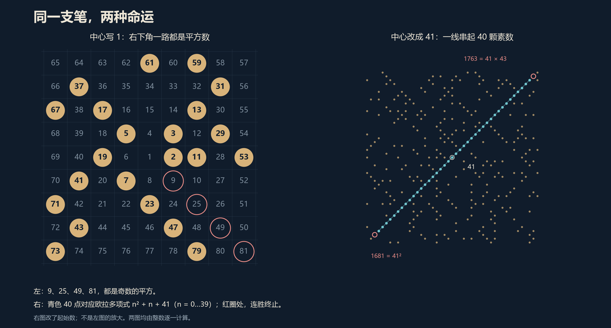
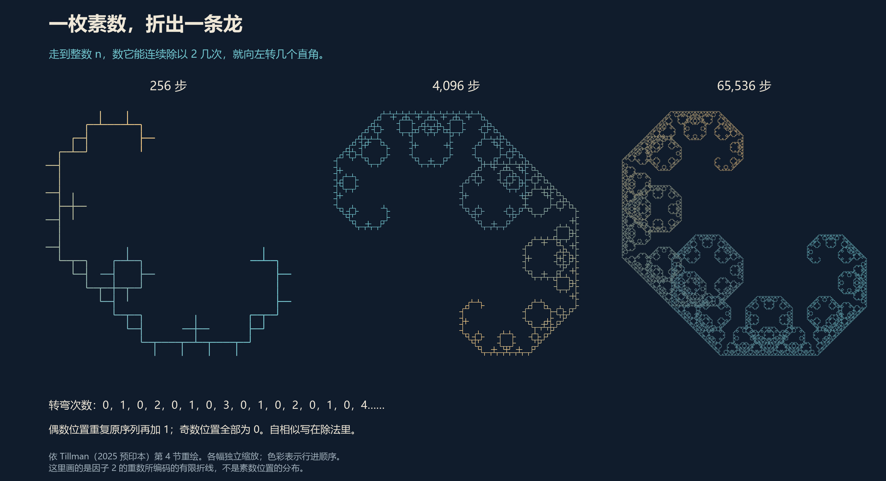
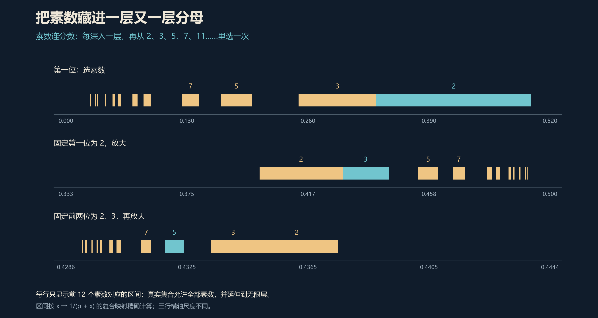
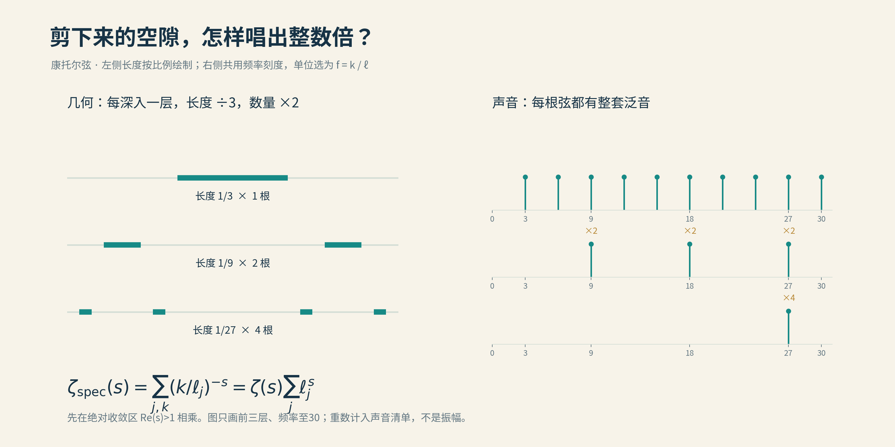

# 11 素数与分形

上一节，我们让素数站在一条直线上，照了一束光。

这一节，不妨把那条直线卷起来。

不需要高深的仪器。一张方格纸，一支笔，外加一场足够漫长的报告，就够了。

## 无聊生万象

1963年，斯坦尼斯瓦夫·乌拉姆坐在一场学术报告的听众席上。

按照马丁·加德纳次年的记述，报告又长又令人乏味。乌拉姆在纸上画起方格，本来想摆弄棋题，后来改了主意：在中央写下1，向右写2，向上写3，再绕着中心，一圈圈写下去。最后，把素数圈出来。[^gardner]

纸上渐渐有了异样。

那些在数轴上东一颗、西一颗的素数，换了座位，竟然显出一道道斜线。仿佛散落的星星，忽然认出了彼此。

*从1写到641601，圈出其中的52192颗素数。这幅图由程序逐一计算：金色的每一点，都有一个确定的整数地址。*

这便是后来著名的**乌拉姆螺旋**。

乌拉姆没有把它留在会议笔记里。他与M. L. Stein、M. B. Wells合作，把纸笔实验搬上洛斯阿拉莫斯的MANIAC II计算机。机器连接的显示设备可以呈现约65000个点，他们再把屏幕拍摄下来。1964年，三人的论文发表在《美国数学月刊》；同年3月，素数螺旋已经登上《科学美国人》的封面。[^ulam]

一场没能留住听众注意力的报告，倒给数学留下了一幅名画。

*1955年，乌拉姆与女儿在洛斯阿拉莫斯实验室开放日。照片藏于美国哲学学会乌拉姆档案；这是螺旋发现之前的生活场景，并非1963年的会议现场。[馆藏说明](https://www.amphilsoc.org/item-detail/stanislaw-and-clair-ulam-los-alamos-scientific-laboratory-open-house-1955)。*

## 星河有路

先看一小块方格，就能摸到这幅图的机关。

从中心的1出发，螺旋每绕完一圈，右下角依次出现9、25、49、81……恰好是3、5、7、9这些奇数的平方。

这一条斜线，素数注定缺席。

原因不玄妙：每添一圈，方形的边长增加2。边长是奇数，格子总数就是奇数的平方。右下角恰好是这一圈的终点，那个数自然可以分解。

其他斜线也有各自的算术身份。沿着它们走，常会遇到二次多项式给出的数。有的路线处处受整除关系拦截，有的则幸运得多。

欧拉留下过一张著名的“通行证”：

$$
n^2+n+41.
$$

把0、1、2……依次代进去，得到41、43、47、53……一直到n＝39，连续40次，结果都是素数。到了n＝40，终于撞上1681，也就是41²。

四十连胜之后，栽在了自己的名字上。

如果把螺旋中心的1改成41，继续按同样的顺序写数，这40颗素数就会落在同一条对角线上。它们沿线的排列顺序与n从0到39的顺序不同，但确实来自这同一张欧拉清单。

*左边，红圈串起奇数平方；右边，起始数换成41，青色串起40颗素数。两端的红圈提醒我们：这条漂亮的路，也有尽头。*

再往里看一层，就能明白“幸运”从何而来。

一个数若总被某个小素数整除，就很难成为素数。例如n²＋n＝n(n＋1)，刚出发就被拆成了两份；而n²＋n＋41不会被2或3整除。它绕过了两处关卡，出现素数的机会自然更多。

当然，绕过几个关卡，不等于一路畅通。要精确预测一个二次多项式能产生多少素数，会走进哈代–李特尔伍德、贝特曼–霍恩一类猜想的领地。**亮线的来历可以解释，亮线远处还有多少星光，却并不因此容易回答。**[^ems]

所以，乌拉姆螺旋最有价值的地方，是把一串难以察觉的整除关系，翻译成了眼睛能认出的纹理。

它让我们发现问题，还没有替我们解决问题。

## 一枚素数，一条游龙

螺旋图很容易让人想到分形：远看纹理纷繁，近看仍有疏密相间的细节。

但“看着像”只是邀请函。要进分形的门，还得说清楚：什么东西在缩放，什么结构在重复，重复能否一直延伸下去。

我们先从一枚素数开始。2就够了。

给每个正整数做一次小小的体检：它能连续除以2多少次？

3是奇数，一次也不行；6可以除一次；12可以除两次；8可以除三次。数学家把这个次数记作v₂(n)，也就是素因子2在n里面出现的重数。

从1开始排队，得到：

> 0，1，0，2，0，1，0，3，0，1，0，2，0，1，0，4……

现在给一只想象中的小虫下指令：先向右走一步；走到整数n，就向左转v₂(n)个直角，再走一步。0就直行，1就左转，2就掉头，4则转满一圈，相当于没转。

整数仍是那些整数，道路却开始盘旋。

*256步、4096步、65536步，分别缩放到合适大小。图按Tillman于2025年提交的预印本第4节规则计算；颜色只表示行进顺序。这里呈现的是因子2的重数所编码的曲线。*

这项对应关系出现在Micah D. Tillman的预印本《质因子如何形成分形》中。论文讨论这种折线与经典**莱维龙曲线**的联系：有限图形带着细小的尖刺，随着步数增加、整体缩放，呈现出相应的极限形状。龙曲线本身早已有之；这篇文章的趣味，在于从质因子里找到了通往它的路。[^tillman]

那条路其实藏在两句很朴素的话里。

**奇数身上没有因子2。一个数乘以2，因子2的重数就增加一次。**

因此，序列的奇数位置全是0；把偶数位置单独抽出来，恰好又是原来的整串序列，只不过每项都加了1。大序列里住着小序列，换一层尺度，相同的安排再次出现。

自相似并非画笔临时起意。它早已写在除法里。

这也解释了一个容易混淆的地方：这条龙研究的是整数如何被素数分解。它并没有告诉我们，下一颗素数会在哪里出现。

一枚素数足以折出一条龙。要驯服所有素数，事情还远得很。

## 小数深处有山河

如果想让**所有素数的位置与间隔**真正进入分形的几何结构，可以换一种玩法：把素数放进分母。

普通分数只有一层。连分数却可以把楼梯一直向下修：

$$
x=\cfrac{1}{p_1+\cfrac{1}{p_2+\cfrac{1}{p_3+\ddots}}}.
$$

这里，每一层的p都只许选素数，可以重复，也不要求从小到大。2、2、2……是一条路；2、3、5……是另一条。所有这样的无限选择，共同生成一群0与1之间的无理数，称为**素数连分数康托集**。

为什么它会长出分形？

先固定第一层。假如选2，下面那一长串贡献一个0到1之间的数，于是整个数被关进1/3到1/2这个小区间。选3，就落在1/4到1/3；选5，就落在1/6到1/5。4没有资格入场，对应的位置便留下空白。

再固定第二层，每个留下来的区间里，又会分出更小的区间；第三层继续分，第四层继续分。

素数决定哪些门打开，素数之间的空缺决定哪些门关闭。分母一层层嵌套，区间一层层缩小，一片由算术生长出来的细密山河，逐渐显形。

*每一行只画前12个素数对应的分支。第二行放大“第一层选2”的区间，第三行再放大“前两层选2、3”的区间；真正的集合允许全部素数，并继续到无限层。*

这并不是刚刚找到名字的新奇玩具。早在1999年，R. Daniel Mauldin与Mariusz Urbański就研究过它。到2025年，Tushar Das与David Samuel Simmons在《遍历理论与动力系统》发表的新论文，仍在追问一个看起来极其朴素的问题：**这片分形，究竟该怎么量？**[^das]

长度不好使：它的普通长度是零。数学家于是换一把适合分形的尺子，用“维数”描述它在越来越小的尺度上有多稠密。这个集合的豪斯多夫维数约为0.657，介于孤立点的0维与线段的1维之间。

但维数只给出了一个粗细等级，还没有给出合用的“分量”。

可以这样理解：用许多小区间把它盖住，每个区间按“长度的0.657次方”计费，看看总账是多少。对于这个集合，按照精确定义的维数来计费，豪斯多夫测度竟然仍是零。于是，一个问题留下来：能不能稍稍修正收费方式，让最后的账单既不是零，也不是无穷大？

这道问题从1999年一路留到了新世纪，2013年又被Mauldin列出。

Das与Simmons的回答有些出人意料：**对满足论文所列规则性条件的一大类修正方法，总账仍只能落在零或无穷大，无法停在一个有限的正数上。**

像是量衣师终于找到合身的尺码，却怎么也裁不出一件分量适中的衣裳。

症结与素数间隔有关。某些地方挤着好几颗素数，某些地方留下长长的空档；这些疏密关系经过分母的反复嵌套，被带进越来越小的几何尺度。作者把“局部有多少几何分量”转换成对素数分布的估计，数论与分形几何便在这里接上了头。

论文还讨论另一种量法——堆积测度。在额外的素数间隔猜想成立时，他们为这个集合上的一种自然测度找到更精细的刻度；这个结果带着条件，也不能直接替换成关于整个集合的无条件结论。

这里的进展，比一句“素数原来是分形”细致得多，也耐看得多：我们把素数编进一片几何风景，然后发现，要量清这片风景，还得回头追问素数。

山河自有来处。

## 弦外之音

不过，分形与黎曼假设之间，还有一条更古老、也更直接的通道。

它不需要先把素数放进图里。

拿一根长度为1的线段，剪去中间的三分之一；对留下的两段继续这样剪，再剪，再剪。无限重复后，留下的是著名的康托集。

这回，我们偏偏收集**被剪下来的那些小段**。

一段长度1/3，两段长度1/9，四段长度1/27……它们越来越短，数量越来越多，总长度却恰好加回到1。如果把每段都看成两端固定、可以振动的小弦，就得到一把拥有无穷多根弦的理想乐器：康托分形弦。

乐器店大概不会接受这份订单。数学家倒不嫌它难收拾。

*把剪下来的开区间视为独立小弦。图中的频率已选取统一单位；弦越短，基频越高，每根弦又带着自己的整数倍泛音。*

一根弦的长度变成原来的三分之一，基频就变成三倍。更关键的是，一根弦不只唱一个音：基频之外，还有两倍、三倍、四倍……的泛音。

因此，这把乐器的声音来自两张清单相乘：**每根弦有多长，以及每个基频取多少整数倍。**

把这件事压进一个公式，就是：

$$
\underbrace{\sum_j\sum_{k=1}^{\infty}
\left(\frac{k}{\ell_j}\right)^{-s}}_{\text{频谱的账本}}
=
\underbrace{\sum_{k=1}^{\infty}k^{-s}}_{\zeta(s)}
\underbrace{\sum_j\ell_j^{\,s}}_{\text{长度的账本}}.
$$

不必被符号吓住。左边逐根弦、逐个泛音记账；右边把“所有整数倍”与“所有弦长”分开统计。在级数绝对收敛的范围内，它就是一次整理乘法。

而那一串整数倍，恰好把黎曼ζ函数带了进来。

剪刀从未问过哪个数是素数。泛音一开口，算术已经在场。

## 听见黎曼

1993年，Michel Lapidus与Carl Pomerance发表了分形弦谱计数的重要结果。粗略地说，频率不超过某个高度的音有多少，首先由弦的总长度决定；再细看下一层修正，分形边界的信息开始显露。[^lp]

这好比隔着门听一支乐队。最先听见的是声势，往后才听清音色。

于是问题可以倒过来问：**如果声音的第二层统计表现得很规整，能不能推断，乐器边界的大小也有稳定的尺度规律？**

这里的“稳定”有一个直观含义。给边界附近涂上一层越来越薄的颜料，观察涂色范围怎样缩小；除去由维数决定的主要缩放比例后，若剩下的系数趋向一个固定的正数，数学家就称它具有“闵可夫斯基可测性”。

并非所有分形都有这样的脾气。标准康托集的尺度一层层按三倍跳动，那份归一化后的大小会持续起伏。它适合示范分形弦，却不能被当作所有分形边界的代表。

Lapidus与Helmut Maier追问的，正是这类**从声音反推几何规律**的普遍问题。他们的结果于1991年宣布，1995年正式发表。[^lm]

答案落在了ζ函数的零点上。

还记得刚才那笔乘法吗？频谱账本等于ζ函数乘以长度账本。如果长度账本中某种尺度振荡表现为一个极点，而ζ函数恰好在同一位置为零，二者就可能抵消。几何里原本存在的起伏，传到声音里，竟然消失了。

像一段录音少了一件乐器。听起来整齐，并不一定意味着演奏时没有杂音。

这一直觉可以做成严格数学：固定一个介于0与1之间的维数D，在定理规定的谱渐近条件下，**上述反推对这一维数的所有分形弦都成立，当且仅当ζ函数在实部为D的整条竖线上没有零点。**[^lapidus]

于是，黎曼假设有了一种意外的说法：

> 在0与1之间的每一种维数上，这种从声音反推几何规律的普遍判断都成立；唯一需要留下的例外，是二分之一。

二分之一，恰好又是那条临界线的位置。

这里“听见”的，是特定的尺度规律，并非凭一段声音还原乐器的全部外形。要解决的，也不是某一把漂亮的康托弦，而是跨越所有相关维数的一整个家族。

但桥已经在那里了。原本写在复平面上的零点问题，被翻译成了一个关于信息的追问：**几何里的起伏，能不能在声音中隐去？**

## 方寸之间

从乌拉姆的方格纸，到连分数的层层分母，再到一把买不到的无穷弦琴，我们其实走过了三种不同的相遇。

有时，算术换一种排列，眼睛便认出隐藏的纹理。有时，素数亲自参与建造，成为分形的骨架。还有时，几何与算术原本各行其路，却在泛音的整数倍里迎面相逢。

它们各有各的分量，不必都急着领取“破解黎曼假设”的奖状。

1963年，乌拉姆只是在一张纸上换了个写数的方向。六十多年过去，那些点仍在引人驻足。有人从中寻找二次多项式，有人画出新的图案，有人沿着几何走到了声音深处。

纸没有变大。

世界在里面展开了。

---

[^gardner]: Martin Gardner，*Mathematical Games: The remarkable lore of the prime numbers*，《Scientific American》，1964年3月。[官方条目](https://www.scientificamerican.com/article/mathematical-games-1964-03/)。报告与涂鸦的叙述采用Gardner的记述；不将后来不同版本的细节拼接成现场实录。

[^ulam]: M. L. Stein、S. M. Ulam、M. B. Wells，*A Visual Display of Some Properties of the Distribution of Primes*，*American Mathematical Monthly* 71 (1964), 516–520。[原刊条目](https://www.jstor.org/stable/2312588)；[全文OCR转录](https://studylib.net/doc/7950840/a-visual-display-of-some-properties-of-the-distribution-o...)。原文明确写作MANIAC II；本章配图为依照编号规则重新计算。

[^ems]: Stéphane Vinatier、Reg Alcorn，*Mathematics as seen by an artist: Inspiring mathematical objects*，[EMS Magazine文章](https://euromathsoc.org/magazine/articles/248)，第2节；法文原作发表于2024年。另见[Plus：A whirlpool of numbers](https://plus.maths.org/whirlpool-numbers)的科普介绍。两篇都讨论了素数螺旋的多项式结构。

[^tillman]: Micah D. Tillman，*How Prime Factors Form Fractals*，[arXiv:2502.15743v1](https://arxiv.org/abs/2502.15743v1)，2025年预印本，第4节，尤其§4.3–4.5。本文采用可直接复算的转弯规则，不把预印本身份写成已经完成同行评审的成果。

[^das]: Tushar Das、David Samuel Simmons，*Exact dimension functions of the prime continued fraction Cantor set*，*Ergodic Theory and Dynamical Systems* 45 (2025), 1757–1776。[正式论文，开放获取](https://doi.org/10.1017/etds.2024.57)。主要依据引言、推论2.2、猜想2.4、定理2.5及问题2.6；关于自然共形测度的条件性堆积测度结果，与关于整个集合的命题须区分。

[^lp]: Michel L. Lapidus、Carl Pomerance，*The Riemann zeta-function and the one-dimensional Weyl–Berry conjecture for fractal drums*，*Proceedings of the London Mathematical Society* 66 (1993), 41–69。[作者提供的论文](https://www.math.dartmouth.edu/~carlp/fractal.pdf)。这里的两项谱渐近式有相应的几何可测性条件，不能泛称任意分形都有相同形式的第二项。

[^lm]: Michel L. Lapidus、Helmut Maier，*The Riemann hypothesis and inverse spectral problems for fractal strings*，*Journal of the London Mathematical Society* 52 (1995), 15–34。[论文条目](https://doi.org/10.1112/jlms/52.1.15)。

[^lapidus]: Michel L. Lapidus，*The Sound of Fractal Strings and the Riemann Hypothesis*，[arXiv:1505.01548](https://arxiv.org/abs/1505.01548)，2015年综述，§6，特别是逆谱问题(ISP)D、定理14–15及其后的解释。该综述也明确讨论了原始论文与后来改进版本的误差条件区别。

本章论文阅读记录、2026年检索补充、故事出处与配图复现方法，见[资料底稿](../资料/11_素数与分形/README.md)。

[全书目录](../README.md) · [本篇目录](README.md) · [上一节](10_素数分布是混沌的吗.md) · [下一节](12_Connes和他的学徒们.md)
