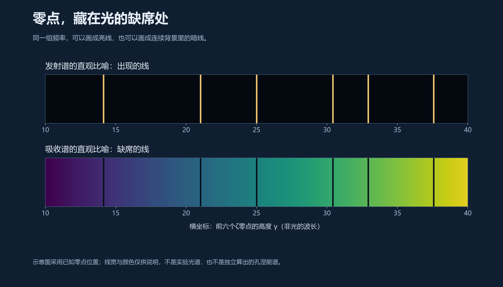
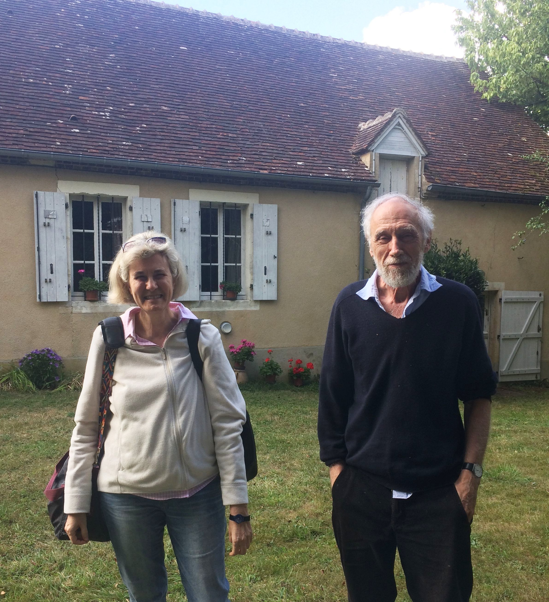
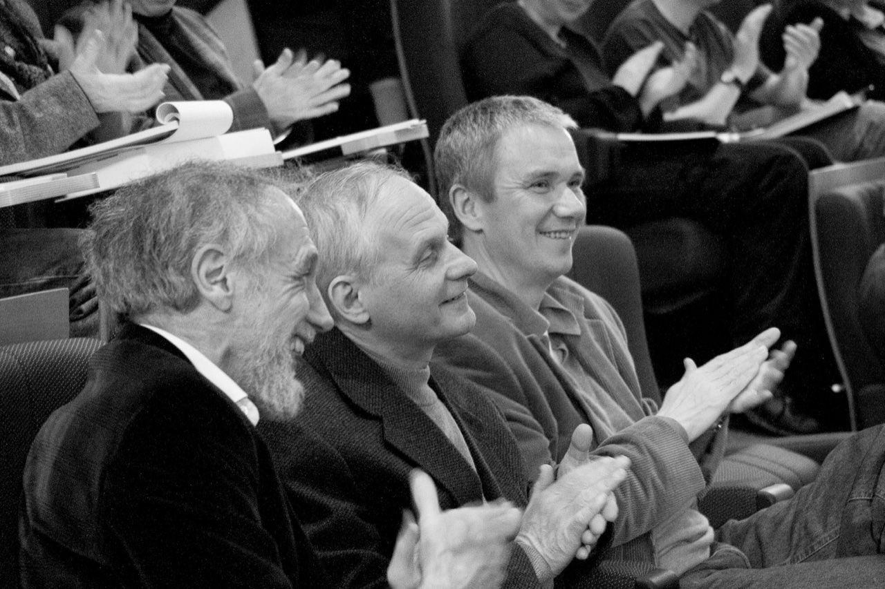
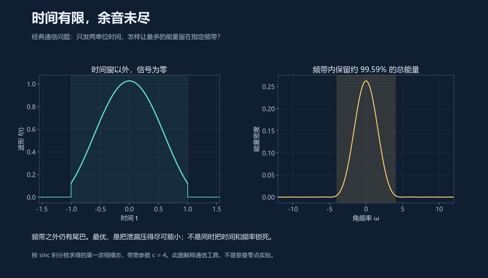
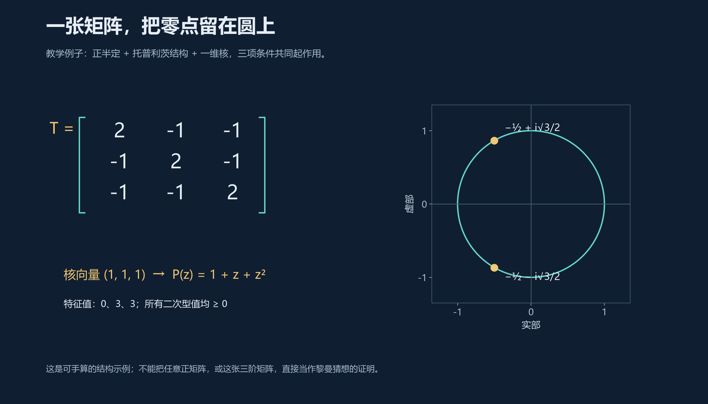

# 12 Connes和他的学徒们

1996年，西雅图，一场向塞尔伯格致敬的数学会议。

阿兰·孔涅讲起他与让-伯努瓦·博斯特建立的量子统计系统。这个系统颇有些神奇：把能量一层层数过去，黎曼ζ函数竟然出现了。

塞尔伯格听完，却追问这项工作与ζ零点究竟有什么关系。

换成一句大白话：函数来了，零点在哪里？

多年以后，孔涅在访谈中承认，当时自己还没有给零点找到真正的位置。这次追问，他带回了法国。[^jackson]

两位菲尔兹奖得主相遇，场面未必总是惺惺相惜。有时候，一位负责修建宫殿，另一位负责问：门呢？

## 一问三十年

先看看那座宫殿里有什么。

博斯特–孔涅系统把第n层能量设为log n。统计物理中，一层能量越高，在热平衡中分到的权重通常越小；用β表示逆温度，权重便是指数衰减。把这个特殊能量代进去，就有：

$$
e^{-\beta E_n}=e^{-\beta\log n}=\frac{1}{n^\beta},
\qquad
Z(\beta)=\sum_{n=1}^{\infty}\frac{1}{n^\beta}=\zeta(\beta),\quad \beta>1.
$$

左边是物理学家计算热平衡时的配分函数，右边是数论里的老朋友。两间原本隔着走廊的办公室，忽然共用了一扇门。

这个系统还有严格的相变与对称性理论，远不止把一个熟悉的级数重新写一遍。但塞尔伯格问得很准：在这里出现的ζ函数，起初负责统计能量权重；我们要找的，却是它在复平面上的零点。[^bc]

**让ζ函数出场，与让它的零点成为某种谱，是两件事。**

孔涅没有把这句话当作散场后的客套。按照他的回忆，回国后的一段时间，他甚至仍按西雅图的时差生活。大约一周后，一个转念出现了：也许应该寻找的，是光谱中缺失的那些线。[^jackson]

此后三十年，非交换几何、阿代尔、迹公式、长椭球波函数、极值问题，一件件走进这间工坊。直到2026年，那扇通向完整证明的门仍未打开；门框、铰链和锁的内部结构，却已经可以认真讨论了。

孔涅的分量正在这里。他交出的是一条能够逐段检查的数学路线，其中有已证定理，有计算证据，也有写在论文里的未竟之处。

至于他的1982年菲尔兹奖，来自算子代数等方面的奠基工作，早于这条黎曼路线。奖章可以照亮来路，不能代替下一页证明。[^imu]

## 次序也是一种几何

“非交换几何”听起来，像是几何学不肯好好说话。

其实，“非交换”的意思并不陌生：先穿袜子再穿鞋，与先穿鞋再穿袜子，结果通常不同。数的乘法允许交换次序，操作的组合未必允许。

看一个可以亲手算的例子。设U把一个函数平移，M把函数乘上横坐标：

$$
(Uf)(x)=f(x+1),\qquad (Mf)(x)=x f(x).
$$

先乘再移，与先移再乘，便得到：

$$
(UMf)(x)=(x+1)f(x+1),\qquad
(MUf)(x)=x f(x+1).
$$

两者相差一个f(x+1)。次序留下了痕迹。

那么，几何在哪里？

在普通几何中，我们先有一个空间，再在上面测量温度、高度，写出各种函数。现代数学发现，在适当条件下，这个过程可以倒过来：知道空间上足够完整的函数代数，就能把空间本身找回来。

于是，一个大胆的问题出现了：如果把这套代数换成不交换的算子代数，能不能也把它当作某种空间来研究？

这就是非交换几何的基本眼光。它让我们用代数、算子和谱，描述那些很难画成一张普通地图的几何对象。

所谓“谱三元组”，也可以先认三张面孔：代数A记录可做的操作，希尔伯特空间H容纳它们作用的状态，算子D负责提供几何中的变化与尺度信息。三者还必须满足相应条件，才是一件合格的数学工具。

看不见经纬线，不等于没有几何。孔涅习惯先听一听，这个空间能发出什么声音。

## 每颗素数，都有自己的远近

要给整数建造几何，首先得问：两个数之间，什么叫近？

平常的尺子说，1与3相距2，1与17相距16。前者近，后者远。

素数2却有另一把尺子：两个数的差里，含有越多因子2，它们就越近。1与17的差是16，含四个2，距离记为1/16；1与3的差只含一个2，距离是1/2。

于是，17反而比3更靠近1。

这并非数学家的任性。整除关系本来就是算术的纹理；换一把尺子，只是让原来不显眼的纹理浮出来。

对每颗素数p，都可以这样定义p进距离，进而得到p进数。再把通常的实数这一侧，以及所有素数各自的p进侧，按一定的相容规则装在一起，就得到**阿代尔**。它像是一张兼听各地方言的算术地图：实数管我们熟悉的大小，素数们各自管整除。

孔涅研究的一个核心对象，是阿代尔经过非零有理数的统一缩放后形成的商空间。这个商空间的轨道纠缠得厉害，普通拓扑不太够用；非交换几何则把“哪些点可以怎样互相变换”的信息，也保存在代数里。[^trace]

在有关的缩放几何中，素数还能对应到周期轨道。为什么周期会是log p？

把乘法换成对数，就看得见了：每乘一次p，对数坐标便增加log p。如果把相差一次乘p的点视为同一位置，直线就卷成了一个周长为log p的圈。绕两圈、三圈，对应p²、p³。

素数是一条原始轨道，素数幂是它的重走。

显式公式里反复出现的log p，终于有了一种几何口音。

## 缺席者的座位

现在回到塞尔伯格的问题。

在通常的光谱想象中，某个频率出现，就画一条亮线。希尔伯特–波利亚式的愿望，是找到一个合适的自伴算子，使它的谱给出黎曼零点的高度。自伴算子的谱是实的；如果这种对应真正覆盖全部非平凡零点，临界线便有了结构上的保障。

孔涅的早期路线，却被显式公式中的负号提醒了。

有些该出现的量，偏偏以“减去”的方式出现。与其执意把它们理解成额外亮起的线，能不能理解成连续背景里被扣掉的部分？

**零点，可能藏在光的缺席处。**

*上面画“出现”，下面画“缺席”。横坐标采用前六个已知ζ零点的高度，颜色和线宽仅为示意；这不是实验光谱，也不是本项目独立算出的孔涅算子谱。*

1998年的预印本、1999年正式发表的论文，把这一直觉推进成了严格的谱解释：临界线上的零点作为吸收谱出现，假如存在偏离临界线的零点，它们则会以共振的方式进入理论。[^trace]

这里有一个值得停留的细节：**理论给临界线上的零点安排了座位，也没有假装那些可能在外面的零点已经消失。**

后者仍要通过完整的迹公式、正性等关键环节去排除。所谓“迹”，可以粗略理解为把一个算子的谱信息汇总起来；迹公式则让这种谱的总账，与轨道一侧的总账相等。在这里，素数和零点终于有望成为同一空间的两种读法。

光谱比喻至此有了数学内容。它不要求真有一团氢气替我们证明黎曼猜想，却要求每一个“缺席”，都能在严格的公式中找到出处。

## 学徒究竟是谁

这间工坊里，当然不只有孔涅。

卡特琳娜·孔萨尼带来算术几何，亨利·莫斯科维奇带来长期积累的算子与非交换几何经验。他们各有自己的学术道路；标题里的“学徒”，并不是一张师生关系表。

甚至，谁教谁，也未必一成不变。孔涅在访谈中谈到，与孔萨尼合作，使自己重新学习了格罗滕迪克式的代数几何。[^jackson]

*孔萨尼与孔涅在乡间住所前。摄影：Danye Chéreau；照片未注明拍摄年月。[访谈及原图出处](https://celebratio.org/connes_a/article/842/)。*

另一则故事，更能消解“大师只负责灵光一闪”的想象。

2010年的访谈中，孔涅回忆，自己曾与莫斯科维奇各算各的，带着一点友好的竞争，处理一个约含一千个复杂项的上循环。两人苦算三周，一种隐藏的霍普代数结构才显现出来。这段经历属于他们的非交换几何研究，并非一次黎曼猜想验算。[^interview2010]

数学家也会说“结构很自然”。只是这四个字，有时要等一千项算完之后才说得出口。

*从左至右：孔涅、莫斯科维奇、迪尔克·克赖默，在IHES的一场讲座中。摄影：Jean-François Dars；原说明未标年月。[来源](https://celebratio.org/connes_a/article/842/)。*

他们后来围绕黎曼问题的合作，也保留着这种气质：先有广阔的几何设想，然后是漫长、具体、有时颇不体面的计算。

理想负责把人带到桌前。剩下的部分，纸不会替人写。

## 把无穷交给正性

几何太大，不妨先找一件可以抓住的事：怎样保证一个数不会是负数？

算一遍，可以知道这一次的答案。写成平方，却能保证整整一类答案。

韦伊判据把黎曼猜想引向了这样的任务。选一段足够光滑的试探波g，按显式公式给它算一个“分数”Q。这个分数有两张账单：一张用ζ零点来写，另一张用素数、素数幂以及实数一侧的背景项来写。

为什么正性会与临界线有关？先把零点写成ρ＝1/2＋iz，再把g的傅里叶变换记作F。若黎曼猜想成立，所有这样的z都是实数γ；在适当的消失条件下，零点一侧便成为：

$$
Q(g)=\sum_{\rho=1/2+i\gamma}|F(\gamma)|^2\geq 0.
$$

每一项都是模长的平方，自然不会为负。如果有零点离开临界线，相应项就不再自动具有这种平方结构。

更有力的是反过来的结论：**对规定的整类试探波，分数一律非负，与黎曼猜想等价。**[^weil]

于是，问题的模样变了：不必先逐个找到所有零点，可以转到素数那张账单上，寻找一个保证正性的统一理由。

这有点像审账。核对一百万张单据没有负数，仍不能保证下一张；如果能发现每一张单据的金额，本来就是某个长度的平方，审计方式便彻底改变了。

计算机能检查的，终究只是有限的输入。几何和算子理论要提供的，是那条不需要逐张检查的理由。

## 电话那头的回声

不过，谁会想到，通往正性的路上，竟然遇见了电话工程师？

20世纪中叶，贝尔实验室的研究者面对一个很实际的问题：通话时间有限，通信频带也有限，一段信号怎样才能把最多的能量留在允许的范围里？

时间与频率之间有一种彼此牵制的关系。一个非零信号，不能既在有限时间之外完全消失，又在有限频带之外完全消失。把一边截得太整齐，另一边就会生出尾巴。

既然做不到两全，就问怎样做得最好。

1961年，斯莱皮安与波拉克研究的长椭球波函数，给出了这类最优浓缩问题的一组天然工具。名字有些拗口，任务却朴素：在时间与频率的两道门之间，尽可能少丢东西。[^slepian]

*一个可以复算的通信模型：信号只存在于时间区间[−1,1]，目标频带为[−4,4]。最优第一模态约有99.59%的能量留在频带内，外面仍有尾巴。此图说明长椭球波工具的来路，并非孔涅零点计算的重现。*

孔涅与合作者研究的，也是函数及其傅里叶变换受到限制时，会出现什么结构。通信理论里磨好的工具，恰好能来这里工作。

2020年预印、2021年发表的一项研究中，孔涅与孔萨尼处理韦伊显式公式在实数这一侧的正性。他们引入与“索宁空间”有关的投影：这个空间中的函数，以及它们的傅里叶变换，都在指定的中央区间消失。[^arch]

乍看之下，是两种缺席。算子理论却能从中生出一个非负量。

若S是正交投影，那么，对任意向量v，都有：

$$
\langle v,Sv\rangle=\|Sv\|^2\geq0.
$$

长度的平方，又出现了。

真正的论文需要把这种正性，与显式公式里的具体项精确接上，并控制两者之间的差。作者在特定支撑范围和消失条件下完成了相应不等式；这不是把全部素数放进来以后，全球正性已经无条件成立。

2024年，孔涅、孔萨尼、莫斯科维奇进一步研究半局部的阿代尔算子。这里的“半局部”，是先把实数这一侧与有限多个素数一起纳入。他们证明了相应索宁空间在扩大素数集合时的一种稳定性，并研究了长椭球波算子与低位零点的联系。[^semilocal]

一座电话实验室里长出的数学，就这样跨过半个多世纪，走到了素数的门前。

## 一张矩阵的秩序

接下来的一步，更适合带着纸笔看。

2025年，孔涅与瓦尔特·范瑟勒科姆发表了一篇研究二次型与实零点的论文。它讨论一个很有吸引力的问题：能否从某种“最低分”的波形出发，让它的傅里叶变换只能拥有实零点？[^quadratic]

先看一个三阶玩具模型：

$$
T=\begin{pmatrix}
2&-1&-1\\
-1&2&-1\\
-1&-1&2
\end{pmatrix}.
$$

拿任意三个复数a、b、c来试，它给出的二次型恰好是：

$$
\begin{pmatrix}\bar a&\bar b&\bar c\end{pmatrix}
T\begin{pmatrix}a\\b\\c\end{pmatrix}
=|a-b|^2+|b-c|^2+|c-a|^2\geq0.
$$

因此，它是正半定矩阵。只有a、b、c相等时，分数才降到零；最低分的方向就是(1,1,1)。

把这个方向的三个数，拿来作多项式的系数：

$$
P(z)=1+z+z^2.
$$

它的两个根是−1/2±i√3/2，都在单位圆上。

*这是本书自选的可手算例子。矩阵沿每条平行于主对角线的斜线保持相同数值，称为托普利茨结构。正半定、这一结构以及一维核，共同参与约束零点；只剩“正矩阵”三个字是不够的。*

这件小事背后，有卡拉泰奥多里与费耶尔1911年理论的一个推论：满足相应条件的托普利茨矩阵，其核向量形成的多项式，零点全在单位圆上。

再作一步变换，令z＝eⁱᵗ。对复数t来说，只有t的虚部为零，eⁱᵗ的模才等于1。单位圆上的零点，便对应到t平面实轴上的零点。

从矩阵到函数，从有限个系数到连续的波形，这便露出了一条路。

2025年的论文沿着这条路建立了一般定理：对一类具有平移结构、下有界的自伴算子，**如果最低本征值单重且孤立，对应的本征函数又是偶函数，那么它的傅里叶变换的全部零点都在实轴上**。具体算子与定义域还须满足论文规定的条件。[^quadratic]

“单重”是最低分只有一个独立方向，“孤立”是它与其余谱隔着间隙，“偶”是波形左右对称。这些词都是定理承重的地方，不能因为读起来费劲，就顺手拆掉。

这里的进展，已经超出了“画出来很像”。它确实给出了一种把零点约束在实轴上的机制。

下一问也随之而来：被约束住的这批零点，怎样才能成为黎曼的零点？

## 六颗素数的回声

前面给黎曼的信里，有一张令人过目难忘的数表。

2、3、5、7、11、13。六颗素数参与的一个有限构造，给出了极其贴近若干低位ζ零点的结果。第一项误差上界约为2.6×10⁻⁵⁵。

五十五位小数，足以让人暂时放下茶杯。却还不足以让人放下证明。

这次，我们可以把那张表拆开看了。

**第一步，是规定试探波能延伸多远。**

把乘法变量换成对数变量后，假设波形g只存在于[−L/2,L/2]。把它与反向共轭的自己作卷积，得到的相关波形h，就只存在于[−L,L]。

显式公式从素数一侧读取信息时，会读取h在log p、log p²、log p³……这些位置的值。超过L的地方，波形已经为零，相应素数幂便不再贡献。

所以，只需保留pᵐ≤eᴸ的那些项。

当eᴸ＝13时，出现的是2、3、4、5、7、8、9、11、13这九个素数幂，背后恰好涉及六颗素数。**素数被截断，是因为波形的窗口有限；它们没有事先偷看零点表。**[^weil]

**第二步，是寻找这个窗口里得分最低的波。**

为免把波形缩成零就轻易获胜，要先固定它的总大小，也就是归一化。在数值计算中，再选有限多个基函数表示它，问题便成为一个矩阵的最低本征值问题。

“只用六颗素数”因此不等于“只算六维矩阵”。信中相应实验采用N＝100的截断，基函数有2N＋1＝201个。素数输入有多少，与表示波形要用多少个自由度，是两笔账。

**第三步，把最低波形送进傅里叶变换，观察它的零点。**

2025年提出、2026年收入EMS文集的《Zeta Spectral Triples》，为这种做法建立了更具体的有限维谱构造。作者在相应假设下，通过秩一扰动、合适的内积与商空间，得到自伴的谱解释，并把正则化行列式同波形的傅里叶变换联系起来。[^triples]

于是，这条链有了可以触摸的环节：

> 有限的素数输入 → 韦伊二次型 → 最低波形 → 傅里叶变换 → 实零点。

它们是否越来越接近真正的ζ零点，则是下一层问题。

信里的数表提供了强烈的提示，但提示并不整齐：最前面若干项异常精确，往后误差明显变大；前50项中，有一项约为0.0209。不能把第一项的五十五位精度，分发给整张表，更不能分发给无穷远。[^letter]

## 尚未合拢的门

这条路线最后希望抵达的目标，可以写得很清楚。

给ζ函数加上标准的补全因子，得到整函数ξ，再把临界线转成实轴：

$$
\xi(s)=\frac12s(s-1)\pi^{-s/2}\Gamma(s/2)\zeta(s),
\qquad
\Xi(t)=\xi\!\left(\frac12+it\right).
$$

黎曼猜想便是：Ξ的全部零点，都在实轴上。

前面的构造，试图生产一系列零点全为实数的整函数，再让它们逼近这个Ξ。如果逼近具有足够强的意义，便有希望借助赫尔维茨定理，将“零点不能离开实轴”的性质传递到极限。

关键是“足够强”。只在实轴上画得相像不够；只让前五十个零点重合得惊人，也不够。需要在相关复区域的每个紧集上一致收敛，并排除恒为零的极限等退化情形。

这些是让无穷接受约束的条件。

在此次核对的《Zeta Spectral Triples》作者版本中，最后仍有两处重要的未完成环节。[^triples]

一处，是把应用所需的最低波形条件真正落实：最低本征值的单重性、波形的偶性，不能一直借来使用。

另一处，是把两种波形接起来。作者已经为一个明确构造的候选函数证明了适当条带内的傅里叶变换收敛；但它与韦伊二次型真正的最低波形，并不是同一个对象。还需要足够强的比较估计，让前者的收敛结果能够传递给后者。

**已经能走到目标附近的那个人，与已经证明走在实轴上的那个人，还要证实是同一路人。**

两件事各自令人振奋，合在一起仍需一座桥。数表把桥的影子照得很清楚，桥面还得逐块铺。

与此同时，几何这一侧也没有停工。2026年6月，孔涅与孔萨尼研究整数谱的绝对几何，将若干p进、复几何与阿代尔结构联系起来；其中，素数p对应的实周期轨道，再次出现为“正实数模去乘p”的那个圈。8月31日的新预印本，又把实数所对应的无穷处几何纳入进一步的整体构造。[^geometry]

这些是正在生长的几何理论，尚不能替代上面缺失的收敛论证。但三十年前关于零点的追问，已经把研究带到了许多原先没有道路的地方。

## 山中岁月

有人从数值实验中寻找提示，有人从物理系统中寻找对应。孔涅和合作者的特别之处，是愿意为这种对应修建一套庞大的数学语言，再把语言拆回具体的算子、函数与不等式。

这条路走得很慢。

慢到一篇通信论文，可以在半个世纪后遇见一颗素数；慢到一场会议后的追问，可以陪一个数学家走过三十年。

*孔涅在乡间住所附近步行。照片由本人提供，拍摄年月未注明。[来源](https://celebratio.org/connes_a/article/842/)。*

2010年的访谈里，他说自己可以在家附近走十公里，不碰见一个人。散步时，他想计算的框架；回到桌前，才真正动手。[^interview2010]

照片里草木很深，路仍向前。

远处有什么，暂且不必替他回答。

---

[^jackson]: Allyn Jackson，[*Interview with Alain Connes*](https://celebratio.org/connes_a/article/842/)，2020年7月访谈、2021年发表。本文有关塞尔伯格、回国后时差及孔萨尼合作的内容均为转述，“门在哪里”等为作者比喻。
[^bc]: Bost、Connes，[*Hecke algebras, type III factors and phase transitions with spontaneous symmetry breaking in number theory*](https://repo-archives.ihes.fr/FONDS_IHES/I_Prepublications/CONNES/1994-1998/M_95_38/M_95_38_web.pdf)，Selecta Mathematica 1 (1995), 411–457。这里的相变发生在β＝1，不能与临界线实部1/2混同。
[^imu]: [国际数学联盟：1982年菲尔兹奖](https://www.mathunion.org/fileadmin/IMU/Prizes/Fields/1982/index.html)。
[^trace]: Connes，[*Trace formula in noncommutative geometry and the zeros of the Riemann zeta function*](https://arxiv.org/abs/math/9811068)，1998年预印、1999年发表于Selecta Mathematica。区分吸收谱、可能的非临界共振与尚待完成的全球迹公式。
[^weil]: Connes，[*The Riemann Hypothesis: Past, Present and a Letter Through Time*](https://arxiv.org/abs/2602.04022v1)，2026年，尤其§4；正式版发表于Journal of Mathematics and Philosophy 2(1), 1–52。本文采用对数坐标解释，完整条件与素数幂项见[数学底稿](../资料/12_Connes和他的学徒们/03_数学解释.md)。
[^interview2010]: Cornelissen、Landsman、van Suijlekom，[*The flashes of insight never came for free*](https://www.nieuwarchief.nl/serie5/pdf/naw5-2010-11-4-250.pdf)，Nieuw Archief voor Wiskunde，2010年12月，250–256。
[^slepian]: Slepian、Pollak，[*Prolate spheroidal wave functions, Fourier analysis and uncertainty—I*](https://doi.org/10.1002/j.1538-7305.1961.tb03976.x)，Bell System Technical Journal 40 (1961), 43–63。
[^arch]: Connes、Consani，[*Weil positivity and trace formula, the archimedean place*](https://arxiv.org/abs/2006.13771)，2020年预印；Selecta Mathematica 27, 77 (2021)。支撑与消失条件见其定理1及推论2，不能删去条件后宣布全球正性。
[^semilocal]: Connes、Consani、Moscovici，[*Zeta zeros and prolate wave operators: semilocal adelic operators*](https://arxiv.org/abs/2310.18423v2)，2024年修订；Annals of Functional Analysis 15, 87 (2024)。
[^quadratic]: Connes、van Suijlekom，[*Quadratic Forms, Real Zeros and Echoes of the Spectral Action*](https://doi.org/10.1007/s00220-025-05493-1)，Communications in Mathematical Physics 406, 312，2025年11月18日发表；[预印本](https://arxiv.org/abs/2511.23257)。三阶矩阵是本书为说明其机制自选的例子。
[^triples]: Connes、Consani、Moscovici，[*Zeta Spectral Triples*](https://arxiv.org/abs/2511.22755)，2025年预印；[作者所列2026年EMS文集版本](https://kconsani.github.io/publications.html)。有限构造见定理1.1，候选函数收敛见引理7.3，待证步骤见§8。本章核对至2026年10月22日。
[^letter]: 六素数实验的原始数表、版本区别及误差清单见[第09节资料](../资料/09_给黎曼的一封信/README.md)。本节没有声称独立重现这项高精度计算。
[^geometry]: Connes、Consani，[*On the Absolute Geometry of Spec Z*](https://arxiv.org/abs/2606.06604)，2026年6月4日；[*The Absolute Twistor Line and the Geometry of the compactified Spec Z*](https://arxiv.org/abs/2609.00299)，2026年8月31日。两篇均按预印本记述，几何分支的进展不等同于谱逼近路线已经完成。

[本节研究底稿与原始文献](../资料/12_Connes和他的学徒们/README.md)

[全书目录](../README.md) · [本篇目录](README.md) · [上一节](11_素数与分形.md) · [下一节](13_弹出素数的乐章.md)
