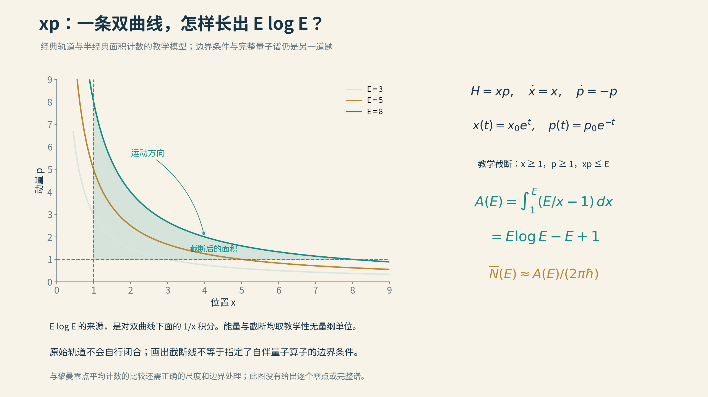
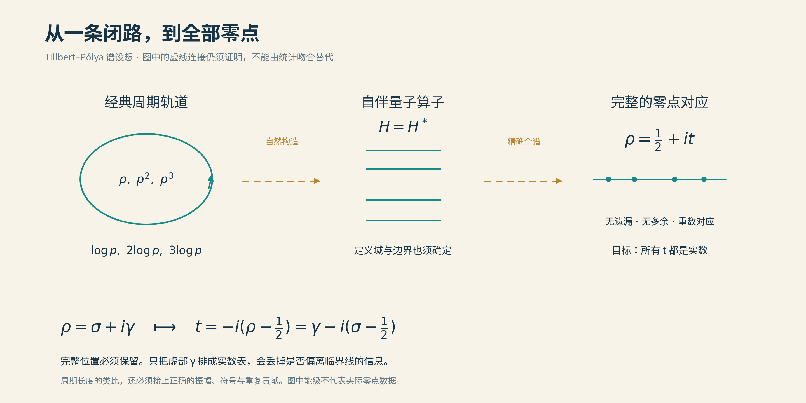

# 13 弹出素数的乐章

假如把14.1347、21.0220、25.0109……依次输入一台合成器，再把它们换成耳朵能听见的频率，我们便能得到一段由黎曼零点写成的声音。

这并不难。任何一串数字，都能用同样的办法播放出来。

真正困难的，是把顺序倒过来：先造一件有独立工作原理的乐器，不把零点坐标输入进去，让它自己发出这些音。

迈克尔·贝里、乔纳森·基廷、赫尔曼·谢拉等物理学家追逐的，正是这类问题。他们的乐器有时只存在于方程中，有时看起来像一套反射镜。它们共同面对一个要求：声音不能只是听着像，最后还必须解释，每一个音为什么恰好在那里。

*迈克尔·贝里，2014年9月3日于亚美尼亚光学与光子学前沿暑期学校。 作者：Vahram Mekhitarian；Commons裁剪：Jakob Gottfried；[来源](https://commons.wikimedia.org/wiki/File:Michael_Berry%2C_Yerevan_-_Ashtarak%2C_Armenia%2C_FOP-2014%2C_03.09.2014_%28cropped%29.jpg)；[CC BY-SA 4.0](https://creativecommons.org/licenses/by-sa/4.0/)。本项目未修改原文件，保留原有标识。*

## 琴键之间，藏着什么消息

先看看那张目标乐谱。

黎曼零点的平均间距会随着高度增加而慢慢缩小。越往高音区走，琴键总体上越密，但不是每相邻两键都越来越近。局部仍有较大的空隙，也有靠得比较近的一对。

比较不同高度时，必须先统一尺子：把当地的平均间距都调整成1。这像比较不同城市的街区，先把地图比例尺调到一致，才能谈街巷究竟疏密如何。

经过这种调整，零点之间显露出随机矩阵所预言的相关与排斥。蒙哥马利证明了受限定条件下的对相关结果，完整的统计图景仍包含猜想；奥德里兹科的计算则提供了非常强的数值支持。

这份统计画像可以帮助筛选候选乐器。假如某个系统的音符完全独立、可以毫无忌惮地挤在一起，它多半少了某种重要结构。

可是，画像没有给每个音符办身份证。许多系统可以拥有同一种统计，正如许多树林都能有类似的树高分布。要得到黎曼零点，仍须找到更细的算术联系。

## 从圆形台球桌走到体育场

把一颗理想小球放进圆形台球桌，按照镜面反射的规则碰撞。每次入射角与反射角相等，圆的几何又保存了额外的秩序。轨道可以很长，却不必因此混沌。

换成一张由长方形中段和两头半圆组成的体育场形桌面，情形就不同了。直边与曲边交替作用，初始方向的细微差别会在长期运动中被放大。如此简单的一副边框，便能支持丰富的混沌动力学。

现在把小球换成波。我们不再问它第十次碰撞发生在哪里，而是问桌面允许哪些驻波模式。类似的数学问题可以出现在微波腔体中，也可以出现在微小的电子系统里。

这就是量子混沌的一项重要任务：理解经典轨道的性质，怎样留在波动系统的谱中。

这里还有一把隐藏的分类钥匙。对于通常讨论的无自旋情形，如果系统保持相应的时间反演对称性，常用的随机矩阵参照是GOE；适当破坏这种对称性，才可能进入与黎曼零点相联系的GUE类别。混沌台球的边框即使足够复杂，也不会自动完成这个转换。

这些对称性像乐器的制作规格，决定它属于哪一类。它们不能给出整首曲子，却能告诉制作者，有些材料一开始就选错了。

## 闭合路线怎样留下回声

在一片混沌轨道中，有一些很特别的路：走过一圈，粒子回到起点，方向也恢复原样。这样的周期轨道，可以不断重走。

波的传播会让不同路径的贡献叠加。有些互相加强，有些互相抵消。半经典理论把这种干涉与经典路径联系起来，其中周期轨道尤其重要。某些迹公式由它们的集体贡献，描述能级密度的起伏。

这提供了一种听谱的方法：一串音符的细节，可能藏着所有闭合旅程留下的回声。

在黎曼显式公式中，素数也有相似的组织方式。一个素数p提供基本贡献，它的平方、立方等继续出现。对应到周期轨道的图景，基本周期与log p相联系，素数幂则像同一条路线重复绕行。

于是，2、4、8可以帮助我们想象一圈、两圈、三圈。6却不能当成2这条路再绕一次，它包含的是不同素数的组合。区分原始材料和重复方式，正是这类公式的结构所在。

动力系统本身也能定义ζ函数，用乘积把原始周期轨道打包。这里“ζ函数”已经成为一种组织信息的语言：一端把整数分解成素数，另一端把重复路线分解成原始闭路。

当然，各种动力ζ函数记录的是各自系统，不会因为名字一样，就变成黎曼ζ函数。引人注意的是，这份结构相似足够具体，值得拿来寻找那件未知的乐器。

## 最简单的候选，只有位置乘动量

贝里与基廷提出过一个令人难忘的候选：

$$
H=xp.
$$

这里x是位置，p是动量，H描述系统的能量。

这个模型的经典运动很特别：位置向外指数增长，动量按相反方式缩小，乘积保持不变。它像一张一边拉长、一边压窄的橡皮片，面积关系却受到约束。

为什么这会吸引研究者？在半经典观点中，估计能级数目，可以先看相空间中容纳了多少个量子小格。对位置乘动量的模型作适当截断后，算出的平均计数，出现了与黎曼零点相同的主要增长形状。

换成音乐的说法，就是琴键的平均疏密有了正确的轮廓。往高处走，音符越来越密，而且变密的方式也对得上。

这是一条有分量的线索。它不是先抄一张零点表，而是由一个很简单的动力学形状产生了对数式的密度。

*图：H=xp的轨道是双曲线，位置指数增长、动量指数衰减。教学性截断下的面积积分给出E log E−E+1，展示平均计数中对数项的来源；如何定义边界和完整量子谱，仍须另行处理。*

但原始模型的轨道不会自己闭合。位置可以越走越远，动量越来越小。研究者在相空间上画出的边界，又不能只是一根铅笔线：运动撞到那里，究竟如何继续？

于是，看似最简单的公式，把困难交给了边界。

## 边界也是乐器的一部分

一根弦，两端固定与一端自由，声音就会改变。同一段空气柱，开口与闭口，也不是同一件管乐器。

所以，写下一个量子算子的形式还不够。它在哪些状态上工作，边界怎样连接，哪些波形允许存在，都属于乐器的制作图纸。

定义合适的自伴算子，谱位于实轴。但自伴性不是因为公式看起来左右对称，就自动成立；无限维系统中，边界和定义域会决定这件事。

2011年，谢拉与罗德里格斯－拉古纳对位置乘动量模型作了修改，让经典运动能够形成闭合周期。贝里与基廷同年也研究了紧化的版本。这些模型进一步把平均谱密度与明确的动力学联系起来。

它们的收获是实在的：原先向远处逃去的轨道，被安置进更可控的结构。

但平均音符数正确，仍然没有把每个音符的位置钉住。两首曲子可能同样长，每分钟音符数相同，听起来却完全不同。真正属于素数的那些细节，还藏在平均背景上面的起伏里。

## 在反射镜之间安排素数

谢拉后来把问题搬到一个更具画面感的系统里：粒子的传播与反射镜。

在相关模型中，镜面排列、反射强弱和边界相位都参与决定波怎样干涉。素数的信息可以进入镜面构造，让不同传播路线携带与算术相应的节奏。

这里的“相位”，可以先想成两个摆动是否踩着同一拍。哪怕频率相同，一个向上时另一个向下，也可能互相抵消。反射发生时改变多少相位，就会改变某些频率是被保留下来，还是被压低。

这使“素数像周期轨道”变得更具体。我们不仅在两张公式中寻找同样的字样，还能问每一次传播、每一次反射怎样产生某个贡献。

同时，构造也暴露了困难。特定的弱反射极限和边界相位选择，会影响哪些零点以怎样的谱现象出现。如果针对一个目标零点调节相位，便应进一步问：能否用同一个独立给定的装置，让全部零点同时出现？

这不是否定调节旋钮的价值。实验与模型本来就靠调节理解机制。但为每个音单独换一副琴身，与造出一件固定的乐器，是两种不同的任务。

## 最难对齐的，往往是小系数

素数与轨道的字典，最醒目的条目是“素数对应原始闭路”。真正做下去，研究者却常被不那么醒目的细节拦住。

闭路走得越长，贡献应当怎样衰减？同一路线绕两圈、三圈，强弱怎样变化？波相遇时产生的正负号，又能否与显式公式一致？

即使所有周期都出现了log p，振幅和相位不对，最后仍会唱出另一首歌。

这些问题解释了为什么一条看起来如此诱人的对应，能够持续几十年而不轻易闭合。动力系统不是一份可随意修改的菜单。改变边界来修正一处系数，往往又会影响别处；给某项加一个所需的负号，也必须说明它来自什么真实的数学结构。

真正的候选模型，须让这些细节一起服从同一套规则。那时才有可能从一份类比词典，走向一条定理。

## 为何“全部零点”不能省略

最后再回到谱路线最初的愿望。

把非平凡零点所在的复平面旋转、平移，使临界线变成实轴，黎曼猜想就是：在新的坐标中，全部非平凡零点都是实数。如果它们恰好构成某个自伴算子的谱，实性便获得了结构保证。

这里要变换的是完整的零点位置。若只取每个零点的虚部，再排成一列实数，当然会得到一列实数，但原来的零点有没有偏离临界线，早已在这个操作中被丢掉了。

*谱路线要架起一整座桥：从周期轨道的算术结构，构造有正确边界和定义域的自伴算子，再把完整的ζ非平凡零点与谱精确对应。两段金色虚线都是必须补足的证明任务。只排列零点的虚部，会丢掉离线信息。 本项目原创；[图源、数学依据与简化说明](img/README.md)。*

因此，制琴图纸必须说明，算子怎样独立构造，全部零点怎样进入，没有遗漏，也没有混入不该有的谱；零点重复出现几次，也要对应起来。不同方案可以用本征值、散射或谱的缺失来表达，具体形式未必相同，整座桥却不能缺少这些连接。

谱路线的魅力，在于它试图把一个位置猜想变成结构的必然。它的艰难，也正在于结构必须足够完整。

我们还没有拿到那件最终的乐器。但平均密度、周期轨道、相位与边界，已经让寻找过程变得具体。下一节换一种做法：既然函数的表达式已经知道，能不能先让一台可控装置执行它，再从物理信号中读出零点？

这一次，乐器将真正开机。

[全书目录](../README.md) · [本篇目录](README.md) · [上一节](12_Connes和他的学徒们.md) · [下一节](14_在动力学系统中寻找零点.md)
