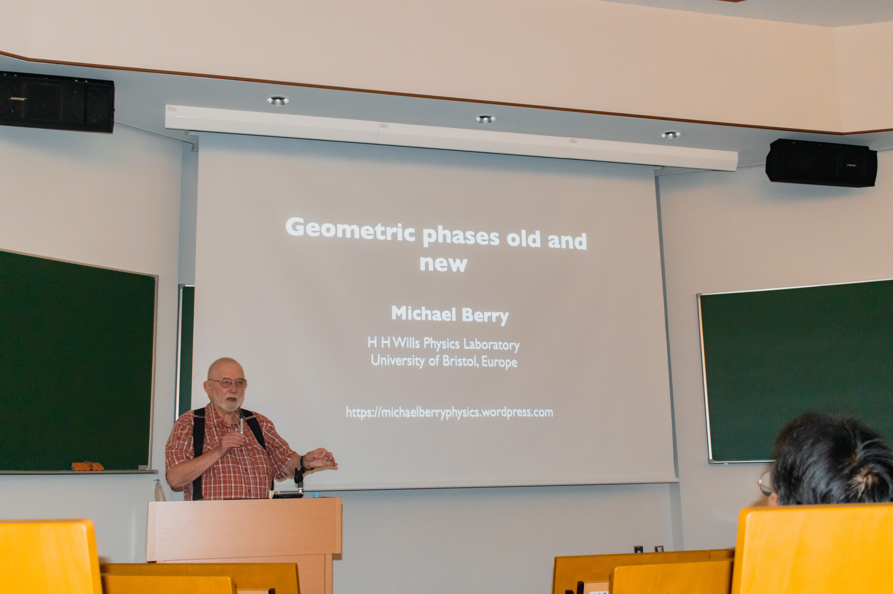
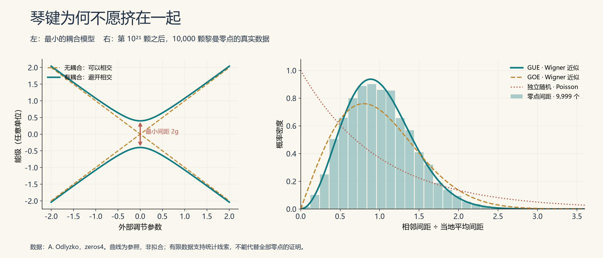
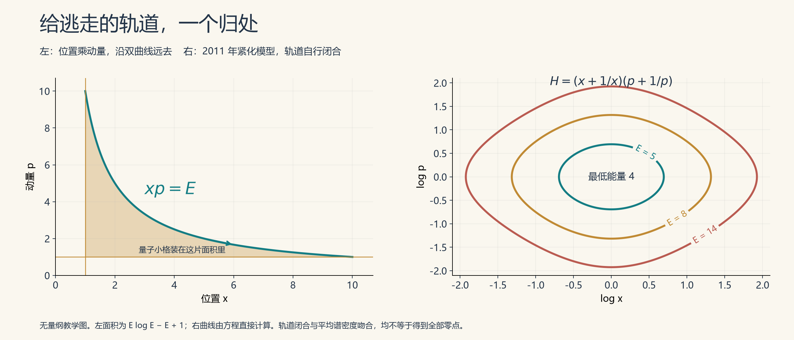

# 13 弹出素数的乐章

2012年，迈克尔·贝里真的让素数唱了一回歌。

他把第一颗黎曼零点的高度14.1347……换算成钢琴最低音的27.5赫兹，再按同一比例，把后面的零点排进听得见的音域。钢琴的音域里，由此容下了1657个零点音符。[^ref1]

数学家的钢琴，琴键多少有些拥挤。

这还不是随意给一串数字配音。贝里沿着连接素数与零点的显式公式，让不同频率按照各自的分量叠加：一边是零点的振荡，一边是数到素数及其幂时，计数函数留下的台阶。那座横跨数论两岸的桥，终于有了声音。

然而，纸上的和谐未必讨耳朵喜欢。贝里在论文里坦言，把它听成音乐，需要一点想象力。若放慢速度，素数幂的台阶能化作一个个点击声，低处的零点音调却会落到听觉范围之外；若调快到能听见那些低音，后来密集的台阶便难以逐个分辨。

素数与零点，仿佛分别坐在音乐厅的两端。你把耳朵凑近一边，另一边就退入了远处。

不过，贝里心里还有一件更难的事。

**照着乐谱播放声音，已经做到了。能不能造出一件乐器，让它自己长出这张乐谱？**

前面说过的希尔伯特–波利亚设想，到这里便从一句壮丽的愿望，变成了几张需要认真画完的施工图。零点的统计风格，琴键的平均疏密，每个音符的准确位置——三道门，必须一道一道推开。

*2025年8月25日，大阪大学南部阳一郎会馆，贝里讲授“新与旧的几何相位”。这是另一项以他命名的研究，并非黎曼猜想报告；照片里的黑板与听众，保留了理论物理日常的尺度。[大阪大学活动记录](https://qiqb.osaka-u.ac.jp/en/newstopics/news20251008)。*

## 弦外之音

寻找乐器，先听音色。

黎曼零点越往高处走，总体上排得越密。但把各处的平均间距都调成1，再看相邻零点怎样站队，一种很特别的秩序便浮出来：它们不太愿意挤在一起，却也没有整齐到站成仪仗队。

物理学家把前一种倾向叫作**能级排斥**。这里没有谁真的伸手推谁；它说的是，极小的间距出现得比独立随机排列时少得多。

可以先看一个最小的例子。两条能级曲线原本迎面而来，交叉而过；一旦两个状态之间有了耦合，曲线往往就会在相遇处弯开。好比两根可以彼此传递振动的弦，接在一起之后，允许的振动方式已不再是原先两根弦的简单拼盘。

这种“避开相交”的现象，帮助我们理解为什么能级会排斥。不过，要进一步分清排斥有多强，还得看系统的对称性。[^ref2]

随机矩阵理论里有两个常用参照。GOE可以先记成实对称矩阵的世界，GUE则是复厄米矩阵的世界；两者都有实数本征值，却留下不同的间距统计。在小间距处，前者的概率密度大致按间距的一次方趋向零，后者按平方趋向零。GUE对“挤得太近”更为挑剔。

黎曼零点显露出的，正是后一种气质。

*右图使用奥德里兹科公开的实际计算数据：第10²¹颗之后的10,000颗零点，共9,999个相邻间距。GUE、GOE曲线采用Wigner近似，独立随机参照采用泊松过程的指数间距分布；曲线未对数据作参数拟合。左图只是解释避交的两能级模型，本身不推出右图的完整统计。[数据来源](https://www-users.cse.umn.edu/~odlyzko/zeta_tables/zeros4)，[复现与计算说明](../资料/13_弹出素数的乐章/03_数学解释.md)。*

蒙哥马利的工作、奥德里兹科的计算，以及后来围绕相关函数的研究，让这张画像越来越清楚。但已证明的结果仍有适用条件，完整的GUE统计图景不能一笔写成定理。[^ref2]

而且，这首先是一张**局部统计画像**。把观察尺度拉长，具体素数带来的痕迹仍会回来。黎曼零点并没有把自己的籍贯注销，只是与一大类物理系统，说着相似的方言。

## 琴房里的一条单行道

这样的物理系统，到底有没有造出来？

有。走进实验室，先遇到的未必是量子计算机，也可能是一只扁扁的金属腔体。

微波在其中传播、反射，只有某些频率能够形成特定的共振模式。把这些共振频率排成一列，就得到一份可以拿来研究的谱。改变腔体形状，便像改变台球桌的边框；射线怎样跑，波怎样干涉，两种描述在这里相遇。

这就是量子混沌关心的一种联系：经典运动的混沌，怎样留在量子或波动系统的谱里。不过，一张会产生混沌运动的台球桌，还不够。

设想把一段运动录像倒放。对于适当的无自旋系统，如果倒放后的运动仍遵守同一套规律，时间反演对称性就还在；在排除其他对称性分块之后，常见的统计参照是GOE。要走向GUE，通常还得拆掉这份正反方向的等价。

1995年，施托弗雷根等人在微波台球系统上接入了一个隔离器：它像一段只准单向通行的道路。研究者改变腔体长度，追踪共振谱的变化，在相邻间距、能级曲率和避交的最小距离等观测量中，看到了GUE的特征。[^ref3]

数学家还在寻找通往黎曼的路，实验物理学家先给道路装上了单行标志。

后来，破坏时间反演对称性的手法越来越细。2007年的研究利用磁化铁氧体，让不同旋向的微波感受到不同响应，并在相邻共振的行为中测出这种差别。到2022年，芭芭拉·迪茨与合作者，已经用相连的微波波导搭起“道路网络”，同时研究保留对称性与部分破坏对称性时的谱和波形。[^ref4]

所谓量子图，可以先想成一张立体地铁图：波沿着边传播，到节点处，按既定规则分流、反射，再沿不同路线回来相遇。复杂性藏在岔路口，也藏在各条路的长度里。

实验甚至会提醒我们，分类不能只看一句口号。2024年一项微波网络研究中，整个网络具有时间反演对称性，部分观测统计却接近GUE；进一步分辨才知道，方向子结构、实验未分开的成对谱线与漏测都参与了这张图像。放大去看，偏差也在那里。[^ref5]

因此，“出现GUE”已经是可测量、可比较、可追问误差的物理问题。

但同一支乐队，能演奏许多曲子。找到与零点拥有相似统计的系统，尚未找到那件只奏出黎曼乐谱的乐器。

## 四十二，另有回响

乔纳森·基廷进入这段故事，起初是贝里的博士生。

多年后，在庆祝贝里75岁生日的会议上，他回忆自己的择师经历：研究水准当然重要，支持年轻人、容许自由探索的气氛也很重要。还有一张照片，贝里穿着印度长衫，颇令他心动。[^ref6]

学术门派的传承，有时也包含一点衣品。

这份不急于划分学科边界的趣味，后来结出了很实在的果实。基廷既做量子混沌，也研究数论；他在2021年的访谈中回忆，自己一度把工作时间分给布里斯托大学与惠普研究实验室。研究随机矩阵的人，工作地点也很有交叉学科的风格。[^ref7]

*基廷在右侧，与伦敦数学会获奖者合影。照片载于牛津数学系2021年通讯；原图注还标明了本·格林与希瑟·哈灵顿，未注明拍摄日期。[通讯原件](https://www.maths.ox.ac.uk/system/files/attachments/March%202021_0.pdf)。*

2000年，基廷与妮娜·斯奈思做了一件比“曲线看着像”更进一步的事：**让随机矩阵替数论作出精确预测。**[^ref8]

只看零点，知道的是函数在哪里沉到零。还有另一个问题：在临界线上，ζ函数平时有多大，偶尔又能掀起多高的浪？

最直接的办法，是把它的大小平方、四次方、六次方……再取平均。次数越高，罕见的大浪越有分量。数学家把这些量叫作“矩”。

基廷与斯奈思研究了随机酉矩阵的特征多项式。特征多项式也会在特定位置变成零；把它当作ζ函数的一个统计模型，就能追问：零点附近的低谷、高峰与整体起伏，是否也有相通之处？

他们使用的是CUE，即圆酉系综。名字与GUE不同，因为特征值住在单位圆上；在大矩阵的局部平均间距尺度上，两者却具有相同的那类普适统计。换了舞台，熟悉的节奏仍在。

结果很漂亮。把ζ函数矩的主项中另行出现的素数算术因子及常用归一化分开，随机矩阵给出的组合常数依次是：

$$
1,\qquad 2,\qquad 42,\qquad 24024,\qquad \ldots
$$

前两项接上了已知结果，42接上了此前数论家的猜测，后面还有一整串可以继续检验的预言。这里的42并不是黎曼零点的编号，也不是一项高阶矩已经被证明的印章；它是两条独立思路，在同一个精确常数处相遇。

随机矩阵中的计算有严格结果，把它转译成ζ函数全部高阶矩的渐近公式，则仍是一套需要数论来兑现的预测。

这便是跨界的分量：尚未拿下山顶，已经从另一面山坡，送来了有用的地图。

## 一乘之间

统计告诉我们音色，平均密度告诉我们琴键该怎样铺开。贝里与基廷寻找的下一条线索，简单得近乎吝啬：

$$
H=xp.
$$

位置乘动量，就是这个经典系统的能量。[^ref9]

它的运动像拉伸一张橡皮片：位置按指数增大，动量按相反的比例缩小，乘积保持不变。在横轴为位置、纵轴为动量的图上，轨道是一条双曲线。

别被“指数增大”四个字骗了。这个原始模型可以解得清清楚楚，本身是可积系统，并不因为拉伸得快，就成了混沌。

它真正诱人的地方，是面积。

量子力学不允许位置与动量无限精细地同时确定。半经典计数的一种办法，就是把相空间分成一个个大小固定的量子小格，看看能量不超过某个限度时，大致能容下多少格。

为看清机关，先取一个无量纲的教学版本：位置和动量都至少为1，能量不超过E。双曲线下面、两条边界之间的面积就是：

$$
A(E)=\int_1^E\left(\frac{E}{x}-1\right)\,dx
=E\log E-E+1.
$$

对数，就这样从面积里长了出来。

而黎曼零点的平均计数，最醒目的结构恰好也是“高度乘以高度的对数，再减去一个与高度成正比的量”。放回恰当的量子单位，贝里–基廷方案便能对上那两个主要增长项。

这不是先查零点表，再给模型填答案。一条极简单的双曲线，自己提供了正确的平均疏密。至于常数项、边界相位与真正的量子算子，还要另算；上面的教学面积不能替它们包办。

可是，沿双曲线跑出去的粒子，什么时候回来？

原始模型没有回答。它一路远去，留下连续的谱，离一颗颗分立的零点仍有距离。在相空间里画两条截断线，也不等于给粒子规定了完整的返程办法。

琴键的数量有了眉目，琴身还漏着风。

## 让远行者归来

2011年，赫尔曼·谢拉与哈维尔·罗德里格斯－拉古纳给这个老模型添了一项。在合适单位下，原先的“位置乘动量”变成“位置乘以动量与动量倒数之和”；再结合边界处的反射，原本逃走的轨道可以形成闭路。[^ref10]

同年，贝里与基廷也给出了一个更对称的紧化版本。在正的位置、正的动量区域，他们同时使用“位置加位置倒数”与“动量加动量倒数”。位置或动量走向零与无穷时，都会遇到越来越高的能量代价，于是有限能量的轨道被留在有界区域里。[^ref11]

*左图解释平均计数中的对数来源；右图直接按贝里–基廷2011年的无量纲模型计算，坐标为log x与log p。两者解决的问题有区别：铅笔画出的截断区域，不等于动力学自己形成的闭合轨道。*

这段合作还有一个小小的脚注：贝里与基廷在论文致谢中，感谢谢拉提前寄来手稿，激发了他们的研究。几位作者的名字，并非恰好挤进同一张参考文献表；思想确实曾在他们之间来回走动。

从“画一道边界”到“写出能把轨道带回来的运动”，是实在的推进。量子版本再配上合适的定义域与边界条件，可以认真讨论自伴性和离散能级。所谓自伴，粗略说，就是保证能谱实性的一种算子结构；它不能只靠公式外观漂亮，边界也得守规矩。

但这些改造仍主要对齐零点的**平均计数**。贝里与基廷自己指出，那个紧化模型在给定能量上只有一条基本周期轨道，并没有出现为无穷多个素数准备的整支队伍。

把每页音符的总数数对了，还不知道哪一个音该升，哪一个音该降。

零点的个性，藏在平均数没有说出的部分。

## 素数从哪一道门进来

一条闭合轨道，走一圈回到原处，走两圈还是回到原处。波可以沿这些路线传播，不同路线的贡献互相干涉，影响哪些能量更容易出现。

半经典迹公式把这种联系写得很具体：**能级密度的起伏，可以由周期轨道的贡献来描述。**

黎曼显式公式里，也有一套令人心动的结构。每个素数提供基本贡献，素数的平方、立方继续出现；与之相伴的对数，又恰好能把乘法改写成周期的相加。

于是，物理学家试着编一本字典：

| 算术的一边 | 动力学的一边 |
| --- | --- |
| 素数p | 一条原始周期轨道 |
| log p | 这条轨道的基本周期 |
| p²、p³…… | 同一条轨道再走两圈、三圈…… |
| 素数贡献的叠加 | 所有闭路回声的干涉 |

2、4、8，便像同一条路上的一圈、两圈、三圈。6不能冒充其中的下一圈，它还带着另一颗素数的消息。

这张字典很美，却不宽容。周期对了，振幅还要对；绕两圈以后衰减多少，要对；相位、正负号，也得对。贝里与基廷1999年的分析，把这些要求和困难都摆到了桌面上。[^ref9]

尤其麻烦的是重复轨道。你不能为了第一圈补一个负号，却忘了第二圈仍须服从同一套动力学。乐器内部没有一个小人，等着按数论家的要求逐项修音。

**GUE是许多系统共有的统计风格；素数周期、振幅与相位，才开始触及这首曲子的身份。**

从这里往前，谢拉选择了一面面镜子。

## 镜中有回声

谢拉的个人网站上，有一张很适合这段故事的照片：他坐在咖啡馆里，面前摊着笔记本电脑，身后是博尔赫斯与比奥伊·卡萨雷斯的雕像。

镜子、迷宫、无穷，博尔赫斯写过不少。照片当然不能证明谢拉当时在想什么；但让这样两位安静的邻座，陪一位研究黎曼零点的物理学家工作，多少有些相得益彰。

*谢拉个人网站所载照片，原图说明提到博尔赫斯与比奥伊·卡萨雷斯；背景人物为雕像，不是三人的历史合影。网页未注明拍摄年月，也未说明电脑上的研究内容。[来源](https://members.ift.uam-csic.es/gsierra/)。*

2014年，谢拉提出一套与加速观察者有关的镜面模型，并用无质量狄拉克费米子的传播来描述它。术语可以暂时放下，先看他最想做成的动作：**让一次往返的时间，携带整数的对数。**[^ref12]

这不是在普通桌面上随意摆几面镜子。镜面的运动及位置参数经过特定安排；在相应观察者使用的时间尺度下，第n面镜子的往返回声，可以带来log n。

于是，一次涉及2的往返，再加一次涉及3的往返，总时间便与涉及6的某种路径发生联系，因为log 2加log 3等于log 6。整数的乘法，开始在传播时间里留下影子。

下一步是干涉。半透明镜允许波的一部分通过，一部分反射。多条路径到达时，可能加强，也可能抵消。怎样让重复信息消去，留下需要的算术贡献？前面遇到过的莫比乌斯函数，又回来了。

在谢拉后来的表述中，镜面对应的势与无平方因子整数相联系，反射系数带入莫比乌斯函数等算术权重。素数不再只是迹公式旁边的一行注释，整数的分解结构参与了装置的规则。

有趣的进展也伴随着更具体的难题：反射越弱，哪些项可以保留？无穷多面镜子的贡献能否收敛？边界反射时改变的相位，又会留下哪些频率？

相位可以先理解为“踩不踩同一个拍子”。两束波各自都在振动，却可能因为一束向上时另一束向下，相遇之后几乎归于寂静。改变边界相位，就可能改变一颗零点在谱中是显现，还是缺席。

谢拉在2019年的论文中，把一个关键区别说得很清楚：他的构造给出的是一种**局部的谱实现**——针对目标零点，精细调节边界参数，使它成为相应算子的本征值；而希尔伯特–波利亚原先想要的，是同一个算子容纳全部零点。[^ref13]

他还讨论了通向黎曼假设证明的思路，但在结论中明言，弱反射极限及若干级数的收敛仍需更深入分析。

这套模型也有比普通GUE更细的对称性分类：AIII，亦称手征酉类。它为讨论正负能量配对等结构提供了位置；一个分类名称，却不能替代对整个能谱的计算。

因此，镜子已经把“素数如何进入传播”讲得比抽象类比更具体，却还没有组成那件一经定弦、便能弹出所有零点的乐器。

每个音单独调得出来，与整张乐谱自己生长出来，中间仍隔着一段路。

## 此曲尚未终

走到这里，再回望最初的希尔伯特–波利亚设想，景色已经不同。

GUE不再只是数论家桌上的一幅奇异曲线，它可以在微波腔体与网络中接受实验检验；随机矩阵也不只替零点画像，还为ζ函数的起伏给出了精确预测。位置乘动量的模型解释了平均计数中对数的来处，闭合轨道修补了原始运动的缺口，镜面方案则试着把素数的算术送进传播与干涉。

这些进展没有合成同一个完整系统。若要以谱证明黎曼假设，最后仍须让全部非平凡零点与一个合适的自伴结构精确对应，连可能偏离临界线的零点也不能事先排除。只抄下已知零点的虚部，排成实数队列，困难并不会因此消失。

但寻找的过程已经长出了器物：腔体、岔路、边界、镜子。一个十九世纪的问题，在二十世纪的量子理论与二十一世纪的实验台之间，继续寻找自己的声部。

下一节，我们把问题再挪近一点：既然ζ函数的表达式已经知道，能否设计驱动与控制，让真实装置的响应显出它的零点？

这一节追问乐器的谱为什么像黎曼；下一节，要看零点怎样出现在仪器的读数里。

灯还亮着。有人继续画图纸，有人已经接通了电源。

---

### 资料与注记

[^ref1]: Berry，*Hearing the music of the primes: auditory complementarity and the siren song of zeta*，J. Phys. A 45, 382001 (2012)，尤其§§2–3。声化公式的相应解释采用RH，有限个已知零点的合成并非独立谱构造。[作者全文](https://michaelberryphysics.wordpress.com/wp-content/uploads/2013/07/berry454.pdf)。

[^ref2]: Bourgade、Keating，*Quantum chaos, random matrix theory, and the Riemann ζ-function*，Séminaire Poincaré XIV (2010), 115–153。[综述全文](https://seminaire-poincare.pages.math.cnrs.fr/keating.pdf)。局部统计与长程算术修正另见注9。

[^ref3]: Stoffregen等，*Microwave Billiards with Broken Time Reversal Symmetry*，PRL 74 (1995), 2666–2669。[出版社摘要](https://journals.aps.org/prl/abstract/10.1103/PhysRevLett.74.2666)。本轮按摘要核对装置与观测量，未取得全文。

[^ref4]: Dietz等，*Induced Time-Reversal Symmetry Breaking Observed in Microwave Billiards* (2007)，[作者全文](https://arxiv.org/abs/cond-mat/0702041)；Zhang等，*Experimental study of closed and open microwave waveguide graphs with preserved and partially violated time-reversal invariance*，PRE 106, 044209 (2022)，[作者全文](https://arxiv.org/abs/2206.07873)。前者侧重相邻共振的对称性破缺，后者包含部分破缺的过渡情形，不能统称为所有统计都已达到纯GUE。

[^ref5]: Farooq等，*Coupled unidirectional chaotic microwave graphs*，PRE 110, 014206 (2024)。[作者全文](https://arxiv.org/abs/2409.03493)。正文据摘要及§IV；论文明确报告了实验与GUE的偏差，以及数值分辨双重谱线后的显著差别。

[^ref6]: IOP Publishing，贝里75岁生日会议报道，2016年4月19日。[原报道](https://jphysplus.wordpress.com/2016/04/19/physics-art-mathematics-science-hidden-connections-a-conference-marking-sir-michael-berrys-75th-birthday/)。衣品一语为本文旁白。

[^ref7]: 牛津大学数学系2021年通讯，*An interview with Jon Keating*，PDF第9–10页。[原件](https://www.maths.ox.ac.uk/system/files/attachments/March%202021_0.pdf)。

[^ref8]: Keating、Snaith，*Random Matrix Theory and ζ(1/2+it)*，CMP 214 (2000), 57–89。[作者报告版](https://empslocal.ex.ac.uk/people/staff/mrwatkin/zeta/keating-snaith.pdf)。本轮目视核对报告版PDF第4–6页的公式与常数；归一化及交叉核对见研究底稿。

[^ref9]: Berry、Keating，*The Riemann Zeros and Eigenvalue Asymptotics*，SIAM Review 41 (1999), 236–266，尤其§6。[作者全文](https://michaelberryphysics.wordpress.com/wp-content/uploads/2013/06/berry307.pdf)。

[^ref10]: Sierra、Rodríguez-Laguna，*The H=xp model revisited and the Riemann zeros*，PRL 106, 200201 (2011)。[作者全文](https://arxiv.org/abs/1102.5356)。

[^ref11]: Berry、Keating，*A compact hamiltonian with the same asymptotic mean spectral density as the Riemann zeros*，J. Phys. A 44, 285203 (2011)，尤其结论与致谢。[作者全文](https://michaelberryphysics.wordpress.com/wp-content/uploads/2013/06/berry4401.pdf)。

[^ref12]: Sierra，*The Riemann zeros as energy levels of a Dirac fermion in a potential built from the prime numbers in Rindler spacetime*，J. Phys. A 47, 325204 (2014)。[作者全文](https://arxiv.org/abs/1404.4252)。镜面位置参数、往返时间与弱反射等条件见底稿；不是普通静止镜阵的实验报告。

[^ref13]: Sierra，*The Riemann Zeros as Spectrum and the Riemann Hypothesis*，Symmetry 11, 494 (2019)，尤其§15。[正式论文](https://www.mdpi.com/2073-8994/11/4/494)，[全文存档](https://s3.cern.ch/inspire-prod-files-1/1e65b86fec7566dba4d2d2384183f67b)。

论文原件、人物材料、公式展开、照片来源及图像复现，见[第13节研究底稿](../资料/13_弹出素数的乐章/README.md)。

[全书目录](../README.md) · [本篇目录](README.md) · [上一节](12_Connes和他的学徒们.md) · [下一节](14_在动力学系统中寻找零点.md)
