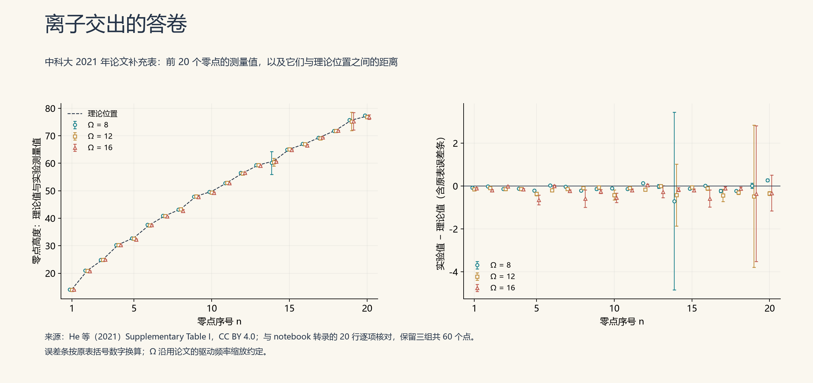
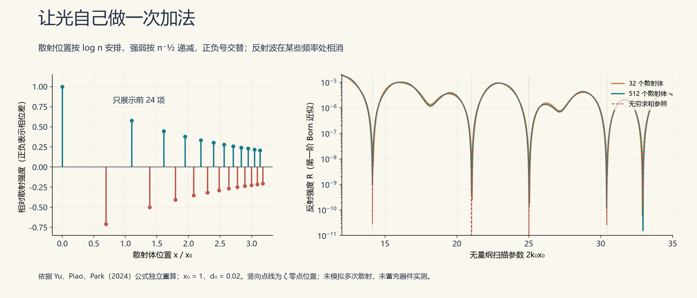
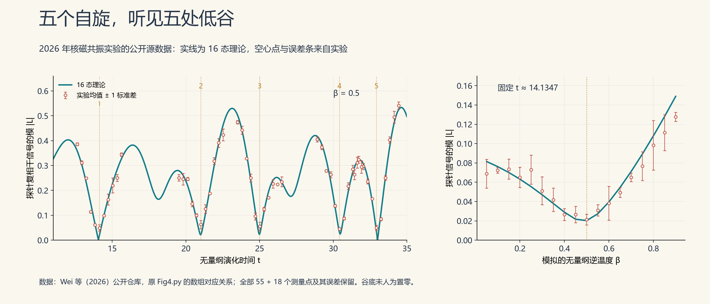
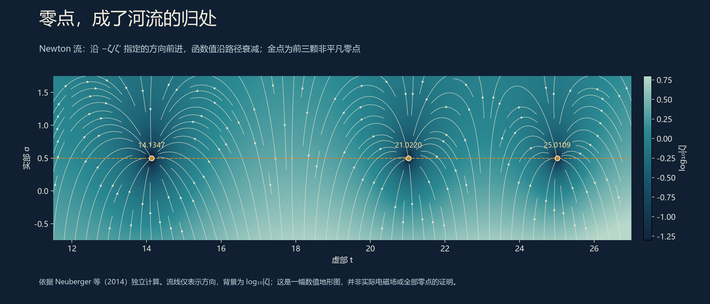
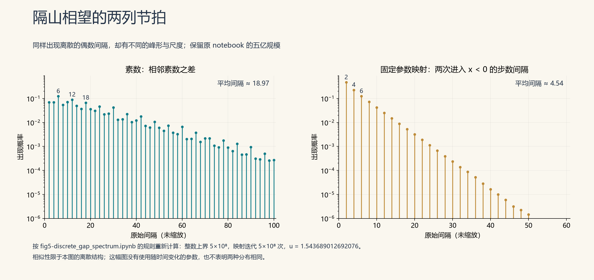
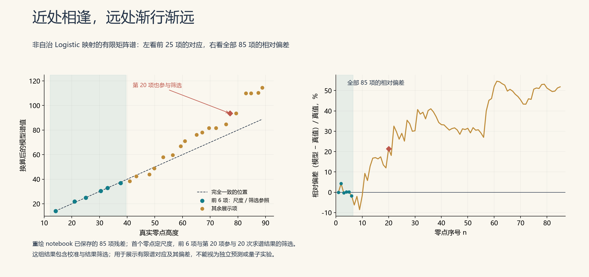

# 14 在动力学系统中寻找零点

实验室里，人们通常盼着仪器有反应。

2021年，中国科学技术大学的研究者却在等待一颗镱离子安静下来。

微波仍在施加，控制信号仍在变化。可当旋钮转到某些位置，离子内部两个量子状态之间的转移，竟像被人轻轻按住了。那些使它沉默的数字，与黎曼ζ函数的零点相连。[^he2021]

一百多年前写在纸上的问题，如今要听一颗原子的回音。而最值得留意的回音，恰好是没有回音。

上一节，我们听的是乐曲的风格：能级之间怎样避让，间距怎样起伏，是否有GUE的气息。这一节，要辨认具体的音符。

**怎样让一个零点，在仪器上留下自己的位置？**

实验台也在变得宽阔。精密装置之外，越来越多的尝试可以先在计算机里搭起原型：写一条运动规则，迭代百万次，求一组矩阵的谱，再让它与零点碰面。数值软件与可获得的算力，让物理、工程和计算科学背景的研究者，也能把自己的工具带到这张桌前。

有些问题还在等新的数学，有些想法，已经不必等一间新的实验室。

## 此时无声

参与这项研究的名字里，有上一节的老熟人：赫尔曼·谢拉。

他和查尔斯·克雷菲尔德（Charles Creffield）早已在琢磨这件事。2014年，两人公布方案，次年正式发表：给冷原子施加精心安排的周期驱动，让量子态之间的转移在某些参数处受到压制，用这些位置寻找零点。[^creffield]

到2019年，中国科学技术大学团队与两人合作，把想法带进了单离子实验，论文于2020年发表。首个黎曼零点，开始出现在一个受控量子比特的响应里。2021年的工作，则把可辨认的范围推进到前80个零点。[^he2019][^he2021]

装置的主角是一颗镱离子。电场把它困在小小的空间里，研究者选出它内部的两个能级，充当量子信息的“0”和“1”，再用微波控制两者之间的转移。

难处在于，微波不能随便播一首歌。

研究者需要把函数的计算规则，翻译成驱动信号的波形。信号每隔一段时间重复一次；如果总在完整周期结束时观察，周期内复杂的变化，就能由一个较简洁的“有效作用”来描述。这是Floquet理论擅长处理的事。

好比观察一位舞者：每个瞬间都很繁复，但每跳完一轮，脚步究竟向前挪了多少，仍可以数清。

设计得当，这个累积作用便与一个含有ζ函数的表达式联系起来。扫描外部参数，函数响应随之改变；到了某些位置，有效作用接近零，两个内态之间的转移便近乎停住。

这里的“冻结”，发生在量子内态之间。离子没有被冻成冰珠，更没有暂停宇宙的时间。

它只是以一种极安静的方式，交出了一张答卷。

*按原论文Supplementary Table I重绘，展示Ω＝8、12、16三组共60个测量点。左图看位置，右图看偏差；原表误差条全部保留。数值已与下文研究notebook中的转录逐项核对，Ω沿用论文的频率缩放约定。[补充材料](https://media.springernature.com/original/springer-static/esm/art%3A10.1038%2Fs41534-021-00446-7/MediaObjects/41534_2021_446_MOESM1_ESM.pdf)，He等，2021，CC BY 4.0。这是论文公布的零点估计值，未经加工的采集信号不在此图之内。*

## 沉默也有真假

把一个数学函数交给离子计算，并不等于提前把每一道答案写进离子。

普通计算器预先知道乘法规则，也没有因此失去存在的意义。这里编入的是函数的积分表达式与控制规则；实验要检验的是，这套规则能否可靠地变成物理响应。

但响应为零，仍需要辨认。

一个复数有实部和虚部，像平面坐标里的横、纵两个分量。真正的零点，要求两者同时归零。若只看一个分量，就像只看船是否经过某条经线：经线到了，港口未必到了。

2021年的方案，其有效耦合对应一个由ζ构成的函数的实部。真正的ζ零点会使它消失，可它也有额外的过零位置。例如，约17.899处就是这样的过零位置：实部已经为零，虚部还在，不能给它发一张“黎曼零点”的通行证。

因此，实验中的冻结位置要结合理论结构辨认。论文报告，在30个驱动周期内，前80个零点多数可达到约百分之一或更好的定位精度。[^he2021]

这个进展背后，还有一个很朴素的改动。

早期方案所用的函数，沿着扫描方向衰减得太快。越往后，信号越小，好比远处有人说话，话还没讲完，声音已经埋进风里。

后来的工作换用了另一个与ζ有相同零点、却衰减较慢的函数来设计驱动。要找的坐标没换，仪器终于更容易听见了。

这类细节，比“量子”两个字更能解释实验为什么向前走了一步。

论文的方法部分还留下了一行颇有生活气息的记录：为了应对磁场漂移，实验过程中每半小时就要重新校准一次跃迁频率。数学里的临界线纹丝不动，实验室里的环境可没答应陪它一起。[^he2021]

## 光也会心算

离子之外，还有人让光来做这道题。

2024年，Sunkyu Yu、Xianji Piao和Namkyoo Park提出一类光学散射结构。研究来自首尔大学与首尔市立大学，论文发表在《Physical Review B》。这是一项理论与数值设计：把一串散射体排好，让反射光在与零点对应的波长附近暗下去。[^optical]

不妨想象一列很薄的反光片。

入射光经过它们，每一片都送回一点微弱的反射。各路光走过的距离不同，回来时的相位也不同。有时彼此帮忙，有时互相拆台。最终反射有多强，要把这些带着方向的贡献加起来。

研究者给这列散射体安排了三条规矩：位置按照log n排列，强度按n的某个幂逐渐减弱，贡献的正负交替。

为什么偏偏是log n？

因为光走过的距离决定相位。距离里出现log n，相位就会带上“频率乘以log n”；而这正是复数幂里需要的结构。再把强弱与正负号安排好，叠加出来的式子就接近一条交替级数：第一项加，第二项减，第三项再加……

这条级数叫狄利克雷η函数。在我们关心的临界带里，它与ζ函数拥有相同的零点。

于是，光不必认识希腊字母。它只须遵守干涉规律，就能替人做一次加法。

*按Yu等人的散射公式独立重算。左图只画前24个散射体；右图比较32项、512项及无穷求和的参照曲线，竖向点线标出前五个零点。计算采用弱散射的第一阶Born近似，未包含多次反射，也不是已制成器件的实测结果。*

图里还有一个值得细看的地方：散射体增多，低谷的形状随之改变；有限项并不保证恰好抵消到零。

真实器件还要处理多次散射、加工误差与损耗。论文也讨论了超出最简单近似后的情形。漂亮的级数到了实验台上，每一项都要占地方，每一次抵消都要付出精度。

这条路线的趣味正在这里：把抽象的加法，变成可以设计的空间结构。

## 三十二度的临界线

2026年7月，另一项实验把零点请进了核磁共振系统。参与合作的有魏世杰、翟玥、陆全枫、辛涛、龙桂鲁和Franco Nori等研究者。[^wei2026]

说到量子实验，人们很容易先想到接近绝对零度的寒意。这项实验的样品温度却是305开尔文，约合32摄氏度。

临界线并不总住在冰箱里。

实验使用的分子含有三个氟核和两个氢核，它们的核自旋提供五个量子比特。核磁共振装置读取的是大量同类分子的整体信号；其中四个比特承担模拟任务，一个负责探测。

四个比特，一共可以表示16个基态。研究者便为这16个位置设计能量，按照log 1、log 2、一直到log 16的规律安排。

对数，又来了。

光学方案把它写进散射体之间的距离，这一次，研究者把它写进能级。量子态随时间积累相位，能量里的log n，就会成为相位里的“时间乘以log n”。两种装置，在不同的材料上写出了相近的笔画。

接下来，再安排各项的权重与交替正负号，探针便可以读取这些贡献相加后的结果。

## 十六支箭

若想看清这台小机器在做什么，可以把每一项想成一支会转动的箭。

第n支箭的长度由n和参数β决定，转动速度与log n有关；相邻的两项还要交替取正、负。时间向前，箭头各自转动，最后把它们首尾相接。

如果箭头合成后还剩一截，探针就有响应；如果几乎围成一个闭环，响应便很小。

用一个式子，可以把这件事写完：

$$
L_N(\beta,t)=
\frac{\displaystyle\sum_{n=1}^{N}(-1)^{n+1}n^{-\beta}e^{-it\log n}}
{\displaystyle\sum_{n=1}^{N}n^{-\beta}}.
$$

这里N是参与相加的项数，t是无量纲的演化时间，β控制各项的权重。分母只是统一尺度，真正的相消发生在分子里。

当β取二分之一时，分子对应的无限级数，正好走在临界线上。实验取N＝16，得到它的一个有限版本。

探针还要分别读出两个方向的信号，也就是实部和虚部。两份账一起核对，才能判断合成的箭是否真正接近原点。

*根据论文公开代码与处理后的实验数据重绘。实线为16态模型，空心点及误差条为实验均值与一个标准差，金色点线标记理论参照。左图保留55个测量点，右图保留18个测量点；谷底的残差也原样保留。[原代码与数据](https://github.com/lqf2025/Riemann-data)，MIT许可。*

五处低谷，已经可以辨认。

可别急着把低谷描成五个洞。16支箭与无穷多支箭，毕竟有些家底上的差距；有限项截断会带来偏差，实验也有噪声。图上的点没有精确落到零，正是这项实验实际抵达的位置。

研究者完成的是一项原理验证：用受控核自旋，把数论表达式转成可测的相干信号，在前五个零点附近观察到对应特征。

让一个式子在实验里运行起来，本身就需要许多功夫。并不必替它提前领取最后一张奖状。

## 时间里的相变

这篇论文还把零点与“动力学量子相变”联系起来。

通常说相变，我们想到水结冰：温度变化，物质的状态发生转折。这里关心的则是演化过程——随着时间推进，不同量子贡献的干涉，可能使某些描述整体行为的量出现尖锐变化。

在这套构造里，研究者考察相干信号的大小，并用它的对数构造类似自由能的量。信号越接近零，对数对这种变化就越敏感。系统规模不断扩大时，零点附近特殊的相消规律，有机会成为相变的标志。

这里有一个容易被新闻标题省掉的细节。

上面的式子有归一化分母。项数增大时，即使不在ζ零点处，归一化后的信号也可能趋近于零。因此，要区分的还包括**它以什么速率变小，以及相应自由能怎样随规模变化**。不能把“最后都很小”，直接翻译成“到处都是零点”。

同样，β在这里是由能级与权重构造的无量纲逆温度参数。扫描β，并不意味着把32摄氏度的样品一路冻到某个神秘温度。

论文还提出了可扩展的数字量子模拟方案，并在另一种构造中用数值计算考察高位零点。但高位数值结果、量子算法的资源分析、五比特装置上的实际测量，是三项不同的工作。前景在相互照应，成绩也要各自登记。[^wei2026]

离子、反射光、核自旋，所用的语言不同，做的事却有一条共同的脉络：先把函数的规则译成动力学，再把零点译成信号。

## 零点也有山川

若把镜头从实验台移回计算机，零点还可以成为一片地形的归处。

早在2014年，J. W. Neuberger、C. Feiler、H. Maier与W. P. Schleich就研究过ζ函数的Newton流。[^newton]

它的出发点，是许多本科生见过的牛顿法：先在当前位置测一测函数值与变化率，再据此修正位置，逐步向根靠近。把这一个个离散的修正变成连续运动，就得到一股流。

为ζ函数设计的流动规则是：

$$
\frac{ds}{d\tau}=-\frac{\zeta(s)}{\zeta'(s)}.
$$

s表示复平面上的位置，τ是这场模拟里的时间。右侧告诉每个点，该朝哪个方向走、走多快。

这个规则有一个简洁的好处：只要轨迹仍然正常，沿路的ζ函数值就按指数规律衰减。于是，在零点附近，流线会像细小的河流一样汇拢；不同归处之间，又出现分水岭。

*按2014年论文的微分方程独立计算。横轴是虚部，纵轴是实部，金点标出前三个非平凡零点，虚线为临界线。背景颜色表示函数模的对数；为便于看清，流速作了正比例因子的局部缩放，流线方向保留，不能据图读取真实流动时间。*

这幅图颇有山水之意，但山川也有险处。导数为零时，流动规则可能出现奇异；远处出发的轨迹，未必都能顺利汇入眼前的零点。

更要紧的是，这套流本来就用ζ函数定义。它让零点的组织方式变得可见，也帮助研究吸引区域与分界，却没有自动解释所有非平凡零点为什么必须住在临界线上。

地图铺开了，路还要走。

## 书桌上的实验室

这样的探索，近年又添了一种很日常的条件：算得起，也试得起。

一段程序可以把想法翻译成轨道，把轨道汇成矩阵，再把矩阵的谱画成曲线。原本需要耐心经营的计算，如今可以更频繁地改参数、看残差、重来一遍。研究者的书桌上，多了一座可以随时拆装的实验室。

“今天的个人电脑，抵得上二十年前的超级计算机”，听来颇有沧海桑田之意。若要认真比较，还得问精度、算法与存储：显卡的峰值算力，不能直接兑换成一道双精度求谱题的实际速度。更贴近这里的变化是，**越来越大的数值试验，进入了普通研究者可以反复尝试的范围。**[^computing]

2025年公开的一篇预印本里，Peter Jaksch就从一个平滑的量子势出发，逐次添上小小的修正，让能级依次贴近前50个黎曼零点。他关心的，是这些修正的形状有没有规律，能否解释早先Wu–Sprung势中出现的分形纹理。[^jaksch]

可以把它想成调一件乐器：先有粗略的音色，再逐个校音，观察琴身究竟需要怎样改变。这里用到了已知零点，收获在于反向看见“为了奏出这些音，结构要付出什么代价”。能把已有的曲谱调准，距离自己写出下一页，仍然隔着一道问题。

## 两列节拍

2026年，来自华中科技大学的一项探索，把另一种简单系统带进了这个话题：Logistic二次映射。6月的工作讨论素数间隔与符号动力学，9月的后续研究转向非自治映射的谱。[^wang]

先看一个容易听懂的例子。

素数这边，记录相邻两颗素数相差多少。映射那边，让一个数按二次规则反复变化，每当它落到零的左侧，就记下一次到访；再数相邻两次到访之间隔了几步。把两张间隔表分别统计出来，就有了下面两列针状的节拍。

*依据[原始notebook](https://github.com/maris205/prime_logistic/blob/main/fig5-discrete_gap_spectrum.ipynb)复算：素数统计至5亿，映射也迭代5亿次。保留原始间隔与概率，没有为了重合而缩放横轴。这一图用固定参数u≈1.543689，属于后续非自治模型之前的比较例子。*

两边都出现了一排离散的偶数间隔。素数这边不难理解：除了2和3这一对，两个相邻素数都是奇数，差自然是偶数。映射这边，选定参数下的往返运动，也在这次计算中留下了偶数步的节拍。

更有意思的是，这个参数恰在一道门槛上：两条混沌带在此合并，记作u_c≈1.543689。把旋钮往上轻轻一拨，奇数间隔便开始混入队伍——在补做的百万步计算中，仅增加百万分之一，就出现了260次奇数间隔。素数那边守着的偶数规矩，这边已经松了口。**这道临界门槛，正是研究者特别留意它的原因。**不过，门槛下方的邻近参数也能保持偶数间隔；有这层相似，还不足以认定只有这一个参数与素数有关。[^notebooks]

但再看一眼，差别也很鲜明。素数间隔在6、12、18附近有起伏，映射的峰从2、4、6逐渐落下；这次统计的平均间隔，分别约为18.97和4.54。

像，是一个可以开始追问的地方。两列节拍还没有合奏成同一首曲子。

## 近处相逢

到了零点问题，映射的参数开始随迭代次数缓慢改变。这就是“非自治”：同一条规则，在不同时间带着略有不同的参数。

研究者把状态空间分成许多小格，统计分布怎样在格子之间转移，汇成一个有限矩阵。它的特征值可以是复数，每个复数有一个方向角，也就是相位。把这些相位排序，再换算尺度，就得到一列可以与零点高度比较的数字。

这一公开计算采用6000个格子、100万步演化。它让模型的第一个谱值对齐首个黎曼零点，再考察后面的对应。几颗低位零点，确实靠得很近。[^notebooks]

*按[原始notebook](https://github.com/maris205/riemann_logistic/blob/main/micro_ustc_data_match.ipynb)已保存的85项残差重绘，本轮未重跑完整矩阵求谱。左图展示前25项，右图保留全部85项。首零点用于定尺度，前六项与第20项参与20次求谱结果的筛选，因此图中展示的是经过选择的拟合结果。*

绿色的前六项，平均绝对偏差约0.29；第7至25项，这个数已经变成约11.52。把视野再往远处放，曲线与目标之间的距离继续显露。位置像是约好了见面，走远以后，却各自有了方向。

原程序还有一个需要说明的细节：它挑选结果时，除了偏好前几项贴合，也会奖励第20项出现较大的偏差。所以，第20项的尖峰不能再作为一次毫无预设的发现，更不能因为它与某个实验误差画在一起，就认定存在共同的物理共振。

这也是这里把中科大的实测图单独放在前面的原因。实验的误差条描述测量的不确定性；模型的残差描述换算后的谱值离目标有多远。两者都值得看，却各自回答一道题。

后续论文还进行了更明确的留出检验：用一部分零点调节模型，把其余零点留到最后检查，样本外误差明显增大。这使它更适合作为一个有启发性的有限谱拟合例子，而不是一台已经能够可靠报出新零点的机器。[^wang]

从量子势的逐次修正，到非自治映射的有限矩阵，人们都在试着让简单结构与零点相遇。这里展示的吻合，主要还发生在有限、较低的高度范围；怎样离开校准过的那一段路，仍是更难的一步。

数值图可以把门画得很清楚。门后有什么，要继续走才知道。

## 灯火未阑

到这里，物理篇已经摆出了一张颇不寻常的工作台。

有寻找谱结构的宏大计划，有检查能级统计的精密计算，也有一颗离子、一束反射光、五个核自旋，以及屏幕上缓缓流淌的复数。

它们把问题拆成了可以动手的部分：一段驱动怎样编写，一组能级怎样安排，一处相消怎样辨认，一个漂亮的吻合怎样经受新数据的考验。

零点仍然安静。但围绕它们，人类已经发明了许多种倾听的办法。

机器在这里一直是帮手。它算数，调参，检查误差，把理论译成脉冲。

如今，连写程序这一步，也开始有了新的合作者。2023年的FunSearch已经把语言模型与自动检验接在一起：模型提出代码，计算机运行、评分，再让较好的方案进入下一轮搜索。它在组合数学问题上找到了新的构造。这样一来，机器参与的便不只是“把这道题算完”，还有“换一种办法试试”。[^funsearch]

对于带着物理、工程或计算背景而来的研究者，这类工具缩短了从想法到可运行原型的距离。跨界的门槛在降低，解释结果、检验外推的功夫，仍然要有人承担。

下一篇，我们就走到这位新合作者面前。

实验台上的灯还亮着。

那封写给黎曼的信，开始有了新的执笔者。

---

**延伸阅读与可复现资料**：本节的[论文、史料与数学解释底稿](../资料/14_在动力学系统中寻找零点/README.md)；[动力学图程序](src/render_zero_dynamics.py)与[本轮三张重绘图程序](src/render_wang_examples.py)；[原始代码与数据说明](../资料/14_在动力学系统中寻找零点/原始代码/README.md)。

[^creffield]: C. E. Creffield、G. Sierra，*Finding zeros of the Riemann zeta function by periodic driving of cold atoms*，预印本2014，Phys. Rev. A **91**, 063608（2015）。[原文](https://arxiv.org/abs/1411.0459)。

[^he2019]: R. He等，*Identifying the Riemann zeros by periodically driving a single qubit*，预印本2019，Phys. Rev. A **101**, 043402（2020）。[原文](https://arxiv.org/abs/1903.07819)。

[^he2021]: R. He等，*Riemann zeros from Floquet engineering a trapped-ion qubit*，npj Quantum Information **7**, 109（2021）。[论文](https://doi.org/10.1038/s41534-021-00446-7)；[中国科学技术大学报道](https://en.ustc.edu.cn/info/1007/4204.htm)。装置、有效耦合、额外实部零点、精度与校准细节见原文结果及方法部分。

[^optical]: S. Yu、X. Piao、N. Park，*Computing Riemann zeros with light scattering*，Phys. Rev. B **110**, L220201（2024）。[作者稿](https://arxiv.org/abs/2408.01095)；[发表版](https://doi.org/10.1103/PhysRevB.110.L220201)。

[^wei2026]: S. Wei等，*The Riemann Hypothesis manifested in dynamical quantum phase transitions*，Nature Communications **17**, 8163（2026）。[论文及补充材料](https://doi.org/10.1038/s41467-026-74935-8)；[清华大学物理系报道](https://www.phys.tsinghua.edu.cn/xqwz/info/1048/2401.htm)；[代码与数据](https://github.com/lqf2025/Riemann-data)。

[^newton]: J. W. Neuberger、C. Feiler、H. Maier、W. P. Schleich，*Newton flow of the Riemann zeta function: separatrices control the appearance of zeros*，New Journal of Physics **16**, 103023（2014）。[原文PDF](https://d-nb.info/1275484190/34)。

[^wang]: Liang Wang，*The emergence of prime distribution from low-dimensional deterministic chaos*，Research in Mathematics **13**(1), 2684334（2026年6月），[DOI](https://doi.org/10.1080/27684830.2026.2684334)、[作者稿](https://zenodo.org/records/20565112)；*Numerical Spectral Correspondence Between a Non-Autonomous Quadratic Map and the Riemann Zeros: An Exploratory Study*，Mathematical and Computational Applications **31**(5), 193（2026年9月），[原文](https://doi.org/10.3390/mca31050193)。机构依论文署名；正文按探索性工作介绍，未将猜想或校准后的吻合写成证明。

[^computing]: 算力比较口径见[2006年11月TOP500](https://top500.org/lists/top500/2006/11/)与[NVIDIA Blackwell架构白皮书](https://images.nvidia.com/aem-dam/Solutions/geforce/blackwell/nvidia-rtx-blackwell-gpu-architecture.pdf)。前者BlueGene/L为280.6 TFLOPS的Linpack成绩，后者RTX 5090为104.8 TFLOPS的FP32理论峰值，两者不能直接作等效硬件比较。本研究notebook未提供足够硬件与基准资料，故不宣称使用了等同当年超算的算力。

[^jaksch]: Peter Jaksch，*Successive generation of nontrivial Riemann zeros from a Wu-Sprung type potential*，[arXiv:2510.16759](https://arxiv.org/abs/2510.16759)，2025年首次公开。正文依据PDF的数值优化、逐次匹配与结论部分；目标零点已进入修正过程，不是独立预测50个未知零点，也未据此推断作者使用了AI。

[^notebooks]: 两份原始notebook、固定提交版本、原输出及重绘CSV已保存在[复现底稿](../资料/14_在动力学系统中寻找零点/05_映射图与算力转场.md)。间隔图重新计算了完整五亿规模；谱图使用作者已保存的残差数组。程序中的“量子观测”等标签不改变其经典数值求谱的性质。

[^funsearch]: B. Romera-Paredes等，*Mathematical discoveries from program search with large language models*，Nature **625**, 468–475（2024；2023年12月在线发表），[论文](https://doi.org/10.1038/s41586-023-06924-6)；[研究团队介绍](https://deepmind.google/blog/funsearch-making-new-discoveries-in-mathematical-sciences-using-large-language-models/)。这里只用来说明“生成代码—运行检验—继续搜索”的研究流程，不称其解决了黎曼假设。

[全书目录](../README.md) · [本篇目录](README.md) · [上一节](13_弹出素数的乐章.md) · [下一节](../04_第四篇_AI新纪元/15_最后的菲尔兹.md)
