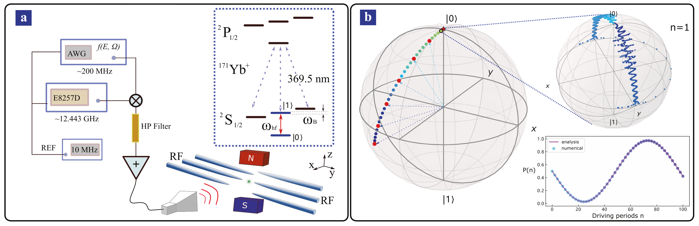
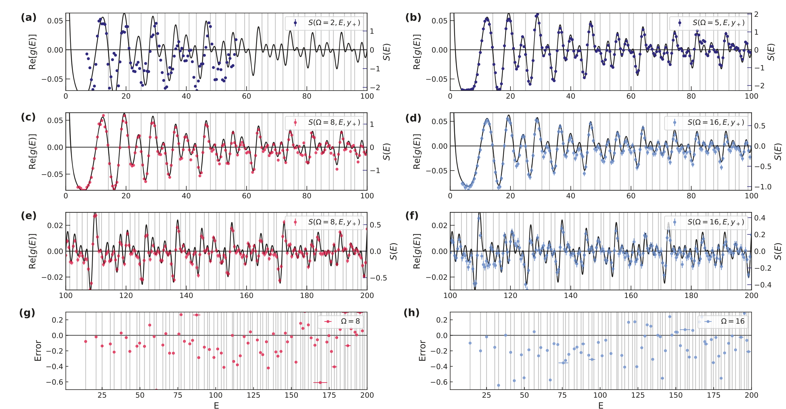
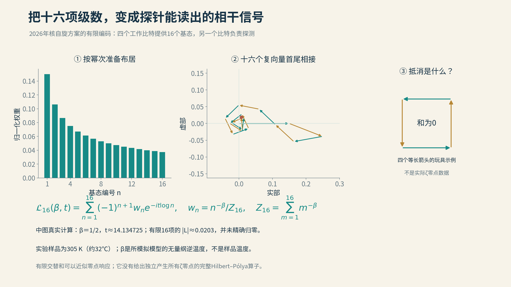
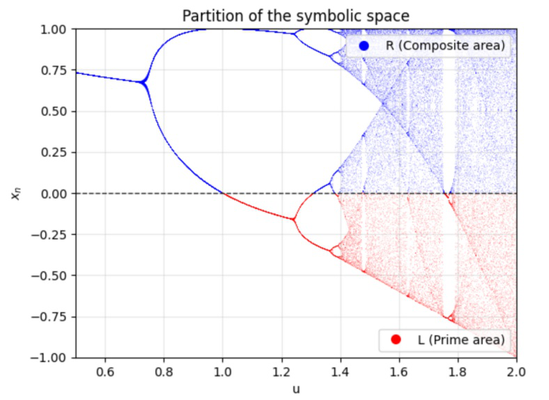
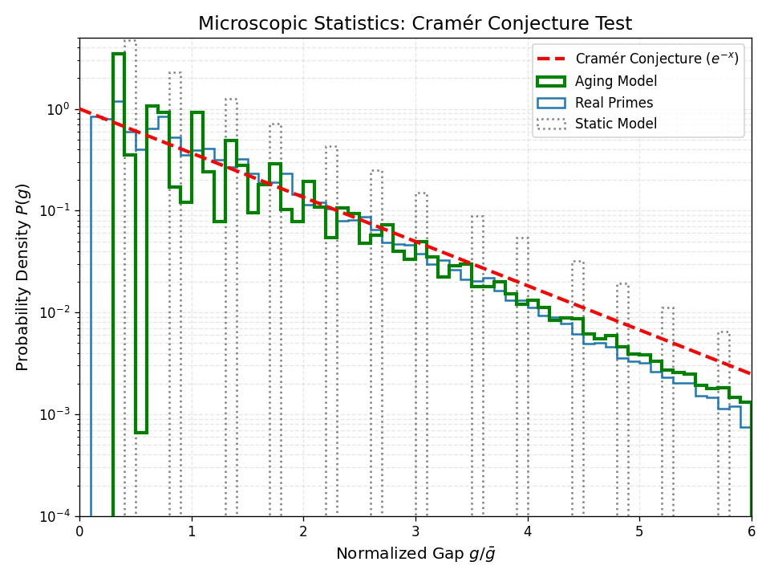
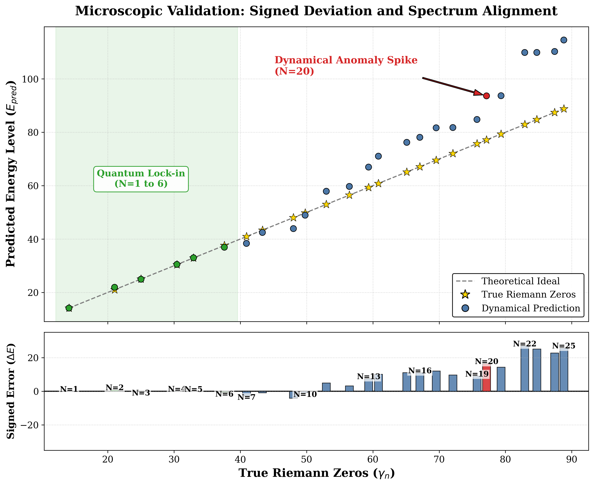

# 14 在动力学系统中寻找零点

2021年，一颗被囚禁的镱离子，开始参与一个通常写在纸上的数论问题。

研究者不断改变控制参数，观察它内部两个量子状态之间的转移。在某些位置，这种转移明显受到压制，仿佛有一股原本推动状态来回变化的力量忽然减弱了。

这些位置，与黎曼ζ函数的零点联系在一起。

这是中国科学技术大学团队与合作者完成的一项实验。它没有把那颗离子安排成一张素数台球桌，也没有等待自然界偶然唱出一串神秘数字。实验者采取了更直接的办法：把函数的计算规则，编进一段可以实现的量子演化。

上一节要寻找一件独立产生完整零点谱的乐器。这里先问一个更靠近工作台的问题：能不能让物理系统执行一部分计算，再把抽象的“等于零”，变成仪器能够读到的信号？

## 计算器知道规则，不等于知道答案

这个办法很容易招来一句质疑：既然把ζ函数放了进去，得到零点还有什么意义？

不妨先想一台普通计算器。

计算器事先知道乘法规则，却不必存下世上每一道乘法题的答案。输入两个数，它依照规则运行，才给出结果。一个能够执行函数表达式的物理装置，也可以按这样的方式理解。

预先编入函数的积分核、权重或相位规则，与预存每个零点的位置，是不同的事。前者告诉机器如何计算，后者才是直接把答案交给它。

真正值得研究的问题于是变得具体：规则能否可靠地转成控制信号？系统运行后，哪个可观测量代表函数值？有限的装置、有限的时间和噪声，会把答案改变多少？

在某些情况下，这种转换可能带来新的模拟计算方法；在另一些情况下，它首先是一项精巧的量子控制实验。它们都需要靠实际资源和误差来评估。

## 每隔一个周期，看离子一眼

那颗镱离子内部有两个适合作为量子比特的能级。微波可以控制状态的变化，实验便利用它们来承载信息。

研究者施加周期性的驱动。周期内，控制信号一直变化；但如果总在每个周期结束时观察，就可以用一种有效演化描述它积累下来的作用。这类处理周期驱动的方法，叫作Floquet理论。

可以想象一个人在不断变化的地面上行走。只看每一步，情况很复杂；若每走完一整套重复动作拍一张照片，仍有可能发现一个简洁的整体规律。量子系统的数学当然不同，但“按周期观察”有类似的作用。

实验设计的关键，是把与ζ函数有关的傅里叶表达式写进驱动波形。这样，在适用的近似下，两个状态之间的有效耦合就与一个由ζ函数构成的实函数相联系。

扫描外部参数，相当于向这台机器逐个提出问题：在这里，函数的响应有多大？走到某些消失位置，有效耦合接近零，状态间原有的转移便受到压制。

所谓“冻结”，发生在内态动力学中。离子并不是突然失去机械运动，而是用两个量子状态之间的变化，为函数的消失做了一个可见的记号。

*把函数写进驱动：原论文图1展示了镱离子量子比特的微波控制示意（a），以及周期驱动在布洛赫球上的演化协议（b）。这是装置与协议示意，不是实验室照片；图内的理论曲线与演化标记也不能全部当作测量数据。装置读出的是受控动力学，不是一次测量全部黎曼零点。裁切自 Ran He 等，Riemann zeros from Floquet engineering a trapped-ion qubit，npj Quantum Information 7,109 (2021)，图1；[原文](https://doi.org/10.1038/s41534-021-00446-7)；[CC BY 4.0](https://creativecommons.org/licenses/by/4.0/)。仅裁切页面边缘及正文，保留原图全部面板、标注与配色。*

## 一个零信号，需要怎样辨认

论文报告，通过观察30个驱动周期内的演化，实验分辨出了前80个零点，多数结果达到约百分之一的精度。

这是很生动的转换：原本属于复分析的一串数字，现在能够从离子的状态变化中读出来。

不过，读仪器之前必须先知道仪器测了什么。这个方案的有效响应涉及一个复函数的实部。复数有两个分量，就像平面上的箭头有水平和竖直两个方向；其中一个分量消失，整个箭头却不一定消失。

所以，某次状态转移受到压制，可能对应真正的ζ零点，也可能只是相关实部的一次额外过零。论文对这些情况作了区分。零信号的含义，由编码表达式和读出方式共同决定。

这是一条很实用的实验经验。我们不能只因为仪器“安静了”，就替它回答一个比测量内容更大的问题。知道哪些安静是真正的答案、哪些是另一种抵消，本来就是设计的一部分。

提高驱动精度、延长观察、改进判别，都可以让这类装置变得更有用。每一步改进也会让研究者更清楚，限制究竟来自控制误差，还是来自函数被转换成信号的方式。

*从读数到零点：（a）至（f）的黑线是理论函数Re[g(E)]，其中g(E)=−ζ(1/2+iE)/(1/2+iE)；彩色点是实验读数S，灰色竖线标出已知的ζ零点。（g）、（h）展示提取零点与精确值之差。实部过零并不自动等于ζ函数为零，因为虚部可能不为零。图中部分灰线旁没有红点，表示相应误差超出绘图范围，不能理解为没有测量或没有零点。裁切自 Ran He 等，Riemann zeros from Floquet engineering a trapped-ion qubit，npj Quantum Information 7,109 (2021)，图2；[原文](https://doi.org/10.1038/s41534-021-00446-7)；[CC BY 4.0](https://creativecommons.org/licenses/by/4.0/)。仅裁切页面正文，保留原图a–h全部面板与原标注；可打开原图放大阅读。*

## 五个核自旋，换一种读法

2026年，另一支合作团队在《自然·通讯》发表了一项相关工作。这次的舞台换成核磁共振量子处理器，使用五个核自旋量子比特。

先看一眼实验室的温度计：305 K，约32摄氏度。核磁共振装置并没有被冷却到接近绝对零度。研究者通过控制核自旋的状态布居，模拟所需的热权重；论文里的β是包含能量尺度的无量纲逆温度参数。β＝1/2对应所模拟模型中的临界线，不能读成样品的实际温度。这里讨论的动力学相变，也与前面博斯特—孔涅系统在β＝1处的平衡相变有所区别。

其中一个负责探测，其余四个构成16维工作空间。我们可以把它们理解为一台小型的可控计算装置：准备初态，安排演化，让各部分积累相位，最后从探针读出合成信号。

解释这个方案，最方便的办法仍是小箭头。

让不同项按不同速度旋转。再按所需大小分配它们的长度，并给其中一些项加上相反符号。经过一段时间，所有箭头相加，合成的箭头可能很长，也可能因为彼此抵消而接近零。

如果转速与整数的对数对应，权重又按特定幂次分配，就能形成一个与交替ζ级数有关的有限和。完整的无穷交替级数在临界带内，与ζ函数有相同的零点位置，这为实验提供了入口。

实际装置能够放进去的项数有限，所以它实现的是这个无穷表达式的有限近似。箭头怎样分配、截断到哪里、归一化怎样安排，都会影响最后读数。

这一次，探针的两个正交分量都可以测量，因此能够取得复响应的实部与虚部信息。相较于只盯着一个投影，两分量共同变化给出了更完整的抵消图景。

*图：四个工作比特容纳16个基态。热权重、交替符号与随时间积累的相位，合成一个归一化复信号。图中前两栏由有限和实际计算，右栏四箭头仅解释抵消；在首个ζ零点高度，16项响应仍有残差。*

## 零点为什么会与相变相遇

论文把这种构造与“动力学量子相变”联系起来。

平常说相变，我们想到水结冰：改变温度，物质的状态在某个位置发生质的变化。动力学量子相变则把目光转向时间。一个量子态开始演化以后，它与初态的重叠怎样变化？与返回振幅有关的量，会不会在某些时刻出现特殊的尖锐行为？

若许多贡献恰好彼此抵消，返回振幅可以变得很小，甚至消失。把这种消失与数论函数的零点联系起来，便能用动力学量来寻找零点。

这里的亮点，是让两种原本相隔很远的问题共享同一个可研究的表达式。一边问复杂函数在哪里为零，另一边问量子演化中哪些时刻出现特殊的抵消。

有限装置里，我们实际看见的是曲线的谷值、相干信号的消失或近似消失。严格相变中的非解析行为，通常还要放到适当的系统极限中讨论。实验先验证能够实现的那一部分，再由理论解释它怎样接向更大的命题。

这项核自旋实验报告了前五个零点附近的响应。它还用数值方法研究很高处的零点区域，包括第万亿个附近。前者来自小型硬件测量，后者来自计算机模拟，各自展示了方案的不同面貌。

## 从读出一个数，到控制一整套误差

把离子实验和核自旋实验并排看，能发现一条共同路线。

先找到函数的一种数学表示，再把它翻译成可控制的演化，随后选择可测量的输出，最后从输出中辨认零点。

每次翻译都会带来新的问题。无限级数要截断，连续波形要由有限带宽实现，理想演化会受到噪声影响，测量还只能进行有限次数。研究者的工作，是让这些环节配合起来，说明最后的信号究竟接近原问题到什么程度。

这件事的价值，不需要用“实验已经证明黎曼猜想”来放大。它把一个数学表达式变成了可以操作、重复和改进的实验流程，也让控制理论和算术问题产生了新的接触。

至于速度是否优于经典算法，需要在同一精度、同一范围和完整资源开销下比较。小装置成功读出了零点，是一种成果；普遍的计算优势，则是另一个需要单独回答的问题。

如果有一天这些方法能有效扩展，它们可能成为新的函数测量工具。即使暂时没有，它们也能帮助我们理解：一个抽象问题经过真实物理系统以后，哪些结构最稳固，哪些最容易在噪声中丢失。

## 一段程序，也可以成为实验台

本书作者Liang Wang在2026年6月发表的探索，从符号动力学迈出第一步。连续轨道看起来很复杂，却可以先用一种朴素的方法记录：落在左边记L，落在右边记R。另一边，素数筛也能写成由“保留”与“筛去”组成的符号序列。借助研究单峰映射符号序列的MSS理论框架，这项工作提出一个同构假设：能否在二次映射的带合并位置附近，为筛法的算术结构找到对应的动力学语法？

第一篇工作的核心数值证据，是素数间隔与动力学序列间隔的统计相似性。一边记录相邻素数之间相差多少，另一边记录轨道中相邻两个L符号相隔多少步，就得到两份可以比较的间隔清单。研究既考察固定参数映射的离散间隔结构，也引入随迭代缓慢变化的参数，研究分布随尺度变化的表现。把间隔除以各自的平均值以后，非自治模型与真实素数的概率分布呈现出相近的整体轮廓；固定参数模型则明显不同。这个结果让符号动力学的设想有了具体的数值支撑，也为后续的谱探索提供了动机。研究还比较了信息复杂度，并探索孪生素数密度的渐近形态。统计相似性尚不能代替严格同构证明，相关附加假设与参数校准也仍需保留在解释中。

图：先把轨道变成可以阅读的符号串。二次映射的分岔图以x＝0为界，蓝色区域记作R，红色区域记作L；论文据此探索轨道符号与筛法序列的对应。原图的“合数区／素数区”是模型标签，同构假设及其数值检验从这种编码出发。

来源：Liang Wang，The Emergence of Prime Distribution from Low-Dimensional Deterministic Chaos，作者存档v5.0图3，第11页，[论文DOI](https://doi.org/10.1080/27684830.2026.2684334)／[作者存档](https://zenodo.org/records/20565112)，[CC BY 4.0](https://creativecommons.org/licenses/by/4.0/)。原图提取，未改动图内内容。

图：把两份间隔清单放到同一把尺子上。横轴是间隔除以各自平均值，蓝线是真实素数，绿线是参数随迭代变化的动力学模型，灰线是固定参数模型，红虚线是指数分布参照。绿、蓝曲线的整体轮廓相近，局部仍有差异。这幅图属于非自治模型的归一化统计比较；原图标题中的“Cramér检验”不代表证明了最大素数间隔猜想。

来源：Liang Wang，The Emergence of Prime Distribution from Low-Dimensional Deterministic Chaos，作者存档v5.0图10，第30页，[论文DOI](https://doi.org/10.1080/27684830.2026.2684334)／[作者存档](https://zenodo.org/records/20565112)，[CC BY 4.0](https://creativecommons.org/licenses/by/4.0/)。原图提取，未改动图内内容。

同年9月的后续研究，把这个问题再向谱的方向推进了一步。沿着算术符号结构出发，研究希望进一步比较具体零点的坐标，让问题从群体统计走向逐项对应：如果某个动力学核心的轨道统计与素数有关，那么由相关动力学构造出的谱，会不会也留下黎曼零点的影子？研究在这一思路下另行设计非自治二次映射，让参数按假设的对数规律缓慢变化；低位实验把相空间划成小格，对格子间的转移作高斯平滑，并在长时间窗口中汇总成经验转移矩阵；后续较大范围的比较又采用不加这种平滑的蒙特卡洛转移统计。提取它的复特征值相位，经过参数校准与线性缩放，就能与低位黎曼零点逐项比较。

数值结果显示，这样构成的谱重建在校准范围内能够较好地跟随零点的增长，并呈现具体的局部对应。不同锚定方式的比较，又把哪些特征稳固、哪些依赖参数选择的问题显露出来。研究同时保留未参与校准的零点作检验：样本外误差明显增加，局部谱统计也未呈现目标GUE行为。这里分析的是汇总后的经验矩阵，尚不能等同于完整非自治演化的谱，矩阵本身也并非自伴。从符号动力学的假设走到可计算的谱对应，已经形成了一条具体的探索路线；下一步要解释的是，这些联系为何出现、能否在减少校准以后继续成立，以及怎样接向更严格的谱结构。

图：把前几个零点放大看。上图将动力学矩阵特征相位换算出的数值与真实零点比较，下图保留误差的正负；绿色区域中的前6个位置贴合较好，往后偏差逐渐显露。首个零点用于确定整体缩放，前6个零点还参与了数值分辨率的选择，因此绿色区域是校准范围内的对应，不能当作完全独立的预测。图内“Quantum Lock-in”是原作者的形象标记，这里展示的是经典动力学的数值计算。

来源：Liang Wang，Numerical Spectral Correspondence Between a Non-Autonomous Quadratic Map and the Riemann Zeros: An Exploratory Study，Math. Comput. Appl. 2026, 31(5), 193，图2，第11页，[论文](https://doi.org/10.3390/mca31050193)，[CC BY 4.0](https://creativecommons.org/licenses/by/4.0/)。原图提取，未改动图内内容。

## 不同装置，回答不同问题

现在可以把本篇几种做法分开摆在桌上。

某些系统提供了与零点相似的群体统计。某些构造用少量算术信息逼近具体的低位零点。量子控制实验把函数表达式变成可测信号。更强的谱计划，则希望找到一个独立结构，一次解释完整的零点世界。

它们可以互相帮助。统计画像能帮助筛选候选模型；有限计算能暴露一个想法最先失效的位置；真实实验能考验编码和读出的可靠性；严格的谱理论则不断提醒我们，最终需要怎样的连接。

最有用的检查，有时非常朴素。模型输入了什么？哪些数字参与过调节？有没有留下一块从未看过的区域？系统变大以后，结果是否仍然成立？

这些问题让一个漂亮的吻合有机会变成可靠知识。也让一次不吻合不必只是失望，而能成为下一次设计的依据。

## 当机器也开始提出问题

从给黎曼的信出发，我们走到了会响应控制信号的离子和核自旋。零点不再只是一串写在纸上的坐标，它们可以出现在优化结果、波的干涉和实验读数里。

机器在这段旅程中早已不可缺少。它计算零点，搜索最低波形，安排控制脉冲，也会诚实地告诉研究者，一个样本内很漂亮的结果，到了新数据上没有站住。

下一篇要讨论的变化，是机器开始进一步参与猜测、构造论证和检查证明。它不只执行我们已经提出的问题，也可能改变下一个问题怎样被提出。

无论分工怎样变化，研究仍要经过同一道门：把发现写清楚，让别人能够检验，并说明它通向什么、还停在哪里。

那封写给黎曼的信，还会有新的段落。

[全书目录](../README.md) · [本篇目录](README.md) · [上一节](13_弹出素数的乐章.md) · [下一节](../04_第四篇_AI新纪元/15_最后的菲尔兹.md)
