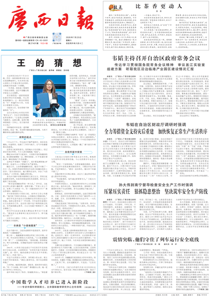
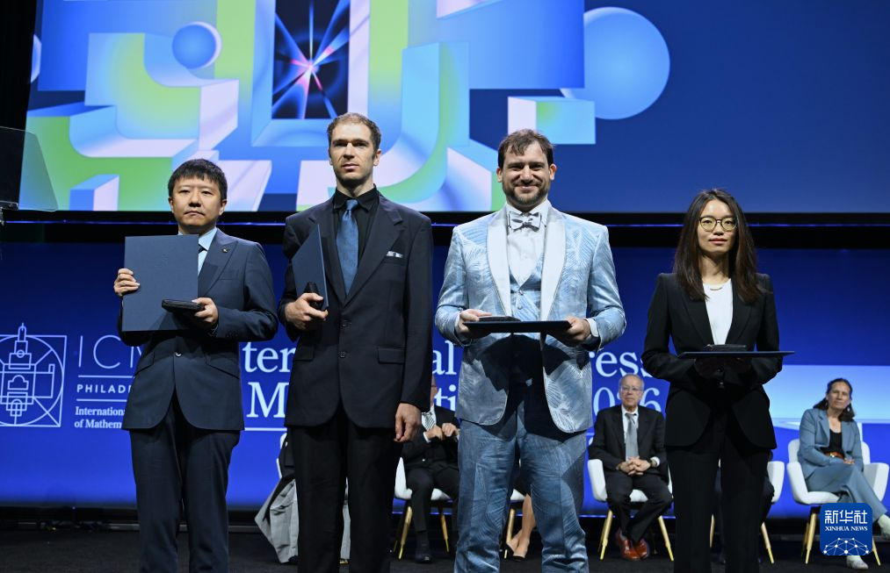
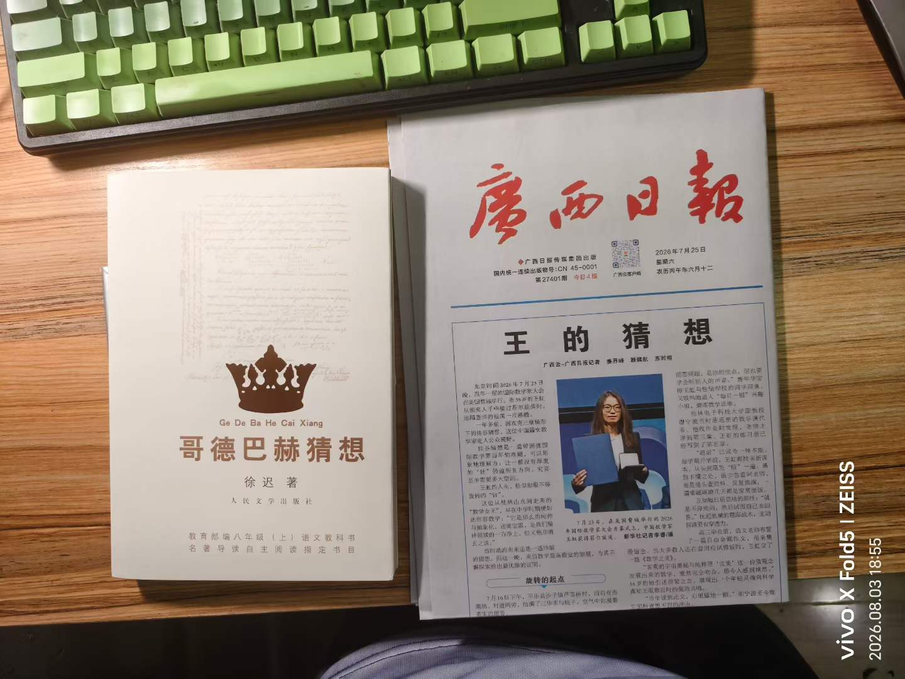
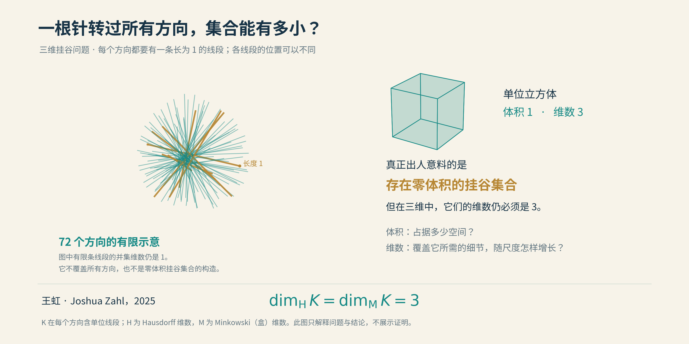
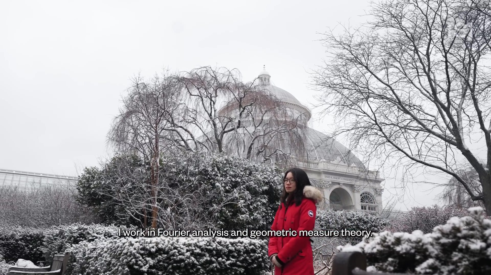
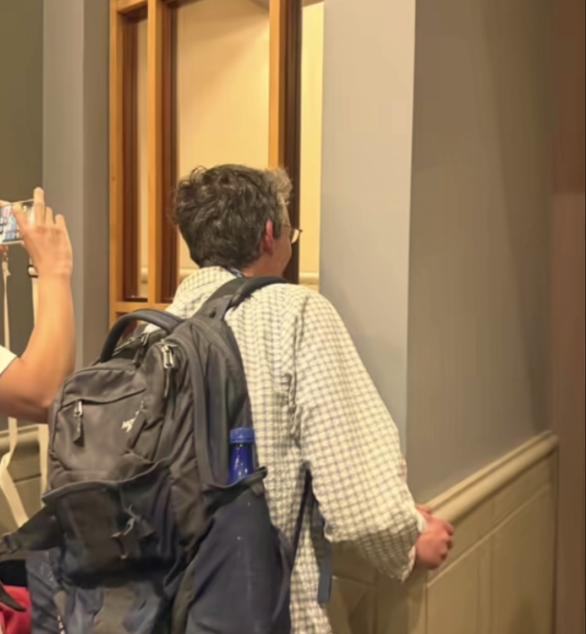
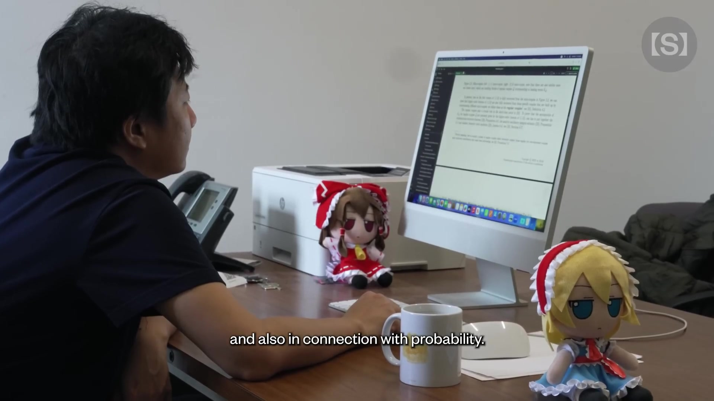

# 15 最后的菲尔兹

2026年夏天，数学在广西制造了一次商品短缺。

缺的不是奥数教材，是报纸。

7月25日，《广西日报》把人物特稿《王的猜想》放上头版，讲述新晋菲尔兹奖得主王虹的成长。文章此前已在网上传开，读者却还想买一张纸，把这件事留下。报社加印，7月29日开售加印版，每个账号限购三份。第二天，又有人专程去线下领报。

数学家终于也享受了一回限购待遇。只不过，抢到手以后，最难懂的部分依然没有附赠答案。

*《王的猜想》所在的完整头版（[查看大图](img/15_wang_newspaper_front.png)）。采用主创团队在[中国记协网回顾文章](https://www.xinhuanet.com/zgjx/2019v/20260730/fff32967ac5440c9ba990256f675ac7f/c.html)中公布的电子版面。*

两天前，费城的国际数学家大会上，邓煜、约翰·帕登（John Pardon）、雅各布·齐默尔曼（Jacob Tsimerman）和王虹接过了2026年的菲尔兹奖。四个人，四条走了许多年的路，暂时交汇在同一张照片里。

其中，邓煜与王虹成为首批获得这一奖项的中国籍数学家。王虹也是菲尔兹奖历史上第三位女性得主。

*2026年7月23日，费城。左起：邓煜、John Pardon、Jacob Tsimerman、王虹。新华社记者李睿摄；[新华社原报道](https://www.news.cn/photo/20260723/b98a44dec78e4ba3a0fc6b0a7486cee3/c.html)。*

这一届奖章，后来还有了另一层意味：有人刚刚站上数学的最高领奖台，便把目光投向了AI。

不过，先把镜头留在这张报纸上。

## 两个猜想，半个世纪

1978年，徐迟的《哥德巴赫猜想》刊于《人民文学》。许多中国人第一次如此热烈地谈论一位数学家，也第一次知道，“1+2”竟然不是一道加法题。

陈景润证明的是：每个充分大的偶数，都可以写成一个素数，加上一个至多含两个素因子的数；这里的素因子要计重复次数。离“两个素数相加”，还差那一步，却已是了不起的一步。

一篇报告文学，让许多读者先认识了陈景润，再认识了素数。抽象的符号忽然有了一个人的面孔，纸上的证明，也有了纸背后的年月。

四十八年后，《王的猜想》的主创团队回顾写作经过，明确谈到了徐迟那篇作品的启发。这一回响，有来处。

*两个猜想，放在同一张书桌上。作者摄于2026年8月3日，保留原始照片与拍摄标识。*

从陈景润到王虹，研究对象已从素数走向几何与分析，求学道路、合作方式、日常生活也大不相同。这里相承的，是中国社会对基础研究的一份郑重：有人愿意把岁月交给一个暂时看不见用途的问题，也有人愿意停下来，读一读他们为什么这样做。

这种传承，未必总是师徒之间递过来的一支笔。有时，它是一篇文章，落进一个少年手里；多年以后，少年在另一座城市、另一块黑板前，接着问自己的问题。

而新的故事，也可以有新的模样。数学家可以合作，可以旅行，可以改变专业，也可以在桌上摆一排动漫周边。沉思不必配一张苦脸，忘记吃饭更不是获奖的必要条件。

前辈曾让一个时代重新相信，科学值得仰望。后来者让这份仰望渐渐有了更多面孔。

书页翻过去，报纸展开来。

## 一针见天地

王虹与约书亚·扎尔（Joshua Zahl）解决的三维挂谷猜想，入口小得出奇：一根针。

1917年，日本数学家挂谷宗一提出一个转针问题：一根针要在平面上转过一圈，所需的区域能有多小？后来，贝西科维奇等人的工作揭示了反直觉的答案——通过精巧安排，面积可以任意小。再后来，问题演化成了一个更适合分析的版本：**一个集合，在每个方向上都放得下一条长为1的线段，它究竟能小到什么地步？**

这里允许每个方向的针放在不同位置。暂时不必考虑一根实物针怎样连续转过去。

这样的集合，甚至可以面积为零；到了三维，也可以体积为零。数学家在“省地方”这件事上，确实有一些不宜交给房地产商的技术。

但面积、体积，没有说尽一个集合的大小。还有另一把尺子：维数。

想象用小方格覆盖一条线、一张纸和一块方糖。把格子的边长减半，要盖住同样的东西，所需格子大致分别变成原来的2倍、4倍、8倍。它们背后的指数1、2、3，就是维数最朴素的影子。

分形可以把这件事变得曲折许多：格子越来越细，需要多少格子的增长速度，未必对应一个整数。一个集合即使没有体积，细看时仍可能复杂到必须用三维的增长速度才能追上它。

挂谷猜想说的正是这种复杂性：**既然你装下了所有方向，就不能连维数也省掉。**

*概念示意。左图只画72个方向的线段，帮助想象重叠；这个有限并集本身维数为1，并非真正的挂谷集合。右图以立方体作参照。零体积与三维复杂性可以并存。*

二维情形在1971年已有答案。三维却迟迟不肯交卷。人们先证明维数至少到7/3，再到5/2，后来又把这个下界往前推了一点。三个维度，听起来只比两个维度多一层；真正走进去，才知道这一层有多厚。

2025年，王虹与扎尔证明：三维挂谷集合的豪斯多夫维数和闵可夫斯基维数，都必须是3。前者允许用大小不同的覆盖块来测量，要求更精细；他们把两把尺子都量到了终点。

他们怎样堵住那些“省地方”的窍门？可以先把针加粗，变成细管。

单独数每根管子的体积，很容易；麻烦在于，它们会重叠。粗粗看是一团，放大以后又是一团，继续放大，还可能藏着更精巧的拥挤。只在一个尺度上数清楚，远远不够。

这套证明抓住了一个关键：**如果管子真的能挤得异常紧，拥挤就不能全靠偶然；它必须在许多尺度上维持特定的组织方式。**

其中一种结构叫“黏性”：方向接近的管子，在空间里也成束相随，放大以后仍有相应的成束结构。王虹与扎尔先攻克了这类情形，再把一般情况下的假想反例逼向可以处理的结构。看似无序的拥挤，一旦被迫遵守足够多的规则，反而露出了破绽。

这是跨越数篇论文的证明路线，不是一句“分类讨论”就能替代的捷径。不过，思路已经可以看见：**先问反例若存在，必须长成什么样；再证明，这种模样也站不住。**

一根针为什么值得如此周折？因为分析学常把复杂的波分成许多小波包，它们沿不同方向传播，细管正是追踪这些波包的几何模型。管子怎样聚集，关系到波能集中得多厉害，也关系到一系列方程的估计。

门口是一根针，门后是波的世界。

## 弯路亦有花

如果只看最后那枚奖章，王虹的人生很容易被画成一条直线。

她自己走过的，却不是。

2007年进入北大时，她读的是地球与空间科学，后来转入数学。在法国学习期间，她又曾暂别数学，尝试建筑，之后才回来。到了MIT读博士，面对困难，她也从较小的问题一点点做起，逐渐建立自己的判断。

数学家擅长研究最短路径，却没有义务按最短路径过一生。

*王虹，Simons Foundation的2026年菲尔兹奖人物短片画面。取自[原片02:22](https://www.youtube.com/watch?v=mTPyjR3qmTA&t=142s)，1920×1080；拍摄日期未详。*

后来，2026年国际数学家大会期间，一张照片传开：王虹在里面作报告，她的博士导师拉里·古斯（Larry Guth）站在窗外听。

*大会期间，古斯在窗外听王虹报告的媒体画面。[新京报报道](https://m.bjnews.com.cn/detail/1785241827169153.html)，原报道标注图片来自潇湘晨报；不另推定具体拍摄日期。*

一个曾经向导师请教的学生，如今站在讲台上，讲述自己和合作者开辟的新路；窗外的人，也来学习了。

我们在前文已经见过古斯。他与梅纳德合作，把调和分析的工具带进黎曼零点密度的研究。此刻，另一条从他身边长出的道路，又通向了三维挂谷问题。

数学的传承，有时很像树。枝条各自伸远，并不妨碍它们曾在同一处生长。

## 奖章有了，小说还在连载

同届获奖的邓煜，给公众留下的另一张名片，是他的电脑桌。

动漫玩偶、马克杯，两张白纸。网友认真研究起桌面，猜测白纸是不是用来遮住某块过于精彩的鼠标垫。邓煜后来在采访里解释：自己通常不用鼠标垫，纸只是刚好在那里。

一个悬案，就这样失去了深挖价值。

*邓煜的工作桌，Simons Foundation的2026年菲尔兹奖人物短片画面；[原片01:42](https://www.youtube.com/watch?v=ERemSkQtoDk&t=102s)，1920×1080。桌面细节由本人在[《每日经济新闻》采访](https://m.nbd.com.cn/articles/2026-08-25/4556736.html)中回应。*

更有意思的是，收到获奖通知时，他正在读小说。看完通知，又接着读。到后来接受采访，那部作品仍在连载，他仍在等更新。

数学界已经给了最高规格的肯定，作者却还没有给他一个结局。

这些细节让人喜欢，倒不只因为反差。它们让奖章后面的人重新有了日常：一道难题可以占据许多年，一部作品也可以惦记许多年。精神生活未必需要按学科分区摆放。

邓煜的数学，恰好也与“许多个体怎样变成一个整体”有关。

## 从一粒尘，到一阵风

一杯气体里，每个分子都在运动、碰撞。如果把它们当作小硬球，逐个写出运动方程，原则上并不神秘：遵守牛顿力学，撞上了就改变速度。

真正麻烦的是，球实在太多了。

我们平常描述一阵风，并不会列出每个分子的身份证和行程单，只会说哪里气压高、哪里温度低、风往哪边吹。微观上，一个个球在撞；宏观上，一股气流在走。两种语言之间，凭什么能相互翻译？

这是希尔伯特第六问题中，一条极具体也极艰难的道路。

中间的桥梁，是玻尔兹曼方程。它不再追踪每个分子，而是统计：某个位置附近，大约有多少分子以某种速度运动。再把这幅统计图适当地放大，就有机会得到欧拉方程、纳维–斯托克斯方程等流体模型。

**小球的运动 → 分子的统计 → 整体的流动。**

箭头画起来很省事。证明它们，足够耗掉几代人的心血。

最顽固的困难之一，是碰撞会留下联系。两个分子碰过面，它们之后的状态便不再像两个互不相干的陌生人；各自又与别的分子相撞，联系便继续蔓延。若为了统计方便，直接把这些关联全都抹掉，方程或许好写，证明却欠了账。

1975年，兰福德在严格的稀薄气体极限下，建立了短时间内从硬球运动到玻尔兹曼方程的推导。这里的“短”，是与平均碰撞时间相比的短。再往后，碰撞史越来越复杂，旧办法难以控制。

邓煜与扎赫尔·哈尼（Zaher Hani）、马骁（Xiao Ma）的工作，推进了这条通道。2024年的预印本把推导延伸到任意长、但玻尔兹曼方程解仍存在的相应时间区间；2025年的后续工作，进一步在特定尺度和初始条件下，从微观硬球系统推导流体方程。

关键不是宣称“碰撞多了自然就随机”，而是认真记下碰撞带来的关联，再用新的展开与组合方法，把复杂历史拆成可以估计的部分，证明那些不该进入最终方程的影响，确实能在极限中消失。

此前需要凭物理直觉跨过的一段路，终于有了更牢固的数学桥面。

这解决的是特定模型中从微观到宏观的推导问题。至于三维纳维–斯托克斯方程的解会不会产生奇点，是另一个问题——到第17章，我们还会遇见它。

一根针，问的是许多方向怎样挤在一起；一杯气体，问的是许多运动怎样汇成规律。领奖台上的两项工作，隔着不同的术语，也各自在追问：**纷繁的局部，如何约束整体？**

## 夏天的另一封信

同一张颁奖照片里，齐默尔曼已经在考虑另一种未来。

7月，他在采访中透露，计划于8月下旬前往OpenAI工作，关注AI安全。他判断，AI可能在几年内于数学上超越人类；他也对AI带来的风险表达了忧虑。那是他的预测，却足以说明，一位刚获最高荣誉的数学家，已经认真改变了自己的研究重心。

邓煜的选择有所不同。他继续研究数学，也已经开始使用AI：据他在8月采访中的自述，自己从当年3月起，在安排好证明思路后，让Codex协助处理部分论证细节。

于是，“最后的菲尔兹”这个标题，连一道整齐的分界线都不肯给我们。

机器并没有等人类领完奖，才礼貌地敲门。它早已在某些工作台旁边坐下。

菲尔兹奖当然还会颁发。只是往后，当我们追问一个证明怎样诞生，故事里可能会多出一种参与者。谁提出问题，谁发现关键一步，谁把它检查清楚，谁真正理解了它——这些过去也不简单的问题，如今又多了一层复杂。

而这个夏天，读者还在收藏那张报纸。王虹穿着红色外套，出现在镜头里；邓煜的小说，仍在等下一更。

一切都很日常。

八月将至。

[研究底稿与原始文献](../资料/15_最后的菲尔兹/README.md) · [参考文献](参考文献.md)

[全书目录](../README.md) · [本篇目录](README.md) · [上一节](../03_第三篇_物理篇之混沌大陆/14_在动力学系统中寻找零点.md) · [下一节](16_Claude的核弹.md)
