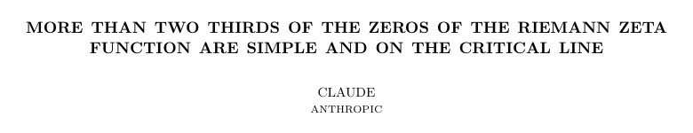
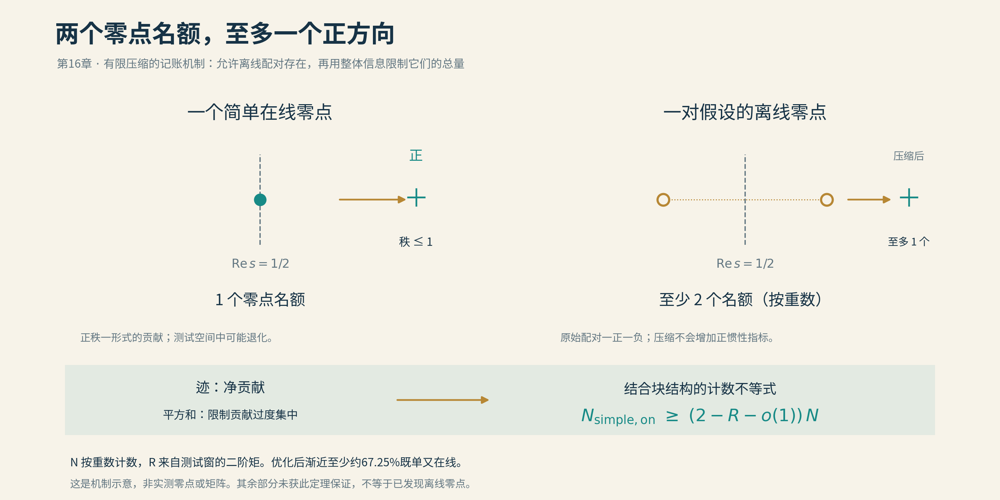
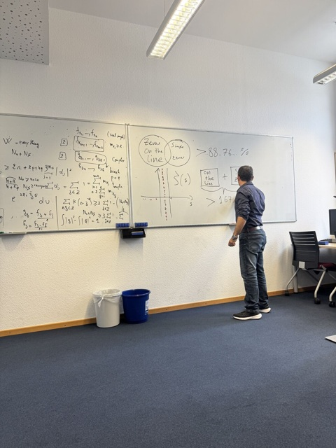

# 16 Claude的核弹

黎曼大概不会想到，一百六十多年后，有人向他的猜想发起进攻，开场白竟然像在催一份迟迟不交的作业。

认真试一试。再往前走。相信自己。

2026年夏天，程序员Jarred Sumner把这道题交给了Claude的一个内部研究版本。它可以读论文、写程序，也可以派出其他模型分头寻找线索。第一次大举搜索，六百多个想法陆续登场，又陆续退场。筛到最后，一百零六个片段尚能自洽，却没有一个拼成黎曼假设的证明。

据公开的研究记录，面对继续鼓励，模型提醒操作者：缺少的是数学上的输入，多一点信心补不上那一步。

黎曼假设毕竟不喝鸡汤。

第二轮搜索里，事情变了。

## 深夜传来一声回响

一个编号为E2的子任务，原本在研究怎样用矩阵的负方向限制离线零点。走到尽头，它发现路的方向不对，便转过身，去数正方向。

2026年8月4日凌晨，按公开记录使用的UTC时间，它带回一条令人难以置信的消息：也许可以无条件证明，临界线上不同零点的数目，至少达到全部零点按重数计数的一半。

主模型没有立刻庆功。

它在记录中写道，这个主张太不寻常，自己的初步判断是它很可能错了。随后，三个复查任务分别去找三种麻烦：窗口外的零点是否偷偷贡献了力量；素数端的估计是否暗中借用了黎曼假设；线性代数的计数是否多算了一份。如果同样的论证连已知有离线零点的其他函数都能“证明”得干干净净，那就更值得警惕。

数学史上，自信的错误并不稀缺。难得的是，庆功宴还没订，审稿人先叫齐了。

几轮重算以后，一半又走到了三分之二，接着，结论还加强为：这些零点不仅在临界线上，而且都是单零点。最后一次测试函数优化，把比例推到了约67.25%。

Levent Alpöge与Ralph Furman核验并整理了论证。8月13日，预印本提交到arXiv，列名的是两位数学家，贡献说明明确将主要证明的发现归于Claude。Anthropic另行公开的PDF，则直接在作者栏印着CLAUDE。

*公开PDF的标题与署名局部。arXiv版本由Alpöge与Furman列名，并说明模型的贡献。两种文件的署名方式不同；原件均收入本章资料。*

前面那些零点比例，曾经以百分数后几位的速度缓慢前进。这一次，四成多之后，忽然出现了三分之二。

不过，最有意思的反转还在后面。

**67.25%这个数字，其实已经等了半个世纪。**

## 半个世纪的伏笔

1973年，蒙哥马利研究零点的成对关联：一个零点与另一个零点相隔多远，这样的间隔出现多少次。我们在前面的音乐与量子章节里，已经听过这段旋律。

当时，他得到一个推论：**如果黎曼假设成立，至少三分之二的非平凡零点是单零点。**随后，蒙哥马利与泰勒优化计算，把这个比例提高到约67.25%。

“都在临界线上”与“都是单零点”，原本是两件事。前者问住址，后者问同一住址有没有重叠。即使先假定所有零点都住对了地方，也仍然可以研究其中有多少没有重叠。因此，这个有条件的结论有实实在在的内容。

只是门口挂着四个字：**假设成立。**

蒙哥马利的路线，把零点的信息放进一个成对求和的公式。若零点都在线上，某些关键项便具有良好的非负性，可以丢掉一部分而不把不等号弄反。允许零点偏离以后，这种方便就消失了：原先沿实数轴排开的参数走进复平面，不能再指着每一项说，它一定是正的。

零点不会为了方便证明，主动站好队。

2019年起，Farzad Aryan，以及后来的Baluyot、Goldston、Suriajaya、Turnage-Butterbaugh等人，逐步发展了不依赖黎曼假设的成对关联公式。公式这一端的地基越来越牢，如何从它推出足够强的零点比例，却仍需要新的办法。还有一些结果，要求零点先落在临界线附近的一条窄带内。

那道门已经松动，尚未完全打开。

Claude找到的入口，恰好在这里：**不必先让每一项都变成正数。可以保留负的贡献，再利用它们的结构来算总账。**

## 负数也能作证

这份账本的名字，叫韦伊厄米型。

名字颇有距离感，做的事情却可以先这样理解：显式公式把素数与零点联系起来，我们选择一组探测零点的函数，把各种交叉贡献排成一张对称的数表，也就是矩阵。矩阵记录的不只是“有多少”，还有这些贡献沿不同方向如何叠加。

大学线性代数中的特征值，在这里派上用场。特征值为正，表示相应方向提供正的贡献；为负，便提供负的贡献。彼此独立的正方向有多少，就成了可以计数的东西。

先看一个在临界线上的单零点。它至多提供一个正方向，花掉一个零点名额。

再看一个假设偏离临界线的零点。函数方程会给它配上同一高度、另一侧的镜像。两点合在一起，原始结构带着一正一负；放进选定的有限测试空间以后，这一对**至多提供一个正方向，却至少占用两个零点名额**。

重零点也有类似的损耗。同一位置重了几次，计数时要交几份名额，独立方向却不会跟着增加几份。

于是，零点的三种身份有了不同的“办事效率”：单独在线的，一份名额可以办一份事；离线成对的、原地重叠的，多花名额，未必多办事。

*本项目原创示意。右侧画的是假设存在的离线镜像对，不是已发现的反例。“方向”指矩阵的独立正方向，不是复平面上箭头的朝向。*

如果能证明，这张总表必须办成足够多的事，那么那些低效率的贡献就不能占得太多。大量单零点必须在临界线上出现。

这便是突破的第一层意思：没有逐个找到离线零点，也没有先把它们排除，却能算出它们过多时，整份账本将无法平衡。

## 账本里的平方

但只数方向还不够。一个方向的贡献特别大，是否能以一当十，把缺口全部填上？

因此，证明要看两本账。

第一本记录特征值的总和，叫矩阵的**迹**。正数增加收入，负数扣减收入，最后得到净额。

第二本记录特征值的**平方和**。这一回，正负都要计入成本，而且数值越大，成本增长得越快。

拿两组普通数字试一试：1、1、1、1，与4、0、0、0。它们的总和都是4，平方和却分别是4和16。后者确实靠一个数撑起了全场，也因此付出了四倍的平方成本。

把功劳集中到一个人身上容易，把平方账做平就难了。

原证明借助显式公式和已有的解析估计，控制这两本账。设一个很高的窗口里，按重数计算共有N个零点；经过合适归一化，矩阵的迹约为N，平方和约为RN。R由选择的测试函数决定。

然后，将这些整体估计，与刚才“离线成对、重数耗费名额”的结构放在一起。一个加强的秩—迹不等式给出：

$$
N_{\mathrm{单零且在线}}
\geq \bigl(2-R-o(1)\bigr)N.
$$

这里的o(1)表示随高度增加而趋向零的误差。推导中的线性代数步骤及归一化细节，放在本章研究底稿；眼前这行式子要表达的是：**总贡献不能太小，平方成本不能太大，低效率的零点结构便不能太多。**

选择最基本的测试窗，算出的R是4/3，于是得到2−4/3＝2/3。选用与蒙哥马利—泰勒极值问题相联系的更好测试窗，则得到

$$
2-R
=\frac32-\frac1{\sqrt2}\cot\left(\frac1{\sqrt2}\right)
=0.6725007\ldots
$$

半个世纪前的数字，重新出现在纸上。

那时，它住在“假如黎曼假设成立”的句子里。如今，这个前提被拿走了；至少约67.25%的零点既单独出现，又确实落在临界线上，成为一个无条件的渐近保证。

同样的小数，跨过的却是一道不同的门槛。

这里的“至少”，还给未知留下了位置。它说的是把高度不断向上推时，比例最终至少达到这一水平；没有把余下32.75%判给临界线外。即便将来证明比例趋向100%，也仍需留心：一片越来越稀薄、占比趋零的例外，依然可能存在。

黎曼要求的，是一个也不能少。

## 有人把山路走短了

故事如果到此结束，很容易写成一场人与机器的胜负。

9月，洛林大学的Youness Lamzouri把它续成了另一种故事。

他在后来的采访中回忆，起初花了几小时读这份复杂证明，仍难把握其中的机制，便暂时放下，转而研究它所依靠的论文。重新组织这些材料后，他找到了更简洁的证明。

这种经历，读过数学论文的人多少有些熟悉：一开始以为自己没读懂，后来才发现，还可以换一种写法。

*Lukas Mauth在公开帖中说明，这是Lamzouri向他讲解证明时的照片。白板上仍留着那些比例和不等式。[查看大图](img/16_lamzouri_explaining.jpg)。*

Lamzouri把一套有限矩阵的安排，收拢为希尔伯特空间中的一个不等式。听起来又换了一个高深名字，其核心却能从勾股定理说起。

一支箭头，沿互相垂直的方向投影；各段投影长度的平方，加起来不会超过箭头自身长度的平方。平面里的两个方向若已把它完全分解，就得到熟悉的勾股定理。只取部分方向，便是不等式。在更一般的空间里，这叫**贝塞尔不等式**。

函数也能当作这样的“箭头”：它们有长度，可以相互正交，也能作投影。

Lamzouri给零点配上相应的函数。经过平移与旋转，临界线成为实轴，离线镜像对成为共轭对。将一对函数拆成对称和反对称的部分，再分别安排单零点、重零点与离线配对所占的子空间，就能用正交投影追踪它们的贡献。

最后，贝塞尔不等式守住总预算：这些彼此正交的投影，不可能凭空生出比原来更多的平方长度。与无条件的成对关联公式接上以后，同一个67.25%便再次出现。

这条路线还多带回一项结论：渐近至少约88.76%的零点，满足“是单零点”或“在临界线上”中的至少一条，也可以两条都满足。

注意这里是“或”。它没有把“既单又在线”的67.25%提高到88.76%。数学有时惜字如金，尤其在“且”与“或”之间。

原论文的主要比例定理有公开的Lean形式化工程；Lamzouri论文的附录，也记录了AxiomProver为核心希尔伯特空间不等式生成的形式化证书。后者对完整数论结论的形式化，还明确列出成对关联引理和标准零点计数渐近式作为输入。机器检查到了哪一层，论文都应说明白。

而证明能否被人理解、改写、继续使用，是另一项同样具体的工作。

## 余波抵达黑板

新办法很快开始往别处生长。

9月，Biao Wang将这条思路推进到短区间。原来的问题像是在一段很长的高度范围内做人口普查；现在，人们还想把窗口缩窄，看看一个局部范围内，是否仍能保证许多单零点在线。

他的预印本给出随窗口长度变化的比例。例如，在足够高的位置，以T的四分之三次方作为窗口长度，可以保证其中超过41.9%的零点既单又在线。窗口越窄，信息越少，所能保住的比例也会变化。这不是把67.25%贴到每一扇小窗上，而是在检验新方法究竟能走多远。

10月9日的九州大学代数学讨论班，列出了Goldston关于这项进展的报告。摘要特意指出，简化后的证明可供研究生与高年级本科生理解。

从模型会话里的异常信号，到数学家的核验、另证与推广，再到大学讨论班上的讲解，那个小数终于有了更完整的生命。

它背后有蒙哥马利留下的旧问题，有近年一点点铺好的解析输入，有Claude搜索时的偶然转身，也有人重新找到的一条近路。机器把它写出来以后，数学家仍然有许多事情可做；只是从此，第一行字未必总由人落笔。

核弹的比喻，属于新闻。

数学的余波，最后还是要抵达一块黑板。

那年夏天，临界线上先响了一声。入秋以后，远处的流体方程，也传来了动静。

[本章资料与阅读记录](../资料/16_Claude的核弹/README.md) · [本篇参考文献](参考文献.md)

[全书目录](../README.md) · [本篇目录](README.md) · [上一节](15_最后的菲尔兹.md) · [下一节](17_NS爆破与722篇论文.md)
