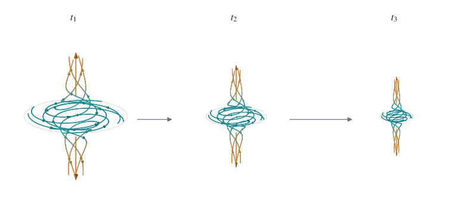
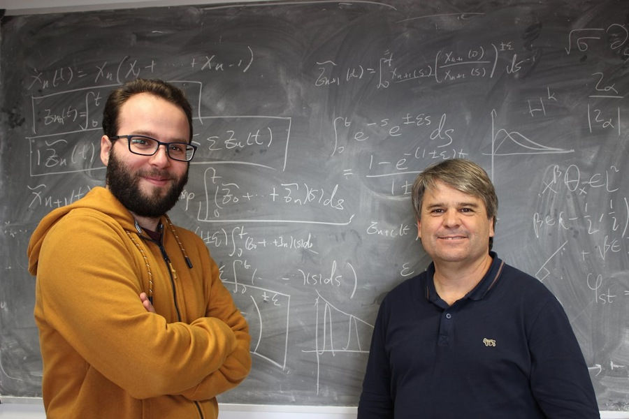

# 17 NS爆破与722篇论文

2026年9月，水还没有沸腾，数学界先沸腾了。

9月8日，OpenAI公布了一份166页的论文，宣布给出了三维Navier–Stokes方程有限时间爆破的构造，并附上Lean形式化工程。

上个月，Claude还在临界线上数零点。这一次，机器走进了流体方程，碰到的是另一道千禧年难题。

新闻里的动词很短：解决了。

数学家们接下来的反应，却足够写成一部长篇：有人兴奋，有人质疑，有人写信，有人联名，有人开始研究新构造的边界。还有人发现，自己一直付费使用的工具，背后的公司忽然也站到了同一条赛道上。

数学中的非线性，终于从方程里溢了出来。

## 一滴水的悬案

纳维与斯托克斯留下的方程，其实在回答一个很朴素的问题：一小团水，下一刻会往哪里走？

它受压力推动，被周围的水带着移动，又因黏性与邻居相互牵扯。把牛顿定律写给每一小团流体，再加上“水不能凭空压缩或膨胀”，便得到这组方程。

写下来不算太长。让它永远规规矩矩地运行，却让数学家忙了近一个世纪。

1934年，勒雷证明了某种广义意义上的解可以一直存在。我们已经能给流动留下一个整体轮廓，但这个轮廓会不会在某个地方失去光滑，仍是另一回事。黏性总想把尖锐的差异抹平，流动自身的非线性却可能把旋涡拉伸、把局部变化放大。究竟谁赢，三维世界迟迟没有交卷。

这里的“爆破”，也不是一杯水真的炸穿了桌子。它指数学模型中的某些量在有限时间内失去控制；这份新论文构造的情形，是最大速度趋于无穷，而总动能仍然有界。

这两件事可以同时发生。总动能要把“速度的平方”在整个空间里加起来。一个越来越快、却也越来越小的区域，未必让总账一起发散。好比一座山峰不断长高，山脚却急剧收窄，整座山的体积仍可能越来越小。

流体的舞台上，最猛烈的一幕，可以只占越来越小的一角。

## 让风暴自己长大

这份构造有一个必须先交代的条件：**存在光滑的外力。**

外力允许我们对流体施加推动，却不能靠自身突然变成无穷大，把答案硬塞进方程。论文选择零初速，要求外力在空间和时间上光滑、只在有限范围内起作用，然后让流体的速度在有限时间内失控。

Clay原题明确列有允许这类外力的破裂方案。因此，这个方向并非临时给题目开后门。不过，它也没有直接回答“完全不加外力时，黏性流体是否一定保持光滑”。两个问题的门牌相邻，房间并不相同。

论文的核心画面，是一个不断收缩的旋涡。流体向轴线附近盘旋，又沿轴向流出；高速区变得越来越细，速度越来越大。

*原论文Figure 1的图形部分。核心的横向和纵向尺度都在缩小，横向缩得更快，因此相对形状越来越细长。它是论文示意图，不是实验录像；缩小的是高速区域，并非同一团不可压流体的体积。*

单画出这个旋涡，还远远不够。把预设的速度与压力代回方程，通常会剩下一堆无法平衡的项。若把它们全算作外力，外力也会跟着发散，题目便做错了。

真正费功夫的一步，是在旋涡外围加入精心安排的振荡，让流体自己的运动，补上缺少的动量输运。

这里有一个本科生就能看懂的小机关。两种小扰动的径向、切向分量，分别是(1，1)与(−1，−1)。平均起来，每个分量都是零；但两分量相乘，两个结果却都是1。

**平均速度可以抵消，平均的动量输运却可以留下。**

非线性就藏在这个乘法里。往外运动时携带偏多的切向速度，往里运动时携带偏少的切向速度，两种运动都可能帮助把角动量向外送。新构造利用这样的二次效应，让振荡脉冲承担背景旋涡尚未平衡的部分，再逐层修正剩余误差。

黏性在这里也没有被请出场。论文安排脉冲先从背景剪切中获得增长，随后随着波长变短，让黏性衰减占上风，收拾尾部。制造增长和控制误差，要在同一组方程里完成。

最后留下的图景，是速度可以失控，外力及其各阶导数仍保持良好。真正的技术难度，正是在这场精细的抵消里。

## 我不用AI，我有Luis

在机器登场之前，这条研究道路上已经有人走了很久。

西班牙数学家Diego Córdoba与Luis Martínez-Zoroa研究过一种跨尺度的放大机制：较大尺度的流动，让更小尺度的旋涡进一步增强；一层接一层，构造出有限时间里的奇性。外力的光滑程度，是这条路线的重要关口。

Córdoba有句被采访记录下来的玩笑：

> “我不用AI，我有Luis。”

这大概是数学界最有人情味的一种算力配置。

*Luis Martínez-Zoroa与Diego Córdoba。摄影：Laura M. Iraola／ICMAT，图片见《国家报》人物采访。拍摄日期未单独注明。*

机器带来的消息，让这句玩笑有了新的背景。Martínez-Zoroa接受采访时坦言，自己尚未仔细读完OpenAI的长篇证明，暂时不能判断它究竟在多大程度上依赖他们的方法。他也承认，若没有AI，他们可能还需要很久，甚至未必能走到终点。

这份克制，比简单的“我们的功劳被抢走了”更值得记住。

两人的工作为相关流体爆破研究提供了重要前驱，但不同证明的具体机制仍要比较。OpenAI现有论文也作了区分：早先的层层放大路线尽量压低小尺度对大尺度的反馈；这里的振荡，反而要主动产生平均动量通量，替背景流补上缺口。共同的历史，不等于每一步都沿着同一条路走。

做科普时，最容易被剪掉的，往往恰好是数学家还没把话说满的那半句。

## 八十八小时与一封长信

这场风波里的另一位主角，是纽约大学的Tristan Buckmaster。他的合作者，正是上一章出现过的Alpöge。

按Buckmaster公开声明的回顾，他们用多种语言模型辅助研究，在8月15日得到光滑外力下的Euler等方程的爆破结果，8月22日完成相应Lean验证。此后，他们还在努力把证明变成可读的数学。

他对机器稿的评价相当不客气：其中一份Euler写作只能称为“AI slop”。他为此道歉，希望本来还能有几个星期，把文本整理得像一篇真正写给同行的论文。

有趣的是，这并非一位拒绝机器的老人，在捍卫最后一支铅笔。他已经把AI请进了工作室，而且自己付账。

与此同时，OpenAI说，团队9月1日听到相关突破的传闻后，组织内部模型探索多个千禧年问题，随后把资源集中到NS；参与该方向的并发智能体约一万个。按公司的记录，找到结果用了88小时，形式化又用了17小时。

一边按星期整理证明，一边按小时调度一万名助手。

两只钟，走到了同一个下午。

9月6日，双方交流。Buckmaster后来公开描述了自己对沟通方式、发布安排和署名提议的不满；他也追问，自己输入Codex的未发表草稿，是否可能影响对方的系统。这是当事人公开提出的疑问。声明结尾，他明确保留了一点：自己不知道那些数据是否被使用。

OpenAI则否认接触两人未发表的研究，并公布内部调查结论，称相关Codex提示既未被系统访问，也不可能通过训练影响这次工作。

公开材料留下了两方的陈述，尚不能据此判定发生了数据挪用。能够确定的是，研究者与工具提供者之间的信任，突然成了数学论文之外的一道大题。

同样值得写下的是，Buckmaster在声明开头，把研究道路的开创之功归给Córdoba与Martínez-Zoroa，甚至直言后者值得一枚菲尔兹奖。

争论最激烈的时候，他仍然记得把灯照向更早铺路的人。

## 二十五枚奖章，落在同一页纸上

9月11日，一份公开声明出现。最初的25位签署者，全部获得过菲尔兹奖。

邓煜、Maynard、Scholze、陶哲轩，都在其中。前面章节里刚在不同方向登场的人物，这次站到了同一份名单上。

他们没有否认模型解题能力的跃升。声明开头就承认，AI已经能够解决多个领域的重要问题。批评随后才到来：企业把攻克数学难题当作能力测试的做法，是否正在偏离数学研究本来的目标？

过去，一道大题被解决，通常意味着某些人掌握了一批新的观念和工具。这些工具会在讨论班里被拆开，在论文里被简化，几年后，变成学生课本中的一节。

如果证明可以迅速生成，这条链条就可能断在中间：答案来了，理解还没有跟上。

学生尤其让他们担心。一道问题除了等待被解答，也能让一个年轻人学会提问、试错和形成判断。如果题目刚分下去，答案已经批量送到，导师的课题清单恐怕比学生的选课表更需要随时刷新。

当然，难题不会因此被某个行业永久圈起来。旁观者完全可以追问：既然问题有了答案，为何还要等待？而签署者追问的是另一面：答案出现以后，那些原本会在求解中长出来的能力，今后怎样培养？

两边问的，其实不是同一道题。

同一天，Clay数学研究所也发了声明。它对NS问题“似乎已经得到解决”的消息表示兴奋，同时强调，评估与归功的过程将有意保持从容。

服务器按小时计费，数学史暂时还没有开通加急通道。

## 一夜之间，书架满了

九月的争论尚未散去，十月的压缩包到了。

10月6日，OpenAI一次发布722份数学手稿，归入372个相关结果族。按照仓库说明，一个结果族可以包含主论文、配套论证、推论和另证。722份手稿，不能直接读成722道彼此独立的著名难题。

一天收到一篇新论文，可以先放进“有空读”的文件夹。一天收到722篇，文件夹就开始像一种生活态度。

数量之外，修订也来得很快。次日，更改记录宣布撤回三份手稿：一处关于分裂阿贝尔八维簇的符号错误，影响了一项抵消论证，并牵连两篇依赖它的论文。截至本章10月23日核对，目录仍列719份、372个结果族。

*本项目原创图，依据10月7日公开更改记录。一处错误牵连两份依赖手稿；这不是对其余手稿正确性的统一认证，也不表示整批成果因此失效。*

一个符号写错，三篇论文同时退场。数学的依赖关系，在这件事上倒是表现得非常团结。

仓库还列出300项顶层结果的形式化覆盖，约占719项的42%。机器检查、同行阅读、判断新意，各自仍有工作。哪份文本修订了，哪些结论依赖它，也都需要留下可追溯的记录。

大规模生产证明以后，版本号突然也成了一种数学素养。

## 声明也用了AI

10月7日，人类数学协会AHM发表措辞强硬的声明，反对这次发布方式，并呼吁数学家停止与OpenAI合作。它把一次放出七百多份文件，解释为权力的展示，而非值得赞许的学术传播。

这个组织的名称，本身就颇有时代感。过去数学家介绍自己，通常不必先声明物种。

协会担心的是，研究方向、发表节奏和阅读负担，越来越多地由拥有模型与算力的公司决定。公司完成能力展示以后，理解数百份文本的漫长劳动，却落到共同体身上。

陶哲轩在博客上转载了这份声明，并清楚标为客座文章。页首还有一条小注：原稿使用另一种文件格式，转换时用了AI。

连抗议书的排版，也已经进入了新时代。

这个细节有趣，却不构成对声明的驳倒。使用一种工具，与同意工具提供者的一切做法，是两回事。AHM的主张也不能代替全体数学家的意见；陶哲轩提供转载空间，同样不能把每一句协会立场都变成他的个人宣言。

另一个组织AGMAI，即数学与人工智能咨询组，则试图提出具体规则。9月29日的建议一开头，就反对企业在共同体无法使用的专有模型上测试高等数学问题；面对已经产生的成果，它又要求清晰引用、保存版本、交代责任，并支持人类理解。

OpenAI说自己参考了这些建议。AHM批评它忽略了开头最重要的一条。

同一份文件，双方都画了重点，只是画线的位置不同。

## 黑板上的回答

不过，数学家们并没有全部去写声明。

Peter Constantin、Mihaela Ignatova与Vlad Vicol在9月提交研究，追问新构造究竟靠哪些条件维持。他们证明：在论文考察的特定轴对称结构与尺度控制下，如果要求外力在空间变量上实解析，就不能出现同样的奇性。

“光滑”允许无限次求导；“实解析”还要求函数在局部由自己的泰勒级数还原，限制更强。新研究告诉我们，那个外力虽然光滑，却不能随便换成更规整的版本。它并未否定原构造，而是在给构造画边界：这一步能走，那一步过不去。

另一些研究者已经开始拿它作新的材料。Cao、Chi与Nie的后续预印本，以OpenAI构造为前提，把缩小后的爆破区域嵌入其他流动，研究在特定衡量方式下，导致爆破的外力究竟有多密集。这类工作继承了前提，也把“一个特殊例子”推进为“它周围还有多少例子”的问题。

到了10月6日，Bastounis、Circelli与Hansen则发表一份形式化审查。他们比较论文与指定版本的Lean代码，发现一些中间估计并不相同：例如纸面论证要求控制到m＋4阶导数，对应代码却使用到m＋5阶，条件更强。

作者明确表示，他们没有据此断言OpenAI的自然语言证明错误。指出的是：一个形式化证明通过检查，并不能自动保证旁边那份长篇文字的每个中间论证也已被同样验证。

翻译交了卷，原稿还得读。

这些工作没有联名声明醒目，却更接近数学家的日常本领：改一个条件，追一条依赖，核对一个量词，把模糊的不安变成可以讨论的命题。至于机器证书与人类文本之间究竟隔着什么，我们留到后面再细说。

## 陶哲轩的另一本账

10月9日，陶哲轩在Caltech作了一场题为《Math 2.0》的报告。讲座原本一年前便已筹划，最初的题目是“机器辅助证明”；几个月的变化，让题目和内容都换了模样。

*陶哲轩与黑板。摄影：David Esquivel／UCLA，沿用本书已核对的校方资料照，并非此次Caltech讲座现场。*

他仍然在谈怎样使用AI：让机器寻找更好的解释，把散落的论文连成知识网络，建设形式化数学库，试着删去某个定理的前提，看看还剩下什么。

问题已经从“能不能解题”，扩展为“我们希望它帮忙做哪些数学”。

这是一本不同的账。第一本记新增多少结果，第二本记这些结果让人多理解了什么。前者容易统计，后者难以压进一张榜单；可一门学问要继续生长，两本都不能没有。

10月15日，OpenAI宣布出资五百万美元，支持由Simons Foundation管理的相关项目，用于会议、工作坊等，帮助数学家理解和发展AI产生的成果。钱是否足以回应所有分歧，尚待观察；至少，“理解”开始有了一项独立预算。

这一年，人们看到了许多不同的数学家：守住优先权的，替前辈争取承认的，担心学生的，倡议停止合作的，也有已经埋头读论文、改证明、找新问题的。同一个人，甚至可以同时站在其中几处。

他们的世界正在改变，反应自然不会整齐得像一条定理。

而那719份文件，还安静地躺在目录里。

其中一份，标题又出现了那个熟悉的名字：黎曼。

[本章资料与阅读记录](../资料/17_NS爆破与722篇论文/README.md) · [本篇参考文献](参考文献.md)

[全书目录](../README.md) · [本篇目录](README.md) · [上一节](16_Claude的核弹.md) · [下一节](18_准黎曼假设.md)
