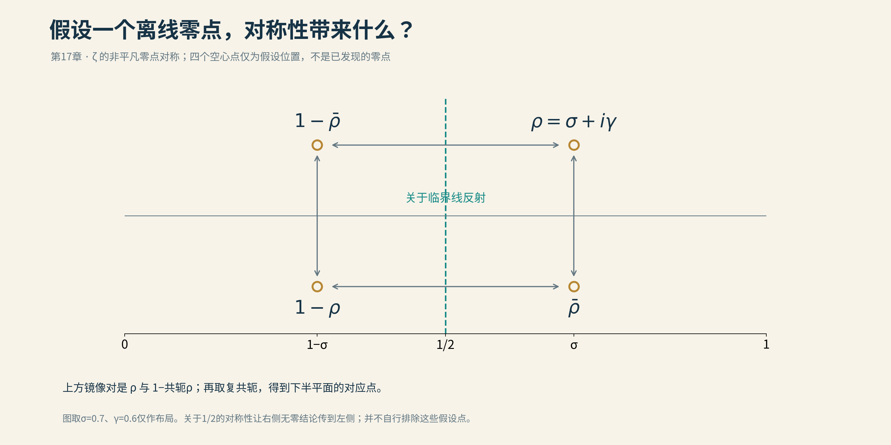
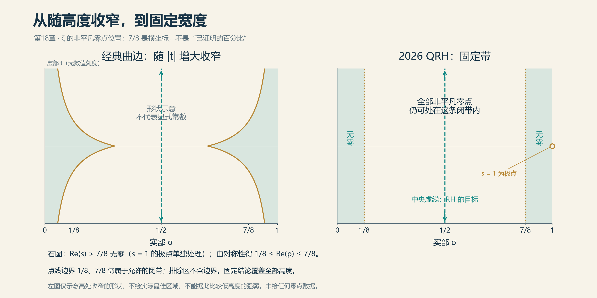
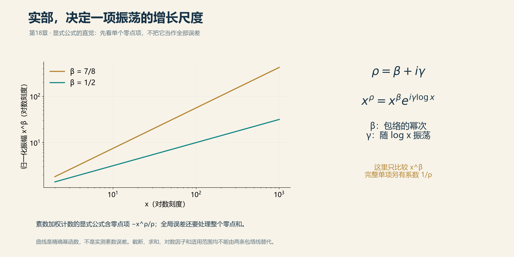

# 17 被拉直的边界

画一条靠近$`\mathrm{Re}s=1`$的无零边界。沿着虚轴向上走，经典边界越来越贴近右端，留下的无零区域越来越窄。它仍然有用，足以帮助控制素数分布，却像一条随着海拔升高不断收腰的走廊。

现在再画一条竖线：$`\mathrm{Re}s=7/8`$。

如果能够证明这条线右边始终没有非平凡零点，无论高度多大，那就不只是把旧走廊拓宽了一点。边界不再随着高度向右退缩，整片固定宽度的区域被排除了。

2026年9月30日署名的《The Quasi-Riemann Hypothesis》，以及10月6日OpenAI公开的论文和证明材料，提出的正是这一类结果。标题中的Quasi常译为“准”。它不是RH的别名，也不是给尚未完成的证明提前颁发的安慰奖；这里要看的是一个明确的弱化命题：把所有非平凡零点限制在比原临界带更窄的固定带内。

## 一条边界与一个百分数

对于ζ函数，论文的无零结论是：除须单独处理的极点$`s=1`$外，

$$
\zeta(s)\ne0
\qquad\text{当}\qquad
\mathrm{Re}s>\frac78.
$$

等号不包含在这个无零半平面里。再由函数方程与共轭对称性，全部非平凡零点被限制在

$$
\frac18\le\mathrm{Re}\rho\le\frac78.
$$

*假设ζ有非平凡离线零点ρ=σ+iγ，则1−共轭ρ是同高度的镜像零点，另有共轭ρ和1−ρ位于下半平面。对称性可以把右侧无零结论传到左侧，本身却不会排除这些假设位置。 本项目原创；[图源、数学依据与简化说明](img/README.md)。*

*经典无零区域在高处向临界带边缘收窄；第17章所述2026 QRH结果则在全部高度给出Re(s)>7/8的固定无零半平面，s=1的极点须单独处理。由对称性，全部非平凡零点限制于1/8≤Reρ≤7/8。边界仍留在允许的闭带中；临界线1/2是RH的更强目标。*

这不是说87.5%的零点在临界线上。分数$`7/8`$在这里是复平面的横坐标，第16节的67.25%才是零点数量的比例。两者都能写成百分数，但不能因此放在一条进度条上。地图上的经度与人口普查的比例，没有义务使用同一张统计表。

经典的Vinogradov–Korobov型无零区域，其宽度包含随$`|t|`$增长而变化的对数因子，长期来看趋于零。固定边界的意义是对无限高度保留统一宽度。不过这不意味着任何具体低高度上，新边界都必然优于每一种已知显式估计；有限高度验证和精细经典区域仍可提供额外信息。

若位置界能在适当意义下统一成立，显式公式就允许把素数计数误差压到固定幂次的尺度附近，例如对任意固定$`\varepsilon>0`$争取$`x^{7/8+\varepsilon}`$型的界。要写出精确版本，仍须处理截断、极点、对数损失以及涉及的函数。RH要求的平方根尺度，依然在更远的地方。

*x^(β+iγ)=x^β exp(iγ log x)。零点实部β决定单项的幂次包络，虚部γ决定对log x的振荡。图中独立计算x^(7/8)与x^(1/2)，只比较归一化振幅；显式公式的完整零点项还含系数1/ρ。 本项目原创；[图源、数学依据与简化说明](img/README.md)。*

这项结果究竟怎样从分析里出现？它没有把弯曲边界拿尺子压直。证明采取的入口，是一个更简单的观察：零点会让倒数产生极点。

## 要排除零点，先研究倒数

如果$`L(s_0)=0`$，那么$`1/L(s)`$在$`s_0`$附近不可能是良好的全纯函数。若能用另一种表达式把倒数全纯延拓过去，就与该处存在零点发生矛盾。

这并不意味着随便找到一个收敛积分就够了。必须证明积分确实等于目标倒数，而且收敛区域足够大。如果为了得到积分表达，已经假定了新区域无零，那么只是把结论藏进了定义。

论文选择的工具，是一种三次theta函数的平滑平均。读者不必先学会完整的theta理论，先记住这个对象有两副面孔：一副来自函数方程与反射关系，另一副来自Poisson求和。两副面孔描述同一个量，却把不同的信息暴露出来。

Poisson求和的基本作用，是把一个格点上的求和换成对偶格点上的求和。换过去以后，原来隐藏的主项、振荡与扭曲L函数会出现在更适合分析的位置。theta函数经常适合这种转换，原因就在于它们把格点和、指数衰减与变换规律组织在同一个对象中。

在这里，三次结构使相关算术自然来到$`\mathbb Q(\sqrt{-3})`$上。证明处理的不仅是ζ，也不是一条孤立的Dirichlet L函数，而是一整族有限阶Hecke L函数。这个扩大的舞台并非炫耀一般性：Poisson展开会产生新的扭曲，若只盯着一个函数，展开后的对象就可能跑出我们能控制的范围。

数学中有时必须把问题放大，才有办法把答案缩小。

## 不要寻找一个并不存在的“最右零点”

设$`\beta_*`$是这一整个L函数家族的非平凡零点实部的上确界，并按证明需要把$`1/2`$也并入定义。

上确界未必由某个零点达到。零点可以从左边不断靠近一个界，却没有任何一个恰好坐在界上；家族还可以有无穷多个成员。因此，我们不能说“取全家族最右边的那个零点”，然后放心开始计算。

正确的反证方式是：假设$`\beta_*`$大于希望证明的边界$`\sigma_0`$，设法得到一个共同的正数$`\varepsilon`$，使家族中每一个目标倒数都能全纯延拓到

$$
\mathrm{Re}s>\beta_*-\varepsilon.
$$

共同宽度很重要。如果每个函数各有一个越来越小的延拓宽度，无穷家族仍可能把零点推得越来越靠右。我们需要的是：不同成员允许有不同的估计常数，但跨过上确界附近的这段宽度不能随成员缩成零。

一旦有了共同宽度，上确界的定义保证附近必有家族成员的零点。该处一方面应是倒数的极点，另一方面又处在新得到的全纯区域里，矛盾就成立了。

## 同一个平均，两种增长预算

把论文中的平滑平均记为$`J_\eta(Z)`$。这里$`\eta`$标记家族中的目标角色，$`Z`$是趋向无穷的尺度参数。

从反射侧看，函数方程配合均方估计与Cauchy–Schwarz不等式，给出$`J_\eta(Z)`$本身的增长上界。Cauchy–Schwarz的作用依然是控制复杂乘积，但选怎样的长度和平滑方式，决定这次控制会损失多少。

从Poisson侧看，可以抽出一个主Mellin项，记为$`f_\eta(Z)`$。Mellin变换适合研究乘法尺度：它把$`Z`$的幂次增长，与复变量中的收敛半平面联系起来。这个主项的变换含有

$$
\frac{H_\eta(s)}{L_\eta^S(s)}.
$$

这里$`H_\eta`$是已控制的非零因子，$`L_\eta^S`$表示删去有限个欧拉因子的L函数。删去的那些局部因子在所讨论区域内不引入目标零点问题，因此最终仍能回到原L函数。

剩下的任务，是同时控制平均本身和“平均减去主项”的误差。若两者都比假设中的最右零点所允许的增长更小，那么主项也必须更小。三角不等式在这里完成最后的拼接，但真正困难的工作，全在此前怎样获得两种节省。

用一个简化的记号$`C(s)=s+c`$表示增长指数的对应关系，证明的骨架是

$$
|J_\eta(Z)|\ll_\eta Z^{C(\sigma_0)+\omega},
\qquad
|J_\eta(Z)-f_\eta(Z)|
\ll_\eta Z^{C(\beta_*)-\delta},
$$

其中$`0<\omega<\beta_*-\sigma_0`$，而$`\delta>0`$提供误差项的节省。它们可依赖假设中的共同间隙，但不依赖目标角色$`\eta`$。于是两项都低于$`Z^{C(\beta_*)}`$一个共同的正幂次，$`f_\eta`$也获得相同性质的节省。

Mellin积分因此能在更大的半平面收敛。在原来已经合法的区域里，反演证明它就是上述倒数表达；再由解析函数的恒等定理，把这个身份延伸过去。这一步不是把积分路径直接跨过零点却假装没有留数，而是先建立新的全纯表达，再与原表达严密接合。

## 非主项为什么没有把节省吃掉

如果只讲到“三角不等式”，这份证明会显得过于轻松，仿佛困难主要在于记得把两个数相加。事实当然相反。

Poisson展开的非主项包含许多扭曲对象。一种潜在零点的存在，会迫使两个相关的截断狄利克雷多项式同时变大：一个带有莫比乌斯型系数，来自倒数结构；另一个不带这种系数。它们不是两个任意的大值事件，而必须共享同一个角色以及相应的扭曲高度。

为什么“同时”值得强调？设某个活动每天都有一个人非常忙，另一个活动每天也有一个人非常忙，这并不说明每天都有同一个人同时忙于两件事。分别控制两个集合，与控制它们的交集，是不同的信息。

证明利用适当的矩估计，限制这类同时大值的项数及其总贡献，再把它们送回非主项的预算。这里与第4节控制异常大值的思想有亲缘：不必逐个精确计算所有坏项，只要证明它们不可能既过多又过大，整体误差就能守住。

对角色、长度、高度以及局部素因子的安排，正是在维护这种关联。如果把不同角色的大值随意拼在一起，或者在一次粗糙估计中抹掉共同结构，所需节省就可能消失。主证明的精细之处，远多于最后那个漂亮的分数。

## 八分之七从哪里出现

证明先得到$`11/12`$边界，再引入针对选定素因子的局部补偿，调整两段长度，并改进大值项的分配，把边界推进到$`7/8`$。

第二阶段中，相关增长指数的形式是$`C(s)=s-11/16`$，直接估计所给的关键尺度是$`3/16`$。两者相遇的位置满足

$$
\frac78-\frac{11}{16}=\frac3{16}.
$$

这行小学算术只负责显示边界从哪里露头，并不代替证明。要让它成为无零结论，仍须确保每个误差项都拥有需要的严格节省，而且节省能够统一地服务于整个家族。

于是，$`7/8`$既不是神秘常数，也不是已经知道无法突破的自然屏障。它是这套参数选择与增长比较可以兑现的边界。

随后，刘柏英的预印本沿相关框架重新分配长度、局部素数因子与矩参数，把数值推进到约$`0.8749570194`$。看起来只比$`0.875`$小了一点，但这不是把同一个小数计算得更精确，而是证明预算中真的挤出了额外余量。其“最优”也须按论文限定的比较系统来理解，不能提升为所有未来方法的极限。截至本稿时，这项工作应按预印本及其公开形式化材料报告状态。

## 怎样回到ζ与Dirichlet L函数

Hecke家族的结果需要传回本书更熟悉的对象。对Dirichlet角色$`\chi`$，把它与二次数域中的理想范数复合，可以得到相应Hecke角色。相关L函数有乘积分解，其主体是

$$
L(s,\chi)L(s,\chi\chi_{-3}),
$$

有限个局部因子及可能的极点需分别处理。在非极点处，如果乘积在目标区域无零，便能推得各个因子的无零性质；取主角色情形，再得到ζ的结论。

这解释了“扩大问题以后再回来”为什么有效。扩展后的家族在变换下更稳定，允许证明闭合，最后通过算术分解把结论带回原来的函数。

公开形式化说明覆盖ζ、各正模数的Dirichlet角色，以及底域$`\mathbb Q(\sqrt{-3})`$上的相应有限阶Hecke家族。它并不等于论文里每一项应用、所有其他数域的L函数或整个广义黎曼猜想都已形式化解决。我们仍须分别阅读命题范围与验证范围。

## 一条直线之后

无零区域跨过全部高度，比例定理跨过总体计数，二者都很强，也都留下不同的空白。固定边界的内部仍有一条宽带；高比例保证之外仍可能有少量离线零点。把这两张图叠起来，也不会自动让剩余零点无处可去。

真正值得注意的，是论证开始借助新的组合方式。三次theta平均、Poisson求和、矩估计与全纯延拓并非凭空产生的魔法；新成果把它们安排进一条能迫使倒数跨过零点上确界的链条。若要继续改进，人们需要理解这条链条在哪里损失、哪里可替换、哪里用了整个家族的封闭性。

因此，“证明已经公开”后面还有一个问题：我们是否已经知道它为什么工作，是否能够用自己的语言讲出来，是否能把它带到另一个问题？下一节将暂时离开复平面的边界，转而检查证明本身的边界。

[全书目录](../README.md) · [本篇目录](README.md) · [上一节](16_Claude的核弹.md) · [下一节](18_从数学家到审核员.md)
