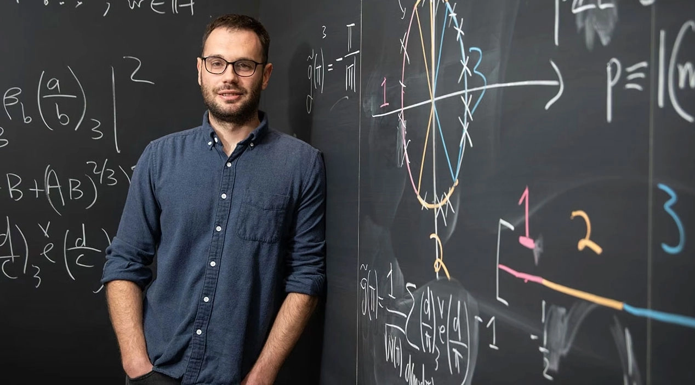

# 18 准黎曼假设

上一节，那份目录还没有翻完。

722篇论文迎面而来，后来留下719篇。讨论声里，有人追问发现，有人追问署名，也有人已经翻开了第三组文件。

编号003，标题是：**准黎曼假设。**

它确实属于那场发布。不过，同一编号下放着三份相关稿件：一份把无零边界推进到7/8，一份给出较短的11/12证明，另一份处理西格尔零点。后者先留在下一章；这一章，我们从几百份文件里，抽出前两份。

标题中的“准”，很容易让人误会。仿佛黎曼假设终于有了消息，只差有关部门盖章。

数学里的意思要朴素一些：暂时不能让所有零点站上那条线，能否先让它们离边界远一点？哪怕只远一点，只要这段距离永远不缩回去。

这个“永远”，已经等了很久。

## 一寸山河

还记得那条临界带吗？横坐标从0到1，中间立着1/2。黎曼希望所有非平凡零点都住在中线上。

1896年，阿达马与德拉瓦莱·普桑分别证明：最右边的直线1上没有零点。素数定理由此落定。后来，人们继续向左开拓，在边界附近清出一条没有零点的走廊。

问题在于，这条走廊越往高处越窄。

维诺格拉多夫、科罗博夫以及后来的研究者，把它修得越来越好；但经典估计仍允许它在无限高处，越来越贴近右侧的墙。无论我们在眼前清出了多少空间，遥远处的零点仍可能向1靠拢。

准黎曼假设要求换一份保证：**找到一条横坐标小于1的竖线，线的右边，任何高度都没有零点。**

不是检查到某一层楼，也不是大部分楼层都没有。整栋楼，没有顶。

OpenAI署期2026年9月30日的主论文，给出的竖线是7/8。10月6日，它随那批材料一同公开。对ζ函数而言，右侧排除区再经函数方程映到左侧，便得到：全部非平凡零点，都落在下面这条固定宽度的带内。

$$
\frac18\leq\operatorname{Re}\rho\leq\frac78.
$$

这里ρ表示一个非平凡零点。两条边界本身仍包含在允许区域里；ζ在1处另有一个极点，它不是零点。

*原创示意。左图只画经典区域在高处收窄的形状，不表示某个具体高度的最佳估计；右图的固定边界覆盖全部高度。中间的1/2，仍是黎曼假设要求抵达的地方。*

7/8就是0.875。但这绝不是说“黎曼假设已经证明了87.5%”。第16章的67.25%数的是零点的比例，这里的7/8量的是零点能走到的最右位置。

一个问多少人已经到家，一个问最远的人还可能在哪里。两份好消息，可以一起听，不能相加报喜。

这条直线之所以重要，也不只是地图变得整齐。

在素数计数的显式公式里，一个零点的实部，控制着相应振荡项增长的幂次。实部越靠右，允许它掀起的波澜便越大。把所有零点从1附近统一赶开，就能让素数分布的误差获得一个固定幂次的节省，而不再只是随规模缓慢改善。

*只比较两个幂函数的增长：x的7/8次方与平方根。真实显式公式还要计入系数、振荡与所有零点的总和，图中曲线不是实测素数误差。*

较短的11/12论文，就明确给出了算术级数中素数计数的误差界：主尺度为x的11/12次方，再乘一个对数因子。结论同时涵盖不同的余数班级，并有统一的常数。它还把一些原来需要假设的算法结论变成了无条件结果，例如在素数模数下，用确定性的多项式时间算法求平方根。

一条画在复平面上的直线，另一头连着素数，也连着计算。

## 旧纸上的新路

数学家的第一项实际选择，颇有人情味。

7/8版本有199页；10月5日署期的11/12版本，有49页。边界虽弱一些，大家先集中读短的。拉齐维乌批评稿件难读，萨纳克则调整了当学期的课程，带着学生研究它。这样的反应，见于10月19日的《Quanta》采访。

世界已经变了，研究生的阅读量倒是很稳定。

纸页翻下去，一个意外渐渐露出来：关键零件，许多原本就在数学家的工具箱里。新证明把它们接到了一起。其中一条线索，通向亚历山大·邓恩与马克西姆·拉齐维乌研究过的三次高斯和。

*亚历山大·邓恩与黑板。图片署名Caltech，经[Quanta相关报道](https://www.quantamagazine.org/ai-proved-the-quasi-riemann-hypothesis-what-happens-now-20261019/)刊出；原图未注明拍摄日期，不作为2026年读稿现场。*

这条旧线索，还有一个停车场里的开头。

2021年1月，疫情期间，两人在帕萨迪纳的一处停车场偶遇，聊起重新见面讨论数学。此后数月，邓恩常常清晨五点便到办公室。他们攻的是帕特森猜想，研究一类由素数生成的振荡和，为什么会出现微妙的偏向。合作中，他们发现一个大家原以为可以改进的筛法估计，恰恰不能按预想改进；调整方向之后，才走通了证明。

这些细节来自两人对《Quanta》的回忆。那项工作2021年公开，2024年发表于《数学年刊》。主要渐近结论仍以广义黎曼假设为前提，但论文中的一些变换公式并不需要它。

这个区别很要紧。2026年的新证明借用的是那些无条件工具，并没有把“假设黎曼猜想成立”偷偷装进行李，再宣布自己抵达了目的地。

人们当年为另一道难题磨出的零件，如今装在了一扇意想不到的门上。

## 把难题请进人群

先从49页的版本说起。它的入口，我们在第8章见过。

莫比乌斯函数把整数标成＋1、−1或0：含有素数平方因子的记0，其余按质因子个数的奇偶交替记号。我们关心的，是这些正负号加起来，还剩多少。

如果有一百万项，最粗糙的估计只能说，绝对值不会超过一百万。若正负号能充分抵消，剩下的就会小得多。前面说过，若能始终压到接近平方根的尺度，就触及了黎曼假设的核心。

这一次，要求先放低：不求平方根，只求一个固定小于1的幂次。

为什么抵消会排除零点？因为莫比乌斯函数恰好出现在ζ的倒数里。在最初合法的区域，有

$$
\frac1{\zeta(s)}=\sum_{n=1}^{\infty}\frac{\mu(n)}{n^s},
\qquad \operatorname{Re}s>1.
$$

正负抵消越强，这个倒数就越有希望以良好的解析表达向左延伸。而ζ若在那里等于零，倒数就会出现极点，两者冲突。因此，一条控制莫比乌斯和的估计，可以变成一条排除零点的边界。

原论文处理的是更广的Hecke L函数家族，莫比乌斯函数也相应搬到了数域的理想上。术语可以先放在一边，核心困难没有变：**怎样证明这一串正负号确实抵消，而不是仅仅看起来像随机？**

一个孤零零的和，很难估计。研究者便给它添上许多不同的权重，造出一整个家族。

这好比一道题单独坐在那里，怎么问都不肯开口。于是把它的亲戚都请来，开始算总账。

## 分身有术

这里的“算总账”，不是把所有和直接相加，而是先取绝对值平方，再求和。这样，每一项都非负，谁也不能靠别人负得足够多，把自己的大值藏起来。

但平均受控，还不够。全班平均分低，不能证明某一个学生没有考满分。

短证明的巧妙处，是让我们要控制的那个和，在家族里出现许多近乎相同的副本。

它选用六次角色作权重。这类权重在互素的位置，取值像六个等分圆周的方向；输入变成一个六次幂时，权重就回到1。于是，把家族参数选成许多不同素元的六次幂，得到的和便几乎还原为原来的目标和。差别来自不互素的少数项，需要另外估计。

分身不是白送的，但账算得过来。

先看一个完全可以心算的例子：假设一张表里所有数的平方之和不超过100，而某个数A在表里出现了25次，那么25个A的平方也不能超过100，因此A的绝对值至多是2。

一个A或许能躲在平均数里。二十五个A，就没那么容易了。

实际证明里，这个逻辑变成了幂次计算。把很小的指数损失和对数暂时省略：目标和大约有D项；整个家族的平方总量，被压在D²的尺度；目标和有大约D的1/6次方那么多个副本。先除掉副本数，再开平方，得到

$$
|A|^2\ \lesssim\ \frac{D^2}{D^{1/6}}=D^{11/6},
\qquad |A|\ \lesssim\ D^{11/12}.
$$

这就是11/12露头的地方。式子是读懂指数的简化账本；原稿还处理了平滑权重、互素误差，以及可以任意缩小的指数损失。

分数没有从天而降。它藏在“能造多少副本”与“总量能压多低”之间。

## 转身，另见天地

当然，最难的工作尚未交代：那个漂亮的平方总量，凭什么成立？

这就轮到停车场故事里的旧工具出场了。

证明使用泊松求和，把原来的加总换成另一种加总。可以借音乐作一个有限的比方：同一段声音，既能按时间记录，也能拆成不同频率。换一种表示，原来纠缠在一起的东西，有时便能看清。

在这里，莫比乌斯系数与变换产生的高斯和结合，变成三次theta函数的系数。theta函数带着特别的变换规律；再转一次，某些原本六次的角色结构，变成了更容易控制的二次结构。已有的二次大筛估计，终于可以接上。

这不是把“六”除以“三”那么简单。真正有用的是：新结构有更好的整体估计，能够省掉旧估计里一项碍事的损耗。

为了用上theta函数，证明还得先补进一些带立方因子的项，凑成完整的对象。补进去容易，取出来并不轻松：正负贡献可能互相抵消，不能见总量小，就认定其中某部分也小。

他们用莫比乌斯反演拆开补入的项；剩下不好处理的部分，再经两次泊松变换，送回同一类问题。只是这一次，尺度变小了。如此反复，直到余下的范围小得可以直接估计，再把结论一层层传回来。

像沿着山路绕行：转过一圈，看见相似的风景，海拔却已经不同。

也正因为变换会不断产生新角色、新权重，整个证明必须在一个足够稳定的家族里展开。只盯着ζ一个函数，转身之后，可能连下一步该向谁借力都不知道。

这里选择的是Q(√−3)上的有限阶Hecke L函数家族。它适合容纳三次结构；最终又能通过L函数的乘积分解，把无零结论传回Dirichlet L函数和ζ。

题目变大了，路反而通了。

## 向左，再向左

49页的版本，把边界放在11/12，约0.9167。199页的主论文，则把它推到7/8，也就是0.875。越往左，排除的区域越大。

长稿不是把短稿多算几位小数。它有自己的两阶段组织：先取得11/12，再改造探测用的平均，加入选定素因子的局部补偿，调整两段求和的长度，并加强控制异常大值的矩估计。

其分析骨架，可以抓住一个动作：**同一个平均，从两面估计。**

一面由反射关系限制它自身能长多大；另一面用泊松展开，把含有目标L函数倒数的主项抽出来，证明其余部分不能贡献太多。平均本身不够大，余项也不够大，主项便不能独自长得太快。

增长一旦被压住，对应的Mellin积分就能在更靠左的区域收敛，于是给倒数铺出一段新的解析延拓。假设中的零点，本该让倒数在这里出现极点；新表达却不允许它出现。

这一步还有个容易被一句科普话带过去的细节：不能随手“取最右边那个零点”。无穷多个零点可以不断靠近某个位置，却没有谁真正站到最右端。

证明用的是整个家族零点实部的上确界，也就是最右位置的极限。若这个极限超过目标边界，就让所有成员的倒数共同向左跨过一小段。跨越的宽度不能因成员不同而缩成零。这样，上确界附近总能找到一个零点，撞上刚刚铺好的解析区域，反证才真正闭合。

零点可以不选出一个带头的，却不能逃过一个覆盖全家的估计。

7/8也不是天生不可逾越的关口。10月8日，刘柏英提交了后续预印本；12日更新的版本，通过重新分配长度与矩参数，把边界推进到约0.8749570194。

从0.875到0.874957，看上去像校对员改了一行小数。实际改变的，是证明允许零点停留的地方。哪怕只向左一点，也必须让所有相关误差继续听从同一套不等式。

论文还证明了这个数在它明确列出的比较系统内的最优性。意思是，这套工具、这些约束之下，余量已经用到头；并不是替未来的数学宣布停工。

## 直线之外

这一次，人们得到的，既有一个新结论，也有一条已经可以拆开研究的路。

公开材料中的Lean范围说明，列出了ζ、所有Dirichlet L函数，以及上述Hecke家族的7/8无零结论；主角色在1处的极点单独排除。论文后续的所有应用，并不自动属于这份形式化范围。证明怎样被核验、又怎样被人理解，后面还会专门谈。

对黎曼假设本身，距离依然清楚：7/8与1/2之间，还隔着一片宽阔的地带。证明大量零点已经在线，与证明所有零点不能走得太远，是两种不同的进展。把两项结论叠在一起，剩余的零点也不会自动归队。

但这一回，经典边界在高处不断退让的局面，出现了一条固定的防线。它横贯无限，不随高度收窄。

更耐人寻味的是，它管住的并非只有ζ。那些把素数分进不同余数班级的Dirichlet L函数，也在同一份结论里。

于是，第一篇留下的那颗特殊零点，又回到了纸上。

它如果存在，便要紧贴着1，在实轴上藏身。过去，人们清理了大片区域，总得给这个可能的例外留下一个座位。

现在，直线向左移了。

那把椅子，该收起来了。

[本章研究底稿](../资料/18_被拉直的边界/README.md) · [本篇参考文献](参考文献.md)

[全书目录](../README.md) · [本篇目录](README.md) · [上一节](17_NS爆破与722篇论文.md) · [下一节](19_课后习题之西格尔零点.md)
