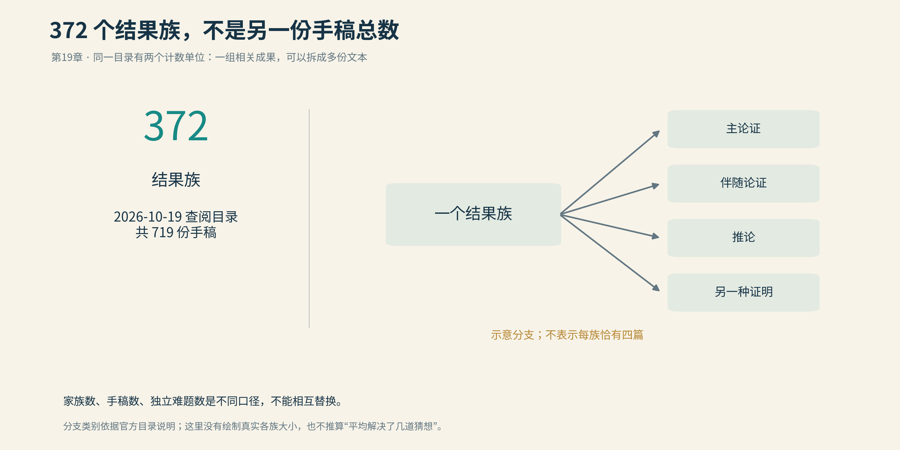
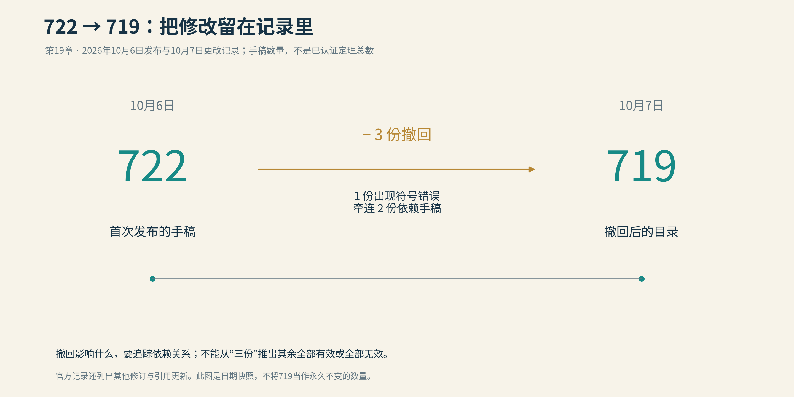
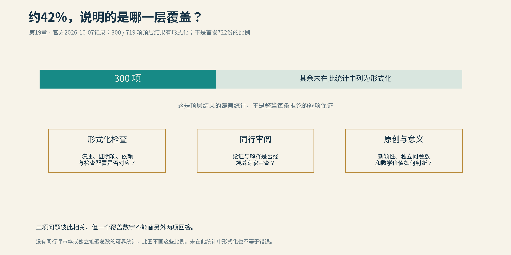

# 19 OpenAI的722篇数学论文

一天收到一篇陌生领域的论文，可以先放进“有空读”的文件夹。一天收到722篇，文件夹就开始像一种生活态度。

2026年10月6日，OpenAI批量公布数学研究手稿。首次发布的数量是722份，组织为372个结果族。标题保留了这个引发讨论的初始数字；截至2026年10月18日，仓库已经变成719份。三份撤回，并不应该悄悄藏进算术差额里。

首先要把单位说清楚。722是手稿数量，不是722个已经获得共同体承认的定理，更不是722道彼此独立的著名难题。一个结果族可以包含主要论证、伴随结果、推论以及其他版本。把它们全部称为“解决了722个猜想”，会在数学讨论开始以前就先制造一道错误的计数题。

*截至2026年10月19日查阅，目录把719份手稿组织为372个结果族。一个族可能包含主论证、伴随论证、推论及另一种证明；右侧是类别示意，不是实际族大小分布。*

第17节的固定无零区域属于这次发布中受到关注的工作，但本节不再重讲theta平均。现在的问题换了：当研究成果以这种速度和规模出现，谁来读，怎样核验，什么算贡献，又由谁决定数学接下来把注意力放在哪里？

## 从稀缺的证明到稀缺的读者

传统研究并非总是一个人安静地坐在书桌前。大型合作、公开讨论、竞争、优先权争执，早已属于数学史。把过去写成田园牧歌、现在写成工厂轰鸣，虽然容易营造气氛，却会把两边都画得太整齐。

变化仍然真实。一个小组若用数年完成一项工作，公开以后通常还能形成某种缓慢的阅读过程：报告、讨论班、专家通信、修改，再到后续论文。新一代模型若能在短时间内产出许多候选证明，发现速度与理解速度就可能脱节。

这不只是论文下载得快不快。一个代数几何专家不能因为服务器带宽足够，就在午饭后顺便审完数百页解析数论。知识结构、验证经验与注意力都需要时间积累。证明文本可以复制，合格读者不能靠复制粘贴产生。

OpenAI称，这批工作来自对约四千个问题的尝试，大部分采用共同流程，而固定无零区域与部分CM阿贝尔簇工作属于例外。这种说明有助于理解结果怎样产生，但模型尝试的总数、成功率与每份文本的价值，仍是不同指标。失败题目如何选择，成功结果如何聚合，模型能否被外界以同样方式使用，都会影响人们怎样解读这次展示。

一个重要的新问题由此浮现：如果生产候选证明变便宜，而理解它们仍然昂贵，谁承担后半段成本？

## 三份撤回，说明什么

*2026年10月6日首次发布722份手稿，次日因一份手稿的符号错误及对两份依赖手稿的影响，撤回三份，目录减为719份。这是一份版本快照；数字表示手稿，不表示全部成果已获共同体认证。*

10月7日，公开更改记录说明，一篇关于分裂阿贝尔八维簇的手稿出现符号错误，并牵连两份相关Hodge方向的手稿撤回；其他一些文件也进行了修订和依赖引用更新。

这件事既不能被淡化成“只有三个，四舍五入没有”，也不能被夸张成“发现错误，所以全部无效”。数学结果之间有依赖网络。一个局部错误可能只影响一页，也可能沿着共同引理传播到多份论文。需要检查的是受影响的范围，而不是先选一句立场鲜明的口号。

公开撤回记录是必要的。它让后来读者知道自己手上的版本是否已经过期，也让依赖这些结果的人有机会修正工作。如果所有修改只发生在同一个下载链接背后，旧文件便会像没有日期的罐头，外表完整，打开前却不知道里面是哪一批。

当前官方统计约42%的顶层结果具有形式化材料，相关数量为300项。这个比例不能改写成“全部719篇已经通过Lean验证”，也不意味着形式化覆盖了相应论文的每个附带推论。第18节区分过顶层命题、依赖、翻译与内核；数量扩大以后，这些区别只会更重要。

*2026年10月7日官方更改记录列出300/719项顶层结果有形式化，约42%。这一统计不能替代同行审阅、新颖性与数学价值的判断，也不自动覆盖每篇的每条附带推论。*

一个负责任的成果库至少需要让读者方便辨认：哪份是主定理，哪些是同一家族的衍生结果，哪个版本修复了什么，哪项结论受到撤回影响，形式化覆盖的究竟是哪句话。索引与版本管理看起来没有新定理耀眼，却能决定一份新定理是否可以被安全地使用。

## 人类数学协会在反对什么

这次发布很快引起公开争论。Association for Human Mathematics，简称AHM，可译为人类数学协会，对OpenAI的做法提出强烈批评，并呼吁停止合作。

协会强调，数学是一项由人参与、理解和传承的事业；企业大规模发布结果，不应只按技术能力展示来评价。它的批评涉及决定权：谁选择要攻克的问题，谁承担理解的劳动，谁有权把共同体既有的研究方向突然变成一份企业展示清单？

这是协会的立场，不等于全体数学家的统一决议。支持使用AI的研究者，也可以赞同其中某些治理担忧；反对这种发布方式的人，也不必因此否认模型确实发现了数学结果。把讨论划成“相信机器”与“不相信机器”两队，会使真正的分歧失去名字。

另一个同时出现的组织是Advisory Group on Mathematics and Artificial Intelligence，简称AGMAI。它是独立的数学与AI咨询组，与AHM不是同一个机构，也不是一家公司的数学认证部门。

AGMAI此前对使用尚未向数学共同体开放的专有模型测试高级研究问题表达过反对，并提出负责任发布的建议：清楚引用，改善可读性，交代方法与资源，维护版本记录，公开形式化材料，为人类理解提供支持。对已经产生的结果提出发布建议，不等于认可产生结果的全部过程。

这一区别非常容易在传播中消失。“专家给了建议”会被压成“专家背书”，“专家批评了过程”又会被压成“专家否定了定理”。实际上，证明是否成立、成果怎样发布、资源如何分配，是可以分别判断的三件事。

## 陶哲轩没有变成一句口号

陶哲轩在本书前几篇中已经出现过：公开协作、热流、数据库。他本人长期使用和讨论计算工具，因此2026年的批评不宜写成一个原来拥抱技术的人突然宣布反对技术。

9月11日，他是关于AI与数学研究方向的一份公开声明的25位菲尔兹奖初始签署者之一。声明所关心的核心，是“解决问题”与“理解数学”可能脱钩。过去，一个人解决困难问题，通常意味着他对相关结构获得了深入理解；当答案可以大量生成，这个传统的代理指标就不再总是可靠。

10月7日，他的博客刊出了AHM针对批量发布的客座声明。这篇客座声明为争论提供了一个受到广泛关注的场所。

10月9日，他在Caltech的Math 2.0讲座中，继续讨论从证明稀缺走向证明丰富以后，研究怎样组织。他强调的方向包括让AI帮助解释既有证明、连接理论网络、建设形式化库，以及寻找更有用的方法与概念。模型可以扩展数学研究，重点在于扩展什么。

这并不要求每项新结果立刻让所有人看懂。现代数学本来就高度专门化，复杂证明也可能多年以后才出现更好的解释。问题是，我们是否仍把理解当成需要投入资源的目标，还是把它视为发布之后自然会发生、因而无需负责的善后工作。

如果每次展示只计算“新解决了多少题”，很容易把可计数的产量当成全部价值。反过来，若因机器参与就拒绝研究其正确结果，也会错失有用数学。陶哲轩的公开讨论，值得按这种具体的取舍来读，而不是替他配上一句“人类保卫战”的口号。

## 把时钟拨回九月

十月的争议有一个不久前的背景：Navier–Stokes风波。

9月8日，OpenAI宣布构造了光滑外力作用下三维不可压Navier–Stokes方程的有限时间爆破，并提供相关论文与形式化材料。公司表示该构造满足Clay原题所列的相应破裂方案。

这里先把数学对象区分清楚。Navier–Stokes方程含黏性，Euler方程不含黏性；有外力与无外力，也不是同一个命题。OpenAI另外讨论的Euler工作是无外力情形，而引发优先权争论的Alpöge与Tristan Buckmaster工作涉及光滑外力下的Euler结果。不能把几份工作统统压成“同一个流体难题，谁先解出来”。

所公布的Navier–Stokes构造具有正黏性、零初速以及光滑、紧支撑的外力。在有限时间以前，解保持光滑，总动能有界，而最大速度在逼近该时刻时无界。有限能量与局部速度发散可以同时成立，因为越来越高速的区域可能越来越小。外力本身也不是通过变得不光滑来制造一个显而易见的灾难。

Clay题目的不同方案对外力有不同规定：无外力的全球正则性命题，与允许合适外力的破裂方案，需要分别阅读。因此，不能由这份有外力构造直接宣布无外力Navier–Stokes全球正则性已经被否定。公司宣布给出相应方案的解答，也不等于Clay已经完成最终认定或授奖。

数学上的限定并没有消除另一场冲突：当两组工作在不同节奏中接近公开，优先权与信任怎样处理？

## 八十八小时与尚未写完的解释

按OpenAI的公开叙述，团队在9月1日听到相关突破传闻后启动工作，使用约一万个并发智能体，88小时后得到结果，再用17小时完成相应形式化。

Buckmaster则在本人声明中介绍，他与Alpöge使用多种语言模型辅助研究，8月15日已有光滑外力Euler方面的结果，8月22日完成Lean验证，此后继续理解和重写。他们并不是完全不用AI、只靠纸笔抵抗机器的一方。

双方在9月6日的交流，随后成为优先权、署名与施压争议的焦点。Buckmaster的声明描述了他对沟通过程的不满，也讨论了此前使用相关AI产品产生的信任问题。与此同时，他明确表示，并不知道他们的数据是否被使用，也尚不清楚对方模型究竟做了什么。

OpenAI否认使用两人未发表的成果，并报告内部调查的结论。数据是否被使用，并无已证实的肯定结论。这一不确定性没有让争议自动结束：在研究者将未公开思路输入商业模型的工作方式下，信任如何建立，边界如何说明，已经成为需要共同面对的问题。

这场风波揭示的困难，比一桩谁对谁错的网络案件更长久。传统时间表里，得到一个结果以后，还要理解、解释、与同行交流；工业规模的搜索可以在几天内跨过多个问题，却未必同步完成这些工作。两种时钟同时运行，优先权规则、保密预期与合作安排便容易产生摩擦。

需要的不是要求所有研究者以同一速度工作，而是清楚记录贡献、时间、接触过的材料与未公开信息的使用边界。越有能力快速追赶，越需要可信的过程说明。

## 让数量重新回到数学

10月15日，OpenAI宣布出资五百万美元支持Simons Foundation相关项目，帮助数学家通过会议、工作坊等方式理解和研究AI产生的成果。它至少承认了一件重要的事：理解不是零成本地跟随证明自动出现的。

这样的安排能否充分回应争议，还要看具体执行，不能因为资金数字很大，就把前面的分歧宣布解决。读者需要看见哪些成果被理解、哪些得到简化、哪些被修正，是否产生了新概念，以及年轻研究者是否有机会参与而不只是替文本清理格式。

回到QRH，最值得追问的不是它在722份文件中占第几个位置，而是它的数学机制能否成为共同知识。能否把延拓准则讲清，把最吃紧的指数预算抽出来，把Hecke家族与Dirichlet结论的桥梁说明白？能否发现另一种证明，或者明确现有路线的改进空间？这些工作不会增加首发清单的长度，却可能决定成果最终留下多深的影响。

一篇论文可以有许多参与者：提问者、模型开发者、搜索组织者、证明生成系统、核验者、形式化作者、独立解释者。贡献可以细分，责任也应随之明确。没有必要把所有人都塞进一个“作者”概念里，才承认他们的劳动；更不能因为分工复杂，就让错误最终找不到可以回应的人。

722这个数字会留下来，因为它标记了一次引人注目的发布。但数学最后记住的，通常不只是多少份文件，而是其中哪些思想被理解、改造和传了下去。

本书的最后一节，便把问题交回那些尚未出现的思想。若人和AI能够一起寻找新的结构，黎曼猜想下一步可能需要的，究竟是一条更好的不等式，还是一件我们尚未学会制造的乐器？

[全书目录](../README.md) · [本篇目录](README.md) · [上一节](18_从数学家到审核员.md) · [下一节](20_路在何方.md)
