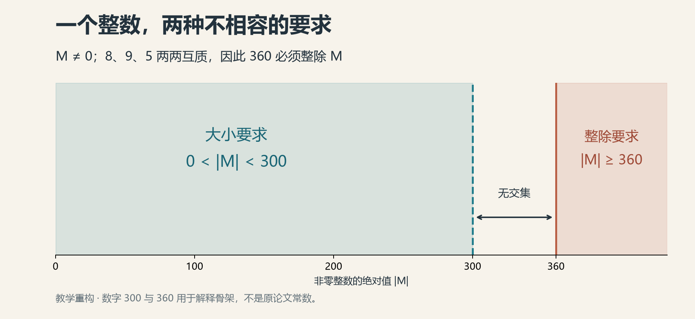
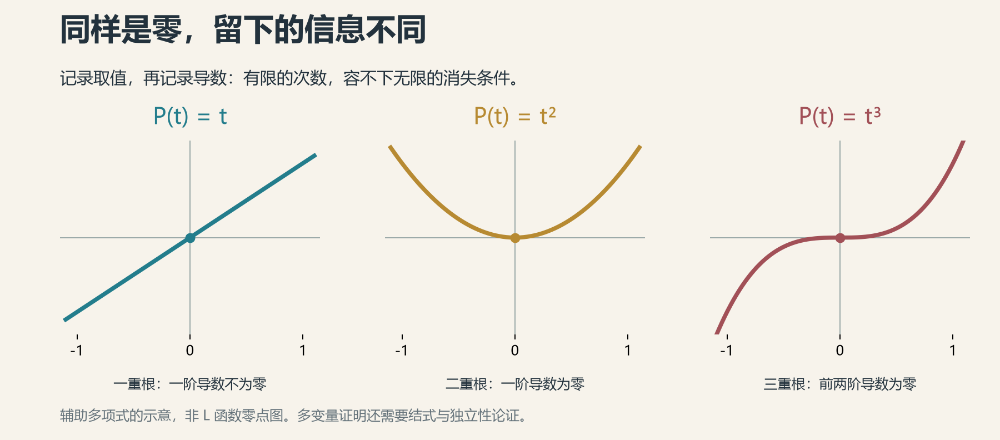

# 19 课后习题之西格尔零点

第一篇的结尾，我们把张益唐留在了一道久攻不下的难题前。

多年灯火，数页长稿。那颗可能存在、又始终无人见过的西格尔零点，像数论深处一间没有亮灯的屋子。许多定理经过这里，都要放轻脚步，补上一句：如果它不存在。

2026年10月，门开了。

更出人意料的是门开之后。数学家陆续走进来，查看梁柱，挪动家具，重新画图。有人把九页写成十九页，有人又把证明收进六页、五页。

曾经写在研究计划第一页的问题，开始显出另一种命运：写在讲义最后一页，前面加两个字——证明。

当然，我们还没有找到哪位教授真把整套论证布置成普通本科作业。这里的“课后习题”，先借来形容一种落差：发现时千山万水，学会之后，老师只给两行提示。

数学史对后来者，一向颇有优待。

## 轰鸣之后

上一章讲的是准黎曼假设。这一章，我们换一份稿子。

OpenAI同批公布的《统一排除朗道—西格尔零点》，只有九页。它有自己的证明路线：从一条经典的解析数论估计出发，把问题送进代数数论，再让一个整数陷入左右为难的处境。

目标可以写成很短的一行。对于相应实Dirichlet L函数在0与1之间的实零点β，证明存在一个统一的正常数c，使

$$
(1-\beta)\log q\geq c.
$$

q是刻画这个L函数的整数参数，叫导子。β越靠近1，左边越小。这条不等式的意思是：不管换到哪个q，都必须给零点与1之间留出一段按同一规则计算的距离。

过去最让人不安的，正是可能有个例外贴得过近。如今，要把这个例外也请出去。

因此，“西格尔零点不存在了”清理的是靠近1的特殊禁区，并没有顺手证明所有零点都在临界线上。黎曼假设的门牌，还挂在远处。

10月11日，威廉·班克斯（William Banks）给出了十九页的展开稿。他把原论证改写成直接证明，逐步列清依赖，还算出了明确的常数：结合已有的有限范围计算，可以取c＝0.003。

第一篇里，那把迟迟没有刻度的尺子，在这里刻下了一个小数。

九页变成十九页，听起来颇不像“简化”。但阅读数学的人都知道，有些论文薄，是因为把楼梯省了。班克斯先把楼梯补回来。

他也说明了工作方式：先研究原稿，再借助Claude形成报告和展开稿，随后逐行检查、改写，并对成稿负责。这场接力从一开始，就有人与机器一起跑。

## 素数为何偏心

一颗零点，怎么会管到一个整数的大小？

中间的信使，是素数。

还记得前面用余数给素数分班吗？在这里，实特征χ给大多数素数贴上两种标签：＋1或−1。少数与q有公因子的素数另行处理。

这些标签有具体的算术含义。例如，对一个固定整数d，考察它在模素数p的世界里能不能开平方：能，就归到一边；不能，就归到另一边。

拿7作例子。整数平方除以7，非零余数只有1、2、4。所以2能开平方，3不能。这里的“不能”，不是计算器精度不够，而是把所有余数试完，确实没有。

本来，两队素数都有自己的地盘。可如果L函数在1附近出现一个足够贴近的实零点，经典公式会传来一个奇怪的消息：在合适的范围内，−1队将占据几乎全部的分量。

这里要给“分量”加一点数学含义。论文没有简单地数人头，而是让每个素数p带着权重log p／p入场，再把权重相加。范围也经过挑选，是q的一个足够大的固定次幂。

用不太严肃的说法，这场投票不是一素数一票；票面分值事先写好了。那个靠近1的零点一旦存在，就会逼出一场悬殊得反常的结果。

新证明抓住的，正是这份反常。

它接着证明：−1队不可能拿走这么多。Green的版本把上限压到接近总权重的一半，带着可控制的误差；而那颗假想零点要求的，却是接近全部。

同一张账单，两种结算。矛盾从这里开始。

## 一个整数的两难

先做一道本书现编的小题。它确实可以留作课后习题。

> 能否找到一个非零整数M，满足：绝对值小于300，同时被8、9、5整除？

8、9、5两两互质，所以它们的乘积360必须整除M。非零的360倍数，绝对值至少是360。

一边要求不到300，一边要求至少360。这样的M不存在。

*一题看懂证明的骨架。300与360是教学例子，不是论文中的常数。非零二字不能删：0能被所有正整数整除，恰好会从缝里溜走。*

新证明当然没有那么短，但它的心脏，确实按这个节拍跳动。

数学家先用一批代数数和多项式的取值，拼成一个很大的表格，再从表格构造行列式，最终得到一个非零整数M。

随后，分两路算账。

一路看表格里的数有多大，估计整个行列式至多有多大。线性代数里有现成工具：行列式的绝对值，不会超过各行长度的乘积。

另一路看M能被哪些素数、以及这些素数的多少次方整除。每多塞进一个质因子，M最少该有多大，就往上抬一点。

如果那颗假想零点带来的−1队过于庞大，第二路算出的最低要求，就会超过第一路容许的最大尺寸。

一个非零整数，被安排进了一间比自己还小的屋子。

## 根号换了一边

但凭什么−1队的素数，能往M里塞进这么多因子？

这里有一个很漂亮的转折：标签−1，原来也是一条代数指令。

仍拿3和7作例子。3在模7的世界里不能开平方，而3³＝27，除以7余6，也就是−1。因此，形式上加入√3以后，有

$$
(\sqrt{3})^7=27\sqrt{3}\equiv-\sqrt{3}\pmod 7.
$$

一次七次方，把根号送到了自己的共轭那边。

推广开来，对于相应的−1队素数p，形如x＋y√d的代数数，取p次方再看余数，会变成x−y√d。左右两幅镜像，忽然通过一个素数接上了线。

这件事放进取值表格里，就意味着：某些看起来不同的行，模p以后有了相同或可消去的部分。做恰当的行变换，相减之后会留下p的因子。进一步安排幂次，还能让更高次的p一起留下来。

所以，−1队每来一批素数，行列式就多背上一批整除条件。

最妙的地方也最费工夫：表格必须造得足够小，又不能退化成零，同时还要让大量素数听从同一套安排。原稿的插值与选行程序，正是在协调这三件事。

“取一个合适的行列式”，往往只有九个字。

数学家的青春，常常花在“合适”里面。

## 抽屉里藏着一条路

10月15日，布莱斯·克尔（Bryce Kerr）发表六页的简化稿。他换了一种组织方式：借助抽屉原理，寻找一个多项式。

道理起初很朴素。准备许多不同的候选多项式，把它们在指定点的取值都换成余数，按整张“余数表”分组。如果多项式比可能的表格还多，总有两个挤进同一个抽屉。

两者相减，便得到一个非零多项式：它在所有指定点的值，都被一个预先选好的大数整除。

再控制这些值的大小。整除条件要求它们很大，大小估计却说它们很小；严谨地说，要把各个共轭下的值一起相乘，回到整数世界比较。结果是，这些值只能全部等于零。

到此还没有结束。一个非零多项式能不能在这么多点上都为零？

克尔调用马瑟（Masser）关于多项式消失的一个定理：在这里特别安排的格点上，若要全部消失，次数必须足够高。可我们造出来的，次数偏偏不够。

矛盾闭合了。

六页背后，站着一条已有的深定理。篇幅缩短，依靠的是把工作交给一件成熟工具。克尔也在文中致谢ChatGPT对数学发展与稿件准备的帮助。

旧工具没有迟到。只是此前没有人把它安在这个位置。

## 把台阶留给后来人

随后，本·格林（Ben Green）加入了整理。

这位与陶哲轩共同证明素数中存在任意长等差数列的数学家，给出了一份五页的版本。初稿10月17日发布，次日更新了参数安排。

*本·格林。牛津大学莫德林学院官网照片，保留书桌与书架的环境；并非此次研究的现场记录。*

原论证为了把表格造好，在√d之外又加入√2，进入一个更大的数域。格林的版本撤去这层扩充，只留下最初的二次域，然后在取值表里加入另一种信息：导数。

为什么导数能帮忙？

想想两个最简单的多项式t和t²。它们在0处都等于0，只看这一格，谁也分不出来。再看一阶导数：前者是1，后者是0。多问一句，信息就多了一层。

如果一个多项式在某点不但取值为零，连前面几阶导数也都为零，就说明它在这里有一个重根。次数有限，多项式能够承受的重根总数，也有限。

*辅助多项式的教学示意。三个函数在0处都为零，分别具有一、二、三重根。这里画的不是黎曼零点，而是解释证明为何要记录导数。*

格林把这个想法用于两变量多项式。他把指定点的取值和多阶导数一起记下来，再组成一个Gram矩阵。可以把它理解为一张“相互比较表”：每行信息与其他各行逐一做内积。

若这些信息彼此独立，Gram行列式就严格为正；这里的代数安排，又保证它是整数。

那句要命的“非零”，终于有了着落。

证明独立性仍需认真工作。两变量情形不能直接照搬“一元多项式根数不超过次数”，格林用结式把相关问题压回一元，再比较次数与消失重数。附录专门补上这一步。

另一头，导数与模p的整除条件也能相处得很好。把zᵖ−z′放到合适的位置，它在那些共轭点上模p为零；对z求导，又会带下一个p。于是，新的表格仍能积累所需的素数因子。

最终，两路算账再次汇合：一边限制行列式的尺寸，一边统计它不得不容纳的质因子。由此得到−1队的权重上限，挡住那颗假想零点要求的极端偏向。

整个证明的线路，更容易沿着纸面追下去了。

有趣的是，格林把来源交代得很坦率：论证是在与ChatGPT 6 Astra的交互中得到的，文字由自己重写；他没有为其中的数学论证主张人类原创。

这并没有让他的工作消失。选择怎样的问题去追问，弄清每一步为什么成立，把省略处补齐，最后写成一篇愿意署名的文章——这些劳动，正让一个答案变成可以共同使用的数学。

理解不是在证明末尾盖一枚“已阅”的章。

## 提示：请换一种方法

10月19日，陶哲轩发表了证明讲解。格林在评论中又报告，自己收到一份四页的证明和一份三页的证明。后来者仍在调整工具，寻找更清楚的入口。

隔天，陶哲轩提出一个公开研究挑战：用这些新方法，重新研究类数为1的虚二次域中，假想的“第十个判别式”能有多大。这个老问题早已有答案；挑战要比较的，是新路能把人带到哪里。AI可以参与，也须交代参与方式。

注意，这还是研究挑战，并非普通课程已经布置的作业。但熟悉的课堂气息，确实来了：答案你已经知道，请换一种方法。

这一幕，也让“从世纪难题到课后习题”有了更深一层意思。

一份答案刚出现时，可能像一座没有入口的建筑。后来的人补上门，修好楼梯，标明哪根柱子承重，哪堵墙可以撤。等到下一代走进来，往往只觉得这间屋子采光不错。

他们当然可以学得比前人快。数学本来就在为这种不公平工作。

于是，不必拿今天讲得清楚的几页纸，去轻量昨天的漫长岁月。张益唐多年追索的困难，属于尚无答案的世界；后来者拿到的是地图，所经历的已是另一段旅程。

真正值得端详的，是地图怎样画成，又怎样交到更多人手里。

那个曾让许多定理附带条件的例外，退场了。新的黑板前，问题却没有变少。

窗外天色渐明。

有人翻到下一页，在页边写下两个字：提示。

---

论文版本、数学细节与人物自述见[本章研究底稿](../资料/19_课后习题之西格尔零点/README.md)及[本篇参考文献](参考文献.md)。本章依据截至2026年10月23日的公开预印本与讲解叙述；“课后习题”为文学引题，文中300与360的小题为教学重构。

[全书目录](../README.md) · [本篇目录](README.md) · [上一节](18_准黎曼假设.md) · [下一节](20_人类数学家协会VS.GPT.md)
