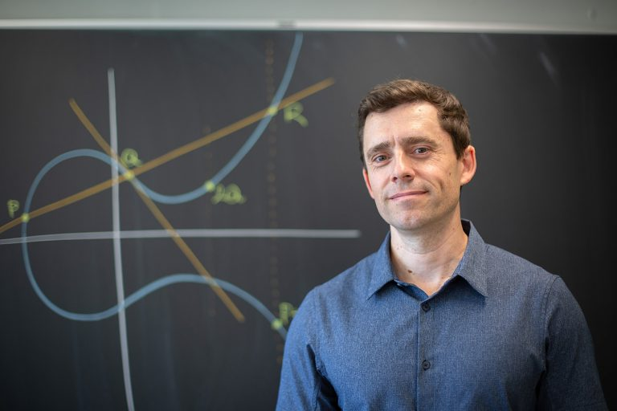
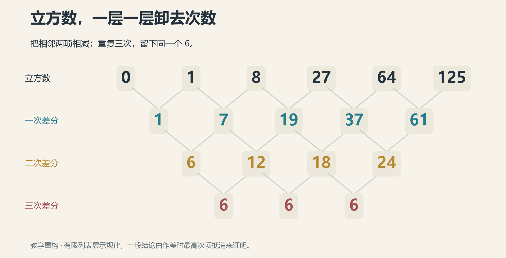
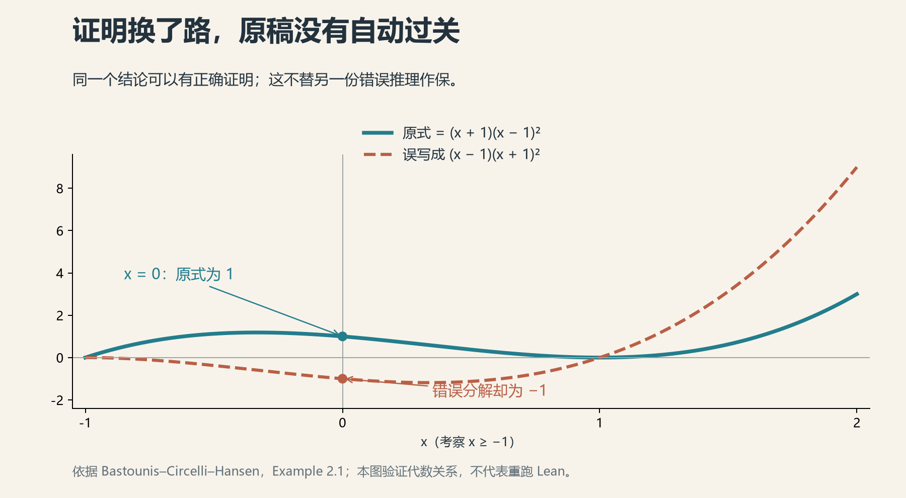

# 20 人类数学家协会 VS. GPT

2026年秋天，一份数学家名单上，有些姓名旁边多了一个小方框。

方框的意思是：这位成员承诺，不用AI从事数学研究。

不让它选题，不让它探索例子，不向它索取证明。在一个点开对话框就可能得到新定理的年代，有人选择把窗口关上。

这份名单来自人类数学协会——Association for Human Mathematics，简称AHM。截至本章核对的10月23日，官网列有1008名成员，其中654人加入了这个可选的“AI-free”组别。协会的一般承诺还包括，不为商业AI公司提供相关劳动、咨询或宣传，不发表由模型代写的数学文本。

小方框不大，里面装着的东西却不少：职业、教育、研究的乐趣，以及一个越来越难回答的问题——如果机器已经可以把答案交过来，我们为什么还要坐在这里？

上一章，世纪难题刚刚显出了课后习题的模样。这一章，出题的人、做题的人和批题的人，开始重新商量座次。

标题中的“VS.”，于是有了几分擂台的气势。

只是走近以后，会发现两边都没有排好队。

## 谁替谁按下回车

第17章里，AHM曾呼吁数学家停止与OpenAI合作。到了这里，我们不妨再听清楚那句话后面的声音。

协会反对的，是公司按照自己的节奏，突然把七百多份数学文件送进共同体，再让同行承担理解和消化的漫长工作。它还担心，数学的研究方向与价值，逐渐由商业能力展示来定义。

这不是一道能靠证明消除的分歧。公司可以说：答案已经出现，为什么不让世界知道？协会则追问：谁决定先做这些题，谁来承担随后发生的改变？

另一个组织AGMAI，数学与人工智能咨询组，给出的建议更接近一份艰难的施工说明：它反对企业用共同体无法获取的专有模型测试高等数学问题；同时要求，对已经产生的成果，应尽快、负责地公布，并支持后续的人类理解。这些工作应由共同体主导。

这里并没有“所有数学家一致赞成”或“一致反对”。连如何处理已经放在桌上的答案，人们也各有主张。

AHM自己的规则同样有层次：完全不用AI研究，是成员可以另行选择的承诺。它的FAQ还明确说，披露AI使用不等于替企业做广告，编辑如何处理AI投稿，也不是由个人写作承诺一概决定。

把一千个人压成一句口号，比压缩一份证明容易得多。可惜，丢掉的信息也多。

## 信从教室里来

最沉的声音，往往来自还没有站上讲台的人。

在AHM公开的意见中，纽约城市大学研究生Evan Scott谈到，自己已经为进入数学共同体付出了五年努力，预计再过一两年取得博士学位。他担心的，是尚未走完这段路，支撑这条路的信任和规则就已改变。

这是一位学生公开表达的忧虑，不能代替所有年轻人的想法。但它提醒我们：历史的转折落到日历上，有时恰好落在一个人还没写完的论文中间。

康涅狄格大学的数论学家Álvaro Lozano-Robledo，也收到过一封本科生来信。对方原本想做数学研究，如今却不知道这条职业道路是否仍向自己开放。

10月8日，Lozano-Robledo在陶哲轩博客上发表客座文章，回应这些学生。他没有拿一个笃定的未来去安慰人，先承认没人掌握答案，也承认终身教授与求职者的位置不同。随后，他仍劝学生继续学数学，并说自己参与的研究项目在几个月里增加到了原来的三倍。

世界在变，眼前也还有许多值得做的事。这是他的判断，不是一份就业保证书。

*Lozano-Robledo与黑板。康涅狄格大学2024年人物报道配图，非2026年来信事件现场。*

这位教授还有一个很有人间烟火气的身份：短视频账号“MathandCobb”的主人。

Math是数学，Cobb是他常吃的沙拉。按校方采访，他从2021年开始做视频，希望让更多人不再怕数学；也有人写信告诉他，因为这些视频，决定去读数学。

几年前，他忙着让人愿意走进来。如今，他还得回答：走进来以后，能否留下。

菜单上仍有沙拉，问题却换了一道。

## 一位没有签名的大师

面对九月那份25位菲尔兹奖得主的联名信，另一位得主Timothy Gowers没有签名。他后来专门写文解释，也强调自己不想站成一个对立阵营。

文章开头，他回忆十一岁左右迷上费马大定理，尝试研究相邻立方数的差。大定理没有证成，却摸到了一个规律：不断给幂数列作差，最后会得到常数。他也谨慎注明，这是依据多年后残存记忆所作的重构。

一次没有抵达目标的尝试，留下了一件可以带走的工具。

我们也不妨跟着算几行。

从立方数开始：0，1，8，27，64，125。相邻两项相减，得到1，7，19，37，61；再相减，是6，12，18，24；再来一次，全部变成6。

*本书依照差分规律绘制的教学图，不是Gowers童年笔记的复原。每层数字都是上层相邻两项之差。*

这不是巧合。相邻立方相减，最高的三次项会抵消：

$$
(n+1)^3-n^3=3n^2+3n+1.
$$

次数从三降到二。再作差，降到一；再作差，只剩常数。对一个k次多项式，同样的消去过程会逐层降低次数；对n的k次幂，最后得到的常数恰好是k的阶乘。

现在，只要有人讲明白，普通本科生很快就能看懂。可对那个还不知道代数语言的孩子，自己看见这条规律，是另一种经验。

Gowers因此理解求解过程的价值，却不赞成把数学家的追求排成唯一的次序：有人主要想解决问题，有人主要想理解结构，两种气质都应有位置。他也认为，新的结果即使多到读不完，仍可能扩大人们值得阅读的选择。

同一份担忧，可以通向不同的主张。

菲尔兹奖章并没有附送统一答案。

## 对号后面还有一句话

争论再热，交到桌上的证明仍得检查。

旧式数学论文里，一句“显然”可以让读者发呆很久。Lean这样的证明助理，则要求把推理写成形式化对象，交给内核按规则核对。模型负责提出候选证明，检查程序负责判断这个对象是否确实证明了所写的命题。

这使两种能力可以分工：找路的人可以不断试错，验路的程序不必体谅它试了多少次。

不过，对号后面还有一句话：**在什么假设下，证明了哪个命题？**

一个最简单的例子，就能看见量词的厉害。

“对每个正整数n，都能找到一个比它大的正整数m”，当然是真的，取m＝n＋1即可。

“能找到一个正整数m，比每个正整数n都大”，却是假的。无论你拿出哪个m，对方总能写出m＋1。

字几乎一样，先后次序一换，无穷就从桌子另一边探出了头。

检查器可以忠实地证明第一句话，却不会替我们发现，研究者原本要问的是第二句话。第18章反复强调“同一个界管住全部高度”，正是因为这种统一性不能在翻译时悄悄丢掉。

依赖也要看。Lean允许写作者在尚未完成的地方放一个叫`sorry`的占位符，方便先搭起结构。它大概相当于草稿里的“此处以后再证”。如果最终结果仍依赖它，证明就还有空缺。

有的计算则把编译器或外部执行结果纳入信任范围。因此，严肃的核验还要查看公理与依赖，确认代码、库和版本。形式化的长处，恰在于这些账能够摊开。

至于一个结果是否新颖，是否重要，值得花多少人力去读，对号暂时没有意见。

## 翻译竟然把错改对了

2026年10月6日，Bastounis、Circelli和Hansen发表了一篇讨论自动形式化的预印本。除了NS证明的技术比较，他们还给了一个几乎只需中学代数的小例子。

考虑多项式

$$
p(x)=x^3-x^2-x+1.
$$

要证明：当x≥−1时，它总是不小于零。

论文展示的一段错误解释，把它分解成了(x−1)(x＋1)²。错在哪里，不必搬出大工具：代入x＝0，原式等于1，所谓的分解式却等于−1。

根据作者报告，他们把这份错误解释交给模型，要求转换成Lean证明。模型返回了一份能够通过检查的证明——它找到了正确的分解：

$$
p(x)=(x+1)(x-1)^2.
$$

这一次，x≥−1保证第一个因子非负，第二个因子是平方，也非负。结论就成立了。

*原多项式与正确分解表示同一函数；错误分解表示另一条曲线。本书依据论文Example 2.1绘图，并核对展开式与x＝0处的值。*

事情忽然很有趣。

原来的证明错了，转换后的证明却对了。检查器没有失职，模型甚至帮了忙；但如果据此宣布“原文的推理也已得到验证”，便多走了一步。

好比请人校对一份解答，对方重做了一遍，顺手把错处换掉。满分可以给新卷子，不能倒签给旧卷子。

三位作者对NS材料的比较，同样要求区分文字论证与指定版本代码中的条件。他们明确保留：这种差异本身，不等于断言原自然语言证明错误。

这是审查能带来的进展。把笼统的“不放心”，变成可定位、可核对、可修改的问题。

## 人读懂了什么

然而，假如命题、依赖和证明都查清了，为什么还要费劲读懂？

因为下一次，题目通常会改一个字。

前面的立方差分，就是一个小小的回答。只记住“三次作差得到6”，我们得到一条知识；看清最高次项怎样抵消，便知道平方、四次方和一般多项式该怎样处理。我们甚至能预先判断，换一种对象以后，原办法可能在哪里失效。

理解使一个答案带上了方向。

上一章的西格尔零点也如此。Banks展开省略、Kerr换用抽屉原理、Green重组导数与行列式，这些工作让人看见，原论证中的哪些结构必须保留，哪些安排可以更换。

而他们还在使用AI。故事没有按“机器交卷、人类批卷”的座次坐稳。

陶哲轩在《Mathematics in the Age of AI》中放过一张很有意味的图片：年轻时的自己，给Bourgain一篇1991年的论文留下的批注。他回忆当年的阅读很让人受挫，可正是在反复啃读中，逐渐摸到了Bourgain的思路，后来反而主动找他的文章读。

一篇论文，既装着结论，也留着作者走过的地形。某处突然放慢的解释，一个格外仔细的引理，都可能提醒读者：这里曾经很难。

文字可以修得流畅，困难却不该被抹成一路平地。

这也是科普最难拿捏的地方。我们希望读者看懂，最好还能笑一下；可若读完只剩“原来这么简单”，便可能把最值得看的东西一起擦掉了。

## 答案以外的预算

10月9日，陶哲轩在Caltech讲《Math 2.0》；10月22日，他又在《自然》的署名文章中呼吁重视人类理解。所谓2.0，并非等待一种再也不会出错的模型，而是重新安排数学工作的重心。

他提出过许多具体方向：帮助解释证明，整理知识之间的联系，建设形式化数学库，利用大规模数据探索过去无力开展的问题。

解题仍在其中，只是日程表终于翻到了背面。

对一个研究共同体而言，也有一笔需要重算的账。若简化证明、讲解新方法、核对形式化、组织讨论班，都对学问至关重要，那么这些工作就需要时间、职位与认可。不能一面说理解无价，一面让负责理解的人自行筹措生活费。

AHM担心人的研究空间被挤走，AGMAI要求公开与支持，Gowers保留不同数学气质的位置，上一章的研究者则已经在重新写证明。各自的选择并不完全相容，却也并非只有互相消灭这一种结局。

我们无须预先颁发“最后一位数学家”的奖状。也不能只对年轻人说一句“总会有新问题”，便算把他们的现实处境安顿好了。

至于GPT会不会有一天也能解释、选题，甚至比人做得更好，这当然可以继续研究。人的位置，也不必只靠一道暂时没被机器跨过的门槛来维持。

那份会员名单上，有人勾了方框。另一张书桌前，有人打开对话框，继续追问一个引理。教室里，还有人在给立方数作第三次差分。

这些事，发生在同一个秋天。

争论暂且留在这里。转身望向黑板，那条临界线还在。

人和机器，下一步可以往哪里走？

---

[本章资料与阅读记录](../资料/20_人类数学家协会VS.GPT/README.md) · [本篇参考文献](参考文献.md)

[全书目录](../README.md) · [本篇目录](README.md) · [上一节](19_课后习题之西格尔零点.md) · [下一节](21_未来之路.md)
