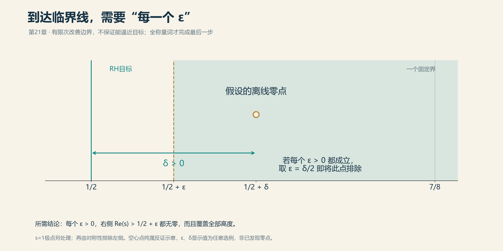
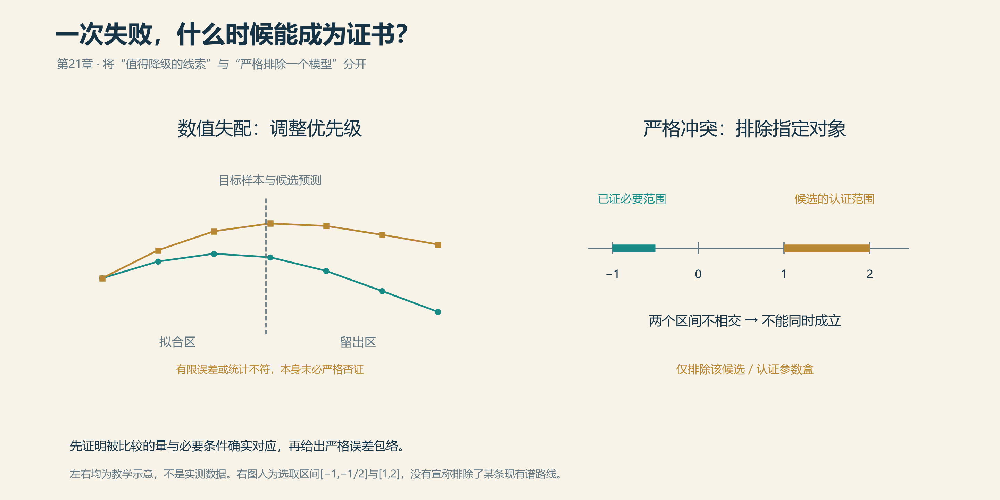

# 21 未来之路

如果要为黎曼猜想选择一幅结尾图，大概仍是一条竖线。

它从十九世纪一直画到今天，位置没有变，周围的注释却越来越密：这里已经无零，那里已有正比例，这一段经过计算核验，那一种统计像极了量子世界。几代数学家在图上留下了姓名，竖线本人没有发表意见。

如今，黑板旁又多了一位参与者。它读论文，写程序，尝试证明；速度之快，让人来不及把上一杯咖啡喝完。

热闹之后，问题仍然很朴素：接下来，往哪里走？

## 半步之遥

前面几章里，我们见过一种进展：把零点能够藏身的地方，越压越窄。

沿这条路走下去，最直接的愿望，就是让右侧的无零边界不断向1/2靠拢。今天挡在7/8，明天能不能再向左一点？若能一直逼近，直到临界线右边连一条缝也留不下，问题就解决了一半；另一半，由零点左右对称的性质接手。

这里有一个小机关。

假如某个零点偏偏藏在实部0.6的位置，只要能证明实部大于0.55的地方全部无零，它便无处藏身。换成0.5001，也是一样：找一道比它更靠近1/2的边界，把它挡在外面。

所以，真正需要的是：**不论给出多小的正数ε，实部大于1/2＋ε的地方，都没有非平凡零点，而且这句话管到无穷高。**

*只要能把边界任意推近1/2，右侧任何假设中的零点都会被排除。图中的空心点是假设，不是发现；再由对称性处理左侧。*

纸上的半步，可能是几代人的路程。连续改进几个数字，并不保证方法还能继续前进。张益唐的七千万与二之间，我们已经见过这种距离：小学生会做减法，数学家还在修路。

一道常见的阻碍，藏在“不等式”三个字里。

想估计一大串忽正忽负的数有多大，最省事的办法，是先把负号去掉，再全部相加。这样当然保险，却也容易把答案估得过大。譬如100和−99原本只剩1，取绝对值之后，账面一下变成199。

解析数论里的振荡和式复杂得多，道理却相通。各项原本可能互相抵消，估计时若把这种配合抹去，后面再精打细算，也未必找得回来。像是只记下乐队里每件乐器有多响，却忘了它们在什么时候停顿。

AI可以尝试不同的拆分，寻找更合适的权重，让该抵消的部分先碰面，再作估计。更大的收获，也许是发现旧方法究竟在哪里丢失了信息。那样，下一次突破就有了可以着力的地方。

还有一些路线，把黎曼猜想改写成“某种量总不为负”。我们在科纳的研究中已经见过这种正性判据。零点的位置，变成了一张表格里有没有负数的问题——只是这张表格有无穷多种填法，不能检查完前几页就合上。

换一种语言提问，有时会让一堵墙露出门来。门后还要走多远，得进去才知道。

## 那件尚未造好的乐器

贝里、基廷、谢拉，以及科纳和他的合作者，都曾沿着另一种声音前进。

他们想找一件乐器。它的每一个固有频率，都与黎曼零点准确对应。

数学上，这件乐器的核心，是一个自伴算子。先不被名字吓住：它有一条格外诱人的性质，谱值都是实数。若把临界线改画成实轴，再证明全部非平凡零点恰好就是这些实谱值，那么零点便只能留在临界线上。

**要找的，是一种让零点“不得不在那里”的结构。**

难处也正在“全部”二字。把已知零点逐个写进矩阵的对角线，当然能做出一件会弹这些音的乐器。可惜，它只是把曲谱背下来了。那些尚未找到的零点，特别是假如存在的离线零点，并不会因此自动归队。

科纳、孔萨尼与莫斯科维奇的谱三元组研究，则从有限的素数信息出发，构造自伴算子，数值上逼近低位零点。这比照着答案调音更有结构上的吸引力。下一步的关口，是严格说明：当构造的规模不断扩大，这些近似为何会走向完整的目标函数，而不只是在开头几十个音符上配合默契。

还有一个容易被漂亮公式掩盖的细节：乐器的声音，也由边界决定。

同一根弦，两头固定，和一头可以自由活动，发出的音并不一样。算子也是如此。除了写清它怎样作用，还得说清允许哪些函数、端点怎样处理、无穷远处有什么要求。这些内容合起来，才决定它是否真的自伴，以及究竟奏出什么谱。

于是，一行简洁的公式后面，往往拖着几十页定义域与边界条件。数学家的浪漫，有时就装订在附录里。

## 素数的回声

那件乐器应该怎样造？素数已经留下了一点线索。

前面讲显式公式时，我们见过它的两端：一端是零点，另一端是素数和素数的幂。到了谱与动力学的语言里，这种对应很像“声音与回声”：一边是系统的频率，一边是沿着轨道走一圈、两圈、三圈留下的重复。

为什么轨道长度常常写成log p？因为素数的幂，取对数之后，就变成了整数倍。

$$
\log 2,\quad \log 4=2\log 2,\quad \log 8=3\log 2.
$$

2、4、8，像是同一条基本轨道走了一遍、两遍、三遍。3、9、27，则是另一条轨道的回声。更准确地说，ζ函数相关公式里的振荡项，恰好带着这些log p、2log p、3log p的“频率”，于是数论与动力学之间，有了一张可以逐项比对的字典。

但回声不仅有早晚，还有强弱。

一条轨道重复两次、三次，每次贡献多大，符号如何变化，都得与素数公式对上。只在轨道旁贴一个“素数2”的标签，还造不出黎曼的乐器。音高对了，节拍、力度乃至休止符，也不能另弹一套。

这正是贝里—基廷路线、谢拉的镜面模型，以及科纳几何方案迷人的地方：它们试着让算术与一个系统的内部规则发生联系。各自遇到的困难不同，却把“找个长得像的图”推进成了“解释为什么必须这样”。

将来，AI也许可以沿着这张字典寻找候选：换一类空间，换一种边界，算出短轨道，再比较它们的重复规律。哪些模型只像个开头，哪些连细节也开始吻合，计算可以先帮我们分辨。

算力会让试错变快。最后要找到的，仍是那条把两种语言接起来的规律。

## 岔路也有路标

第三篇里，我们见过用实验装置实现ζ函数响应，也见过让动力学模型拟合零点。它们提出的问题，并不完全相同。

有的在问：能不能换一种方式测出这些数？有的在问：一个简单系统，能不能学到零点的规律？再向前，才是：能不能从独立的结构出发，解释全部零点为何只能如此？

这些探索可以相互启发。最有用的下一步，往往是把模型带到它没见过的地方。

用前二十个零点挑好参数，再去预测后面的零点。若离开熟悉的样本便明显失准，就知道模型记住的可能多于它理解的。第14章里的探索，已经给我们看过这种反差：拟合区里相谈甚欢，出了门就各走各的。

这样的失败，仍有不同分量。曲线不贴合，可能只是近似不够好；若能证明某个模型与必须满足的条件冲突，便可以明确关上一条岔路。

举个小例子：目标系统里的某个量，按定理必须为负；候选模型计算出的同一个量，即便把全部误差算进去，仍然落在1到2之间。两者就不可能相同。我们排除了这个候选，也给后来者留下了可以复查的理由。

*曲线不像，是继续调查的线索；与已证明的必要条件严格冲突，才能排除相应候选。两图均为教学示意。*

过去，一条走不通的路，可能只留在研究者的抽屉里。搜索规模扩大之后，这些记录反而更值得保存：什么结构试过了，为什么失败，哪些条件不能同时成立。后来的人和模型，都可以少绕一次远路。

我们可以设想一张共同的工作台：有人提出结构，模型寻找变换，程序计算例子，证明器检查能够形式化的步骤；再有人从结果里认出一个尚未命名的规律。角色可以交替，一次失败也可以成为下一轮的起点。

这样的未来，未必每一天都有头条。更多时候，只是黑板上少了一条错路，多了一个值得追问的问题。

## 下一张黑板

本书从阿提亚的讲台出发，走过张益唐的漫长岁月，听过量子世界里的回声，又看见机器把论文带进一个令人目不暇接的秋天。

走到这里，我们还不能替黎曼猜想指定结局。也许是某个估计突然保住了失落的抵消，也许是那件乐器终于有了完整的谱，也许答案会从今天尚未列入目录的地方出现。

未来若再有一场宣布证明的报告，台上可能是一位老人，一位年轻人，也可能是人与模型共同完成的工作。台下仍会有人追问：那个关键的转折，究竟为什么成立？

这句话问过许多名家，也会问机器。能够回答它的人，才把一份答案变成了后来者可以继续攀登的地方。

下一项进展，也未必就是终点。它可以是一道更靠近临界线的边界，一类被排除的模型，或一种让艰深证明终于可以被理解的解释。数学的历史里，许多后来宽阔的路，最初都只是这样一点落脚之处。

那条竖线没有移动。

黑板旁，多了一些同行者。

[全书目录](../README.md) · [本篇目录](README.md) · [上一节](20_人类数学家协会VS.GPT.md) · [下一节](22_给黎曼的第二封信.md) · [第四篇参考文献](参考文献.md)
