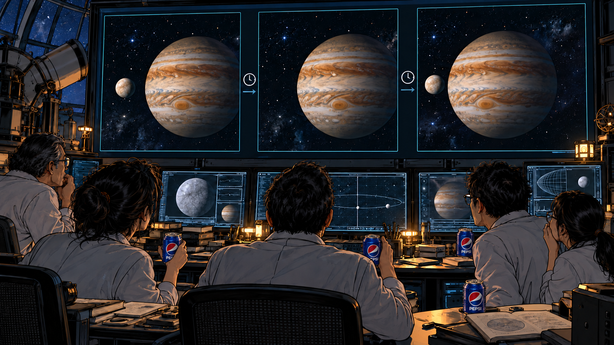

## 一、拆迁

### 北极

*AI生成插图；冰下粒子事件为可视化示意，微光与尺度经艺术夸张。*

2028年4月1日，协调世界时零点，北极圈内，格陵兰深冰中微子观测站迎来了建站以来最丰收的一夜。

值班人员首先怀疑，经费终于批错了地方。

冰盖之下，两千多米深的透明冰层里，微弱的蓝光正接连闪过。中微子本身看不见；偶尔有一个与冰中的物质发生相互作用，产生的高速带电粒子便会发出切伦科夫光。那些深埋的光学模块，等的就是这一点动静，再把捕捉到的光信号送回地面，重建成屏幕上的轨迹与光簇。

两年前，弗朗西斯·哈尔岑凭借南极IceCube与高能天体中微子的研究获得诺贝尔物理学奖。北极这座新站借鉴了同一套办法：把冰当望远镜，等宇宙不小心漏出一句话。

大气背景天天都有，真正能通过该站最严筛选、让研究员舍不得下班的那类高能候选，一年也攒不下几个。往常来一个，大家查仪器、查背景、查得满头白发，最后慎重地写：可能来自天外。

现在，冰层深处像在办一场烟花表演。

没有礼炮，没有观众席。只有屏幕上一簇接一簇的光点，和一群忘了眨眼的研究员。

事件计数一路上升，平日清冷的显示屏挤满轨迹。短的一组，长的一组，停顿，再重复。几个彼此独立的探测分区，读出了同样的节拍。仪器没有坏，时钟也没有疯。

有人把计数率接到扬声器上。沉默了亿万年的冰层，开始像一台急着催稿的电报机。

那是摩尔斯电码一般的长短脉冲。不过，收信人很快发现，自己不必先替外星人补习英文字母：报文用重复的计数建立数字，用数字约定分隔、长度和校验，再逐层展开字符与图像。每一个点划，都由一束中微子撑着，漏掉几颗也不妨碍读信。

2012年，人类曾用加速器做过中微子通信实验，穿过两百多米厚的土层，传回一个单词，速率约每十秒一比特。

眼前这位发件人，显然不按流量收费。

它给得起足够强的束流，也十分体贴地把接收计数压在探测器还能分辨的范围内。研究员看着那条平稳贴近仪器上限的曲线，产生了一种新型的不安：对方不但知道这里有人，还像是读过采购合同。

译码用了四十七分钟。最先恢复的是数学和图像组成的字典，随后才是按字典映射的正文。AI协助整理成各国语言，又把每一条关键信息指回原始符号，供人核对。

最初，大家以为终于迎来了人类与外星文明的第一次对话。

翻开以后才知道，还没到对话。

先同意用户协议。

报文按地球习惯排版，共六百四十八页。大半篇幅都在说明，接收方应当确认自己已经知晓什么，以及发送方在什么情况下不承担责任。

包括但不限于：设备兼容性、语言歧义、地质信息采集、文明身份识别、施工造成的短期不便，以及短期不便超过接收方物种寿命时，仍按短期处理。

最后一页有两个选项。

**已阅读并知晓。**

**未阅读，但已知晓。**

人类第一次在星际事务上，感到了熟悉。

### 拆迁

*AI生成插图*

站里的负责人忙着联系上级，工程师忙着证明仪器没坏，理论组忙着讨论发出这种束流需要多少能量。

只有一名实习生，仍在读协议。

他的办法很朴素：把文件交给AI，要求忽略礼貌、愿景和免责声明，只找“会发生什么、什么时候发生、怎样才能不发生”，每一项附上页码。

这套提示词，他平时用来读实习合同。

AI从第六百三十七页找出了第一条。

**太阳系第三行星及其附属人工栖居设施，位于拉尼亚干线支路的施工影响范围内，拟作整体处置。**

实习生重新读了一遍，又翻回原始图形。太阳、八颗行星、第三颗行星上一个小小的标记，关系清楚，完全没有语言歧义。

他们不是来交流的。

他们是来拆迁的。

附件里的工程图甚至很有礼貌。地球没有被画成红叉，只是颜色比别的天体淡了一些，仿佛制图人员提前调低了它的存在感。

第二条也找到了。

**宽限期三个地球历月，截止于2028年7月1日协调世界时零点。**

旁边附有原子钟计数和天文参照。时区、历法、服务器时间不同步，都已经考虑过了。人类那些常用的延期理由，在技术附件里被逐项堵死。

第三条藏在“具有保留价值的局部结构”一栏。

施工区域内的聚落，如能通过文明入门评级，可列入智慧文化遗产名录，工程绕行。

实习生点开评级表。

没有人口，没有军费，没有国内生产总值，也没有论文总量和世界大学排名。

只有一道题。

原文当然没有“黎曼”这个名字。它从正整数的倒数幂求和开始，规定函数的解析延拓，剔除那一串负偶数上的平凡零点，然后询问：

**其余全部零点，是否都落在实部等于二分之一的直线上？请给出可独立检验的严格论证。**

证明成立，或者严格证明不成立，均可。反例必须能够被确证，不能只交一张小数点很多的截图。有限范围里的计算记录，可作附件，不替代结论。

AI把这段翻译成人类熟悉的名称：

**黎曼假设。**

分类：基础。

题型：判断题，须说明理由。

于是，复平面上那条安静的竖线，突然横在了人类的户口本前。

人类曾用这道题衡量数学家的天才，也用它测试AI有没有进步。现在，出题方换了，答题框变大了，整个文明被装进了一条待评测记录。

实习生把三页摘要发了出去。几分钟前，这还是他第一次处理外星文件；几分钟后，他已经是本项目里唯一完整读过拆迁条件的人。

他的账号权限仍然显示：临时。

### 警示

*AI生成插图*

通知里还附了一项服务。

为避免接收方因对施工能力理解不足而耽误办理，发送方将提供一次免费演示。

免费两个字，被翻译系统标成了绿色。

目标是木卫二。

报文给出了轨道参数、辨认图样，以及演示信号到达地球的时间窗口。它特意标明，这是地球接收时刻，已经计入木星到地球的光行时。中微子负责提前通知，光负责稍后送来现场；两者都没有替人类绕过相对论。

观测通知经天文协作网络转发。全球主要天文台进入紧急模式，凡是木星在地平线上、天气又允许的设备，都转了过去；能够配合的空间望远镜，也加入了记录。

报文还建议采用短曝光，避免把施工前后的画面叠在一起。

天文学家照做了。

这是一个相当令人恼火的细节：对方连怎样取得清晰的恐吓证据，都替他们想好了。

约定时刻到来。

木卫二消失了。

没有火光，没有碎片，也没有向任何方向逃逸的亮点。木星仍在，其他卫星仍在，附近恒星仍在。连续记录里，只有那个本应存在的光源，突然缺了一格。

它没有躲到木星背后，也没有钻进木星的影子。星历排除了遮挡和食，分散在不同地点的设备排除了单台仪器故障。可见光里没有，能够覆盖的红外观测里也没有。校正各站的传播时差以后，缺席从同一时刻开始。

人们可以证明它在观测中消失了，却还不能解释，对方究竟把它放在哪里。

第一次，有人希望只是仪器集体坏了。

一分钟过去。

两分钟过去。

地球上那些原本准备讨论“会不会是愚人节恶作剧”的会议，自动略过了这一项。

十分钟后，木卫二重新出现。

它没有停在十分钟前的旧位置，而是落回了按轨道运动此刻应当抵达的地方。亮度、光谱和能够分辨的表面特征，与先前的记录吻合。

连公转都替它续上了。

紧接着，深冰里的电报机又响了一次。新的中微子报文很短，只有一张施工回执：

**演示项目已完成。对象已恢复至约定状态。请勿将本次体验误认为宽限期延长。**

下方照例附着满意度调查。

没人填。

观测站的接收屏回到通知首页。右下角，一行从摩尔斯电码里译出的倒计时，已经开始跳动。

大约六十秒后，信号停止，那行数字也随之隐去。值班人员按报文里的截止时刻，在本地重新设好了倒计时。

这道题，人类解了一百六十多年。

施工方只肯再等三个月。

只是，这次不按时交作业的代价，有点高。

[番外目录](README.md) · [上一节](00_小序.md) · [下一节](02_星门.md)
