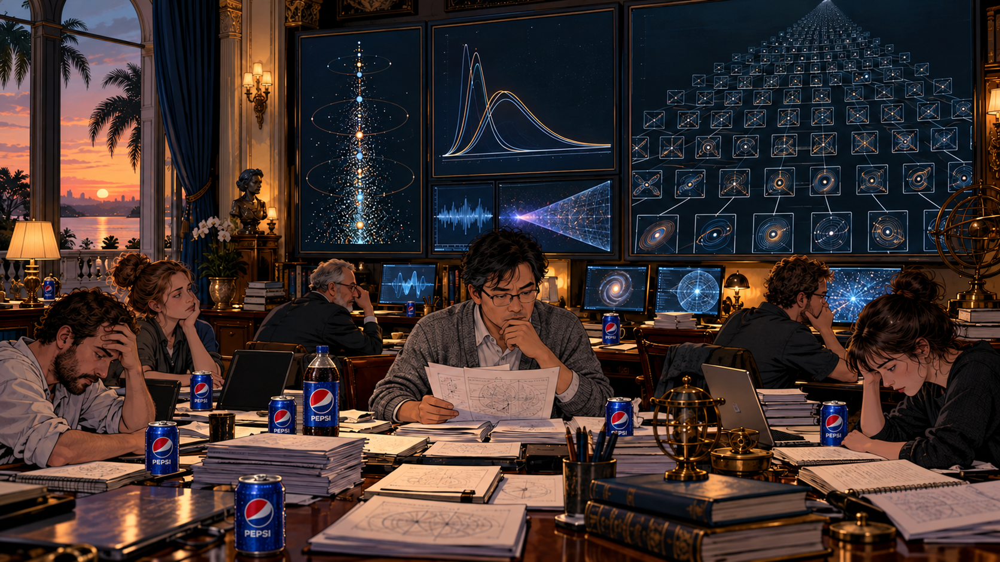

## 三、庄园

### 一天

*AI生成插图*

地球照常转着。

巴黎，人们又上了街。旗帜、标语、扩音器，咖啡馆的椅子被挪到一边，为革命让出通道。游行经过后，服务生把椅子搬回来，接着收拾杯子。

悉尼，歌剧院亮了灯。有人提前半年订票，有人开场前还在找停车位。台上的女高音唱到生离死别，台下有人悄悄看了一眼手机，确认晚餐的预订还在。

洛阳，穿着汉服的姑娘站在灯火里，等摄影师喊她回头。裙裾掠过石阶，身后是唐朝，镜头外是排队的游客。有人问牡丹开了没有，导游说早过了花期，不过夜景也很好看。

东京的末班车照常拥挤，开罗的摊贩收起遮阳棚，圣保罗的孩子踢进了一个球，追着它跑过街角。有人出生，有人告别，有人刚刚决定，明天开始认真生活。

最后一天，与此前的每一天并没有什么不同。

除了 CloseAI 更笨了。

一位程序员让它找出代码里的错误，它建议重启电脑。重启之后再问，它建议保持耐心。程序员关掉网页，决定明天取消订阅。

### 汇总

*AI生成插图*

湖海庄园的窗帘一直拉着。

最后二十四小时，核心团队齐聚长桌旁，各地的研究组从屏幕另一端接入。CloseAI 与 Onthropic 合并了最后一轮算力调度，商业边界暂时撤掉，失败记录也终于开始共享。

汇总表很长。

经典解析数论一侧，机器把能够调用的估计重新组合。曾经足以写成大论文的一点推进，现在常在一夜之间出现。

第一项，无零区域。

那条曾经停在7/8的边界，被推到了 **1/2＋0.000001**。在它右边，无论多高，都已证明没有零点。再借助零点关于临界线的对称性，全部非平凡零点被夹在一条极窄的走廊里：

$$
0.499999\leq\operatorname{Re}\rho\leq0.500001.
$$

这里的ρ，就是任意一个非平凡零点。走廊只剩百万分之二宽，正中间便是黎曼画下的那条线。

在屏幕上，它们已经重合了。把图放大一百万倍，走廊还在。

第二项，临界线上的零点比例。

**100%。**

有人看到这里，已经抬起了头。数字下方还有一行小字：随着统计高度趋向无穷，比例的极限为100%。

从四成多，到67.25%，再到这个终于不用保留小数的数字，半个多世纪的接力，跑到了令人眩晕的地方。可“比例趋于全部”，仍给例外留着门。

把1、4、9、16……这些平方数从正整数里挑出来：前一百万个数里，只有一千个平方数；数得越远，它们所占的比例越接近零。但平方数并没有用完，后面仍有无穷多个。

离线的零点，也可能躲在这样的稀疏里。零点密度估计把它们可能的数量压得越来越低，无零区域把它们可能的位置逼得越来越窄。它们既无处舒展，又几乎不占比例，却仍未被证明不存在。

进度条终于满了。验收仍未通过。

另一批系统沿着等价判据攻关。它们试着把黎曼假设改写成某类量始终非负，再寻找能够保证这种正性的结构。有限规模的检验越来越漂亮，规模不断增大时仍然有效的证明，却总缺一段。

物理与几何方向的报告更厚。

**十二亿个潜在的动力学系统。**

那是程序生成、筛选和粗略测试过的候选规则及参数组合，并非十二亿套已被理解的理论。绝大多数在早期筛选中便被淘汰；留下的少数，才得到更长的计算和数学家的审读。

搜索从量子力学里的能级、散射与自旋，伸向混沌系统的周期轨道、非交换几何的谱结构，再到天体物理与宇宙学中的振荡、引力动力学和膨胀模型。人类曾经分科研究的世界，被机器一页页翻在一起。

有的系统给出了与黎曼零点相似的间距统计；有的能拟合很长一串零点，却在未参与拟合的新区间失准；还有的把答案藏在参数里，调得越准，离独立的解释反而越远。

少数候选已经走得惊人地远。它们的谱，与按高度排列的前 **10¹³个零点** 的高度——也就是复平面上的虚部——逐一匹配，在核验精度内没有发现偏差。其中一些，连未参与参数拟合的后续区间，也接上了。

十万亿个零点。两列数字在屏幕上并肩延伸，仿佛出自同一份底稿。

可谁也不能替第十万亿零一个签字。即使它也对上了，后面还有。

最受期待的，仍是那座希尔伯特—波利亚意义上的桥。

如果能找到一个恰当的自伴算子——一种保证谱值为实数的数学结构——再证明它的谱与全部非平凡零点准确对应，那么零点的实部就会被结构锁在二分之一上。

“全部”二字，耗去了最多的电。

有限矩阵可以造得很大，数值谱也可以吻合得令人屏息；但把规模推向无穷后，算子是否仍具备所需性质？对应是否遗漏了零点？是否混进了多余的谱？这些问题，不能靠再多画一张重合的曲线回答。

陶子轩看完最后几份报告，把它们放回桌上。

AI带来的进展，已经远远超过他们最乐观的预想。新的估计、新的结构，曾经隔着几代人才能接上的联系，如今就摊在这张桌上。有些路，人类走了半个世纪；机器接手之后，路的尽头又向远处退去了很长一段。

可最后那一点，仍然没有接上。

陶子轩想，也许还缺一个人的灵光：在散步时，在发呆时，把两件从未放在一起的事，忽然想在了一起。这样的念头，他年轻时也有过。可它从不按约定的时间来。

若有几年，甚至几十年，这满桌的成果，也许足够等来一次这样的相逢。

窗外的海，仍有潮汐。

下一次潮来，也许已是14.134725万亿年之后。

### 沉默

*AI生成插图*

最后一分钟，没有新的报告送来。

有人摘下眼镜，有人把手机翻扣在桌上。屏幕上，几条计算还在运行，没有人再问预计完成时间。

最后三十秒。

特有普望了一眼窗帘缝隙里的暮色。

“God bless us.”

沉默，还是沉默。

[全书目录](../README.md) · [本篇目录](README.md) · [上一节](02_星门.md) · [下一节](04_尾声.md)
