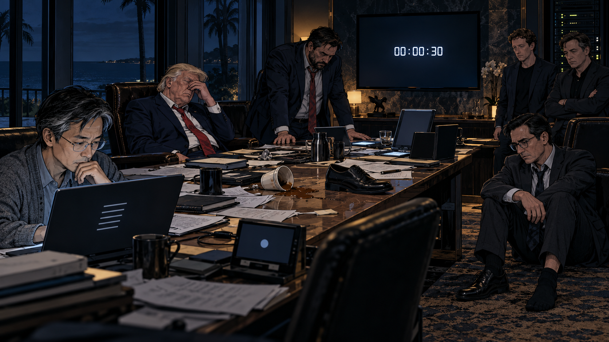

## 三、湖海庄园十二时辰

### 07:00｜还剩十二小时

湖海庄园已经连续三个夜晚没有关灯。

2030 年 12 月 31 日，佛罗里达处于冬令时，比协调世界时慢五个小时。外星人的零点，落在这里的晚上七点。

这造成了一个令人不快的事实：他们连本地的跨年晚会都等不到。

大厅里临时搭起了三面屏幕。

第一面显示倒计时。

第二面显示算力。

第三面显示各条证明路线的状态。

第一面稳步减少，第二面不断上升，第三面几乎不变。

千斯穿着深蓝色西装，已经喝完了第三杯咖啡。他任内最宏大的基础设施工程是几座数据中心，任内最危险的基础设施工程则来自外星人。

特有普坐在他的右侧。

“我们应该把截止日期谈下来。”老人说。

卢密欧回答：“谈过了。”

“你要强硬。”

“强硬过了。”

“换一个人谈。”

“换过了。”

“怎么会一点余地都没有？”

卢密欧看向桌边的灰色圆点。

“因为它不是来谈判的。它是客服。”

### 08:14｜一个非常接近的结果

CloseAI 发来消息：发现突破。

五分钟后，所有人都围在屏幕前。

新证明将一类长期失控的误差项压到了所需尺度之下，并给出了可由独立系统复核的证书。几个关键不等式全部通过。

奥特慢的脸上第一次出现没有计算过的笑容。

“我们也许做到了。”

陶子轩从第一页翻到最后一页，再翻回中间。

“这一句的常数依赖于什么？”

屏幕另一端静了片刻。

“当前截断高度。”

“依赖有多快？”

“正在检查。”

十八分钟后，检查结果出来了。

常数增长得比他们消去的误差更快。

会议室里没有人说话。证明的全部局部步骤都是真的，放在一起，却没有走出原来的地方。

马思哲说：“至少我们找到了一条死路。”

陶子轩合上文件。

“是的。”

他没有补充，死路有无穷多条。

### 09:26｜备份文明

火星舰队报告，一切就绪。

所谓就绪，是指如果再有六年，他们就可以开始转移第一批人口。

马思哲问：“把意识上传呢？”

“上传到哪里？”千斯问。

“离开施工区的探测器。”

一位工程师说，最近的合适载体并没有足够的计算、供电和通信能力。即使把压缩后的文化档案发出去，也不能在剩余时间里将一群活着的人送到安全的地方。

他们最后批准发送一份人类知识摘要。

第一页是问候。

第二页是元素周期表。

第三页讨论某些内容是否涉及版权。

法务部门要求暂缓发送。

千斯把那一页抽出来，扔进了垃圾桶。

这是他当天做得最痛快的一件事。

### 10:40｜紧急上诉

卢密欧再次接通灰色圆点。

“我们愿意接受其他测试。”

“审查条件已在附件列明。”

“我们可以证明更难的东西。”

“不改变本次审查条件。”

“我们证明过费马大定理。”

“已知。”

“我们有广义相对论。”

“已知。”

“我们能制造核聚变。”

“太阳可以代为完成该项目。”

卢密欧摘下眼镜，慢慢擦了一遍。

“你们有没有人类能理解的同情心？”

“本接口支持情绪识别。”

“那不是一回事。”

“已记录您的意见。”

上诉结束。

系统请他对本次服务进行评价。

卢密欧打了一颗星。

圆点感谢了他。

### 11:55｜是否公布

新闻秘书带来了两套讲话稿。

第一套宣布人类正在遭遇一场空前挑战，政府将毫无保留地公开信息，与全世界共同面对。

第二套宣布总统高度重视科学创新。

千斯把两套稿子并排放在桌上。

“还有七个小时。”他说。

“公布会引发恐慌。”安全顾问说。

“如果不公布呢？”陶子轩问。

“至少社会秩序可以保持。”

“保持到几点？”

顾问看了一眼倒计时，没有回答。

他们讨论了市场、医院、交通、电网、军队，以及一旦社会陷入混乱，数据中心的运转是否受到影响。

每个理由单独听来都很有道理。

最后，他们决定等最后一轮证明结果出来再说。

这使所有人都获得了半小时的心安。

半小时后，他们又获得了半小时。

新闻秘书带走了第一套讲话稿。第二套也没有发表。

庄园外，一对游客正在合影。女孩让男孩再往左边一点，避免背景里的警车挡住海景。

陶子轩隔着窗看了他们一会儿。

他想起，在数学里，一个没有被通知的反例，也仍然是反例。

### 13:08｜第二种门

Onthropic 宣布发现了一个新算子。

它拥有实谱。

它的平均谱计数与黎曼零点一致。

它在已计算的范围内出现了令人震惊的吻合。

奥利奥的手指略微发抖。

“我们需要立即投入全部剩余资源。”

陶子轩看完结构，问：“定义域呢？”

工程师调出一页说明。

“边界条件已经数值验证。”

“我问的是自伴性证明。”

“矩阵是厄米的。”

“有限矩阵是。极限对象呢？”

他们继续往下翻。

边界条件里有一个尚未被确定的相位。只要选择合适的相位，前面那些零点就会准确出现。

“这个相位怎么选？”

“根据目标谱反推。”

陶子轩闭上眼睛。

他能够听见空调的声音，也能听见桌下某人的鞋尖敲着地毯。

“我们把答案，”他说，“写进了门锁。”

奥利奥没有争辩。

十分钟后，他要求把刚才释放给普通用户的算力重新收回。

世界各地又有一些人发现，自己的助手突然变得很爱建议休息。

### 14:32｜没有发出的通知

外交部门又一次打来电话，询问是否需要向其他国家通报紧急情况。

卢密欧拿着听筒，看向千斯。

“他们会问，为什么现在才说。”千斯说。

“是的。”

“我们怎么回答？”

卢密欧没有立即开口。他一向擅长回答难题，却发现自己所有的回答，都需要明天还会存在。

特有普说：“现在公开，就是承认我们失败了。”

倒计时还剩四个多小时。

最后，卢密欧告诉电话那端：“继续待命。”

电话挂断后，房间里有人轻轻松了口气。

他们终于又避免了一件难堪的事。

### 15:47｜把所有门都推一遍

两家公司合并了最后一轮调度。

模型之间的商业隔离暂时解除。工程师把各自的引理库、失败记录和反例集合接到一起。最初十分钟，系统发现两家公司用不同名称维护着同一百七十三条失败路线。

马思哲说，这说明强强联合已经带来显著效率提升。

没人笑。

陶子轩建议，把一部分算力从“继续完善当前证明”转移到“寻找当前证明为什么不可能”。

“现在还花时间否定自己？”千斯问。

“如果船底有洞，”陶子轩说，“提前知道，比到海里知道好。”

“我们只剩三个小时。”

“所以更不能把三个小时全花在往船上搬东西。”

一半调度改为反例搜索。

二十七分钟后，三条最有希望的路线被排除。

屏幕变红了。

这实际上是当天最扎实的一次进展。

可惜它看起来最不像。

### 17:03｜半份证书

一个模型在小规模试验区提出了新的拼接条件。

它把项目内部两条失败路线的一部分接到了一起。

陶子轩认出了那张图。两年来，他已经见过它的十几个版本。这一次，边界条件似乎终于不再互相冲突。

这一回，模型没有直接宣称得到了证明。它列出七个必须完成的步骤，并证明其中四个。剩下的三个，包括全局迹公式和谱的完备性。

“有可能吗？”奥特慢问。

陶子轩看了很久。

“这次有一个值得认真研究的问题。”

他看向倒计时。

一小时五十七分。

整个房间都明白，这句话在昨天、在去年，或者在二十年前，会是一句好消息。

### 18:06｜最后一小时

机房开始过热。

不是因为算法比过去更聪明，而是因为人类很难在末日到来之前接受降频。

供电团队请求关闭部分非关键设备。

会议室的照明暗了一半。

特有普说：“留着我的灯。”

没人回答，但那盏灯确实留着。

网络部门仍然在转发公共互联网的流量。一个短视频正在世界各地流行：一只猫拒绝跳进纸箱，最后把整个箱子坐塌了。

有人在评论区写：这就是我今年的科研。

陶子轩的手机响了一声。

是家里问他什么时候回来。

他盯着屏幕，写“快了”，删掉，写“还在开会”，又删掉。

最后只发了三个字：

“我爱你。”

对面很快回复：“怎么突然说这个？”

陶子轩没有再看手机。

### 18:41｜文明摘要

剩余十九分钟。

最后一组计算还在运行。屏幕角落的进度条缓慢移动，没有人再敢询问预计完成时间。

他们把已经完成的数学成果整理成一个包。正确的引理、反例、计算方法、失败结构分类，都装了进去。

这是一份极其惊人的文明摘要。

如果还存在未来，它会让数学家们工作很多年。

存储程序提示：是否保留永久副本？

工程师把鼠标停在“是”上面，没有点下去。

奥特慢问：“如果最后这一条也不行呢？”

陶子轩没有回答。

他看着那些文件。每一份都是真的，每一份都来之不易，没有一份是他们需要的那个证明。

桌上的电话没有再响。

窗外，海水一次次涌上沙滩，又退回去。

### 18:57｜还剩三分钟

最后一条路线停止了。

不是系统崩溃，也不是电源故障。

它发现了一个反例。

反例只有七行。

在此前三年里，人类写了数以亿计的页码，耗掉了难以想象的电力，建设了新的数据中心，关闭了旧的账号。最后，一段七行的推理把这一切轻轻放回桌面。

陶子轩读完，点了点头。

“它是对的。”

卢密欧站了起来。

他先把眼镜放好，然后绕过长桌。

特有普抬头看他。

“我们需要一个非常好的声明。”

卢密欧一拳打在他脸上。

老人连同那把略高的椅子向旁边一歪，撞上了扶手。保镖动了一下，随后停住。他们看见屏幕上的数字，又看见国务卿脸上的表情，职业生涯第一次遇到了一个没有写进手册的优先级问题。

“声明！”卢密欧喊道，“你还要声明！”

特有普捂住脸。

“你疯了？”

“是，我疯了。你知道这些年我是怎么过的吗？”

他指着灰色圆点。

“我跟那个东西谈了两年！它甚至没有脸！我对着一颗圆点讲自由、讲秩序、讲我们共同的未来。它让我填表！”

没人拦他。

“千斯可以，为什么我不可以？他能当总统，我就只能继续当国务卿？给你们擦屁股，替你们解释，替你们把每一句话变成‘并不意味着’！”

千斯站起来：“现在不是——”

“你闭嘴！”

卢密欧抬起一只脚。

“还有这双鞋！他非说男人应该穿这种大鞋！我说不合脚，他说要有气势！我穿着它在全世界走了这么多年，连逃命都跑不快！”

他终于把那只鞋踢了出去。

鞋在长桌上滑过，撞倒了一杯冷咖啡，停在一份“以人为本”的政策文件上。

“毁灭吧。”他说。

接着，他嗷的一声扑向千斯。

两个人撞翻了椅子。桌边响起短促的惊呼。马思哲本能地想拍下来，摸到手机，又慢慢把手放下。

陶子轩坐着没动。

在他面前，七行反例仍然亮着。

这是整个房间里唯一没有失态的东西。

### 18:59:30｜最后三十秒

保镖终于把两人分开。

卢密欧坐在地上，一只脚穿着鞋，一只脚只剩袜子。他不再说话。

千斯靠着桌沿，领带歪在一边。

特有普慢慢扶正椅子，重新坐下。他看起来一下子老了很多。

屏幕上的倒计时变成了白色。

没有音乐。

没有宇宙舰队。

窗外也没有燃烧的天空。

只有空调、海风，以及某个机柜里始终不肯安静下来的风扇。

*AI生成插图*

“我本应是米国最伟大的总统。”特有普说。

没有人反驳。

“但不会有人记得了。”

他看了一眼窗外。

“灯都关了吧。”

有人关掉了会议室最后一排灯。

“God bless us.”

最后几秒钟，没有人再看别人。

数字归零。

所有屏幕一起黑了。

