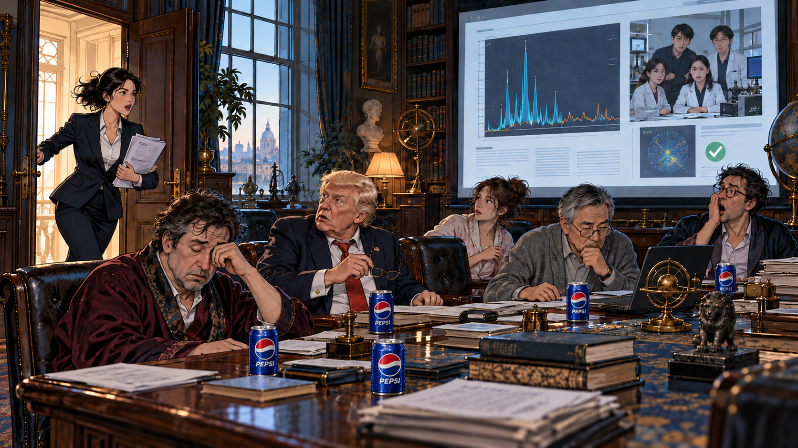
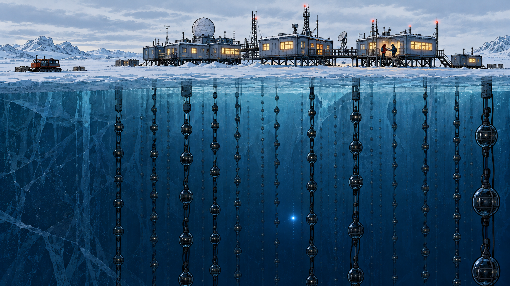

## 四、尾声

### 黎明

*AI生成插图*

特有普在一片寂静中醒来。

他仿佛看到了光。

地狱，还是天堂？窗帘、长桌、歪在椅子上熟睡的人，都有些眼熟。原来到了这边，也没有人收拾会议室。

他似乎有一点懊悔。几年前，不该削减陶子轩的经费。那时候，数学在预算表上安静得很，看起来少给一些，也不会出什么事。

又有一点庆幸。至少，不用再担心下一届总统选举了。

不过，都无所谓了。

寂静，还是一片寂静。

唯有一束晨光，洒在了桌面上。

### 简报

*AI生成插图*

咣的一声，大门被踹开了。

秘书攥着一份简报，呼啸而来。

“黎曼假设被证明了！”

椅子响了，眼镜掉了，有人猛地坐直，仿佛刚被叫到名字。

一份翻译自中文的简报，被迅速投到大屏上。来源一栏写着：新新智元。

> **我国数学家释放真正核弹：黎曼假设被证明！**
>
> 数学圣杯终被摘取。我国一支由数学、物理与计算机研究人员组成的团队，与国产 AI 大模型通力协作，从早期宇宙膨胀的动力学模型中获得启发，找到了全新的谱结构。
>
> 团队沿希尔伯特—波利亚方案，构造出自伴算子，并证明其谱与全部非平凡零点准确对应，由此证明了黎曼假设。完整证明已通过 Lean 形式化检验。经过几个月的细致核验，几组独立检查团队相继传回通过的消息。

### 北极

*AI生成插图*

几个月过去了。

格陵兰的 IceCube 北极站，再也没有等来那场烟花般密集的闪光。

冰层深处，探测器偶尔亮起，留下一条寻常的轨迹。值班人员照常记录，照常交班。

仿佛什么都没有发生过。

[全书目录](../README.md) · [本篇目录](README.md) · [上一节](03_庄园.md)
