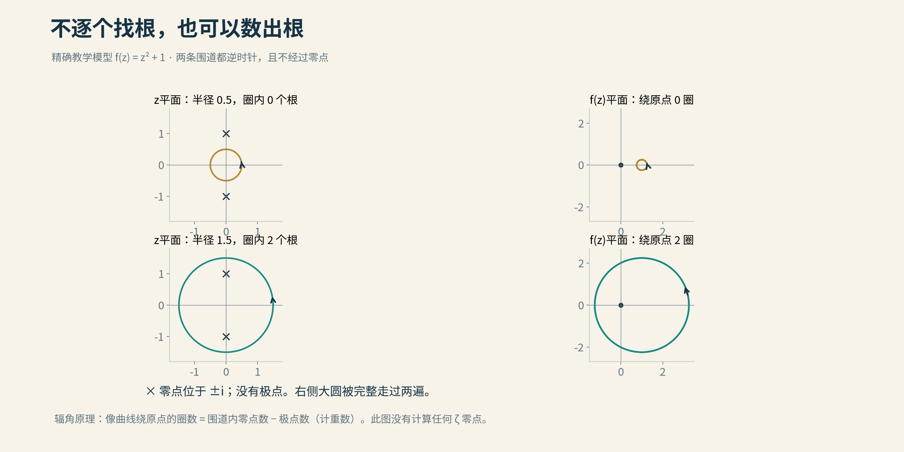

# 数学解释与科普参考

[返回索引](README.md)。本文件保留正文省略的定义和教学设计；它不是所引论文的证明替代品。

## 一、四件容易混淆的事

1. 无穷多个在线：数量不会数完，但比例仍可能趋零。
2. 固定正比例在线：范围增大后，保证不会被稀释到零。
3. 比例趋于1：例外可以有有限多个，也可以无穷多个但密度为零。
4. 全部在线：不允许任何离线非平凡零点，这才是RH。

自拟例子：前N个正整数有约√N个平方数，比例约1/√N，趋于0；非平方数比例趋于1，仍漏掉无穷多个平方数。例子仅说明逻辑层级，不声称离线零点一定像平方数一样分布。

## 二、比例的严格口径

N(T)是0<Im ρ≤T内的全部非平凡零点数，按重数计；N₀(T)是其中在线者，也按重数计；N₀*(T)只计既在线又为单零点者。

$$
\kappa=\liminf_{T\to\infty}\frac{N_0(T)}{N(T)},\qquad
\kappa^*=\liminf_{T\to\infty}\frac{N_0^*(T)}{N(T)}.
$$

κ≥c意为：任给正ε，从某个高度起，在线比例总不少于c−ε。不必先证明比例极限存在，也不保证每个有限窗口均达到c。

单零点满足ζ(ρ)=0、ζ′(ρ)≠0。一个在线二重零点给N与N₀各贡献2，给N₀*贡献0。RH本身不蕴含全部零点均为单零点。

依据：[BCY全文](https://arxiv.org/html/1002.4127v2)§1—2。只看到“41%”而忽略分母和重数，容易把不同命题拼成一条错误的纪录表。

## 三、从变号到整体计数

在临界线上乘以一个合适的非零相位，可得到实值Hardy函数Z(t)，零点位置不变。连续实函数变号时一定过零，但偶数重零点可能只碰到零而不变号。

这一步适合作为初学入口。现代比例方法还需要函数方程、辅助函数、辐角计数与积分估计，不能讲成“把曲线画长一些再数”。

保留而未插入正文的旧图：

图取f(z)=z²+1。半径1/2的圆内没有零点，像曲线绕原点0圈；半径3/2的圆内有±i两个零点，像曲线绕原点2圈。第二幅像的几何轮廓是一个圆，但走过两遍；视频必须显示运动方向与遍历次数，不能仅凭静态轮廓数圈。仅用于解释复分析中的“绕圈计数”，不是ζ函数实测图。

## 四、正文代数例子怎样承载磨光直觉

自拟教学例子：

$$
(1-u)(1+u+u^2)=1-u^3.
$$

当|u|<1，误差模长由|u|降到|u|³。u=0.1时，由0.1降到0.001。有限和不会产生倒数在u=1处的极点；u=1时，乘积依旧为0。由此可以同时解释“抵消波动”和“没有把零点抹掉”。

局限：ζ在临界线附近不能直接套成这个全域收敛的几何级数；真实磨光研究的是特定积分中的平均效果。例子不能证明ζ磨光后逐点接近1。

原图finite_mollifier_toy采用多保留一项的周期版本：

$$
f(t)=1-ae^{it},\quad M_3(t)=\sum_{k=0}^{3}a^ke^{ikt},\quad
f(t)M_3(t)=1-a^4e^{4it}.
$$

整周期的平方模平均分别为1+a²与1+a⁸。a=0.65时，数值为1.4225与约1.031864。图中青色起伏更小，数据来自这个模型，不是临界线采样。正文用三项恒等式入门，图用四项版本，须说明是同一思路的两个例子。

## 五、为什么更长不自动更好

自拟钟摆比喻：两种频率相差大，有限时间中容易交替抵消；频率极近时，有限观察时间内可能仍同向累积。振荡和展开平方后会出现成对交叉项，不能只加各项的能量。

可供进阶视频使用的一行：

$$
\left|\sum_n a_ne^{it\omega_n}\right|^2
=\sum_{m,n}a_m\overline{a_n}e^{it(\omega_m-\omega_n)}.
$$

频率相同给对角项；频率接近给难以快速抵消的非对角项。真实ζ均值还有算术结构，不能把所有困难都化约为两只钟。数学工具决定多长范围的误差能被证明足够小。

## 六、二阶平均为什么怕尖峰

本项目自拟数值例子：10个非负数，9个为1、1个为10，平方的平均为10.9；若最后一个降为2，平方平均为1.3。少数尖峰对二阶平均的影响非常大。

这解释为什么“把需要估计的乘积控制得更平稳”可能改善比例下界。它不是实际ζ数据，也不表示可以任意改动ζ取值。实际操作是设计有限乘子，且证明乘积的均值界。

## 七、科普参考与叙事借鉴

- [Conrey：The Riemann Hypothesis](https://aimath.org/~kaur/publications/49.pdf)，2003。研究者综述，适合把比例与其他RH路线区别开；技术程度偏高，不直接拿原段落给普通读者看。
- [Jackson：A Different Kind of Institute](https://aimath.org/news/fea-aim.pdf)，2005。实地采访从具体门口进入数学机构，适合学习如何让场景承担介绍。不是比例定理的技术依据。
- [Derbyshire公开书摘](https://www.nationalacademies.org/read/10532/chapter/17)。适合观察人物轶事如何引入问题；哈代船上故事保留转述层级。本章未采用，避免20世纪前史挤占现代研究。
- [AIM 2018 RH会议视频索引](https://aimath.org/videos/rh-2018-videos/)。已找到公开讲座入口，尚未逐段听写。后续可寻找作者对方法的口头解释，引用前核对视频本体与时间码。

科普资料主要提供解释与叙事路径，数学结论仍回到[论文卡片](01_论文与进展.md)。不因媒体说法生动而省掉关键条件。

## 八、这一版的取舍

正文只留一组代数恒等式；原有计数定义和均值解释移到本文件。保留两个对理解有帮助的教学图。前史一节，其余重心放在新世纪人物、方法和合作。

作者旁白包括试卷成绩、卖场计算机、银行百分数、裁衣和桥梁验收。它们不是引用；后续视频不要加引号并署数学家的名字。
